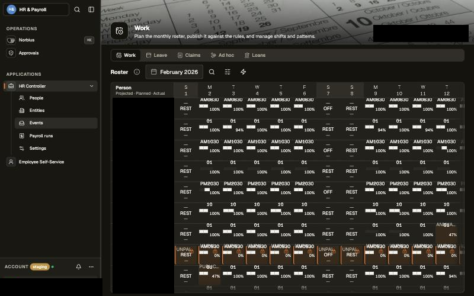
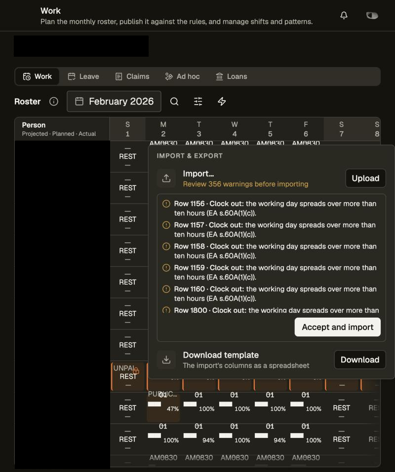
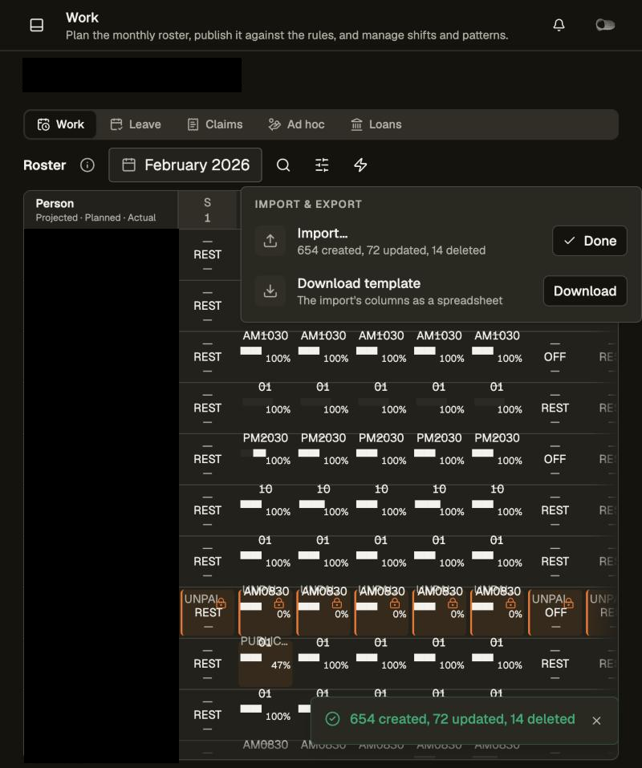
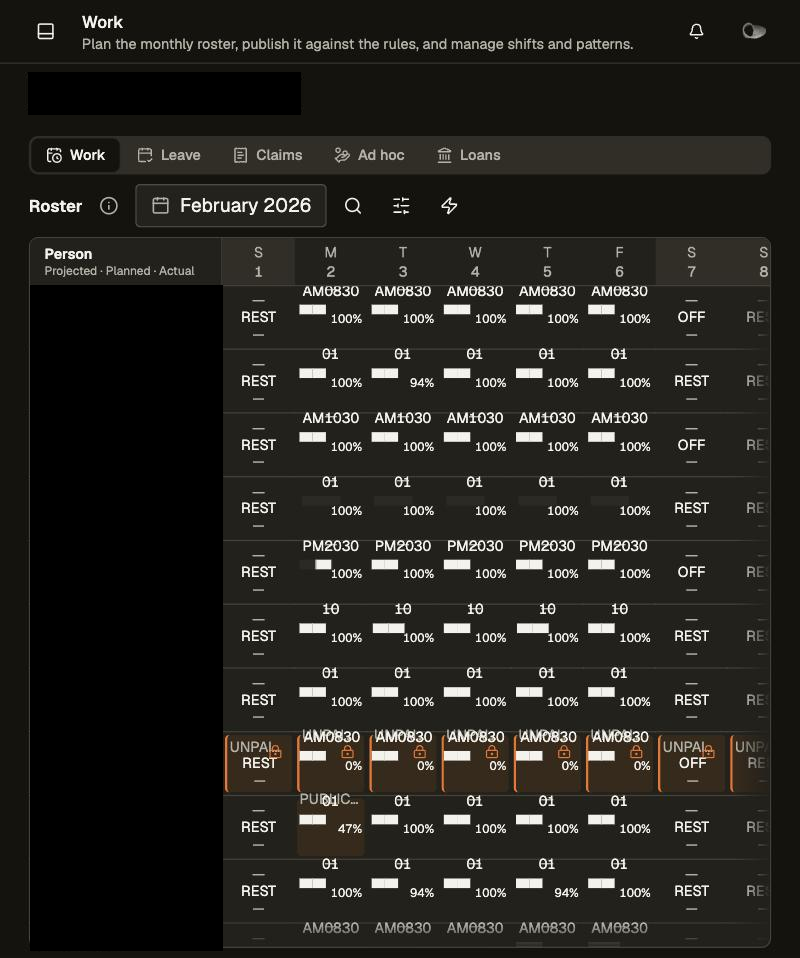
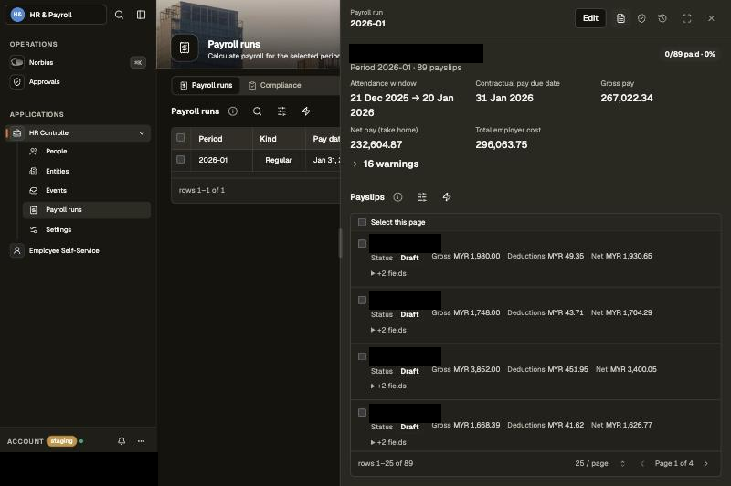
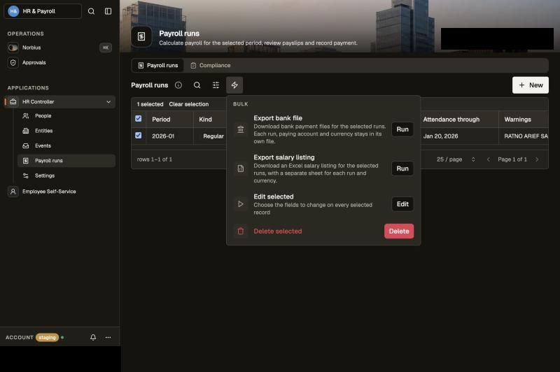

# HR & Payroll


A Bolt workspace for employment records, rosters, leave, claims, loans, payroll and statutory contributions
across several jurisdictions. A payroll run builds one payslip per employment contract and links it to the
records it settled.

## Apps and roles

| Application           | Tasks                                                          |
| --------------------- | -------------------------------------------------------------- |
| Employee self-service | Own schedule, leave, claims and payslips                       |
| Entities              | Legal entities, shift patterns and definitions, holidays       |
| People                | Profiles, employment contracts, face enrolment and offboarding |
| Events                | Roster and attendance, leave, claims, one-time payments, loans |
| Payroll               | Regular and off-cycle runs, payslips and exports               |
| Settings              | Jurisdiction versions, catalogues, rules and behaviours        |

The five HR apps live under `src/app/hr_controller/`; employee self-service is `src/app/hr_employee/`.
Teams (`src/access_control/team/+team.ts`) link these policies:

| Team                                   | Policy              | Apps                          |
| -------------------------------------- | ------------------- | ----------------------------- |
| Employee                               | `employee`          | Employee self-service         |
| Supervisor, Production Manager         | `supervisor`        | Employee self-service, People |
| L1 Manager                             | `manager`           | All HR apps and self-service  |
| Senior Management                      | `senior_management` | All HR apps and self-service  |
| HQ Payroll HR, Manager (HR Controller) | `hr_controller`     | All HR apps and self-service  |
| HR Manager                             | `hr_manager`        | All HR apps and self-service  |
| Attendance Kiosk                       | `kiosk`             | The `attendance` kiosk        |

Automations run as `hr_controller` (`calendar_tick`, `behaviour_taps` with `payslip_hold_automation`)
or their own `*_automation` policy; `src/access_control/policy/grants.ts` holds grant fragments the
policies share. Seed packs carry staff affiliations in `sys_user.team`.

**Kiosk.** `attendance` (`/kiosk/attendance`): the chromeless attendance-capture device, opened by the Attendance Kiosk team.

## Data model

Country law is data, not code. Each jurisdiction is a lineage of dated, sealed `jurisdiction_settings` versions
with their catalogue rows (`statutory_contribution_catalog`, `leave_catalog`, `claim_catalog`,
`adhoc_catalog`, `loan_catalog`, `allowance_catalog`, `work_catalog`) and
`rule_set` rows. Rates, bands, eligibility and pricing are CEL expressions on those rows, and behaviours (for
example exit leave encashment) are rules on the settings version. The engine under `src/lib/payroll_engine/`
evaluates them and holds no jurisdiction-specific logic. A change of law is a new version, made without
touching source.

What each jurisdiction configures, and its gaps, is tracked in the [jurisdiction trackers](docs/inventory/README.md).

Jurisdiction versions own suspension-kind definitions as a validated custom field. The workspace has
27 models; payroll movements, settlement/payment records and independently reviewed operational records
retain their own identity.

## Automations and integrations

| Automation            | Trigger                                                                                                                                                                                                                   | Result                                                                                         |
| --------------------- | ------------------------------------------------------------------------------------------------------------------------------------------------------------------------------------------------------------------------- | ---------------------------------------------------------------------------------------------- |
| `behaviour_taps`      | Payroll run create/delete; payslip status; contract, employment profile and entity changes; leave/claim/adhoc/loan catalogue entries; roster entries; obligations; regulatory tasks; workplace cases and work suspensions | Applies the version's behaviour rules: each reads its declared rows and returns the writes.    |
| `statutory_drift`     | Monthly; also on demand                                                                                                                                                                                                   | Enqueues one `statutory_lineage` run per sealed in-force lineage. It never seals.              |
| `statutory_lineage`   | Enqueued by `statutory_drift`; also on demand                                                                                                                                                                             | Checks one lineage against its official sources; changes become one unsealed draft for review. |
| `late_arrival_notice` | Every five minutes                                                                                                                                                                                                        | One reminder per person-day when a rostered shift has no clock-in after the entity's grace.    |
| `calendar_tick`       | Daily                                                                                                                                                                                                                     | Runs the behaviour rules for every employment in force, so date-driven duties raise tasks.     |
| `invitation_profile`  | Staff invited; staff user created or contact changed                                                                                                                                                                      | Creates employment profiles for invited staff and links their identities after acceptance.     |

### Payroll hotline

Employees ask about their own payslips on WhatsApp, one number per legal entity. The source role is
`src/agent/envoy/+payroll_hotline.envoy.ts`; its whole authority is the `payroll_hotline` policy.

1. An administrator adds and pairs a WhatsApp instance in Settings, Integrations.
2. On the entity's General tab, HR picks that number as the payroll hotline (`entity.hotline`), saves, and selects
   **Answer payroll questions on this number**. This sets the instance's envoy.
3. An administrator records each employee's WhatsApp number on their account (Settings, People). An employment
   profile links to the account through `user_id`.

What a turn may read and do:

- **Own payslips only.** A DM holds `payroll_hotline` alone (`dm: 'envoy'`), even for an administrator. It reads the
  sender's own payslips (`employment_profile.user_id` is the sender), and only those of the entity whose number they
  wrote to (`{ actor: 'instance' }` against `entity.hotline`). It may read `salary_from`, `salary_to`, `status`,
  `currency`, `gross`, `total_deductions`, `net` and `paid_at`. It writes nothing.
- **Leave, claims and corrections** go to self-service or HR.
- **Unknown numbers and groups.** A number on no account gets one fixed notice and no turn. Group messages are
  ignored.
- **Limits.** `envoys.receive` allows 10 messages a minute per sender and 300 a minute across every hotline.

## Seed

- **base** — `seed/jurisdiction/<CODE>/version_*/`: nine sealed jurisdiction lineages (SG, MY, PH, ID,
  VN, TW, CN, JP and TH) with their catalogues and rule sets; `seed/overtime_policies.ts` adds each
  version's overtime rule.
- **sample** (private) — `seed/seed.ts` reads the seed bank tree `norbital_hr` with
  `bolt build --bank=<checkout>`: entities, people, contracts, rosters and their records. A roster
  day's overtime and incentive derive from its clock past the planned shift, so the bank's typed hours
  are dropped on the way in.

## UI walkthrough

These screenshots were taken on staging on 2026-10-21, with the private sample pack loaded. Names, employee numbers,
entity names and account details are masked; amounts are real.

### Work import

Events → Work → ⚡ → **Import…** reads a work-day workbook and previews it before writing anything. Rule warnings
must be accepted before the import runs. The result reports what was created, updated and deleted. In this example a
full-month file gave 356 warnings, then 654 created, 72 updated and 14 deleted. A day that a payroll run has consumed
shows a padlock on the board.






### Loan repayments

A loan's repayments are a two-column Amount | Date table. A repayment on a payslip is locked: its amount is
disabled and its remove control becomes a padlock ("Included in payroll"). The server refuses direct writes too:
`loan_repayment_entry.update` → "A repayment on a payslip cannot be changed.", and `delete` is not accepted.


A loan with no principal or repayment period (legacy data) cannot save schedule edits.


### Consumed entries

The run links each work day, leave, claim, ad hoc and loan entry it settles. Consumed work days are read-only on the
board. Consumed claim, leave and ad hoc records still open an edit form; Save is refused with "This entry is captured
by payroll. Delete that unpaid payroll run to change it."


### Payroll run and exports

The run shows its attendance window, pay due date, gross, net and employer cost. Select runs → ⚡ gives two exports:

- **Export salary listing** downloads one XLSX sheet per run and currency, with columns grouped by family and a final
  Total company payment column. That column reads "Needs confirmation" until bank charges are known.
- **Export bank file** refuses until the paying account has a matching bank layout.





## Checks

```bash
pnpm install
pnpm check      # bolt check
pnpm test       # bolt build --bank=$SEED_BANK (default ../../seed_bank), bolt test, then test:node
pnpm test:node  # vitest.node.config.ts: the node-side suites in tests/
pnpm lint       # prettier --check .
```
