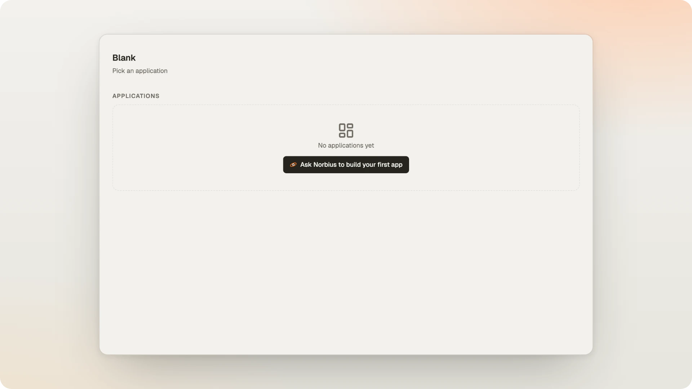

# Blank

Blank is a clean, unopinionated Norbital workspace built for teams that want to design their own operational software from first principles instead of adapting an existing industry template. Rather than forcing bespoke processes into rigid off-the-shelf tools or running day-to-day operations across scattered spreadsheets, chat threads, and manual handoffs, teams start with an uncluttered foundation and introduce only the records, screens, roles, and workflows their business actually needs.

Out of the box, the workspace includes the core Norbital shell, bilingual English and Simplified Chinese support, an approvals inbox, built-in change history, and Norbius—the workspace assistant—ready to help turn plain-language requirements into structured record types, custom applications, and guarded workflows. Teams can build incrementally through Norbius in Workspace Studio, preview drafts safely before publishing, or work directly with an engineering team as requirements mature.

## Expected Business Impact

- **Zero legacy clutter:** Start from a clean operational slate using your organization's own terminology, structures, and rules rather than stripping down an unrelated industry template.
- **Faster move from spreadsheets to structured operations:** Replace ad-hoc trackers and manual email or chat handoffs with purpose-built records, screens, and workflows shaped one module at a time.
- **Governance built in from day one:** Inherit workspace-wide user management, review queues, audit history, and bilingual labels before authoring a single custom application.
- **Controlled, low-risk rollout:** Introduce one record type, one application, and one team boundary at a time, validating every change in preview before publishing it to staff.

## Roles & Access

Blank ships intentionally unopinionated with **no preconfigured business teams, custom permission policies, or approval chains**. Builders define roles and access boundaries around their own organizational chart rather than inheriting preset departments.

- **Workspace Administrators:** Manage member invitations, workspace settings, connected services, and the review and publication of new workspace drafts.
- **Custom Teams (Authored as You Build):** Once teams and policies are authored for your workflow, administrators assign members to those roles in **People** to control which records each team can view, which fields they can edit, which workflow actions they can run, and which updates require approval before taking effect.
- **Built-In Safety Defaults:** Until custom write permissions are defined, the included starter Notes placeholder remains strictly read-only so unconfigured data cannot be entered accidentally.

## Apps & Functionality

Blank starts with **zero prebuilt business applications** and **one read-only starter placeholder** so the workspace opens cleanly and grows only as you author modules.

| App / Module                      | Functionality                                                                                                                                                                                                                       |
| --------------------------------- | ----------------------------------------------------------------------------------------------------------------------------------------------------------------------------------------------------------------------------------- |
| **Workspace Home**                | Clean applications launcher that prompts builders to ask Norbius to create their first app and automatically displays custom applications as they are published.                                                                    |
| **Norbius (Workspace Assistant)** | Always-available workspace assistant that helps ingest and analyse supplied information, answer operational questions, configure the workspace, and draft new record types, applications, and workflows for preview and publishing. |
| **Approvals**                     | Built-in review inbox ready to route provisional changes for multi-step sign-off, revision requests, rejection, or withdrawal once approval rules are added to custom workflows.                                                    |
| **Notes (Starter Placeholder)**   | A single read-only example record holding a title and optional body text with English and Simplified Chinese labels; designed to be replaced or removed once your first real business record type is created.                       |
| **Workspace Shell & Settings**    | Standard navigation, workspace search, notifications, bilingual interface support (English and Simplified Chinese), member directory, and external service pairing controls ready to host future apps.                              |

## Automations & Connections

Blank ships with **no preconfigured automations or external connections**, keeping background processing silent until your workflows require it. Teams can add scheduled, event-driven, or on-demand automations as they build out the workspace, and pair built-in communication channels (such as email or messaging) or custom connectors under **Settings → Integrations** with credentials stored securely by the platform.

## Scope & Boundaries

- **Included out of the box:** A clean workspace shell, bilingual English and Simplified Chinese defaults, Norbius assistant, approvals inbox, change-history foundation, member and integration management, and one read-only Notes placeholder.
- **Requires authoring before operational use:** All domain record types, custom business applications, team roles, access policies, approval routes, background automations, and external system syncs must be designed and published for your specific workflow.
- **Starts completely empty:** No demonstration transactions, industry catalogs, or sample operational data are preloaded into the workspace.
- **Outside the software boundary:** Internal process design, organizational governance policies, legal or regulatory compliance sign-off, and external vendor account provisioning remain the responsibility of the workspace owner.

## Documentation

- [Documentation Index](docs/README.md) — Developer setup, verification commands, schema migration workflow, and authoring guide.
- [Architecture & Inner Mechanisms](docs/architecture.md) — Technical architecture and ASCII diagrams covering the workspace build pipeline, runtime topology, physical data model, triggers, migrations, and extension points.
- [Source Reference](docs/source-reference.md) — Verified inventory of workspace configuration, models, localization catalogs, toolchain versions, and local browser evidence.
