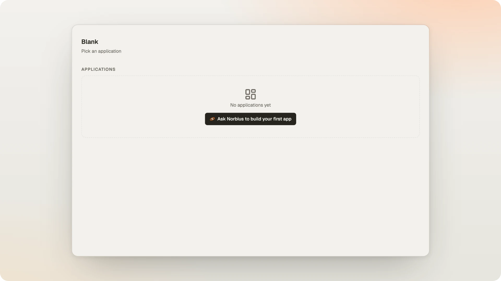

# 空白

“空白”是一款纯净、无预设行业假设的 Norbital 起步工作区，适合希望从零按自身流程打造专属业务系统的团队。无需勉强套用僵化的标准软件，也无需继续依赖分散的电子表格、聊天群和人工交接，团队可以从干净的底座出发，按实际业务需要逐步构建数据结构、应用页面、角色权限与审批流程。

工作区开箱即提供核心外壳界面、中英双语支持、审批收件箱、完整的变更留痕能力以及工作区智能体 Norbius。业务负责人可以直接在工作区中向 Norbius 描述需求，由其协助草拟记录类型、应用页面与流程规则，并在预览确认后发布上线；也可交由研发团队按标准结构持续迭代扩展。

## 预期业务价值

- **零历史包袱：** 从干净的业务画布起步，完全使用企业自己的术语、字段与流转规则，无需先清理无关的行业模板配置。
- **加速从表格迈向系统化运营：** 将临时台账、邮件往返与群聊交接逐步沉淀为结构化记录、专属界面与受控流程，按模块稳步落地。
- **开箱自带治理底座：** 在搭建首个业务应用之前，即已具备成员管理、审批队列、操作审计历史与中英双语能力。
- **小步快跑、风险可控：** 一次新增一个业务模型、一个应用页面或一条权限边界，所有改动均可先预览验证，再正式发布给团队使用。

## 角色与权限

空白模板刻意保持中立，**未预置任何业务团队、自定义权限策略或审批链**，方便建设者完全按照自身组织架构设计权限体系。

- **工作区管理员：** 负责邀请与管理成员、维护工作区基础设置、配对外部连接服务，以及审核并发布新的工作区版本。
- **自定义团队（随业务搭建定义）：** 当团队与权限策略编写完成后，管理员可在**成员**页面为人员分配对应角色，精确控制各团队可见的数据范围、可编辑字段、可触发的业务操作，以及需要审批后才生效的敏感变更。
- **默认安全保护：** 在尚未配置写入规则前，附带的示例“笔记”占位记录保持严格只读状态，防止工作区在规划阶段被意外写入非结构化数据。

## 应用与核心功能

空白工作区初始包含 **0 个预置业务应用**与 **1 个只读示例占位记录**，保持界面简洁，随着您逐步构建模块自动生长。

| 应用 / 模块                 | 核心功能                                                                                                                             |
| --------------------------- | ------------------------------------------------------------------------------------------------------------------------------------ |
| **工作区首页**              | 简洁的应用启动入口，提供一键向 Norbius 发起首个应用构建的引导；后续发布自定义应用后将自动展示于此。                                  |
| **Norbius（工作区智能体）** | 随时可用的通用智能助手，支持整理与分析提供的信息、解答问题、协助配置工作区，并草拟新的数据模型、应用页面与自动化流程以供预览和发布。 |
| **审批**                    | 内置待办审阅收件箱；当自定义业务流程配置审批规则后，自动承接待审批变更，支持多级批准、退回修改、驳回与撤回。                         |
| **笔记（示例占位记录）**    | 单个只读示例记录，包含标题与可选正文，并内置中英文显示名称；建议在创建首个正式业务记录后替换或删除。                                 |
| **工作区外壳与设置**        | 提供统一导航、全局搜索、消息通知、中英双语切换、成员目录以及外部服务配对管理，随时承接后续扩展模块。                                 |

## 自动化与外部连接

空白模板**未预置任何后台自动化或外部系统连接**，在您主动启用前不会产生任何后台任务。随着业务扩展，团队可按需新增定时、事件驱动或手动触发的自动化流程，并在**设置 → 集成**中配对内置沟通渠道（如邮件或即时通讯）或自定义外部连接器，凭证由平台安全托管。

## 范围与职责边界

- **开箱即用内容：** 干净的工作区外壳、中英双语基础配置、Norbius 智能助手、审批收件箱、变更审计底座、成员与集成管理，以及一个只读的示例笔记占位记录。
- **上线前需自行构建：** 所有行业专属的数据结构、业务应用界面、团队角色、权限策略、审批路线、后台自动化及外部系统同步，均需按实际业务需求设计并发布。
- **初始完全为空：** 工作区不预装任何示例业务单据、行业基础目录或演示台账数据。
- **软件边界之外：** 企业内部流程梳理、组织治理规则决策、法律法规合规确认以及第三方外部系统账号与凭证开通，均由工作区所有方负责。

## 技术文档

- [技术文档目录](docs/README.md) — 开发者环境初始化、校验与构建命令、数据库迁移流程及编写规范索引。
- [系统架构与内部机制](docs/architecture.md) — 深度技术架构与 ASCII 图解，涵盖工作区编译流水线、运行时拓扑、物理数据模型、触发器、迁移校验与扩展点。
- [源码参考清单](docs/source-reference.md) — 经源码核验的工作区配置、模型清单、国际化词条、工具链版本与本地界面证据。
