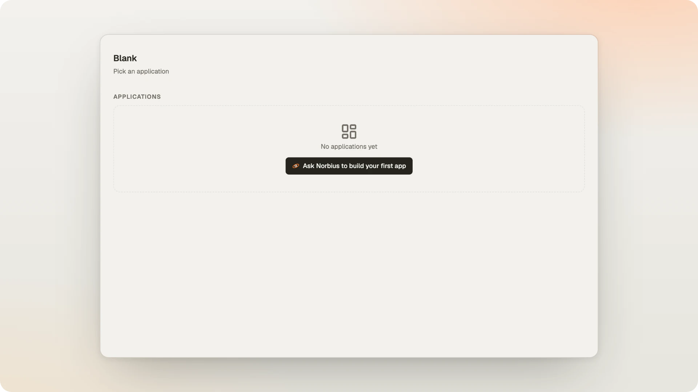

# Blank — Technical Documentation



Technical documentation for `@template/blank` (`norbital_blank`), a minimal Norbital Bolt starter workspace containing one read-only example model (`notes`), zero authored applications, zero authored automations, and bilingual English/Chinese configuration.

## Document Index

| Document                                            | Purpose                                                                                                                                                                                                                                                                            |
| --------------------------------------------------- | ---------------------------------------------------------------------------------------------------------------------------------------------------------------------------------------------------------------------------------------------------------------------------------- |
| [Architecture & Inner Mechanisms](architecture.md)  | Deep technical architecture with pure-ASCII diagrams covering the Bolt build pipeline, filesystem discovery & extension points, physical ER schema, database trigger/audit/search pipelines, migration replay verification, access/approval mechanics, and localization/seed flow. |
| [Source Reference](source-reference.md)             | Exact inventory of every authored file in `src/`, `seed/`, `migrations/`, `package.json`, `norbital.template.json`, physical schema tables, and local browser evidence.                                                                                                            |
| [Template Overview (English)](../README.md)         | Non-technical business overview, roles & access summary, starter modules, and scope boundaries.                                                                                                                                                                                    |
| [Template Overview (中文)](../README.zh.md)         | Simplified Chinese business overview mirroring `README.md`.                                                                                                                                                                                                                        |
| [Workspace Assistant Brief](../src/agent/+agent.md) | Prompt brief loaded by Norbius inside this workspace.                                                                                                                                                                                                                              |
| [Coding-Agent Source Map](../src/agent/AGENTS.md)   | Source layout rules, gates, and invariants for coding agents editing this template.                                                                                                                                                                                                |

## Developer Quickstart

Run all commands from this template's directory (`templates/blank/`):

```bash
bun install --frozen-lockfile   # Install pinned dependencies (hoisted linker; bunfig.toml)
bunx bolt check                 # Validate discovery, schema history replay, rules, and types
bun run test                    # Execute workspace tests via `bolt test`
bunx bolt build                 # Compile `.norbital/`, refresh template counts, and build release/seed packs
```

Additional package scripts from [`package.json`](../package.json):

```bash
bun run dev                     # Run `bolt dev` watcher for live local rebuilds
bun run format                  # Format workspace files with Prettier + prettier-plugin-svelte
```

Notes on package isolation:

- Templates are standalone packages — never install unpinned or unpublished first-party versions with plain `bun install`; use `bun install --frozen-lockfile` or the local overlay when developing alongside unreleased `@norbital-ai/*` packages.
- [`tsconfig.json`](../tsconfig.json) extends `./.norbital/tsconfig.json`, which is generated by `bolt check` / `bolt build` and intentionally excluded from Git via `.gitignore`.

## Schema Migrations & Seed Workflow

### Migrations (`migrations/`)

- `bolt build` compiles the workspace declaration manifest (including platform system tables and authored models) into the next editable SQL migration under `migrations/` and verifies replay against a scratch database.
- [`migrations/`](../migrations/) currently tracks three migrations (`0001_initial.sql`, `0002_schema.sql`, `0003_schema.sql`) alongside `snapshot.json`, `migrations.lock.json`, and `physical.json`.
- Always commit the SQL files, `snapshot.json`, `migrations.lock.json`, and `physical.json` together. `bolt check` replays every migration prefix and verifies the physical schema hash at each step against `migrations.lock.json`.
- Use `was` on renamed models or fields to preserve data and history lineage across migrations.

### Seeding (`seed/+seeder.ts`)

- Blank ships with **zero public seed rows** and starts completely empty.
- [`seed/+seeder.ts`](../seed/+seeder.ts) exports `seeder({ bank: { tree: 'blank' } })`, allowing an operator to load optional private demo members in memory via `bolt seed --bank=<path>` without shipping any demo data inside the template release.

## Authoring Rules & Extension Workflow

Follow the standard Bolt filesystem conventions as you build out the workspace:

- **Workspace config:** [`src/+workspace.ts`](../src/+workspace.ts) — time zone, locale, languages, optional named `connections`, and per-policy `limits`.
- **Record models:** `src/data/model/<name>/+model.ts` — declared via `model('<name>', { ... })` from `@norbital-ai/bolt`. Nest child models inside their owner's folder; only the leaf directory name becomes the model name. Replace or remove [`notes`](../src/data/model/notes/+model.ts) once your first domain model exists.
- **Syncs:** `src/data/model/<name>/+<sync>.sync.ts` — declared beside their model via `sync('<model>', '<sync>', { ... })`.
- **Custom datatypes:** `src/data/custom_field/<name>/+custom_field.ts`.
- **Applications & pages:** `src/app/<app>/+app.ts` with `+<page>.page.svelte` companions.
- **Teams & policies:** `src/access_control/team/+team.ts` and `src/access_control/policy/+<name>.policy.ts`. Teams, policy grants, and approval flows are authored in source; the **People** surface assigns members to existing authored roles rather than editing policy definitions.
- **Automations:** `src/automation/+<name>.automation.ts` — executed under the reserved system identity with explicit declared `policies`.
- **Integrations:** `src/integration/<name>/+integration.ts` (with optional `+integration.svelte`). Built-in communication channels require no custom integration declaration; all pairing and credentials are managed under **Settings → Integrations** in the host's sealed store.
- **Localization:** `src/i18n/+messages.ts` (default language) and `src/i18n/+<lang>.messages.ts` (e.g. `+zh.messages.ts`).

Start small — add one model, one page, and one policy at a time, running `bunx bolt check` after each step (or authoring drafts interactively with Norbius in Workspace Studio and previewing before publishing). For the full `@norbital-ai/bolt` declaration contract, see the [Norbital OSS repository](https://github.com/norbital-ai/oss/tree/main/packages/bolt).
