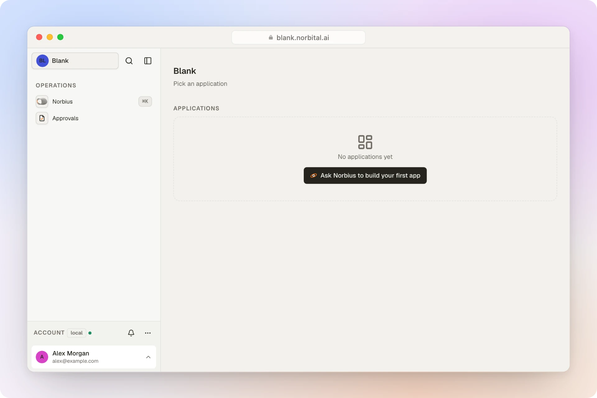

# Source Reference

Verified directly against this template's source files, migrations, and package metadata. This document is a local source inventory, not a declaration that any deployed tenant is currently serving these exact bytes.

For conceptual architecture and inner-mechanism diagrams, see [Architecture & Inner Mechanisms](architecture.md). For developer commands and workflow, see the [Documentation Index](README.md).

## Template Metadata & Counts

From [`norbital.template.json`](../norbital.template.json):

| Property           | Value                                       |
| ------------------ | ------------------------------------------- |
| `schema_version`   | `1`                                         |
| `key`              | `norbital_blank`                            |
| `name` / `name_zh` | `Blank` / `空白`                            |
| `industry`         | `General`                                   |
| `visibility`       | `public`                                    |
| `capabilities`     | `["data_modeling"]`                         |
| `tags` / `tags_zh` | `["Starter", "Blank"]` / `["入门", "空白"]` |
| `counts`           | `1` model, `0` apps, `0` automations        |

## Workspace Configuration

From [`src/+workspace.ts`](../src/+workspace.ts):

| Setting       | Value              | Notes                                                                      |
| ------------- | ------------------ | -------------------------------------------------------------------------- |
| `tz`          | `'Asia/Singapore'` | Default workspace time zone (also recorded in `migrations/snapshot.json`). |
| `locale`      | `'en-SG'`          | Default formatting locale.                                                 |
| `languages`   | `['en', 'zh']`     | Supported UI/catalog languages.                                            |
| `currency`    | `null` (unset)     | No base workspace currency declared.                                       |
| `connections` | none               | No named external integration slots declared.                              |
| `limits`      | none               | No per-policy rate limits declared.                                        |

## Applications and Pages

| Source application | Title                    | Pages | Purpose                                                                              |
| ------------------ | ------------------------ | ----- | ------------------------------------------------------------------------------------ |
| —                  | No authored applications | —     | Host shell (Workspace Home, Norbius, Approvals, Search, Settings) remains available. |

- Kiosks: none.

## Authored Models and Exposed Operations

Outputs fix field visibility. Policies select outputs and scope rows; write contracts (`create`, `update`, `delete`, `import`) and checks constrain mutations. Each row links to its owning declaration.

| Model   | Source                                           | Fields                 | Read outputs                | Writes           | States / Locks | Effects / Syncs | Audit  |
| ------- | ------------------------------------------------ | ---------------------- | --------------------------- | ---------------- | -------------- | --------------- | ------ |
| `notes` | [`+model.ts`](../src/data/model/notes/+model.ts) | `2` (`title`, `body?`) | `default` (`fields: 'all'`) | none (read-only) | none           | none            | `true` |

### `notes` Field & Physical Specification

Declared in [`src/data/model/notes/+model.ts`](../src/data/model/notes/+model.ts) and materialized in [`migrations/0001_initial.sql`](../migrations/0001_initial.sql) / [`migrations/snapshot.json`](../migrations/snapshot.json):

| Column / Property   | Type / Definition                          | Required | Origin                                                                                       |
| ------------------- | ------------------------------------------ | -------- | -------------------------------------------------------------------------------------------- |
| `id`                | `uuid` (`primary key`)                     | Yes      | Platform default key                                                                         |
| `revision`          | `int` (`default 1`)                        | Yes      | Platform audit metadata                                                                      |
| `created_at`        | `timestamptz` (`default now()`)            | Yes      | Platform audit metadata                                                                      |
| `created_by`        | `text`                                     | No       | Platform audit metadata                                                                      |
| `updated_at`        | `timestamptz` (`default now()`)            | Yes      | Platform audit metadata                                                                      |
| `updated_by`        | `text`                                     | No       | Platform audit metadata                                                                      |
| `title`             | `text`                                     | Yes      | Authored field (`{ kind: 'text' }`)                                                          |
| `body`              | `text`                                     | No       | Authored field (`{ kind: 'text', optional: true }`)                                          |
| `bolt_record_label` | `text` (generated stored)                  | —        | Compiled from `record_label: 'record.title'` via `bolt_record_label_notes_06f5fc13("title")` |
| `bolt_search`       | `tsvector` (generated stored, GIN-indexed) | —        | Compiled via `bolt_search_document(coalesce(bolt_record_label_notes_06f5fc13("title"), ''))` |

- Icon: `lucide:sticky-note`
- Description: `"A free-form note written in this workspace."`
- Triggers on `notes`:
  - `BEFORE INSERT OR UPDATE OR DELETE`: `store_row_rules('{"audit":true,"key":["id"],"states":{}}')`
  - `AFTER INSERT OR UPDATE OR DELETE`: `bolt_audit('[]','[]')` (skipped when `current_setting('bolt.write', true) = statement_timestamp()::text`)
- Indexes on `notes`:
  - Primary key on `id`
  - GIN index `notes__gin__73732636` on `bolt_search`

Import is available only on models whose unique constraint is marked `import_key: true`; `notes` declares no unique keys and exposes no write verbs.

## Localization Catalogs (`src/i18n/`)

| File                                                      | Language       | Keys                                                                                                                                               |
| --------------------------------------------------------- | -------------- | -------------------------------------------------------------------------------------------------------------------------------------------------- |
| [`src/i18n/+messages.ts`](../src/i18n/+messages.ts)       | Default (`en`) | `models.notes.label` (`"Notes"`), `models.notes.singular` (`"Note"`)                                                                               |
| [`src/i18n/+zh.messages.ts`](../src/i18n/+zh.messages.ts) | `zh`           | `models.notes.label` (`"笔记"`), `models.notes.singular` (`"笔记"`), `models.notes.fields.title` (`"标题"`), `models.notes.fields.body` (`"正文"`) |

## Workspace Assistant & Agent Files (`src/agent/`)

| File                                            | Role                  | Summary                                                                                                                                                                                     |
| ----------------------------------------------- | --------------------- | ------------------------------------------------------------------------------------------------------------------------------------------------------------------------------------------- |
| [`src/agent/+agent.md`](../src/agent/+agent.md) | Norbius runtime brief | Defines Norbius as the general workspace assistant (ingest/analyse information, answer questions, configure workspace, build/improve source) with no prescribed business domain.            |
| [`src/agent/AGENTS.md`](../src/agent/AGENTS.md) | Coding-agent map      | Documents model folder ownership rule (`notes/`), empty surface inventory, CLI gates (`bolt check`, `bolt test`, `bolt build`), and starter invariants (`notes` is read-only; start small). |

## Automations

All named runs execute under the reserved system identity with explicitly declared `policies`. Model `effect` callbacks run as the writer and are separate from named automations.

| Automation | Trigger | Policies | Purpose               |
| ---------- | ------- | -------- | --------------------- |
| —          | —       | —        | No named automations. |

## Access Control, Custom Fields, and Integrations

- Authored teams (`src/access_control/team/`): none.
- Authored policies (`src/access_control/policy/`): none.
- Authored approval flows: none.
- Custom datatypes (`src/data/custom_field/`): none.
- Custom integrations (`src/integration/`): none.
- Named connections (`+workspace.ts` `connections`): none.

Pairing and credentials belong to the host's **Settings → Integrations** surface; defining a connection slot in source does not pair it.

## Seed Configuration (`seed/`)

| File                                    | Declaration                           | Public Seed Rows                                                                                                     |
| --------------------------------------- | ------------------------------------- | -------------------------------------------------------------------------------------------------------------------- |
| [`seed/+seeder.ts`](../seed/+seeder.ts) | `seeder({ bank: { tree: 'blank' } })` | `0` (empty starter; optional private demo members are read in memory only when `bolt seed --bank=<path>` is invoked) |

## Database Schema & Migration Inventory (`migrations/`)

### Migration Files

| File                                                         | Steps | Summary                                                                                                                                                                                                                                              |
| ------------------------------------------------------------ | ----- | ---------------------------------------------------------------------------------------------------------------------------------------------------------------------------------------------------------------------------------------------------- |
| [`0001_initial.sql`](../migrations/0001_initial.sql)         | `160` | Creates `store_*` and `bolt_*` functions, 26 physical tables (1 authored + 20 system + 5 engine), foreign keys, row-rule triggers, GIN/btree/partial unique indexes, initial `bolt_history_register` snapshots, and `bolt_audit` trigger on `notes`. |
| [`0002_schema.sql`](../migrations/0002_schema.sql)           | `3`   | Updates `sys_user.preferences.locale` shape from enum `["en","zh"]` to `text` (`max: 35`), re-registers `sys_user` history schema, validates rows, and replaces check constraint `sys_user__ck__3996db29` with `sys_user__ck__8405d565`.             |
| [`0003_schema.sql`](../migrations/0003_schema.sql)           | `3`   | Adds optional `email_notifications: bool` to `sys_user.preferences`, re-registers `sys_user` history schema, validates rows, and replaces check constraint `sys_user__ck__8405d565` with `sys_user__ck__5ef80452`.                                   |
| [`snapshot.json`](../migrations/snapshot.json)               | —     | Canonical schema snapshot of 21 model/system tables plus workspace `tz` (`Asia/Singapore`) and `currency` (`null`).                                                                                                                                  |
| [`migrations.lock.json`](../migrations/migrations.lock.json) | —     | SHA-256 digests for `snapshot`, each SQL migration file, and physical DB state at every prefix (`""`, `0001`, `0002`, `0003`).                                                                                                                       |
| [`physical.json`](../migrations/physical.json)               | —     | Format-2 normalized physical database catalog representation used for deterministic replay verification.                                                                                                                                             |

### Physical Tables Created by Migrations (26 Total)

| Layer                                         | Count | Tables                                                                                                                                                              |
| --------------------------------------------- | ----- | ------------------------------------------------------------------------------------------------------------------------------------------------------------------- |
| Authored model                                | `1`   | `notes`                                                                                                                                                             |
| Platform identity & config                    | `7`   | `sys_user`, `sys_session`, `sys_invitation`, `sys_api_key`, `sys_challenge`, `sys_config`, `sys_workspace`                                                          |
| Platform approval records                     | `2`   | `approval_request`, `requestor`                                                                                                                                     |
| Platform integrations, sync, messaging & runs | `11`  | `sys_integration`, `sys_envoy`, `sys_conversation`, `sys_message`, `sys_inbox`, `sys_outbox`, `sys_sync`, `sys_sync_row`, `sys_run`, `sys_notification`, `sys_file` |
| Engine internals (audit & approval runtime)   | `5`   | `bolt_history`, `bolt_history_schema`, `bolt_history_current`, `bolt_approvals`, `bolt_approval_effect`                                                             |

## Package Toolchain

Pinned in [`package.json`](../package.json), [`tsconfig.json`](../tsconfig.json), and [`bunfig.toml`](../bunfig.toml):

- **Package:** `@template/blank` (`0.0.1`, private, `"type": "module"`).
- **Runtime dependencies:** `@norbital-ai/bolt` (`0.0.10`), `@norbital-ai/ui` (`0.0.10`), `svelte` (`5.57.3`), `vite` (`8.3.5`), `effect` (`4.0.6`).
- **Tooling / test dependencies:** `@norbital-ai/bolt-cli` (`0.0.10`), `typescript` (`6.0.3`), `@typescript/native` (`npm:typescript@7.0.2`), `svelte2tsx` (`0.7.61`), `vitest` (`5.0.5`), `@effect/vitest` (`4.0.6`), `happy-dom` (`20.14.5`), `@sveltejs/vite-plugin-svelte` (`7.3.1`), `prettier` (`3.9.9`), `prettier-plugin-svelte` (`4.1.1`), `@types/node` (`26.6.5`).
- **Effect overrides:** `effect`, `@effect/platform-node`, `@effect/platform-node-shared`, `@effect/vitest` all pinned to `4.0.6`.
- **Installer guard (`bunfig.toml`):** `linker = "hoisted"`, `minimumReleaseAge = 86400` (24-hour third-party publish delay; `@norbital-ai/*` first-party packages explicitly excluded).

## Browser Evidence

Captured through the browser from a separate local documentation workspace on 30 October 2026. This shows layout and navigation (empty applications launcher with **Ask Norbius to build your first app**, sidebar **Norbius** and **Approvals** entries, and local account controls); it does not certify external providers, automation results, or a specific deployed release.
