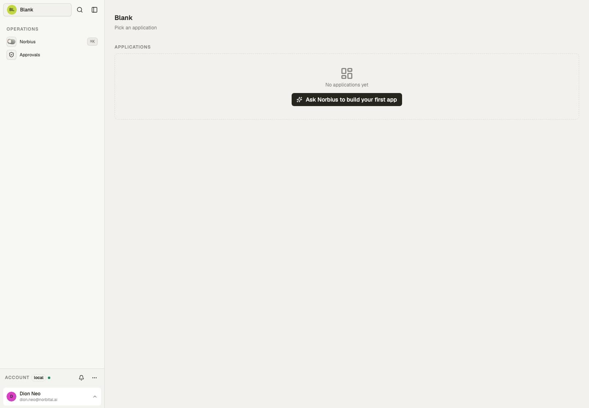

# Source reference

Checked against this template's source and compiled declaration manifest on 30 October 2026.
This is a local source inventory, not a declaration that a deployed tenant runs these bytes.

1 models, 0 applications, 0 automations.

## Applications and pages

| Source application | Title                    | Pages | Purpose                                   |
| ------------------ | ------------------------ | ----- | ----------------------------------------- |
| —                  | No authored applications | —     | The shell and assistant remain available. |

## Models and exposed operations

Outputs fix field visibility. Policies select outputs and scope rows; write columns and checks constrain mutations. Each row links to its owning declaration.

| Model                                      | Fields | Read outputs | Writes | Post-commit effects | Syncs |
| ------------------------------------------ | ------ | ------------ | ------ | ------------------- | ----- |
| [notes](../src/data/model/notes/+model.ts) | 2      | default      | none   | none                | none  |

Upsert is available when both create and update are exposed; it resolves an explicit ID or the model’s natural key and requires an explicit conflict rule.

## Automations

All named runs use the reserved system identity and the listed policies. A manual-start grant controls who may start a run; cron/webhook/schedules use their declared trigger path. Model effects run as their writer and are separate from these named automations.

| Automation | Trigger | Policies | Purpose               |
| ---------- | ------- | -------- | --------------------- |
| —          | —       | —        | No named automations. |

## Integrations and source roles

- Integration definitions: none.
- Named connections: none.
- Source policies: none.
- Custom datatypes: none.

Pairing and credentials belong to the host's Connections surface; defining a connection does not mean it is paired.

## Browser evidence

Captured through the browser from a separate local documentation workspace on 30 October 2026. This shows layout and navigation; it does not certify external providers, automation results or deployment.
