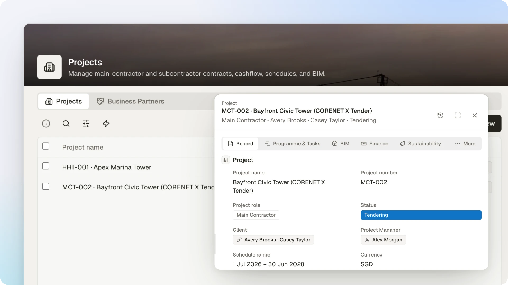

# Construction Operations

Construction Operations is an end-to-end contractor project management workspace designed for both **main contractors coordinating multi-trade subcontractors** and **specialist subcontractors delivering their own packages**. It unifies field communication from **WhatsApp** and **Email**, **3D BIM models**, **hierarchical work-breakdown schedules**, and a **catalog-controlled commercial and cashflow ledger** in one operational hub.

Construction teams typically lose hours every week reconciling scattered spreadsheets, buried site chats, outdated bill-of-quantities workbooks, and disconnected delivery dockets. This workspace replaces those manual handoffs with a single source of truth per project: one authoritative 3D BIM model paired with one live cost estimate, standardized rate catalogs across every order and invoice, three-way verification across commitments, deliveries, and billing, and structured capture of site updates as they happen.

## Expected Business Impact

- **Eliminate pricing drift and commercial leakage:** Every line item on client contracts, subcontracts, Variation Orders, Purchase Orders, Delivery Orders, Invoices, and Ad-hoc Costs draws from project BIM takeoff quantities or the approved Item Matrix — removing free-text line entries and keeping estimated budgets, commitments, deliveries, and payouts reconciled item by item.
- **Cut manual BIM takeoff turnaround:** Automated deduplication and visual AI classification group thousands of repeated model elements into unique component types, price them against active unit rates and waste factors, and isolate unrecognized assemblies for focused Quantity Surveyor review rather than full manual re-measurement.
- **Prevent stale estimates after design revisions:** Replacing a project's BIM model keeps the prior file in record history, flags the model for re-costing, and marks the prior cost estimate void until updated on demand or by the nightly end-of-day sweep.
- **Turn unstructured site chatter into actionable records:** WhatsApp messages, voice notes, site photos, and email attachments are automatically transcribed, routed to the right project, and drafted into schedule updates, 3D-pinned snags, draft variation orders, or commercial documents.
- **Enforce commercial discipline with clear audit trails:** Executed contracts, issued invoices, certified progress claims, incurred ad-hoc costs, and baselined cost estimates lock automatically against silent edits, while automatic three-way matching flags billing variances before payment.

## Roles & Access

Workspace authority is divided across four business teams to maintain separation between site delivery, commercial control, workspace administration, and external stakeholders:

- **Construction Administrators:** Full operational, commercial, and setup authority across projects, schedules, BIM models, contracts, invoices, the Item Matrix, Business Partners, and shared company integrations (including Autodesk Construction Cloud).
- **Project Delivery (Project Managers & Site Supervisors):** Manage project setup, BIM model revisions, filed drawings and specifications, work-breakdown schedules, 3D-pinned defects and RFIs, Business Partners, and message triage. Delivery users cannot create or alter commercial contracts, invoices, ad-hoc costs, or master unit rates; when they upload a revised BIM model, the workspace automatically marks the previous cost estimate void without granting access to commercial pricing.
- **Commercial & Quantity Surveying (QS):** Manage client contracts, subcontracts and supply contracts with their value, retention, tax, and payment terms, Variation Orders, Purchase Orders, Delivery Orders, Invoices, Progress Claims, Ad-hoc Costs, the master Item Matrix, and BIM cost estimation review and baselining. Commercial users cannot modify site schedules, BIM models, or snag registers.
- **Client & Consultant:** Read-only visibility across the Operations app to inspect project status, programmes, 3D models, site issues, and commercial progress — with zero write permissions and no visibility into internal integrations or configuration settings.

Personal WhatsApp and email channels are strictly isolated per team member: individuals can connect and configure intake rules only for their own accounts, while company-wide shared channels are administered centrally.

## Apps & Functionality

### Operations

| App / Module                        | Functionality                                                                                                                                                                                                                                                                                                                                                                                                                                                                                                                                                                                                                                                                                                                                                                                                                                                                                                                                                                                                                                                                                                                                                                                     |
| ----------------------------------- | ------------------------------------------------------------------------------------------------------------------------------------------------------------------------------------------------------------------------------------------------------------------------------------------------------------------------------------------------------------------------------------------------------------------------------------------------------------------------------------------------------------------------------------------------------------------------------------------------------------------------------------------------------------------------------------------------------------------------------------------------------------------------------------------------------------------------------------------------------------------------------------------------------------------------------------------------------------------------------------------------------------------------------------------------------------------------------------------------------------------------------------------------------------------------------------------------- |
| **Projects**                        | Portfolio register showing project role (Main Contractor, Subcontractor, or Specialist Contractor), client, status, schedule, open tasks, open issues, and active contracts, with a one-click action to sweep pending BIM costings across all projects. Opening any project enters the five-tab **Project Hub** detailed below.                                                                                                                                                                                                                                                                                                                                                                                                                                                                                                                                                                                                                                                                                                                                                                                                                                                                   |
| **Project Hub — Record**            | The project's own fields: name, number, role, status, client (the partner who engaged us — the client, or the main contractor when we subcontract), project manager, schedule, reporting currency, Autodesk project link, and description, plus the site address and spatial zones and grid axes.                                                                                                                                                                                                                                                                                                                                                                                                                                                                                                                                                                                                                                                                                                                                                                                                                                                                                                 |
| **Project Hub — Programme & Tasks** | Work-breakdown schedule and milestone tracking, nested by breakdown code (3.1.2 sits under 3.1, under 3) with each task keyed by its source-schedule activity ID, with quick switching between a **Timeline** (interactive 4D date scrubber, summary rollups, milestone diamonds, behind-plan alerts, and one-click highlighting of scheduled elements in the 3D BIM viewer), **Table**, and streamlined **Board** view. Supports two-way Autodesk Construction Cloud schedule sync plus Primavera P6, Microsoft Project, Excel, and CSV import/export.                                                                                                                                                                                                                                                                                                                                                                                                                                                                                                                                                                                                                                           |
| **Project Hub — BIM**               | Three sub-tabs: **3D Model & Issues** pairs an interactive browser 3D viewer (fast local caching after first open, Orbit/Pan/Inspect navigation, keyboard controls, Iso/Top/Front/Side camera presets, X/Y/Z 3D section cuts, issue severity and 4D highlights, and click-to-pin defects with saved camera viewpoints and site photos) with the project Issues & Snags register — selecting an issue isolates its element and frames the camera, selecting it again or **Show whole model** restores the full model, and a row action opens the issue record; **BIM Costing** displays the project's single inline BIM cost estimate, void/dirty alerts when the BIM model changes, on-demand re-run or large local IFC scanning, coverage and unmatched item review, and baselining controls; **Model file** holds the revision label, the single IFC model, and its parsed summary.                                                                                                                                                                                                                                                                                                             |
| **Project Hub — Finance**           | Five sub-tabs: **Overview** shows the **Cashflow & Commercial Pulse** (each figure tagged In, Out or Net: client contract value in, commitments to subcontractors out, projected cashflow and margin net, plus overall physical progress, overdue alerts, and a monthly chart of money in from the client against money out to subcontractors); **Cashflow & Budget** reconciles every BIM and catalog code with each column marked by side — In: client contract value; Out: cost budget, commitments to subcontractors, Delivered (DO), billed, paid, and budget left; Net: in less committed out; **Client contracts** and **Subcontracts & supply** manage upstream and downstream agreements, each carrying its value, retention, tax, and payment terms, with nested **Variation Orders (VO)**, nested **Transactions** (Purchase Orders, Delivery Orders, Invoices, Progress Claims, Credit Notes), automatic three-way PO → DO → Invoice matching, execution locks, and one-click progress claim drafting; **Ad-hoc Costs** tracks catalog-backed non-BIM project costs (preliminaries, hoisting and logistics, permits, testing and commissioning, temporary works, and site overheads). |
| **Project Hub — Documents**         | Filed documents register: drawings, specifications, schedules, contract documents, handover records, and synced Autodesk sheets, with earlier versions kept in record history.                                                                                                                                                                                                                                                                                                                                                                                                                                                                                                                                                                                                                                                                                                                                                                                                                                                                                                                                                                                                                    |
| **Business Partners**               | Dedicated partner register organized into **All Partners**, **Customers**, **Vendors**, and **Subcontractors** across 16 construction trade specialties, with contact handles for automatic message matching, standard payment terms, and per-partner tabs for linked Orders & Contracts, Transactions, and Assigned Tasks.                                                                                                                                                                                                                                                                                                                                                                                                                                                                                                                                                                                                                                                                                                                                                                                                                                                                       |
| **Messages**                        | Unified WhatsApp and Email coordination inbox displaying sender, channel, project routing, voice-note transcription status, and AI extraction status, with manual controls to sync messages, route pending threads, or extract updates into project records.                                                                                                                                                                                                                                                                                                                                                                                                                                                                                                                                                                                                                                                                                                                                                                                                                                                                                                                                      |

### Configuration

| App / Module    | Functionality                                                                                                                                                                                                                                                                                                                                                |
| --------------- | ------------------------------------------------------------------------------------------------------------------------------------------------------------------------------------------------------------------------------------------------------------------------------------------------------------------------------------------------------------ |
| **Item Matrix** | Master catalog of active unit rates, embodied carbon factors (kgCO₂e per unit), measurement bases (count, length, area, volume, weight, lump sum, or percentage), waste factors, rate bases, currencies, validity periods, and trade classifications covering both BIM assets and approved Ad-hoc Cost catalog items, with bulk Excel and CSV import/export. |
| **Connections** | Isolated workspace to pair personal WhatsApp and email accounts, define personal message filtering and AI auto-extraction guidelines, and manage administrator-owned shared company channels and Autodesk Construction Cloud links.                                                                                                                          |

## Automations & Connections

### Built-In Automations

- **Nightly BIM Costing Sweep (22:00 daily):** Scans active and tendering projects for newly uploaded, updated, or voided BIM models, automatically schedules costing for standard-sized models, and notifies commercial and delivery teams when oversized models should be processed through browser-based multi-angle scanning.
- **Visual AI BIM Takeoff & Costing:** Parses IFC files, collapses repeated elements into unique archetypes, captures isolated multi-angle 3D studio views per archetype, classifies each against active currency-matched Item Matrix rules, prices quantities with waste factors and contingency, totals the estimate's embodied carbon from each item's carbon factor, and explicitly flags uncataloged assemblies for Quantity Surveyor review.
- **Continuous WhatsApp & Email Intake + Voice Transcription:** Mirrors incoming and outgoing messages from connected accounts in real time (backed by a 15-minute catch-up check), respects each connection's chosen start window, carries through attachments and photos, and transcribes site voice notes into searchable text.
- **Automated Project Routing & Structured Extraction:** Routes incoming messages to the right project using contact handles, project codes, each partner's live contracts and client projects, and AI classification (automatically re-evaluating unassigned threads whenever contacts or intake rules change), then extracts task progress updates, photo-backed site issues, draft variation orders, and draft commercial documents from messages and attached PDFs or images.
- **One-Click Progress Claim Valuation:** Computes gross work done from revised contract values and physical schedule progress, applies the client contract's retention rate and cap, deducts previously certified or submitted inflows, and drafts a ready-to-review Progress Claim (a project without an active client contract cannot claim).
- **Daily Morning Exception Digest (06:00):** Sends project delivery, commercial, and administrator teams a consolidated morning alert covering open critical and high-severity issues, blocked or overdue tasks, contracts and variations awaiting review, and overdue invoices or claims.

### External Connections & File Formats

- **WhatsApp & Email:** Personal member connections and shared company accounts for continuous field intake.
- **Autodesk Construction Cloud (ACC):** Secure account authorization providing two-way schedule synchronization (every 30 minutes) and project sheet/document synchronization (hourly).
- **Industry File Standards:** Native import and export support for **IFC** 3D BIM models, **Primavera P6** schedules, **Microsoft Project** schedules, **Excel**, **CSV**, and **PDF** document conversion.

## Scope & Boundaries

- **Operational project control, not statutory accounting:** The workspace manages project budgets, orders, variations, deliveries, billing, claims, and cashflow forecasting, and provides clean data for finance teams — it does not replace an enterprise general ledger, execute bank or GIRO transfers, or submit statutory tax filings.
- **BIM coordination and takeoff, not CAD authoring:** Users inspect, slice, tag, and estimate federated IFC models exported from authoring tools such as Revit, ArchiCAD, or Tekla — geometry authoring, clash resolution modeling, and professional engineering sign-off remain in specialist CAD tools.
- **Drafting assistance with human sign-off:** AI-extracted variation orders, invoices, progress claims, and BIM cost estimates always enter in draft status and require authorized Quantity Surveyor or Project Manager review before activation, issuance, or baselining.
- **Customer-managed external accounts:** Organizations provision and maintain their own Autodesk Construction Cloud credentials, WhatsApp accounts, email accounts, and company rate cards.

## Documentation

- [Technical Documentation & Developer Quickstart](docs/README.md)
- [Architecture & Inner Mechanisms (with ASCII Diagrams)](docs/architecture.md)
- [Source Reference](docs/source-reference.md)
