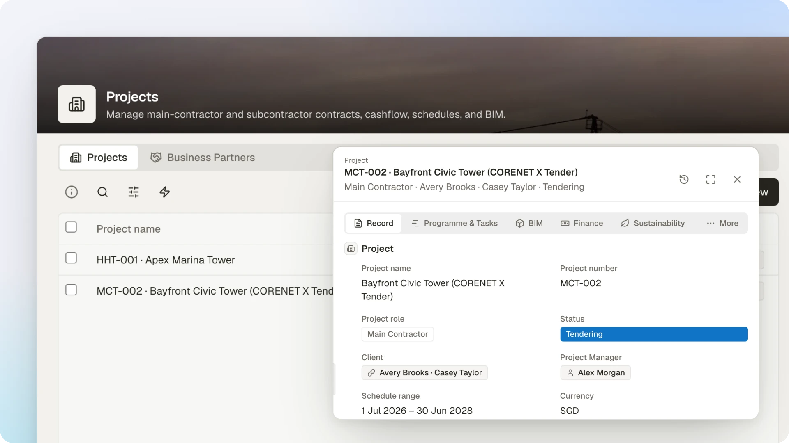

# 施工管理

**施工管理**是一套面向**总承包商（协调多家专业分包商）**以及**专业分包商（交付自身工程包）**的端到端工程项目运营工作区。它将来自 **WhatsApp** 与 **邮件** 的现场沟通信息、**3D BIM 建筑信息模型**、**层级工作分解（WBS）进度计划**以及**基于标准目录控制的商务与现金流台账**统一整合在同一协作平台中。

传统施工团队往往需要每周耗费大量时间，在分散的电子表格、冗长的现场聊天记录、过时的工程量清单以及独立的送货单据之间反复核对。本工作区以“单项目单一事实来源”取代零散手工交接：每个项目维护一份权威的 3D BIM 合模模型并一对一绑定一份造价估算，所有订单与单据均强制关联标准计价目录，自动执行采购、送货与发票三单匹配，并将日常现场消息实时沉淀为可追踪的业务记录。

## 预期业务价值

- **杜绝手工报价偏差与成本漏损：** 客户合同、分包合同、工程变更单、采购单、送货单、发票及非 BIM 临时成本的所有明细行，均必须源自项目 BIM 算量或已启用的清单矩阵目录——彻底消除自由文本填报金额，实现预算、合同承诺、现场到货、开票与支付逐项对账。
- **大幅缩短 BIM 算量与估价周期：** 自动去重与视觉 AI 分类可将模型中成千上万个重复构件归并为唯一构件原型，按有效单价与损耗率自动计价，并跨算量、跨项目记住每类构件的计价归属（造价师修正后即以修正为准）；对目录中未收录的构件由 AI 提出清单矩阵新增项供造价师审批，而非重复手工算量。
- **杜绝设计变更后沿用过期估算：** 只要项目替换了新的 BIM 模型，系统会在记录历史中保留旧模型、将项目标记为待重新算量，并将原有造价估算自动置为作废状态，直至新模型完成算量与计价。
- **让零散现场沟通自动转化为结构化台账：** 来自 WhatsApp 与邮件的文字、语音消息、现场照片及单据附件会自动完成语音转写与项目归类，并按需生成任务进度更新与评论（照片与单据归档至对应任务）、记入所属任务动态并附照片的现场问题、变更单草稿或商务单据草稿。
- **固化商务纪律与完整审计留痕：** 生效合同、已签发发票、已批复请款单、已发生临时成本及已定版造价估算均自动锁定，防止未经受控流程的静默篡改；三单自动核对在付款前即时暴露超额差异。

## 角色与权限

工作区预设四类业务团队角色，在现场交付、商务造价、系统管理与外部协作方之间建立清晰的职责与数据边界：

- **施工管理员（Construction Administrators）：** 拥有工程运营、商务造价与共享集成的完整管理权限，可维护项目、进度计划、BIM 模型、合同单据、清单矩阵、业务伙伴以及公司级共享连接（包括 Autodesk Construction Cloud）。
- **项目交付团队（Project Delivery，项目经理与现场主管）：** 负责项目立项与维护、BIM 模型版本更新、归档施工图纸与规范、层级 WBS 进度计划及其动态（评论、缺陷、技术核定单等现场问题以及会议）、业务伙伴名录维护及现场消息分拣。交付人员无权创建或修改合同金额、发票、临时成本或清单矩阵单价；当其上传新版 BIM 模型时，系统仅自动将原估算置为作废，不赋予其修改造价明细的权限。
- **商务与造价团队（Commercial & QS）：** 负责客户合同、分包与供货合同（含合同金额、保留金、税率与付款条款）、工程变更单、采购单、送货单、发票、进度请款单、非 BIM 临时成本、主清单矩阵维护（包括审批 AI 提出的清单矩阵新增项）、BIM 资产计价归属以及 BIM 造价估算复核定版。商务人员可评论任务，但无法提出问题、记录会议，也无法修改施工进度计划或 BIM 模型。
- **业主与顾问（Client & Consultant）：** 仅拥有工程运营应用的只读权限，可实时查看项目进展、施工计划、3D BIM 模型、现场问题及商务概览，无任何编辑权限，且无法查看内部系统配置与渠道连接信息。

成员个人的 WhatsApp 与邮箱连接相互严格隔离：每位成员仅能绑定并配置自己名下的个人账号与消息采集规则，公司级共享渠道与外部系统连接则由管理员统一维护。

## 应用与核心功能

### 工程运营（Operations）

| 应用 / 模块                                          | 核心功能                                                                                                                                                                                                                                                                                                                                                                                                                                                                                                                                                                                                                                                                                                                                                                                                                                                                                       |
| ---------------------------------------------------- | ---------------------------------------------------------------------------------------------------------------------------------------------------------------------------------------------------------------------------------------------------------------------------------------------------------------------------------------------------------------------------------------------------------------------------------------------------------------------------------------------------------------------------------------------------------------------------------------------------------------------------------------------------------------------------------------------------------------------------------------------------------------------------------------------------------------------------------------------------------------------------------------------- |
| **工程项目（Projects）**                             | 汇总展示各项目的承包角色（总承包商、分包商或专业分包商）、业主、状态、工期、待办任务数、未闭环问题数与生效合同数；仅当存在无法归入任何项目的消息时，另显示**待归档消息**标签页。点击任一项目即可进入以下七组标签页组成的**项目工作台**。                                                                                                                                                                                                                                                                                                                                                                                                                                                                                                                                                                                                                                                       |
| **项目工作台 — 项目档案（Record）**                  | 维护项目自身字段：名称、编号、承包角色、状态、客户（委托我方的业务伙伴——业主，或我方分包时的总承包商）、项目经理、工期、报告币种、Autodesk 项目链接与项目说明，以及可折叠的可持续性与合规元数据（建筑面积 GFA、建筑类型、绿色标志目标、BCA 编号、审批节点、合格人士、BIM 经理、BEP 版本、CONQUAS 目标）及现场位置、地址、空间区域与轴网。                                                                                                                                                                                                                                                                                                                                                                                                                                                                                                                                                      |
| **项目工作台 — 进度计划与任务（Programme & Tasks）** | 按分解编码嵌套管理 WBS 工作包与关键里程碑（3.1.2 位于 3.1 之下，3.1 位于 3 之下），每项任务以源进度计划中的作业编号标识。**BIM 任务**建造模型中的构件；**临时任务**是模型中不体现的工作（脚手架、吊装、混凝土试块检测、资料收集）。工具栏内置简洁的图标视图切换器，可在**时间轴**（4D 日期滑块、父级汇总条、里程碑菱形、进度滞后提示及一键在 3D BIM 模型中单独显示当日施工构件）、**列表**（含任务类型与进度列）与精简**看板**之间即时切换。任务以两个标签页打开：**记录**采用自动保存的文档式双栏布局——标题、无边框 Markdown 说明（支持悬浮工具栏与 `/` 斜杠菜单，粘贴或添加的图片与附件均存于任务中）及子任务列表，右侧窗格呈现属性、工期日期及 WBS 与 4D BIM 关联；**动态**为多态业务动态时间线（标题、时间、纯文本说明及可选附件）。支持与 Autodesk Construction Cloud 双向同步，以及 Primavera P6、Microsoft Project、Excel 与 CSV 计划文件的导入导出。                                   |
| **项目工作台 — BIM**                                 | 包含两个子标签页：**3D 模型与任务**集成行内 IFC 上传/替换栏、浏览器端交互式 3D 视图（首次打开后本地高速缓存、旋转/平移/点选查看模式、等比例滚轮与触控板捏合缩放、键盘漫游、轴测/顶视/正视/侧视快捷视角、X/Y/Z 三轴三维剖切面，以及支持隐藏/孤立选中构件、按 IFC 类别显隐切换与全部恢复的**构件可见性**面板）与项目的 BIM 任务列表——选择某个任务即以品牌色单独显示其构件、其余模型半透明并对准视角，再次选择或点击**显示完整模型**即恢复完整模型，行操作可打开任务；点选构件会列出建造该构件的 BIM 任务并可为其**新建 BIM 任务**；**BIM 造价估算**以紧凑 KPI 抬头与固定高度内部滚动工程量清单（BOQ）表格展示项目唯一的造价估算，支持数量、损耗率、单价与不可预见费的防抖自动保存行内编辑，并内置可随时往返的 3 步式 **BIM 造价流程**（**1. 解析与分析** → **2. 审核提议与合规**，可在线审核/审批清单矩阵新增项与单价、编辑清洁 BIM 属性、3D 定位合规问题并下载清洁 `.ifc` → **3. 生成造价**）。 |
| **项目工作台 — 财务（Finance）**                     | 下设五个子标签页：**概览**呈现**现金流与商务概览**（每项数字均标明流入、流出或净额：业主合同金额为流入，分包与采购承诺为流出，预计现金流与毛利率为净额，另含整体物理进度、逾期预警及按月对比业主流入与分包流出的图表）；**现金流与预算台账**按每个 BIM 与目录编码逐项核对，每列均标明方向——流入：业主合同金额；流出：成本预算、分包与采购承诺、送货单已到货、分包已开票、已付分包及预算结余；净额：流入减已承诺流出；**客户合同**与**分包与供货合同**分别管理上游与下游合同，每份合同自带合同金额、保留金、税率与付款条款，并在合同内部嵌套管理其所属的**工程变更单 (VO)** 与**交易单据**（采购单、送货单、发票、进度请款单、贷项通知单），内置自动三单匹配、生效锁定及一键生成进度款请款草稿；**非 BIM / 临时成本**独立管理绑定标准目录的措施费、吊装物流、政府规费、检测调试、临时工程与现场管理费。所有合同与单据明细行均从项目 BIM 构件或清单矩阵目录中选取，杜绝手工自由填价。            |
| **项目工作台 — 可持续性（Sustainability）**          | 包含三个子标签页：**概览**汇总建筑模型算量与非 BIM 临时成本的隐含碳排放（kgCO₂e 或 tCO₂e）并对照 BCA Green Mark 基准计算碳排强度，汇总现场 A4–A5 排放与建筑废弃物回收率，按专业绘制图表，统计缺少碳排放因子的明细行，并支持预览与导出可定制的 A4 **PDF 可持续性报告**；**按清单项的碳排放**列出每个清单项的生命周期阶段、数量、碳排放因子、碳排放、EPD 来源与再生材料占比；**现场日志（Site logs）**记录各周期的现场用电、柴油、A4 运输、市政用水/新生水及建筑垃圾台账。                                                                                                                                                                                                                                                                                                                                                                                                                       |
| **项目工作台 — 合规（Compliance）**                  | 包含两个子标签页：**概览与 BIM 合规审查**展示法定报批节点与 ISO 19650-2 指标、按监管机构筛选的 CORENET X / BCA / SCDF / PUB / URA / 企业 SOP 合规检查表（含处置分类与 3D 构件定位）以及可定制的 A4 **PDF 合规报告**预览导出；**审核与 IMS 台账**管理 BCA CONQUAS、CORENET X 与 ISO 9001/14001/45001/19650 现场检查、不合格项（NCR）、安全指标及报批记录。                                                                                                                                                                                                                                                                                                                                                                                                                                                                                                                                      |
| **项目工作台 — 文档（Documents）**                   | 归档文档台账：施工图纸、技术规范、进度文件、合同文档、竣工资料与同步自 Autodesk 的图纸，历史版本保留在记录历史中。                                                                                                                                                                                                                                                                                                                                                                                                                                                                                                                                                                                                                                                                                                                                                                             |
| **业务伙伴（Business Partners）**                    | 集中维护往来单位档案，按**全部伙伴**、**客户**、**供应商**与**分包商**分页筛选，覆盖 16 个建筑专业工种，维护用于自动路由消息的电话与邮箱账号及标准付款条款，并在每个伙伴详情页中联动展示其关联订单、往来单据、指派任务与动态。                                                                                                                                                                                                                                                                                                                                                                                                                                                                                                                                                                                                                                                                 |

### 系统配置（Configuration）

| 应用 / 模块                      | 核心功能                                                                                                                                                                                                                                                                                                                        |
| -------------------------------- | ------------------------------------------------------------------------------------------------------------------------------------------------------------------------------------------------------------------------------------------------------------------------------------------------------------------------------- |
| **清单矩阵（Item Matrix）**      | 集中维护企业级可量化单价与碳排放因子（kgCO₂e/单位）目录，涵盖 BIM 构件分类单价与非 BIM 成本目录项，包含计量单位与口径（按个数、长度、面积、体积、重量、包干、比例，或由其他清单项的计价数量派生，用于模型未建模的内容，如未建模钢筋、模板或涂料）、损耗率、定价依据、币种、有效期与专业工种，并支持 Excel 与 CSV 批量导入导出。 |
| **BIM 合规（BIM Compliance）**   | 整合两个配置标签页：**合规规则**维护动态 CORENET X、BCA、SCDF、PUB、URA 及企业招标 SOP 规则（确定性几何/属性检查与多模态语义检查）；**算量与清理配置**管理 BIM 清理预设、容差、排除 IFC 类别、材料密度、专业别名与 AI 阈值。                                                                                                    |
| **报告模板（Report Templates）** | 管理可持续性与合规 A4 PDF 报告的多版本（`草稿 → 已发布`，发布后锁定）中英文 HTML 打印版式、声明文案、信头与公司印章。                                                                                                                                                                                                           |

成员个人 WhatsApp 与邮箱连接及其监听/分类规则位于 Bolt 的 **`/connections`** 界面；公司级共享渠道（WhatsApp、邮箱及 Autodesk Construction Cloud）在**设置 → 集成 → 连接（Settings → Integrations → Connections）**中统一管理。

## 自动化与外部连接

### 内置后台自动化

- **视觉 AI BIM 算量与估价：** 在上传模型的浏览器中完成 IFC 算量，将重复构件归并为唯一资产（楼梯等组合构件整体只计一次），按几何测量每类资产并从四个角度单独渲染；优先沿用此前算量与造价师修正中记住的计价归属，仅对其余资产对照当前生效且币种一致的清单矩阵执行分类，按损耗率与不可预见费精确汇总造价，并按各清单项的碳排放因子汇总估算的隐含碳排放。清单矩阵未覆盖的资产由 AI 提出清单矩阵新增项，经商务审批后方可参与计价。
- **WhatsApp 与邮件持续采集及语音转写：** 实时同步已连接账号收发的消息，严格遵守各连接设定的历史起始同步窗口，自动保留现场照片与单据附件，并将纯语音消息转写为可检索文本。
- **智能项目路由与结构化提取：** 结合业务伙伴联系方式、项目编号规则、伙伴的在途合同与其委托的项目以及 AI 分类将现场消息精准路由至对应项目（每当新增联系人或调整采集规则时自动重评待审核或历史忽略消息），并从文本、图片及 PDF 附件中为消息涉及的每项任务提取一条进度更新与一条评论（将消息中的照片与单据归档至该任务，仅在消息明确说明时才修改状态、进度、优先级、区域、工种或完工日期），将现场问题连同消息照片记为所属任务的问题动态（无对应任务的事件自动新建一项临时任务），并生成变更单草稿与商务单据草稿。
- **一键进度款请款测算：** 根据修订后合同总额、当前物理施工进度、生效客户合同的保留金比例与上限以及往期已批复或已提交请款记录，一键核算本期可请款净额并生成进度请款单草稿（无生效客户合同的项目无法请款）。

### 外部连接与行业文件标准

- **WhatsApp 与邮件：** 支持个人工作账号与公司共享账号接入，持续沉淀现场沟通与附件。
- **Autodesk Construction Cloud (ACC)：** 通过安全账号授权接入，提供施工进度计划双向同步（每 30 分钟）以及项目图纸与模型元数据双向同步（每小时）。
- **行业通用格式：** 原生支持 **IFC** 建筑信息模型、**Primavera P6** 与 **Microsoft Project** 进度计划文件、**Excel / CSV** 表格导入导出以及 **PDF** 文档转换。

## 范围与职责边界

- **聚焦工程项目运营，不替代财务总账与银行付款：** 工作区提供完整的项目预算、订单、变更、到货、开票、请款与现金流台账，并可为财务部门提供对账依据；但法定总账核算、税务申报及银行转账付款仍由企业财务系统或银行网银完成。
- **聚焦 BIM 协同审查与算量，不替代专业建模软件：** 团队可在浏览器中浏览、剖切、基于模型规划 BIM 任务并估算由 Revit、ArchiCAD、Tekla 等软件导出的 IFC 模型；三维几何建模、深化设计出图及注册结构/机电工程师法定签章仍在专业设计软件中完成。
- **AI 辅助起草，关键商务节点由人工把关：** 自动提取生成的变更单、发票、进度请款单以及 AI 生成的 BIM 造价估算均默认以草稿形态落库，须经授权的造价师或项目经理复核确认后方可执行生效、签发或定版锁定；AI 提出的清单矩阵新增项在商务审批前不参与任何计价。
- **外部账号与企业定额由客户自主维护：** Autodesk Construction Cloud 应用凭证、WhatsApp 与邮箱账号以及企业清单矩阵单价体系由使用方自行开通与维护。

## 技术文档

- [技术文档索引与开发快速开始](docs/README.md)
- [系统架构与核心机制详解（含 ASCII 架构图）](docs/architecture.md)
- [源码文件参考清单](docs/source-reference.md)
