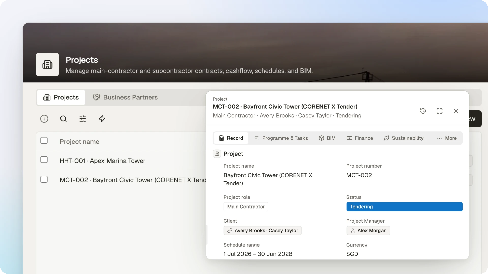

# Construction Operations — Workflows & Architecture

## Generic contractor design (Main Contractor, Subcontractor & Specialist Contractor)

Each project declares `project_role` (`main_contractor`, `subcontractor`, or `specialist_contractor`). Orders (`contracts`) and transactions (`commercial_documents`) distinguish `upstream` (Sales Orders / client revenue) from `downstream` (Purchase Orders / subcontractor & vendor cost) plus `variation_order` (VO), while `trade_specialty` classifies 16 trade packages (`roofing`, `flooring`, `mne`, `electrical`, `plumbing`, `hvac`, `structural`, `facade`, `piling`, `civil_earthworks`, `waterproofing`, `fire_protection`, `elv_security`, `finishing`, `landscaping`, `general`) across business partners, orders, WBS tasks, BIM issues, and the Costing Matrix.

## Core workflows

### 1. Project Overview & Cashflow (`Overview`)

- Review project role, commercial retention/tax/payment terms, Autodesk ACC project ID, spatial `zones`, site `address`, and message `capture_rules`.
- Track revised upstream contract sum, downstream committed cost, projected margin %, net projected cashflow, overdue payables/receivables, and the SQL-aggregated commercial `<Chart>`.

### 2. Hierarchical WBS Progression (`Programme & Tasks`)

- Manage parent/child WBS work packages (`parent_task_id`, `wbs_path`) and milestones (`tasks`) across a virtualized **Timeline** (4D date scrubber, rollup summary bars, milestone diamonds and variation markers), **Table**, and **Board** views.
- Pull and push large programmes via **Autodesk ACC/APS** (`tasks.syncs.autodesk_schedule`), or upload **Primavera P6 (`.xer`)**, **MS Project (`.xml`)**, CSV, and XLSX schedules (`tasks.syncs.schedule_file`).

### 3. Unified BIM Hub (`BIM` → `3D Model & Issues` | `Cost Estimation` | `BIM Files`)

- **3D Model & Issues:** Inspect live `.ifc` models in the browser (`web-ifc` + Three.js) with X/Y/Z axis section planes, severity/4D highlights, and click-to-tag **Issues & Snags** (`issues`) right beside the project issues register.
- **BIM Files:** Upload `.ifc` models and drawings into `project_files` (with automatic `revision_trail` and optional Autodesk ACC sheet/model sync via `project_files.syncs.autodesk_files`).
- **Visual AI BIM Cost Estimation:** Uploading an `.ifc` model runs `analyze_bim_file`:
  1. Parses geometry and deduplicates identical physical elements into unique archetypes (`src/lib/ifc-viewer/ifc_takeoff.ts`).
  2. Renders isolated multi-angle isometric snapshots per archetype (`src/lib/ifc-viewer/ifc_asset_snapshots.ts`) so poorly named or misclassified proxy elements are identified visually rather than via fragile keyword matching.
  3. Classifies each archetype with visual AI against active currency-matched rules in `cost_matrix` (applying area/length/volume/count basis and waste factors); unseen or unmapped assemblies route explicitly to `unknown_unseen_catalog` for commercial review.
  4. Combines quantified BIM costs with editable **Additional Non-BIM Costings** (`additional_costs`) inside `cost_estimates`. Baselined estimates lock rates and totals permanently.

### 4. Orders & Transactions (`Orders` → `SO` / `PO` / `VO` & nested `Transactions`)

- **Orders (`contracts`):** Sales Orders (`upstream`), Purchase Orders (`downstream`), and Variation Orders (`variation_order`) with itemized `priced_lines`, EOT days, revision history (`revision_trail`), and lock upon activation.
- **Transactions (`commercial_documents`):** Nested Delivery Orders (`delivery_order`), Invoices (`invoice`), Progress Claims (`progress_claim`), and Credit Notes (`credit_note`) with exact Effect `BigDecimal` totals, automatic **3-way PO → DO → Invoice match evaluation** (`match_status`), lock upon issuance, and one-click **Draft progress claim** (`generate_payment_claim`).

### 5. Business Partners, Messages & Isolated Configuration

- **Business Partners (`Operations → Business Partners`):** Dedicated register for **Customers** (`client`), **Vendors** (`supplier`), and **Subcontractors** (`subcontractor`) with trade specialties and linked records.
- **Configuration:** External integrations (`whatsapp`, `email`, `autodesk_acc`), quantifiable `cost_matrix` rules, and personal intake rules (`communication_settings`) stay isolated in the **Configuration** app.
- `sync_messages` ingests WhatsApp and email messages on new `sys_message` creation (plus a 15-minute safety net, deduplicated, with voice transcription), `classify_messages` routes them to projects, `extract_project_updates` turns unstructured site chats/emails into structured `tasks`, `issues`, draft variation orders, and transactions, and `daily_project_digest` sends 06:00 SGT exception digests.

## Access control

Source teams under `src/access_control/team/+team.ts`:

- `construction_administrators` — `construction_read`, `construction_delivery`, `construction_commercial`, `construction_connections`
- `project_delivery` — `construction_read`, `construction_delivery`, `construction_connections`
- `commercial_qs` — `construction_read`, `construction_commercial`, `construction_connections`
- `client_consultant` — `construction_read`

See [source-reference.md](source-reference.md) for the exact file-by-file inventory.
