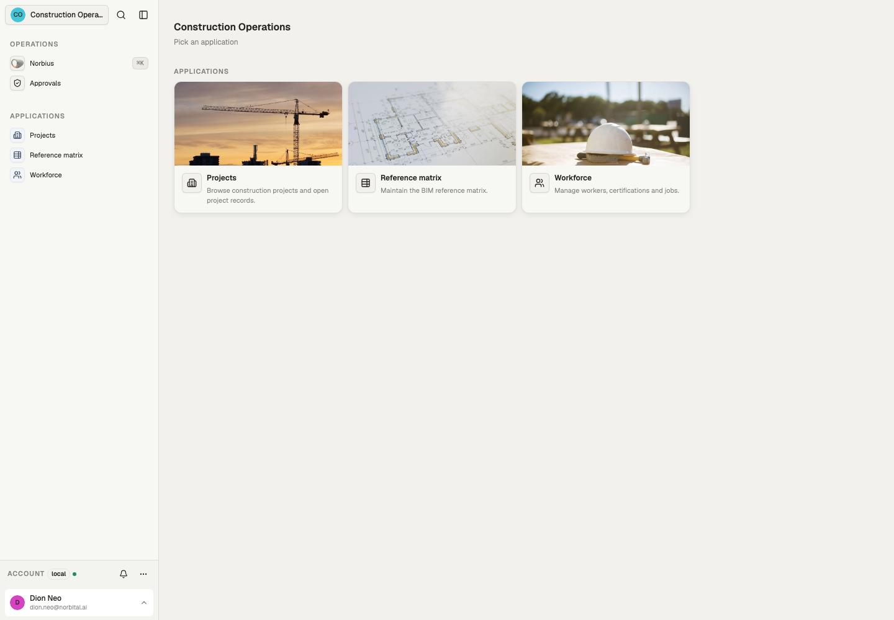
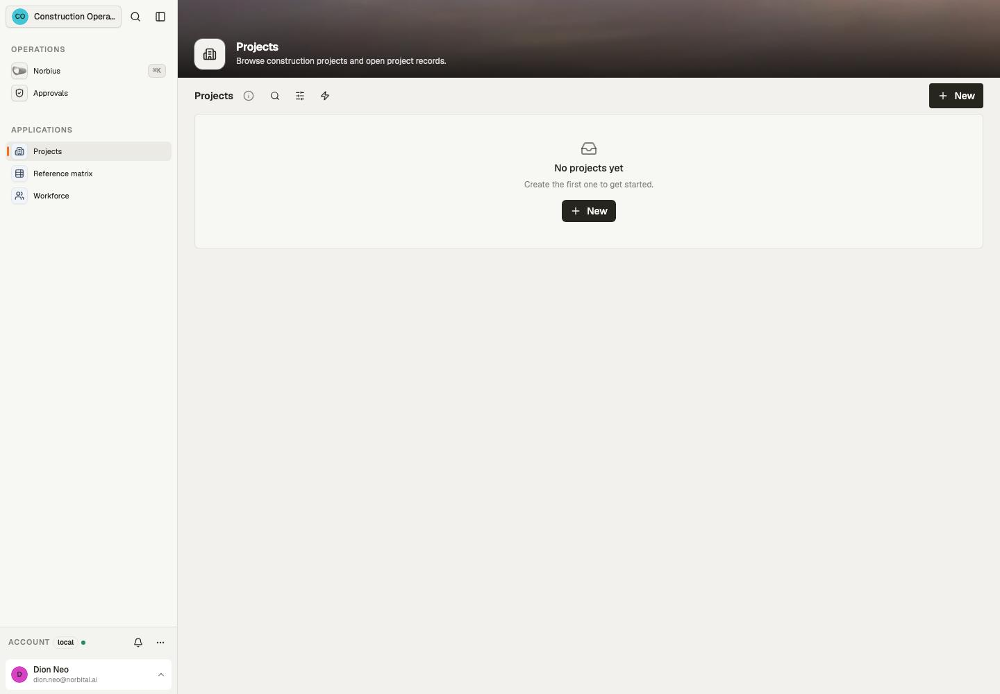

# Source reference

Checked against this template's source and compiled declaration manifest on 30 October 2026.
This is a local source inventory, not a declaration that a deployed tenant runs these bytes.

16 models, 3 applications, 4 automations.

## Applications and pages

| Source application                                                                                  | Title            | Pages                    | Purpose                                                |
| --------------------------------------------------------------------------------------------------- | ---------------- | ------------------------ | ------------------------------------------------------ |
| [construction_project_workspace](../src/app/construction_project_workspace/+app.ts)                 | Projects         | projects: Projects       | Browse construction projects and open project records. |
| [construction_settings_reference_matrix](../src/app/construction_settings_reference_matrix/+app.ts) | Reference matrix | matrix: Reference matrix | Maintain the BIM reference matrix.                     |
| [construction_settings_workforce](../src/app/construction_settings_workforce/+app.ts)               | Workforce        | workforce: Workforce     | Manage workers, certifications and jobs.               |

## Models and exposed operations

Outputs fix field visibility. Policies select outputs and scope rows; write columns and checks constrain mutations. Each row links to its owning declaration.

| Model                                                                                                                           | Fields | Read outputs | Writes                 | Post-commit effects | Syncs |
| ------------------------------------------------------------------------------------------------------------------------------- | ------ | ------------ | ---------------------- | ------------------- | ----- |
| [asset_documents](../src/data/model/projects/asset_documents/+model.ts)                                                         | 10     | default      | create, update, upsert | none                | none  |
| [bim_reference_matrix](../src/data/model/projects/bim_reference_matrix/+model.ts)                                               | 12     | default      | create, update, upsert | none                | none  |
| [certification_types](../src/data/model/certification_types/+model.ts)                                                          | 8      | default      | create, update, upsert | none                | none  |
| [defects](../src/data/model/projects/jobs/defects/+model.ts)                                                                    | 13     | default      | create, update, upsert | none                | none  |
| [job_assignments](../src/data/model/projects/jobs/job_assignments/+model.ts)                                                    | 6      | default      | create, update, upsert | none                | none  |
| [jobs](../src/data/model/projects/jobs/+model.ts)                                                                               | 9      | default      | create, update, upsert | none                | none  |
| [jobs_certification_types](../src/data/model/projects/jobs/jobs_certification_types/+model.ts)                                  | 1      | default      | create, update, upsert | none                | none  |
| [jobs_site_locations](../src/data/model/projects/jobs/jobs_site_locations/+model.ts)                                            | 1      | default      | create, update, upsert | none                | none  |
| [payment_claims](../src/data/model/projects/payment_claims/+model.ts)                                                           | 11     | default      | create, update, upsert | none                | none  |
| [permits_to_work](../src/data/model/projects/permits_to_work/+model.ts)                                                         | 9      | default      | create, update, upsert | none                | none  |
| [permits_to_work_certification_types](../src/data/model/projects/permits_to_work/permits_to_work_certification_types/+model.ts) | 1      | default      | create, update, upsert | none                | none  |
| [permits_to_work_workers](../src/data/model/projects/permits_to_work/permits_to_work_workers/+model.ts)                         | 1      | default      | create, update, upsert | none                | none  |
| [projects](../src/data/model/projects/+model.ts)                                                                                | 12     | default      | create, update, upsert | none                | none  |
| [rfis](../src/data/model/projects/rfis/+model.ts)                                                                               | 13     | default      | create, update, upsert | none                | none  |
| [site_locations](../src/data/model/projects/site_locations/+model.ts)                                                           | 7      | default      | create, update, upsert | none                | none  |
| [workers](../src/data/model/workers/+model.ts)                                                                                  | 12     | default      | create, update, upsert | none                | none  |

Upsert is available when both create and update are exposed; it resolves an explicit ID or the model’s natural key and requires an explicit conflict rule.

## Automations

All named runs use the reserved system identity and the listed policies. A manual-start grant controls who may start a run; cron/webhook/schedules use their declared trigger path. Model effects run as their writer and are separate from these named automations.

| Automation                                                                                      | Trigger              | Policies          | Purpose                                                                                                                                                                                                     |
| ----------------------------------------------------------------------------------------------- | -------------------- | ----------------- | ----------------------------------------------------------------------------------------------------------------------------------------------------------------------------------------------------------- |
| [defect_closeout_digest](../src/automation/+defect_closeout_digest.automation.ts)               | {"cron":"0 6 * * *"} | construction_read | Counts the defect register every morning at 6am and publishes the first 25 open defects as a JSON extract for the closeout meeting.                                                                         |
| [payment_claim_readiness_watch](../src/automation/+payment_claim_readiness_watch.automation.ts) | {"cron":"0 6 * * *"} | construction_read | Counts the draft and submitted payment claims every morning at 6am and publishes the 25 most recently changed as a JSON extract so the commercial team can check progress-claim readiness.                  |
| [permit_expiry_watch](../src/automation/+permit_expiry_watch.automation.ts)                     | {"cron":"0 6 * * *"} | construction_read | Sweeps the active and expiring permits to work every morning at 6am and publishes the first 25 as a JSON extract so permits nearing the end of their validity range are caught before crews are stood down. |
| [rfi_followup_watch](../src/automation/+rfi_followup_watch.automation.ts)                       | {"cron":"0 6 * * *"} | construction_read | Sweeps the open RFIs every morning at 6am and publishes the first 25 by due date as a JSON extract so queries still waiting on the design team can be chased.                                               |

## Integrations and source roles

- Integration definitions: none.
- Named connections: none.
- Source policies: `construction_project_workspace`, `construction_read`, `construction_settings_reference_matrix`, `construction_settings_workforce`.
- Custom datatypes: `emergency_contact`, `permit_signatures`, `project_address`, `site_coordinates`.

Pairing and credentials belong to the host's Connections surface; defining a connection does not mean it is paired.

## Browser evidence

Captured through the browser from a separate local documentation workspace on 30 October 2026. This shows layout and navigation; it does not certify external providers, automation results or deployment.
