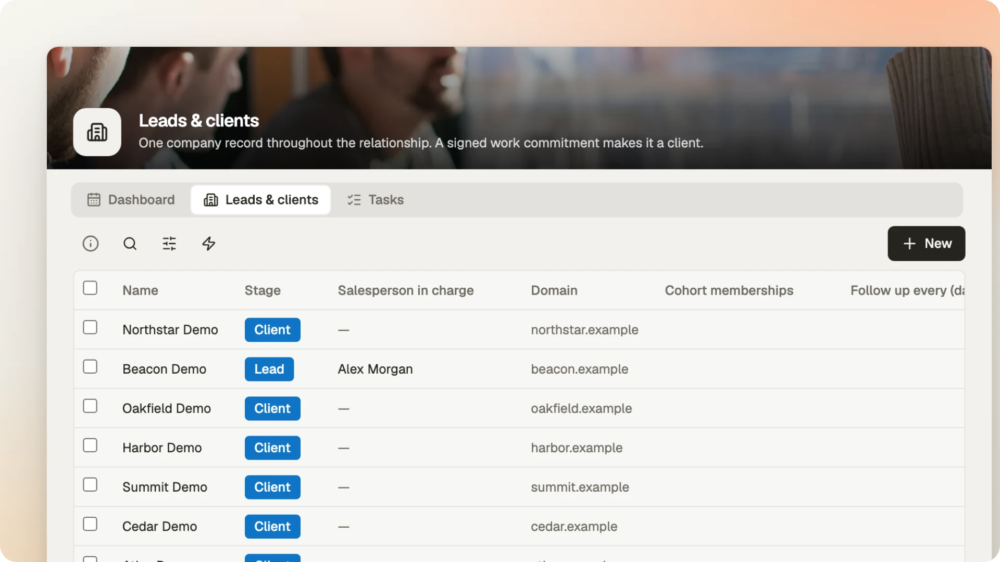

# CRM

An end-to-end client relationship and delivery workspace that runs the entire commercial lifecycle — from initial lead capture and web research through multi-channel client conversations, recorded discovery meetings, structured Scope of Work preparation, and signed agreement governance. Leads and active clients live in one deduplicated company directory, ensuring every contact, message, meeting transcript, task, and executed document stays tied to the same organization from first touch to ongoing delivery.

This workspace replaces fragmented prospect spreadsheets, copy-pasted chat and email threads scattered across personal WhatsApp and Gmail accounts, lost meeting notes, manually assembled proposals, and informal handoffs where prospects are treated as active clients before a commitment is signed. Sales and delivery teams gain a shared operational record with automated follow-up discipline, clear confidentiality boundaries, and traceable evidence behind every project scope and contract.

## Expected Business Impact

- **One deduplicated source of truth from lead to client:** Consolidates prospects, contacts, projects, messages, recordings, tasks, and signed documents under a single company record — preventing duplicate accounts across manual entries, spreadsheet uploads, and Apollo imports.
- **Faster lead preparation and scope assembly:** Automatically researches new leads against your product catalog with cited web sources, transcribes meetings into structured minutes and action items, and drafts Scope of Work sections directly from filed client evidence while preserving every human edit.
- **Complete client history preserved across channels:** Captures inbound messages, voice notes, images, and attachments from personal and workspace channels into one chronological timeline per company and project, eliminating knowledge loss during team handovers.
- **Consistent follow-up discipline and outreach hygiene:** Schedules follow-ups on each qualified lead's cadence with escalating reminders delivered in-app and via direct message, and prevents overlapping cold-outreach campaigns to the same person or company.
- **Enforced commercial governance and auditability:** Keeps leads from converting to active clients until a signed commitment agreement is uploaded, freezes the exact contract version and commercial terms at signing, and flags any later changes automatically.

## Roles & Access

- **Sales Team:** Has shared operational access across both CRM and Configuration — managing companies, contacts, projects, activities, recordings, tasks, product catalogs, outreach sequences, cohorts, and follow-ups. Sales members can preview, download, email, and archive signed agreements, and edit drafting instructions on templates. To preserve commercial integrity, Sales cannot reopen lost accounts, delete archived signed copies, change company legal/signatory details, or publish new legal template versions.
- **Personal Account Privacy Boundary:** Each sales member connects and manages only their own personal WhatsApp, email, and Google Calendar accounts, along with their own message intake rules. Personal calendar entries remain strictly private to their owner, personal messaging accounts synchronize inbound context only (never sending outbound replies on a member's behalf), and synced meetings can only be rescheduled or cancelled by the calendar's owner.
- **Workspace Administrators:** Connect and manage shared workspace communication channels (WhatsApp, Email, Telegram, Slack, Discord) and the workspace Apollo account; maintain the organization's legal entity and signatory details; publish new immutable versions of agreement, email, and research templates; reopen lost accounts when appropriate; and remove mistaken signed-document uploads if required.
- **Automated Background Services & Consent Safeguards:** Scheduled background services handle message syncing, classification, lead research, transcription, scope extraction, calendar projection, and reminders without overwriting human edits or accessing biometric voice profiles. Contact voice recognition requires explicit recorded consent and stays restricted to sales members, while launching or syncing Apollo outreach campaigns always requires explicit user confirmation.

## Apps & Functionality

### CRM

| App / Module                             | Functionality                                                                                                                                                                                                                                                                                                                                                                                                                                                                                                                                                                                     |
| ---------------------------------------- | ------------------------------------------------------------------------------------------------------------------------------------------------------------------------------------------------------------------------------------------------------------------------------------------------------------------------------------------------------------------------------------------------------------------------------------------------------------------------------------------------------------------------------------------------------------------------------------------------- |
| **Dashboard**                            | Displays live summary cards for Clients, Leads, Open Tasks, and Overdue Tasks — each with a quick-jump list of matching records — alongside a day, week, and month calendar combining personal Google Calendar appointments and open task due dates.                                                                                                                                                                                                                                                                                                                                              |
| **Leads & Clients**                      | Unified, deduplicated directory tracking every company from Lead and Qualified through Client or Lost. Toolbar actions import leads from CSV/Excel or Apollo, trigger batch research across unresearched leads, open Outreach Cohorts, and export or preview company-level agreements as formatted pages or PDFs.                                                                                                                                                                                                                                                                                 |
| **Company Hub**                          | Central company record holding registration and domain details, assigned salesperson, follow-up cadence, contacts (with primary and signatory flags), uploaded company files, cited web research with interactive source popovers, proposed use cases, an AI-maintained customer profile (business nature, summary, preferences), notes, and a chronological Activities timeline.                                                                                                                                                                                                                 |
| **Project (Job) Hub**                    | Delivery engagement workspace tied to one company, containing structured Scope of Work sections (overview, definitions, implementation scope, data migration, milestones, acceptance tests, fees, and decisions) automatically synthesized from filed evidence with source citations and edit protection, optional per-project message capture rules, Activities timeline, live-rendered Documents tab (PDF export, email dispatch, signed copy upload, post-signing drift alerts), and supporting Files.                                                                                         |
| **Activities, Conversations & Meetings** | Chronological timeline grouping related message threads into expandable conversation slices with one-click customer/project reassignment. Guided activity creation supports **Recordings** (in-browser audio recording with pause/resume and crash-safe local recovery, or multi-file audio/video upload), **Manual Notes**, and **Scheduled Meetings** (two-way Google Calendar sync with opt-in guest email notices). Meeting records unify audio playback, speaker tagging, consent-based in-browser voice recognition, diarized transcripts, auto-generated Minutes, and linked Action Items. |
| **Tasks**                                | Actionable queue of sales follow-ups and meeting action items filtered to open items by default, with single ownership, due dates, attachments, company/project/contact/meeting links, one-click status controls (Mark Done, Reopen, Cancel), and automated reminder tracking.                                                                                                                                                                                                                                                                                                                    |
| **Outreach Cohorts**                     | Accessible from Leads & Clients to organize prospects into campaign batches paired with a sequence, track engagement counts (enrolled, replied, meetings booked, bounced or unsubscribed), launch batches to Apollo with tailored potential-project bullets, sync live progress back, and mark completed cohorts done to release leads for future outreach.                                                                                                                                                                                                                                       |

### Configuration

| App / Module       | Functionality                                                                                                                                                                                                                                                                                                                                                         |
| ------------------ | --------------------------------------------------------------------------------------------------------------------------------------------------------------------------------------------------------------------------------------------------------------------------------------------------------------------------------------------------------------------- |
| **Message Rules**  | Personal intake controls allowing each member to sync messages from saved Customer Contacts Only (default) or All Messages, add optional filing guidelines (up to 8,000 characters), and inspect the **Classified Messages** log showing each captured message's status and classification reason.                                                                    |
| **My Connections** | Self-service pairing for personal WhatsApp, Email, and Google Calendar with selectable import start boundaries (From Now, Since a Chosen Date, or All Available History), alongside administrator-managed shared Workspace Channels (WhatsApp, Telegram, Slack, Discord, Email) and the Apollo account.                                                               |
| **Products**       | Runtime catalog of products and services organized by category with summaries and qualification/fit criteria, plus the **Seller & Research Focus** panel defining your company's offering and what signals lead research should evaluate.                                                                                                                             |
| **Templates**      | Versioned catalog of reusable Markdown templates covering Agreements to Sign (with optional commitment gating for client conversion), Outreach Emails, and Research Prompts — complete with live A4 previews, drafting instructions, administrator-controlled version publishing, and the **Company Signatory** panel for legal entity details and signature artwork. |
| **Sequences**      | Multi-step email and call outreach sequence editor with day offsets, dynamic lead variables, live preview for any selected contact, and the **Outreach** settings panel managing the AI potential-project prompt (versioned automatically on each edit), default sender name, and Apollo custom-field mapping.                                                        |

## Automations & Connections

- **Lead Acquisition & Cited Research:** Daily scheduled sync (and on-demand CSV/Excel upload) imports leads without duplicates. Every new company is automatically researched once — enriching missing details from Apollo when connected, reading the company website and public web sources, scoring product fit against your active catalog, proposing tailored project ideas, assessing contact seniority and outreach angle, and drafting an initial outreach follow-up.
- **Multi-Channel Message Sync & AI Filing:** Continuously mirrors eligible messages, voice notes (automatically transcribed), images, and documents from connected personal and workspace accounts (Email, WhatsApp, Telegram, Slack, Discord). AI classification filters irrelevant noise, routes client messages to the right company and project using conversation context and job-specific capture rules, and automatically re-evaluates past filtered history whenever contacts or intake rules change.
- **Meeting Transcription, Minutes & Scope Synthesis:** Uploaded or recorded meetings are automatically transcribed with speaker separation and summarized into meeting minutes, decisions, and follow-up tasks. Filing messages, transcripts, or supporting files automatically refreshes the project's Scope of Work and the customer's profile while strictly preserving every manually edited item.
- **Two-Way Google Calendar Sync:** Imports personal calendar events into the Dashboard calendar, automatically links meetings with saved client contacts to active projects, and writes reschedules or cancellations made in CRM back to Google Calendar with conflict protection if Google changed first.
- **Follow-Up Cadence & Multi-Channel Reminders:** Every morning, automatically generates the next follow-up task for qualified leads on their configured cadence and sends step-by-step reminders (day before, due day, overdue, and 3-day escalation copying the task creator) to the owner's inbox and connected workspace direct-message channels.
- **Apollo Outreach & Workspace Document Delivery:** Launches drafted cohorts to Apollo in batches, syncs replies/bounces/unsubscribes back on demand, and renders agreements to formatted A4 PDFs sent directly from the connected workspace mailbox (with a copy delivered to the sender).

## Scope & Boundaries

- **Included out of the box:** Unified lead-to-client CRM, deduplicated lead import, cited web research and product-fit assessment, multi-channel message intake and AI routing, meeting capture/transcription/minutes and consent-based speaker recognition, automated Scope of Work extraction, versioned document previews/PDF delivery/signed archiving with commitment gating, two-way Google Calendar sync, Apollo cohort management, and automated follow-up reminders.
- **Electronic signature execution & legal counsel:** The workspace generates ready-to-sign agreement PDFs, emails them to signatories, and archives executed copies with frozen terms, but does not replace external e-signature platforms or legal review of contractual language.
- **Outbound sending from personal messaging accounts:** Personal Gmail and WhatsApp connections are inbound-only by design so team members never risk unintended automated sends from personal accounts; outbound replies, document dispatches, and reminders always flow through administrator-configured workspace channels.
- **Billing, invoicing & accounting:** Project fee schedules are captured inside Scopes of Work for commercial alignment, whereas invoice issuance, payment processing, tax reporting, and general ledger accounting remain in dedicated finance or ERP systems.
- **Cold-email sending infrastructure & deliverability:** Actual sequence email delivery, mailbox warm-up, bounce handling, and unsubscribe enforcement occur inside Apollo using the organization's configured Apollo account and sending mailbox.
- **External account setup & biometric consent:** Provisioning Google OAuth credentials, Apollo API keys, and obtaining explicit participant consent before recording meetings or enrolling contact voice profiles remain the operating organization's responsibility.

## Documentation

- [Documentation Index & Developer Quickstart](docs/README.md) — setup commands, test/build workflow, and guide directory.
- [Architecture & Inner Mechanisms](docs/architecture.md) — deep technical guide with ASCII diagrams covering topology, 22-model ER schema, state machines, message intake & AI routing, two-way Google Calendar sync, browser voiceprints, SOW merge engine, PDF rendering, Apollo cohorts, and access control.
- [Operator Guide](docs/operator-guide.md) — step-by-step pairing for Gmail, WhatsApp, Google Calendar, and Apollo, import start boundaries, intake rules, voice profiles, outreach cohorts, document signing, and troubleshooting.
- [Activity Timeline Design](docs/design/activity-timeline.md) — conversation slicing rules, meeting capture UX, and A4 document layout behavior.
- [Source Reference](docs/source-reference.md) — complete verified inventory of apps, pages, models, syncs, automations, policies, and integrations.
