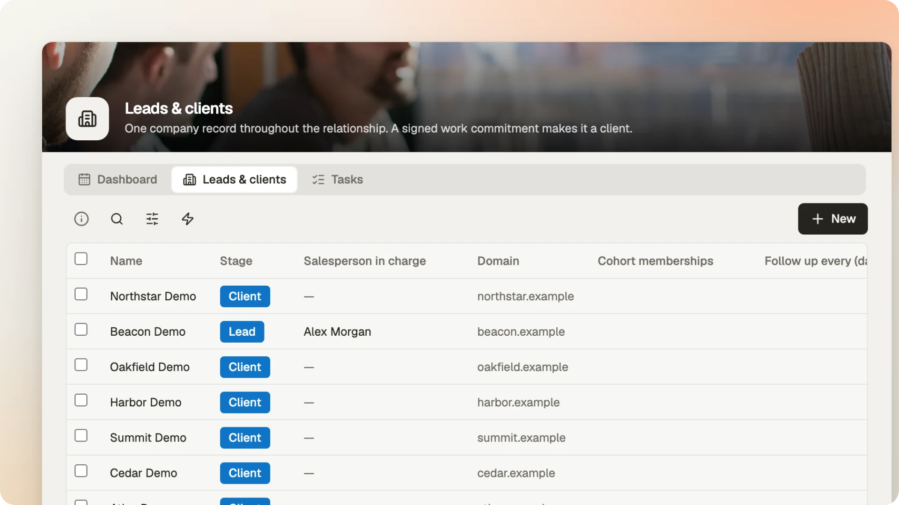

# 客户关系管理

覆盖从线索获取、自动化网络调研、多渠道客户沟通、会议录音整理、结构化工作说明书起草到协议签署归档的全周期客户关系与项目交付工作区。潜在客户与正式客户共用同一张去重公司目录，确保每一次联系、每一条消息、每一场会议纪要、每一项待办以及每一份签署协议都完整沉淀在同一家公司名下。

本工作区旨在替代分散的线索表格、散落在个人 WhatsApp 与 Gmail 邮箱中的零碎对话、会后遗失的沟通结论、手工拼凑的方案文档，以及在尚未签署正式工作承诺前就草率将线索转为客户的不规范交接。销售与交付团队由此获得统一、可追溯的业务事实来源、严谨的跟进节奏、清晰的隐私边界，以及每份项目范围与合同背后的完整证据链。

## 预期业务价值

- **从线索到客户的单一去重事实来源：** 将潜在客户、联系人、项目、消息、录音、任务与已签署文件统一汇总至同一公司记录，杜绝手动录入、表格导入与 Apollo 同步带来的重复建档。
- **显著缩短线索调研与方案起草耗时：** 自动结合企业产品目录开展带出处的网络调研，将会议录音转写为结构化纪要与待办任务，并直接从归档沟通证据中提取工作说明书条款，同时完整保留每一处人工修订。
- **跨渠道沉淀完整客户上下文：** 将个人与工作区渠道的客户消息、语音消息、图片及附件汇入同一时间线，彻底消除人员交接或跨渠道沟通造成的信息断层。
- **建立稳定的跟进纪律与外联秩序：** 按每位已确认线索的节奏自动生成跟进任务，并通过应用内通知与工作区私信发送逐级升级提醒；同时防止同一联系人或公司被重复纳入多个并发冷外联批次。
- **落实商业合规门禁与全流程审计：** 只有在上传已签署的工作承诺协议后，潜在客户才会转为正式客户；签署时自动冻结当时的模板版本与条款内容，后续若信息发生变动立即提示复核。

## 角色与权限

- **销售团队：** 拥有客户关系管理与系统配置两项应用的日常运营权限，可管理公司、联系人、项目、活动、录音、任务、产品目录、外联序列、外联批次与跟进任务，支持预览、下载、发送与归档已签署协议，并可维护模板起草说明。为守住商业合规底线，销售人员不可重新激活已流失客户、不可删除已归档的签署副本、不可修改本公司法定主体与签署人信息，也不可发布新的法律模板版本。
- **个人账户隐私边界：** 每位销售成员仅可连接并管理自己的个人 WhatsApp、邮箱与 Google 日历账户，以及个人专属的消息接入规则。个人日历条目严格仅对所有者本人可见；个人消息账户仅同步入站上下文（绝不会代表个人自动回复）；已同步至 Google 日历的会议仅允许日历所有者调整日程或取消。
- **工作区管理员：** 负责连接与管理工作区共享渠道（WhatsApp、邮箱、Telegram、Slack、Discord）及 Apollo 账户，维护本公司法定实体与签署人信息，发布不可变的协议/邮件/调研模板新版本，并在必要时重新激活已流失客户或移除误传的签署文件。
- **后台自动化与授权保障：** 后台自动化服务按计划执行消息同步、分类归档、线索调研、语音转写、范围提取、日历映射与跟进提醒，但绝不覆盖人工编辑内容，也无权读取联系人声纹档案。声纹识别须以明确记录的联系人授权为前提且仅限销售成员使用；向 Apollo 启动外联批次或拉取进度前均须人工明确确认。

## 应用与核心功能

### 客户关系管理

| 应用 / 模块          | 核心功能                                                                                                                                                                                                                                                                                                                                                                                |
| -------------------- | --------------------------------------------------------------------------------------------------------------------------------------------------------------------------------------------------------------------------------------------------------------------------------------------------------------------------------------------------------------------------------------- |
| **工作台**           | 展示客户、潜在客户、待办任务与逾期任务四项实时指标卡片（点击即可展开对应清单并直达记录），并集成日/周/月视图日历，同屏呈现已同步的 Google 日历预约与待办任务到期日。                                                                                                                                                                                                                    |
| **潜在客户与客户**   | 统一去重的公司目录，覆盖潜在客户、已确认、客户与已流失全阶段。工具栏支持通过 CSV/Excel 或 Apollo 导入线索、批量调研尚未调研的公司、打开外联批次面板，以及直接按模板预览或导出公司级协议 PDF。                                                                                                                                                                                           |
| **公司主页**         | 汇聚公司注册与域名信息、负责销售、跟进间隔、联系人（含主要联系人与签署人标识）、公司级上传文件、带可点击来源浮层的网络调研报告、建议用例、AI 维护的客户画像（业务性质、业务简介与偏好）、备注以及按时间倒序排列的活动时间线。                                                                                                                                                           |
| **项目主页**         | 归属于特定公司的交付项目空间，集中呈现由归档证据自动提取的结构化工作说明书（项目概述、定义、实施范围、数据迁移、里程碑、验收测试、费用与决策，均带来源引用与人工编辑保护）、可选的项目专属消息捕获规则、活动时间线、实时渲染的文件标签页（PDF 下载、邮件发送、签署副本上传与条款变更提示）及辅助文件列表。                                                                              |
| **活动、对话与会议** | 统一时间线自动将同一对话线程的连续消息归并为可展开的会话片段，支持一键重新分配归属客户与项目。引导式新建活动支持**录音**（浏览器内录音，支持暂停/恢复与防丢失本地草稿，或批量上传音视频文件）、**手动笔记**与**预约会议**（与 Google 日历双向同步，可选是否邮件通知参与者）。会议主页整合音频播放、说话人标记、浏览器端授权声纹匹配、分角色转写文本、自动生成的会议纪要与关联待办事项。 |
| **任务**             | 集中管理销售跟进与会议待办事项（默认筛选未完成任务），明确单一负责人与到期日，支持附件上传、关联公司/项目/联系人/会议上下文、一键完成/重开/取消以及提醒进度追踪。                                                                                                                                                                                                                       |
| **外联批次**         | 可从“潜在客户与客户”页面打开，将多条线索编组并绑定外联序列，实时汇总已加入、已回复、已约会议及退信/退订数量；支持一键推送至 Apollo 并注入各公司定制的潜在项目构想、同步外联进度，以及在批次完成后释放线索以便进入后续活动。                                                                                                                                                             |

### 系统配置

| 应用 / 模块  | 核心功能                                                                                                                                                                                                                               |
| ------------ | -------------------------------------------------------------------------------------------------------------------------------------------------------------------------------------------------------------------------------------- |
| **产品目录** | 按类别维护企业所售产品与服务的简介及适配/资格评估条件，并配套**公司业务与调研重点**面板，用于配置卖方介绍与线索调研重点方向。                                                                                                          |
| **模板**     | 版本化管理三类可复用 Markdown 模板——待签署协议（可勾选是否作为客户转化的工作承诺依据）、外联邮件样本与调研提示词；支持实时 A4 排版预览、起草说明维护、管理员专属的新版本发布，以及用于配置公司法定信息与签名图片的**公司签署人**面板。 |
| **序列**     | 多步骤邮件与电话外联模板编辑器，支持设置相对入组天数与动态线索变量，可任选一位联系人实时预览每一步发送效果；配套**外联**设置面板维护潜在项目提示词（每次编辑自动递增版本）、发件人姓名与 Apollo 自定义字段占位符。                     |

成员个人 WhatsApp、邮箱与 Google 日历连接（含导入起点与每连接消息分类规则）位于 Bolt 原生 **`/connections`** 界面；管理员维护的工作区共享渠道（WhatsApp、邮箱、Telegram、Slack、Discord）与 Apollo 账户位于**设置 → 集成 → 连接（Settings → Integrations → Connections）**；消息归档日志可在**客户关系管理 → 潜在客户与客户 → 归档日志**中查看。

## 自动化与外部连接

- **线索获取与带出处网络调研：** 每日定时从已连接的 Apollo 账户拉取线索，并支持按需上传 CSV/Excel 自动去重入库。每家新录入的公司会自动执行一次综合调研——按需调用 Apollo 补全缺失字段、抓取公司官网与公开网页信息、对照启用中的产品目录评估适配度、提出定制化潜在项目构想、评估联系人职级与切入角度，并生成首条外联跟进任务。
- **多渠道消息同步与智能归档：** 持续将个人与工作区渠道（邮箱、WhatsApp、Telegram、Slack、Discord）中符合导入起点范围的消息、语音消息（自动转写为文字）、图片及文档同步入库。AI 分类器结合上下文与项目捕获规则自动过滤无关闲聊、将客户消息归档至对应公司与项目；一旦联系人信息或接入规则更新，系统会自动复核历史被过滤消息。
- **会议转写、纪要与范围自动提取：** 录音或上传的会议音频会自动完成分说话人转写，并生成会议纪要、决策清单与待办任务。每当项目新增已归档消息、会议转写或辅助文件时，系统会自动更新项目工作说明书与客户画像，同时严格保留人工编辑过的任何字段与条目。
- **Google 日历双向同步：** 将个人日历预约导入工作台日历，自动识别包含已建档客户联系人的会议并关联至活跃项目；在 CRM 内修改或取消已同步会议时自动回写至 Google 日历，若远端日历先行变更则自动保留远端版本并提示冲突。
- **跟进节奏规划与多渠道提醒：** 每日早晨自动为尚无未完成跟进任务的已确认线索按设定间隔排期，并按“到期前一天 → 到期当天 → 逾期 → 逾期 3 天升级抄送创建人”的阶梯向负责人收件箱及已连接的工作区私信渠道发送提醒。
- **Apollo 外联执行与工作区协议发送：** 经人工确认后将草稿批次批量推送至 Apollo 并按需同步回复、退信与退订进展；协议文档通过服务端排版为标准 A4 PDF 并由工作区邮箱发送给客户签署人，同时向发起人留存一份副本。

## 范围与职责边界

- **开箱即用覆盖范围：** 线索至客户全周期管理、去重线索导入、带出处网络调研与产品适配评估、多渠道消息接入与 AI 归档、会议录音转写纪要及授权声纹识别、自动化工作说明书提取、版本化协议预览/PDF 发送/签署归档与转化门禁、Google 日历双向同步、Apollo 外联批次管理及阶梯式跟进提醒。
- **电子签章与法律审核：** 工作区负责生成待签协议 PDF、向签署人发送邮件并冻结归档已签署副本，但不替代第三方合规电子签章平台，也不提供法律条款审阅意见。
- **个人消息账户不执行外发：** 个人 Gmail 与 WhatsApp 仅作入站上下文同步，防止以个人名义产生非预期自动发送；所有客户回复、协议寄送与系统提醒均通过管理员配置的工作区渠道发出。
- **开票、收款与财务总账：** 项目工作说明书记录报价与费用条款以支撑商务对齐，而正式开票、回款核销、税务申报及总账核算仍由财务或 ERP 系统承担。
- **冷外联邮件投递与送达率管理：** 外联序列的实际邮件投递、发信域名预热、退信处理与退订合规均由 Apollo 平台及所配置的发信邮箱负责执行。
- **外部凭证配置与合规授权：** 配置 Google OAuth 凭证、Apollo API 密钥，以及在会议录音或声纹建档前取得相关人员明确同意，均由使用本工作区的组织自行负责。

## 技术文档

- [文档索引与开发者快速上手](docs/README.md) — 本地依赖安装、校验、测试、构建命令与完整文档导航。
- [系统架构与核心机制详解](docs/architecture.md) — 包含多幅详细 ASCII 架构图的深度技术手册，剖析系统拓扑、21 个数据模型关系、状态机与门禁、多渠道消息同步与分类、Google 日历双向同步、浏览器端声纹识别、工作说明书合并引擎、PDF 排版、Apollo 外联及权限矩阵。
- [运维与操作指南](docs/operator-guide.md) — Gmail、WhatsApp、Google 日历与 Apollo 配对步骤、导入起点设置、消息规则、声纹管理、外联批次、协议签署及故障排查。
- [活动时间线设计说明](docs/design/activity-timeline.md) — 会话切片归并规则、会议录音交互与 A4 文档排版规范。
- [源码清单参考](docs/source-reference.md) — 与当前源码逐项核对的应用、页面、模型、同步、自动化、策略与集成完整清单。
