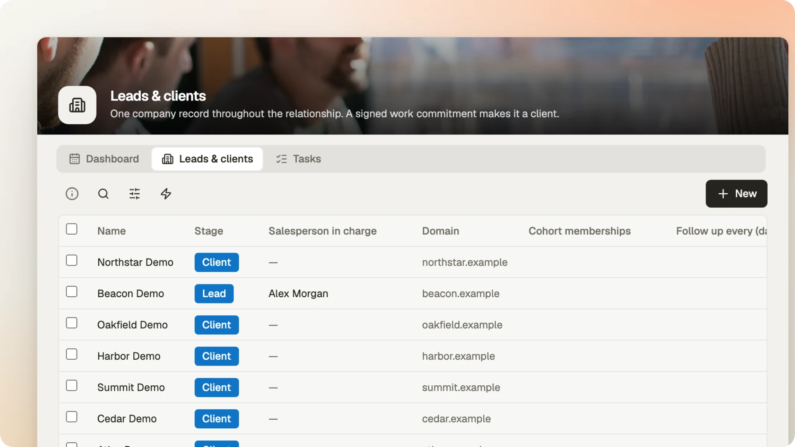

# CRM documentation

Documentation index for the CRM workspace:

- [Template overview](../README.md) — capabilities, apps, roles, data model, automations and checks.
- [Operator guide](operator-guide.md) — pairing Gmail, WhatsApp, Google Calendar and Apollo, configuring
  intake rules, meeting transcription & PIC voice profiles, outreach cohorts, document signing and
  troubleshooting.
- [Activity timeline design](design/activity-timeline.md) — conversation grouping, source identity,
  meeting recording and activity presentation.
- [Source reference](source-reference.md) — generated inventory of apps, pages, models, outputs, writes,
  automations, policies and integrations.

Personal connections, workspace channels and Apollo are paired in **Configuration → Connections**. Teams,
policies and approval flows are authored in source.
