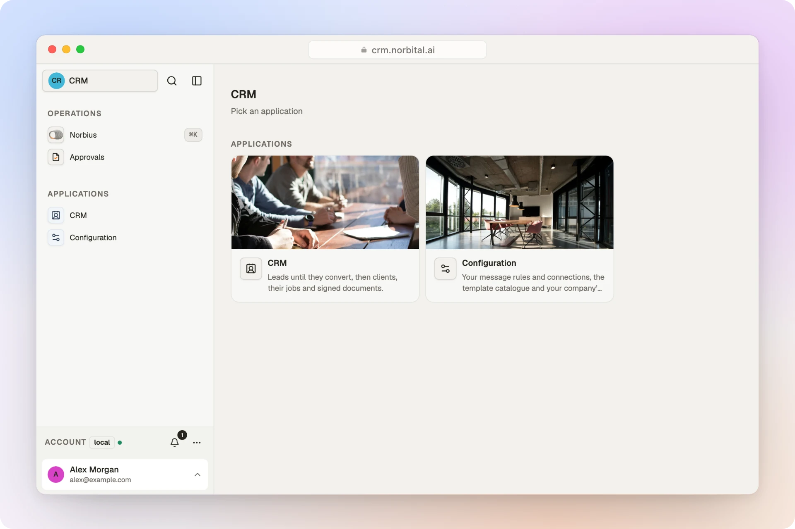
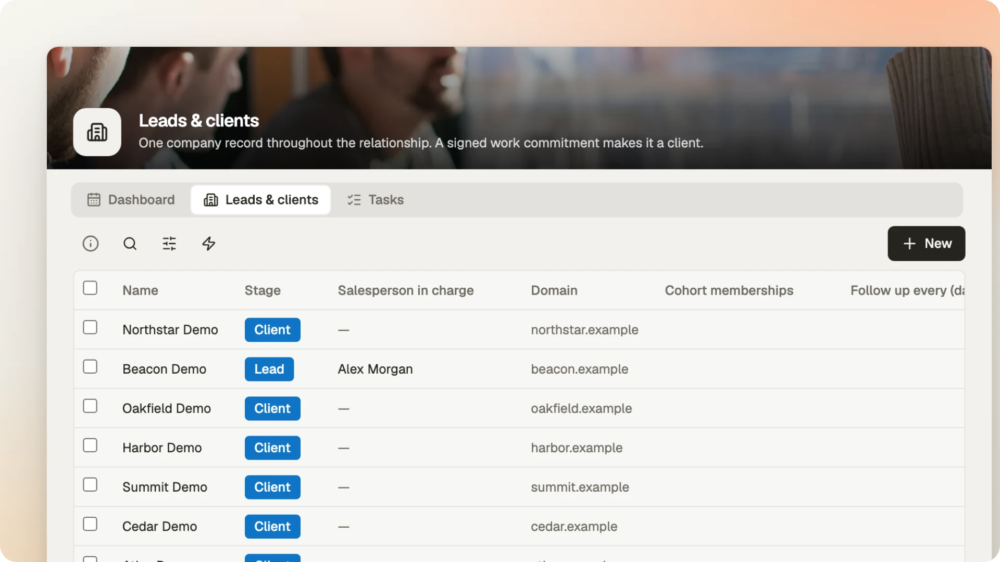

# Source Reference

Verified directly against `src/` (`src/+workspace.ts`, `src/app/`, `src/data/model/`, `src/automation/`, `src/access_control/`, `src/integration/`, `src/lib/`).

**Inventory summary:** 21 models, 2 applications (6 pages), 21 automations, 2 syncs, 2 custom integrations (+ 5 built-in channel integrations), 1 team, 6 policies, 0 custom datatypes.

## Workspace Configuration

- **Declaration:** [src/+workspace.ts](../src/+workspace.ts)
- **Settings:** `tz: 'Asia/Singapore'`, `locale: 'en-SG'`, `languages: ['en', 'zh']`, `currency: 'SGD'`, `apps: ['crm', 'configuration']`, `ai: {}`, `convert: { to: ['pdf'] }`.

## Applications and Pages

| Source application                                | Title         | Pages                                                                                                                                                                      | Purpose                                                                                                                                                        |
| ------------------------------------------------- | ------------- | -------------------------------------------------------------------------------------------------------------------------------------------------------------------------- | -------------------------------------------------------------------------------------------------------------------------------------------------------------- |
| [crm](../src/app/crm/+app.ts)                     | CRM           | `dashboard`: Dashboard (`CalendarSchedule`); `companies`: Leads & clients (table, import, cohorts, classified messages logs, document export); `tasks`: Tasks (open queue) | Unified lead-to-client directory, calendar-led dashboard, outreach cohorts, message filing logs, and follow-up/action-item task queue.                         |
| [configuration](../src/app/configuration/+app.ts) | Configuration | `products`: Products (+ Seller & research focus); `templates`: Templates (+ Company signatory); `sequences`: Sequences (+ Outreach settings)                               | Product catalog, versioned document/email/research templates, and outreach sequences (personal connections & channel classifiers live in Bolt `/connections`). |

## Models and Exposed Operations

Outputs fix field visibility; policies select outputs and scope rows; transforms and database constraints enforce invariants. Field counts reflect all declared fields in each `+model.ts` (including hidden, computed, count, and ref fields).

| Model                                                                                              | Fields | Read outputs     | Writes                                                         | Post-commit effects | Syncs                     |
| -------------------------------------------------------------------------------------------------- | ------ | ---------------- | -------------------------------------------------------------- | ------------------- | ------------------------- |
| [activities](../src/data/model/companies/projects/activities/+model.ts)                            | 45     | `default`        | `create`, `update`                                             | `create`, `update`  | `google_calendar` (write) |
| [agreement_settings](../src/data/model/agreement_settings/+model.ts)                               | 7      | `default`        | `create`, `update`                                             | none                | none                      |
| [calendar_entries](../src/data/model/calendar_entries/+model.ts)                                   | 16     | `default`        | `create`, `update` (`calendar_import` sync only; `import_key`) | `create`, `update`  | `google_calendar` (read)  |
| [cohort_members](../src/data/model/cohorts/cohort_members/+model.ts)                               | 11     | `default`        | `create`, `update`, `delete`                                   | none                | none                      |
| [cohorts](../src/data/model/cohorts/+model.ts)                                                     | 11     | `default`        | `create`, `update`, `delete`                                   | none                | none                      |
| [companies](../src/data/model/companies/+model.ts)                                                 | 27     | `default`        | `create`, `update`                                             | `create`, `update`  | none                      |
| [contacts](../src/data/model/companies/contacts/+model.ts)                                         | 23     | `default`, `crm` | `create`, `update`                                             | `create`, `update`  | none                      |
| [issues](../src/data/model/companies/projects/issues/+model.ts)                                    | 9      | `default`        | `create`, `update`                                             | none                | none                      |
| [meeting_recordings](../src/data/model/companies/projects/activities/meeting_recordings/+model.ts) | 7      | `default`        | `create`, `update`, `delete`                                   | `create`, `update`  | none                      |
| [meeting_speakers](../src/data/model/companies/projects/activities/meeting_speakers/+model.ts)     | 6      | `default`, `crm` | `create`, `update`, `delete`                                   | none                | none                      |
| [notes](../src/data/model/notes/+model.ts)                                                         | 2      | `default`        | none (read-only)                                               | none                | none                      |
| [offering_settings](../src/data/model/offering_settings/+model.ts)                                 | 4      | `default`        | `create`, `update`                                             | none                | none                      |
| [outreach_settings](../src/data/model/outreach_settings/+model.ts)                                 | 6      | `default`        | `create`, `update`                                             | none                | none                      |
| [potential_projects](../src/data/model/companies/potential_projects/+model.ts)                     | 5      | `default`        | `create`, `update`, `delete`                                   | none                | none                      |
| [products](../src/data/model/products/+model.ts)                                                   | 5      | `default`        | `create`, `update`, `delete`                                   | none                | none                      |
| [project_documents](../src/data/model/companies/projects/project_documents/+model.ts)              | 7      | `default`        | `create`, `update`                                             | `create`, `update`  | none                      |
| [projects](../src/data/model/companies/projects/+model.ts)                                         | 18     | `default`        | `create`, `update`                                             | `update`            | none                      |
| [sequences](../src/data/model/sequences/+model.ts)                                                 | 2      | `default`        | `create`, `update`, `delete`                                   | none                | none                      |
| [signed_documents](../src/data/model/companies/projects/signed_documents/+model.ts)                | 8      | `default`        | `create`, `delete`                                             | none                | none                      |
| [tasks](../src/data/model/tasks/+model.ts)                                                         | 13     | `default`        | `create`, `update`                                             | none                | none                      |
| [template_documents](../src/data/model/agreement_settings/template_documents/+model.ts)            | 10     | `default`        | `create`, `update` (`drafting_instructions` only)              | none                | none                      |

### Key Model Notes

- **Import key:** Only `calendar_entries` declares `import_key: true` (`one_entry_per_event` on `['account', 'calendar_id', 'external_id']`); only the `calendar_import` policy grants its writes, owned by `calendar_entries/+google_calendar.sync.ts`.
- **Biometric output split:** `contacts` and `meeting_speakers` expose both `default` and `crm` outputs. Background policies (`hq_automation`, `calendar_activities`) receive only `crm`, hiding `voice_embedding`, `voice_consent_at`, `voice_enrolled_at`, `voice_samples`, and `voice_last_match_at`.
- **Custom record representations (`+representation.svelte`):** `companies`, `contacts`, `projects`, `activities`, `meeting_speakers`, `calendar_entries`, `cohorts`, `products`, `sequences`, `tasks`, `template_documents`.

## Automations

All named automations run under the reserved system identity with their declared `policies`. Manual start authority comes from `sales` capabilities (or Workspace Admin).

| Automation                                                                                          | Trigger / Schedule                                                          | Policies              | Concurrency / Retry / Agent   | Purpose                                                                                                                                                                                                                                                                                                              |
| --------------------------------------------------------------------------------------------------- | --------------------------------------------------------------------------- | --------------------- | ----------------------------- | -------------------------------------------------------------------------------------------------------------------------------------------------------------------------------------------------------------------------------------------------------------------------------------------------------------------- |
| [activities_classify](../src/automation/+activities_classify.automation.ts)                         | code / scheduled                                                            | `hq_automation`       | `agent: 'never'`              | Applies background classification only while a message still awaits triage.                                                                                                                                                                                                                                          |
| [activities_file](../src/automation/+activities_file.automation.ts)                                 | manual (`sales`, `salesStarter`)                                            | `crm`                 | —                             | Assigns or reassigns captured messages or calendar activities to a customer, contact, and job (`classified_by: 'manual'`).                                                                                                                                                                                           |
| [activities_reconsider_job_rules](../src/automation/+activities_reconsider_job_rules.automation.ts) | code / scheduled                                                            | `hq_automation`       | `agent: 'never'`              | Resets non-manual captured messages on a job/company to `pending` after job capture rules change.                                                                                                                                                                                                                    |
| [activities_retry_routing](../src/automation/+activities_retry_routing.automation.ts)               | code / scheduled                                                            | `hq_automation`       | `agent: 'never'`              | Resets hard-filtered `ignored` messages to `pending` after routing rules or PICs change.                                                                                                                                                                                                                             |
| [classify_messages](../src/automation/+classify_messages.automation.ts)                             | cron `*/5 * * * *` (`rest: '1d'`) + scheduled                               | `hq_automation`       | `max: 1`                      | Reconciles `import_start` boundaries, reads each connection's `sys_integration.classifier` + 30-message `sys_message` window, runs `ctx.ai.sys_1.decide` (0.85 gate + `evidentJob` fallback + `needs_update` noul), and spawns a batched System Agent (`ctx.ai.sys_2.task`) per company when CRM updates are needed. |
| [import_leads](../src/automation/+import_leads.automation.ts)                                       | cron `0 7 * * *` (`rest: '7d'`) or manual (`sales`)                         | `hq_automation`       | `max: 1`, `agent: 'confirm'`  | Imports leads from CSV/XLSX (`ctx.convert.ingest`) or Apollo saved contacts, deduplicated by domain, `company_key`, and PIC email.                                                                                                                                                                                   |
| [launch_cohort](../src/automation/+launch_cohort.automation.ts)                                     | manual (`sales`)                                                            | `hq_automation`       | `max: 1`, `agent: 'confirm'`  | Creates/reuses Apollo `potential_projects` custom field, pushes sequence steps, updates contacts in 100-row chunks, and enrolls cohort members.                                                                                                                                                                      |
| [meeting_notes](../src/automation/+meeting_notes.automation.ts)                                     | scheduled (by `transcribe_meeting`) or manual (`sales`, `salesStarter`)     | `crm`                 | —                             | Synthesizes meeting summary, decisions, and deduplicated follow-up `tasks` from combined meeting transcripts via `ctx.ai.sys_2.infer`.                                                                                                                                                                               |
| [meeting_speakers_save_voice](../src/automation/+meeting_speakers_save_voice.automation.ts)         | manual/browser (`sales`, `salesStarter`)                                    | `crm`                 | —                             | Enrolls a 512-dim CAM++ voice embedding onto a consenting contact once per meeting (with server-side `recognise()` verification on automatic matches).                                                                                                                                                               |
| [refresh_job_capture_rules](../src/automation/+refresh_job_capture_rules.automation.ts)             | scheduled (by `projects.update.effect`)                                     | `hq_automation`       | `max: 1`                      | Pages captured messages (50/page) for jobs whose `capture_rules` changed and queues re-classification.                                                                                                                                                                                                               |
| [remind_follow_ups](../src/automation/+remind_follow_ups.automation.ts)                             | cron `0 9 * * *` (`rest: '7d'`)                                             | `hq_automation`       | `max: 1`                      | Creates cadence follow-ups for `qualified` leads and sends `before` / `due` / `overdue` / `escalated` reminders via inbox and active workspace channels.                                                                                                                                                             |
| [replay_calendar_activities](../src/automation/+replay_calendar_activities.automation.ts)           | scheduled (by `contacts` effects)                                           | `calendar_activities` | `max: 1`                      | Pages all imported `calendar_entries` (50/page) and queues `sync_calendar_activities` after client contact updates.                                                                                                                                                                                                  |
| [replay_message_routes](../src/automation/+replay_message_routes.automation.ts)                     | `sys_integration` update + scheduled (by `contacts`, `classify_messages`)   | `hq_automation`       | `max: 1`                      | Replays non-manual ignored/review messages when a connection's classifier changes or customer PICs update.                                                                                                                                                                                                           |
| [research_lead](../src/automation/+research_lead.automation.ts)                                     | scheduled (`companies` effects, `deriveFrom`) or manual (`sales`)           | `hq_automation`       | `max: 10`, `agent: 'confirm'` | Consolidated per-company web research, Apollo enrichment, product-fit scoring, potential-project proposals, initial outreach task, and customer profile extraction (supports single, batch, and unresearched sweep modes).                                                                                           |
| [send_message](../src/automation/+send_message.automation.ts)                                       | manual (`sales`)                                                            | `hq_automation`       | —                             | Replies in workspace WhatsApp/email threads, sends email to contacts, or renders catalogue documents to A4 PDF (`ctx.convert.document`) and sends via workspace mailbox.                                                                                                                                             |
| [sync_calendar_activities](../src/automation/+sync_calendar_activities.automation.ts)               | scheduled (`calendar_entries` effects, `replay_calendar_activities`)        | `calendar_activities` | `max: 1`                      | Projects Google Calendar entries to CRM `activities` (`kind: 'meeting'`), guarding against echo loops and pending outbound edits.                                                                                                                                                                                    |
| [sync_cohort](../src/automation/+sync_cohort.automation.ts)                                         | manual (`sales`)                                                            | `hq_automation`       | `max: 1`, `agent: 'confirm'`  | Pulls Apollo outreach email history (up to 10 pages × 100) and updates member `step`, `replied`, and `stopped` (`bounced`/`unsubscribed`).                                                                                                                                                                           |
| [sync_messages](../src/automation/+sync_messages.automation.ts)                                     | `sys_message` create + self-requeue                                         | `hq_automation`       | `max: 1`                      | Mirrors personal & workspace channel messages (honoring `sys_integration.classifier` mode/disabled automations) into `activities` (25-item fair batches with binary-search filed-prefix skip) and transcribes voice notes inline.                                                                                    |
| [template_documents_new_version](../src/automation/+template_documents_new_version.automation.ts)   | manual (Admin only)                                                         | `template_publishing` | —                             | Publishes the next immutable version of an existing template key while preserving older versions and signed snapshots.                                                                                                                                                                                               |
| [transcribe_meeting](../src/automation/+transcribe_meeting.automation.ts)                           | scheduled (`activities` & `meeting_recordings` effects) or manual (`sales`) | `hq_automation`       | `retry: 3 × 1min`             | Runs host diarized transcription (`ctx.convert.ingest({ diarize: true })`) on `meeting_recordings` (auto-scheduling `meeting_notes`) or legacy `activities.recording`.                                                                                                                                               |
| [update_requirements](../src/automation/+update_requirements.automation.ts)                         | scheduled (`deriveFrom`) or manual (`sales`)                                | `hq_automation`       | `max: 4`                      | Runs two parallel `ctx.ai.sys_2.infer` passes (`SCOPE_ANSWER`, `PLAN_ANSWER`) across project evidence and merges structured SOW fields while preserving manual edits.                                                                                                                                                |

## Syncs, Integrations, Teams, and Policies

- **Syncs (2):**
  - [calendar_entries/+google_calendar.sync.ts](../src/data/model/calendar_entries/+google_calendar.sync.ts) — inbound `google_calendar` read partitioned by `calendars` (`policies: ['calendar_import']`).
  - [activities/+google_calendar.sync.ts](../src/data/model/companies/projects/activities/+google_calendar.sync.ts) — outbound `google_calendar` write with ETag optimistic concurrency (`policies: ['calendar_activities']`).
- **Custom integration definitions (2):**
  - [apollo](../src/integration/apollo/+integration.ts) — HTTP driver (`https://api.apollo.io`, `X-Api-Key`, `rate: '50/min'`, config `label_ids`, `email_account_id`).
  - [google_calendar](../src/integration/google_calendar/+integration.ts) — Calendar driver (config `calendars`, default `['primary']`).
- **Built-in Bolt channel integrations used (5):** `whatsapp`, `email`, `telegram`, `slack`, `discord`.
- **Named workspace connections:** None in `+workspace.ts`; all personal and workspace connections are runtime `sys_integration` rows paired in Bolt's native `/connections` and **Settings → Integrations → Connections** views.
- **Seeded teams (1):** [sales](../seed/public/sys_team.json) (`Sales`, policies `['sales', 'crm']`), a `sys_team` row administrators edit.
- **Policies (6):**
  - [crm](../src/access_control/policy/+crm.policy.ts) — shared lead pipeline, CRM records, documents, products, and outreach grants.
  - [sales](../src/access_control/policy/+sales.policy.ts) — owner-scoped personal accounts (`whatsapp`, `email`, `google_calendar`), private `calendar_entries`, app capabilities (`crm`, `configuration`), and 10 manual automation grants.
  - [hq_automation](../src/access_control/policy/+hq_automation.policy.ts) — background sync, research (`tools: ['web_search']`), extraction, transcription, cohort, messaging, and reminder authority.
  - [calendar_activities](../src/access_control/policy/+calendar_activities.policy.ts) — calendar-to-meeting projection and `open <-> cancelled` transition authority.
  - [calendar_import](../src/access_control/policy/+calendar_import.policy.ts) — inbound Google Calendar event import into `calendar_entries`.
  - [template_publishing](../src/access_control/policy/+template_publishing.policy.ts) — publishing new `template_documents` versions.
- **Custom datatypes:** None.

## Shared Domain & UI Libraries (`src/lib/`)

| File                                                                            | Role                                                                                                                                                                                   |
| ------------------------------------------------------------------------------- | -------------------------------------------------------------------------------------------------------------------------------------------------------------------------------------- |
| `activity-commands.ts`                                                          | Guarded classification, retry-routing, and capture-rule reconsideration helpers.                                                                                                       |
| `activity-create.ts` / `ActivityCreate.svelte`                                  | Typed-union creation wizard (`recording`, `note`, `meeting`) with persistent draft recording and multi-file upload.                                                                    |
| `activity-timeline.ts` / `ActivityTimeline.svelte` / `ConversationSlice.svelte` | 30-minute per-thread/per-project conversation slicing, live + paginated timeline, inline reassignment via `activities_file`.                                                           |
| `ai.ts`                                                                         | Prompt bounds (`PROMPT_MAX = 48_000`, `ITEM_MAX = 2_000`, `ITEMS_MAX = 60`) and transcript Markdown/prompt formatting.                                                                 |
| `calendar.ts`                                                                   | `GoogleEvent` schema, base32hex `eventIdOf()`, attendee filtering, and `syncedChange()` detection.                                                                                     |
| `conversations.ts`                                                              | Multi-transport handle normalization (`handleKey`, `holdsKey`, `matchContact`), attachment bounds, voice-note detection, and active workspace channel lookups.                         |
| `customer.ts`                                                                   | Project-to-customer resolution (`customerForProject`, `projectCustomerRows`) and `salesStarter()` trigger check.                                                                       |
| `derive.ts`                                                                     | Coalesced scheduling of `update_requirements` and `research_lead` from evidence writes.                                                                                                |
| `document-layout.ts` / `DocumentPaper.svelte`                                   | Standard cover/signature parser (`documentLayout`), A4 browser styling, and Pandoc/Typst PDF transformation (`documentForPdf`).                                                        |
| `documents.ts` / `DocumentTab.svelte` / `DocumentPreviewSheet.svelte`           | Live placeholder rendering (`documentRead`, `documentValues`, `sowSections`, `tidyTemplate`, `render`), missing-value checks, and `termsKey()` drift detection.                        |
| `extracted.ts`                                                                  | SOW/decisions/preferences schemas, `markManual()`, `manualFields()`, and `mergeGenerated()` provenance-preserving merge.                                                               |
| `follow-ups.ts`                                                                 | Qualified lead cadence planner (`leadFollowUps`) and 4-step reminder ladder (`reminderFor`, `ESCALATE_AFTER_DAYS = 3`).                                                                |
| `leads.ts`                                                                      | Domain/company normalization (`domainOf`, `companyKey`), CSV/XLSX & Apollo mappers, and deduplicated `planLeads()`.                                                                    |
| `meeting-capture.ts` / `recording-store.ts`                                     | Scoped browser `MediaRecorder` capture (32 kbps, 19.5 MiB cap), IndexedDB draft persistence (`norbital_hq_recordings`), and multi-segment 16 kHz mono WAV stitching.                   |
| `MeetingActivity.svelte` / `MeetingVoices.svelte` / `voice.ts`                  | Unified meeting hub (`Recordings`, `Minutes`, `Action items`) and browser-only CAM++ ONNX 512-dim voiceprint extraction & matching (`suggest`: 0.75 / 0.05; `recognise`: 0.80 / 0.10). |
| `message-import.ts`                                                             | `import_start` decoding (`all`, `since`, `native`), query predicates, `skipRacedWrite()`, and dual-lane `selectBatch()`.                                                               |
| `outreach.ts`                                                                   | Sequence step rendering, Apollo step conversion (`apolloSteps`), schemas, and progress aggregation (`progress`).                                                                       |
| `research.ts` / `ResearchView.svelte`                                           | Cited research Markdown parser, clickable `[n]` reference popovers, and formatted use-case cards.                                                                                      |
| `CalendarSchedule.svelte`                                                       | Dashboard KPI cards and unified calendar UI (personal connections use Bolt's `<Connections>`).                                                                                         |

## Browser Evidence

These screenshots illustrate workspace layout and navigation; they do not certify live external providers or deployed environments.
