# Field Operations


Field Operations is a construction field-operations workspace: schedule a site job, dispatch a
contractor, track on-site progress, and collect photographic evidence whose integrity is checked
mechanically. It is deliberately focused — it does not attempt project costing, payroll, or
portfolio management.

The problem: field-service work needs the right people at the right site on the right day, and the
evidence that the work happened needs to be trustworthy. A photo of a job site is not proof by
itself — the same photo can be reused, a photo can be taken somewhere else, and a photo says nothing
about which site it shows unless the site's identity is readable in it.

Field Operations answers with a dispatch pipeline (site → job → contractor) followed by an
evidence pipeline (per-photo integrity checks, geolocation, and a bounded AI suspicion review whose
findings a controller resolves).

## Apps and roles

| App                    | Audience                                                   | What it provides                                                                                                                                                                                                              |
| ---------------------- | ---------------------------------------------------------- | ----------------------------------------------------------------------------------------------------------------------------------------------------------------------------------------------------------------------------- |
| `field_ops_controller` | Dispatch / operations staff (the BCA controller dashboard) | A dated dispatch schedule as a status kanban beside a site map, the suspect-scrutiny panel, a job-assignment CSV import, and a sites tab.                                                                                     |
| `field_ops_contractor` | Field contractor                                           | One table of its own assignments: job · site · scheduled date · status (plus the contractor for dispatchers). Opening a row shows the job scope, progress, dispatch time, location, assignment activity, and evidence photos. |

Flag visibility is reserved for the controller dashboard: photo integrity flags, the review
ledger and every suspicion-log field render only for controllers. Contractors see their own
assignment's progress and their evidence photos — never the integrity results.

The controller reads assignments, people, sites and open suspicion logs directly from the
sync-backed models. Its board cards and map points are local projections of those rows, so they
stay live without a remote query handler or refresh control.

Teams (`src/access_control/team/+team.ts`, handles `field_ops_controllers`, `contractor_controllers`,
`contractors`): **Field Operations Controllers** and **Contractor (Controller)** hold
`field_ops_controller`; **Contractor** holds `field_ops_contractor`. A contractor is a role, not a
record: a user whose team holds `field_ops_contractor`.

| Policy                        | What it grants                                                                                                                                                                                                                                                            |
| ----------------------------- | ------------------------------------------------------------------------------------------------------------------------------------------------------------------------------------------------------------------------------------------------------------------------- |
| `field_ops_controller`        | Full command of the operational records and both apps; the audit ledgers (communications, reviews, suspicion logs) are append-only.                                                                                                                                       |
| `field_ops_contractor`        | Requestor-scoped grants: assigned sites and their dispatched jobs; own assignments (`read` + scoped `update`, `assignee_user_id = actor.id`); own evidence (`read` + `create`).                                                                                           |
| `field_ops_whatsapp`          | The WhatsApp envoy's declared policy: read sites and assignments; update status, completion and summary on any one; file new photo and message rows under it. This policy grants no other writes, deletes, evidence or log reads, reviews, suspicion data or apps.        |
| `suspicion_review_automation` | The review automation's authority: the photo corpus it inspects (facts for an uninspected photo, or a scene backfilled on a hashed photo without one), append-only review records and suspicion logs, and the single `suspicion_checked_at` stamp that closes the review. |

## Operating walkthrough

The paths below are relative to the workspace. For example, a hosted workspace prefixes
`/app/field_ops_controller/dispatch` with its workspace handle. Opening a record adds
`?record=<model>/<id>` to the current page; `new` opens a creation form. Closing the record
returns to the surrounding board or table.

| Flow                      | Who operates it                  | Entry and outcome                                                                                                  |
| ------------------------- | -------------------------------- | ------------------------------------------------------------------------------------------------------------------ |
| Prepare people            | Administrator                    | **Command center → People**: admit active members and choose their source team; save a mobile number for WhatsApp. |
| File a site and job       | Controller                       | **Sites → New** or **Dispatched jobs → New**: locate the site, then create the dated assignment.                   |
| Dispatch and progress     | Controller, then contractor      | **Dispatch schedule** and the job's **Progress** section: assign the contractor, report work, and complete it.     |
| Import dispatch work      | Controller                       | **Dispatch schedule → Import**: validate a CSV/XLSX and file each new work order once.                             |
| File and inspect evidence | Contractor, Envoy and controller | Photo record or WhatsApp report, then the job's **Conversation** and **Suspicion logs** tabs.                      |
| Review and resolve        | Controller                       | **Suspicion review**, then **Resolve**: inspect the evidence basis and record the controller's conclusion.         |
| Hand over sites           | Controller                       | **Sites → Site handover**: download the selected sites' JSON and CSV outputs from the automation run.              |
| Configure the Envoy       | Administrator                    | **System → Integrations**: connect WhatsApp, select the deployed Envoy, and inspect its messages.                  |

### 1. Prepare the people who dispatch and carry out work

An administrator opens **Command center → People** (`/command-center/people`), invites the member by email or
international mobile number, and selects an existing team. Use **Field Operations Controllers**
for dispatchers, **Contractor** for field staff who should see only their
own work, or **Contractor (Controller)** when the person also dispatches the workspace. Keep the
member **Active**. Team definitions come from source; People assigns those roles to people.

For WhatsApp, open the member, enter their **Mobile number** in international format, and press
**Save**. The sender's number must match this active account. A job is linked to that workspace
member by the email or phone number entered as its contractor contact, rather than by a separate
contractor record or a display name.

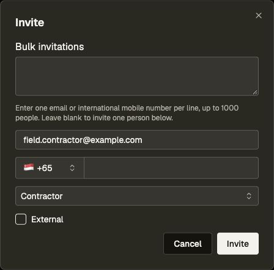

### 2. Locate a site and file its first assignment

A controller opens **Dispatch → Sites** (`/app/field_ops_controller/sites`) and chooses **New**.
Set **Location (required)**, using an address search, a map pin, coordinates or the device's
location. Add **Unit number (optional)** when the work is at a particular unit. The saved site
title comes from the selected location; the unit distinguishes work at that location. There is
no second address to type. **Client / tenant**, **Site type**, **Floor area (sqm)** and a
dispatch-system site code are optional. Saving the same address/unit twice is refused rather
than producing another site.

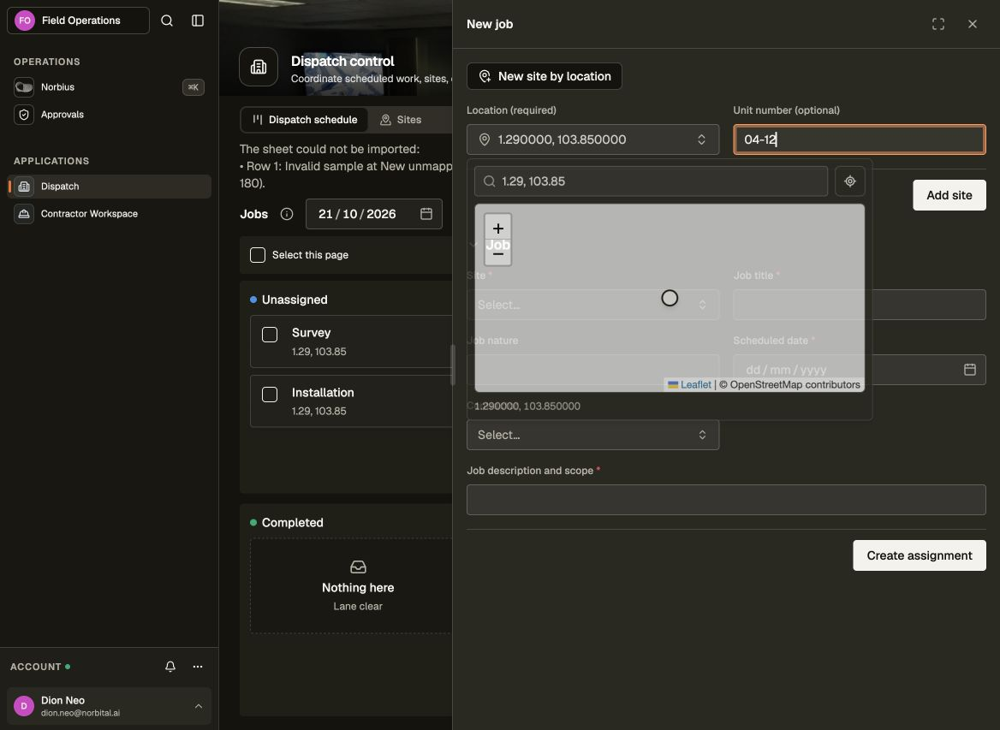

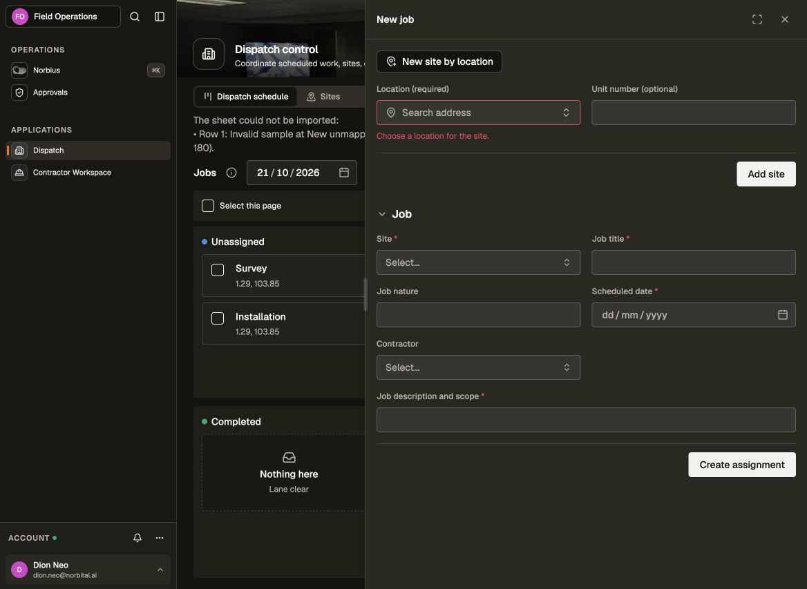

Open **Contractor Workspace → Dispatched jobs** (`/app/field_ops_contractor/jobs`) as a controller
and choose **New**. Supply **Site**, **Job title**, **Scheduled date**, and **Job description and
scope**; **Job nature** and **Contractor** are optional. **New site by location** can create
the location and unit first, using **Add site**, without leaving the assignment form. Select that
site and choose **Create assignment**.

Every new work order is **Pending**. Entering the contractor's email or phone number links the
member who holds it and records **Dispatched at**; a contact no member holds leaves the job without
a contractor, and its board card warns **No contractor linked**. The scheduled date is a Singapore work day;
it is separate from the instant at which dispatch happens.

### 3. Dispatch the day and report progress

The controller opens **Dispatch → Dispatch schedule**
(`/app/field_ops_controller/dispatch`). Choose the dispatch date or **Today**. The date remains
in `?day=YYYY-MM-DD` while opening records. The board groups that day's work into **Pending** and
**Completed**, beside a map of its mapped sites. An empty day has an empty board
and map message; it does not move older unfinished work into today's schedule.

Open a job without a contractor and choose **Edit**. In **Progress**, enter the contractor's email or
phone number, then save. Linking a contractor records the job's first dispatch time; it never
changes the status. A controller can reassign work from this same
section.

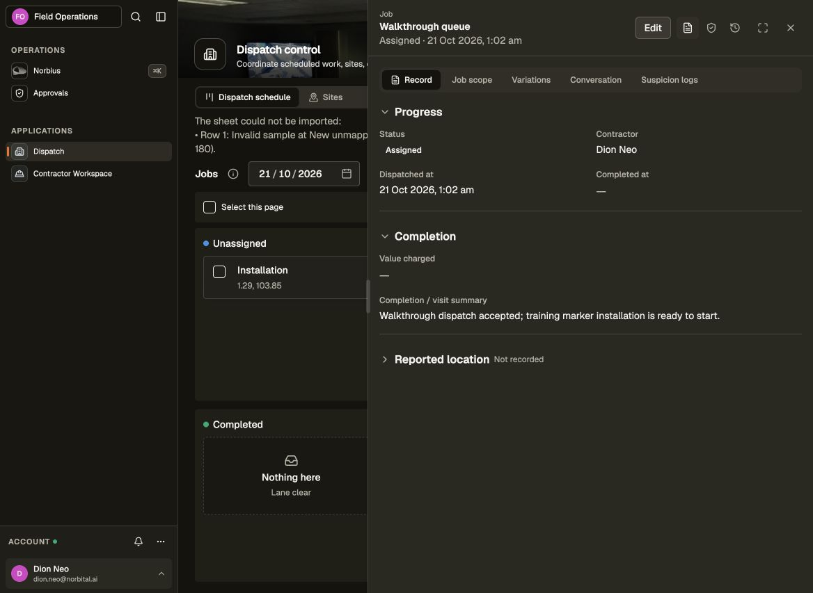

The assigned contractor opens **Contractor Workspace → Dispatched jobs** and sees only their
assignments. Controllers using this page see workspace-wide assignments and a Contractor column.
Use the table's view controls to filter by status and its search to find a job. The **Job scope**
tab retains the site's work order while **Progress** and **Completion** capture the report:

1. Keep **Status** at **Pending** while the work continues.
2. Record **Value charged** and **Completion / visit summary** when available. Expand
   **Reported location** to capture where the report was made.
3. Set **Status** to **Completed** and save when the work is finished. The model supplies
   **Completed at** if it was not entered; later summary edits preserve that completion time.

Contractors can report progress, completion, charged amount and location on their own jobs. Work
order fields and reassignment remain controller operations. A completion report also makes the
assignment eligible for another evidence review; completion does not settle an open finding.

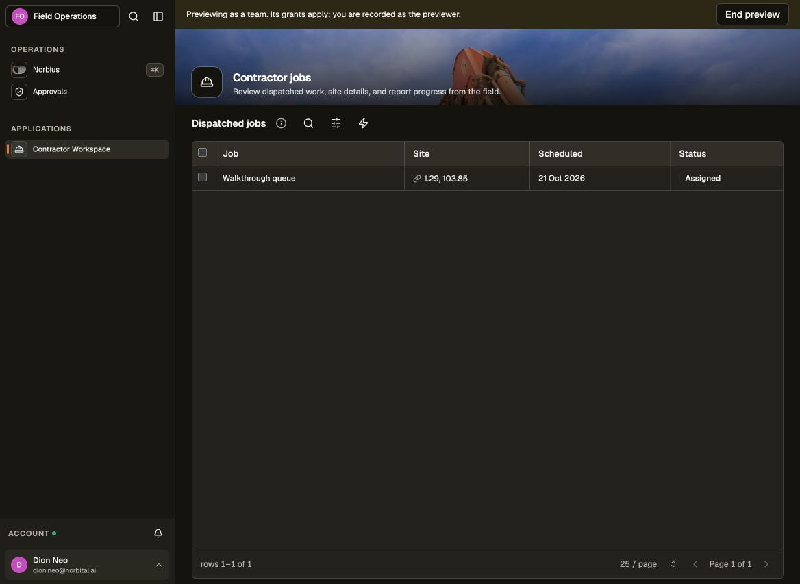

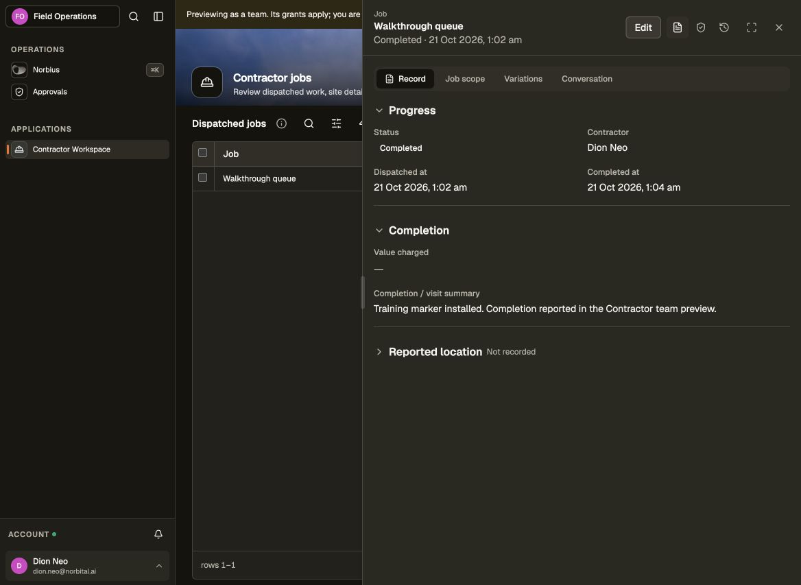

### 4. Review a site's upcoming work and history

Open a site from **Sites** or the dispatch map. **Upcoming jobs** includes future work and
unfinished assignments that are overdue. **Activity history** lists assigned and completed work,
including dispatch/completion times, value charged, reported location and summary. Open a listed
job to inspect its scope, conversation and, as a controller, suspicion records.

Changing a site's Location updates the derived site title. Existing seed sites that have no
location remain readable, but require a Location when edited.

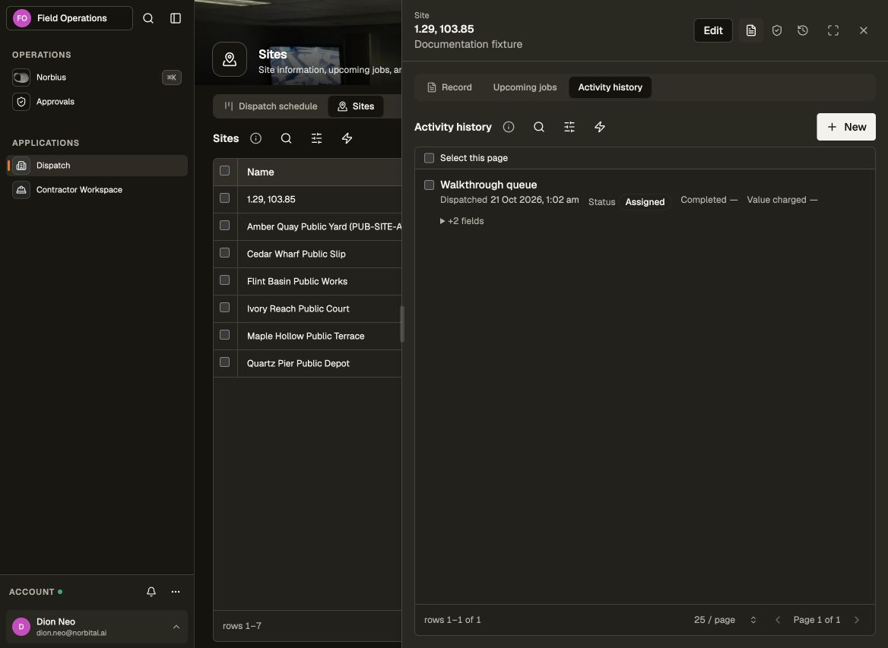

### 5. Import a dispatch sheet

On **Dispatch schedule**, choose **Import** and select a CSV or XLSX. Start with the
[CSV template](assets/job-assignments-import.template.csv) and its
[column reference](assets/job-assignments-import.README.md). Each row needs `site`,
`scheduled_for` (`YYYY-MM-DD`) and `title`. An existing site can be named by code or matching
address and unit. A new site also needs `latitude` and `longitude`; import does not geocode
address text. `unit_number` is optional and overrides a unit embedded in the address. Optional
work-order columns include nature, description, contractor email or phone (`assignee_contact`) and `external_ref`.

The complete sheet is checked before writing. Invalid dates, repeated
references or missing coordinates for new sites produce row-specific errors. Fix the sheet and
import it again. A valid import reports the number of created assignments; select the sheet's
scheduled day to see them on the board. Every row is filed Pending; a contact naming a member
links that contractor, otherwise the card warns that no contractor is linked.

Re-importing the same `external_ref` skips that work order. Without a reference, the same title,
day and site is skipped. A successful repeat therefore creates no duplicate work.

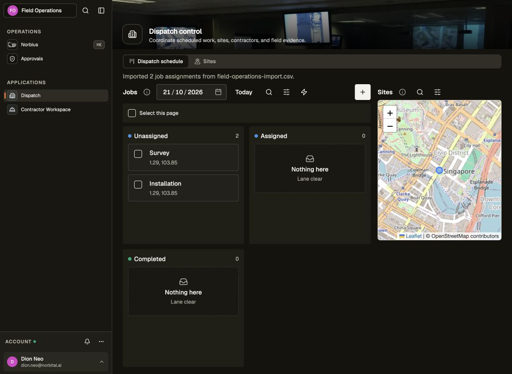


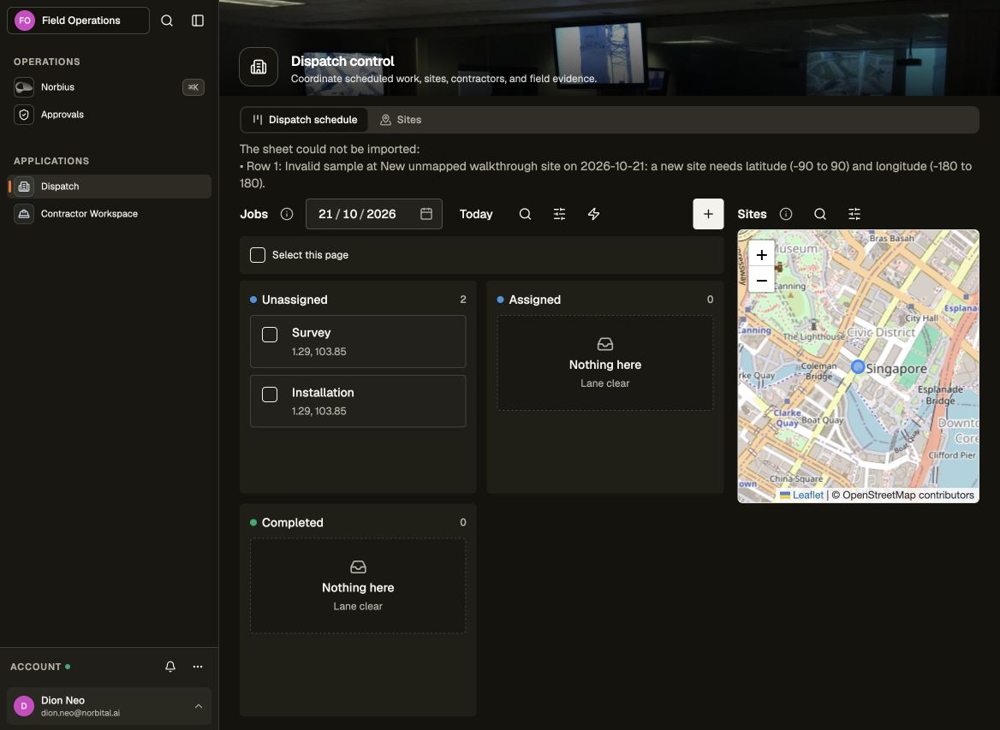

### 6. File photos and inspect the assignment conversation

Create a photo evidence record (`?record=photo_evidence/new`) for a permitted assignment. Select
the assignment and attach a JPEG, PNG or HEIC photo up to 20 MiB. A
workspace upload is labelled as such; the photo's file, parent and provenance cannot be replaced
after filing. Correct a mistaken filing by adding the correct evidence.

The creation form asks only for the parent record and photo. Provenance is supplied by the
system, so there is no required Source field for the person to fill.

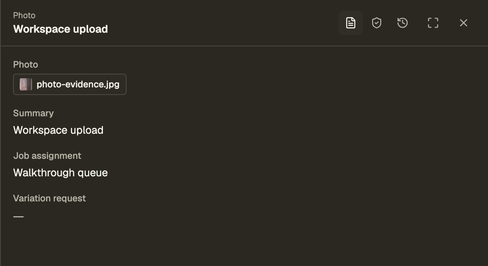

Filing schedules `inspect_photo_evidence` from the photo's effect. A controller reopening the photo sees its
integrity facts: a photo without EXIF GPS shows **Missing geolocation**, and **Matched evidence
ids** stays empty when nothing duplicates it.

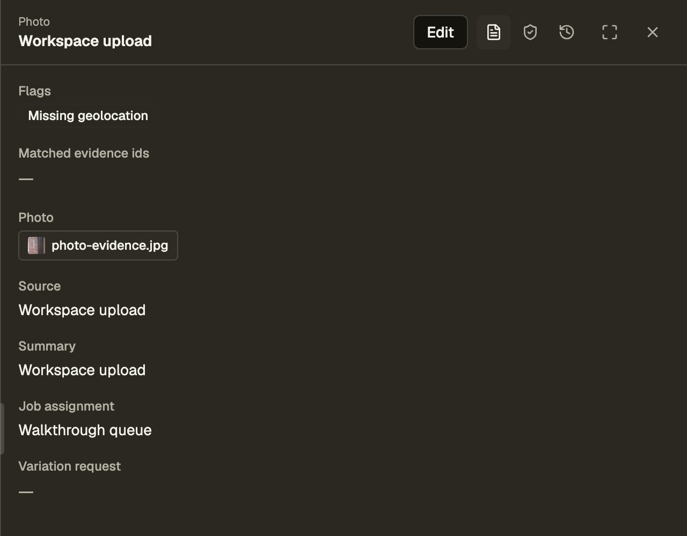

The WhatsApp Envoy can instead file the attachment and its source as part of an assignment
report. It retains the textual messages about that assignment once per provider message. Open
the job's **Conversation** tab to read the messages and photos in time order. Select a photo to
open it at full size; **Latest** returns to the newest item after scrolling away. The timeline
is read-only, and communication records are captured from inbound reports rather than typed
into this tab.

Contractors see their own messages and photos. Controllers also see the source and integrity
facts.

### 7. Review evidence and close a finding

The controller chooses **Suspicion review** on **Dispatch schedule**. The automation inspects
pending photos and reviews unchecked assignments, including completed work. Open
**Command center → Automations** (`/command-center/automations`) to inspect progress, output counts and any
failure. The host needs the workspace's `default` AI model and `scene`/`default` embedding
mappings for the corresponding AI features.

Open a job's **Suspicion logs** tab. **Evidence facts** reports observations such as missing GPS,
photo reuse or a site mismatch. **Similar photos in other assignments** shows comparisons
actually supplied to the review. Select either photo for a larger view. These facts alone do
not mean that the job is suspicious. Every AI decision has a read-only suspicion review with
its reason and **Basis and model**; only a suspicious decision raises an open judgement.

A controller may also create a finding (`?record=suspicious_activity_logs/new`) by selecting
the assignment and supplying a judgement. To close an open judgement, enter the controller's
conclusion under **Resolution** and choose **Resolve**. The saved resolution records who decided
and when. It cannot be reopened or rewritten, and the original evidence basis remains available.
Any other open judgement still requires its own resolution.

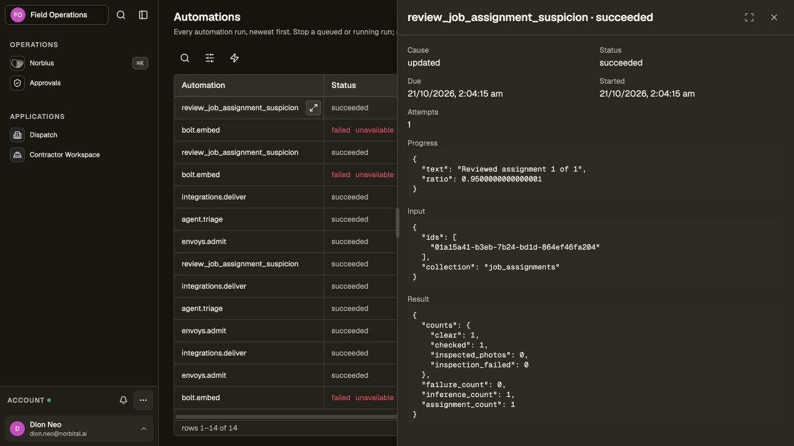

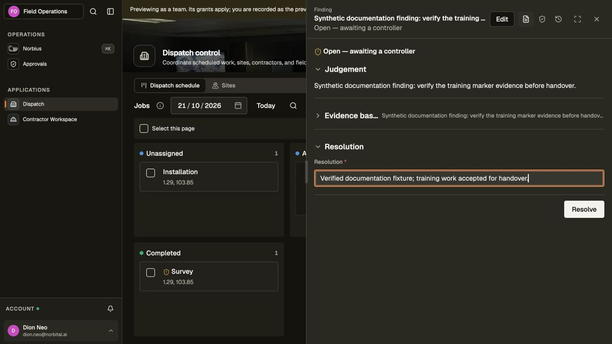

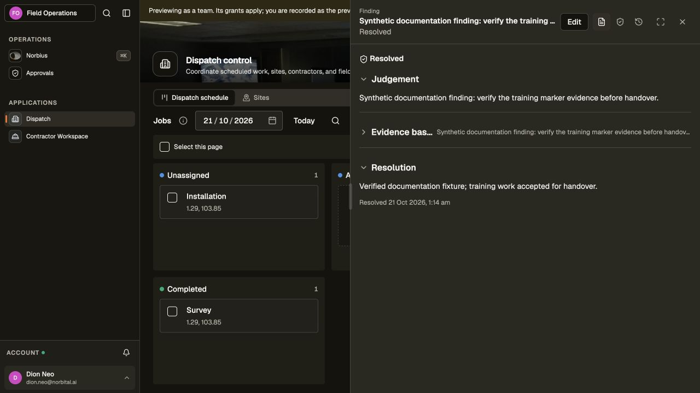

### 8. Hand selected sites to another system

In **Sites**, select one or more rows and choose **Actions → Site handover**. On success the page
reports **Site handover succeeded** with download links; the same output stays on the automation
run under **Command center → Automations**. Each selected site produces three files: a JSON bundle, a job-assignment CSV and a photo-evidence CSV. The JSON
contains the site details and those related records and their photos. File references and integrity facts travel with the evidence; this action exports the
records rather than changing their workflow state.

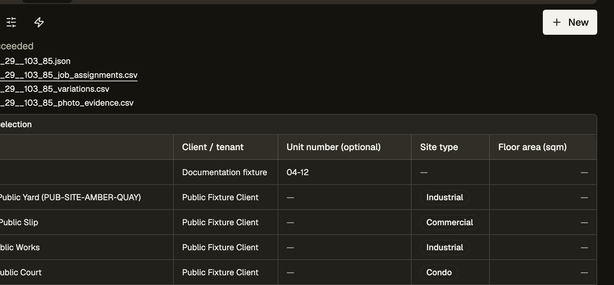

### 9. Connect and operate the WhatsApp Envoy

An administrator opens **More → System → Integrations**
(`/settings/integrations`). Under **Agent channels**, **Norbital · Private** is the
`field_ops_whatsapp` source role. This template already declares its named WhatsApp connection;
use that instance rather than creating another channel for the same Envoy.

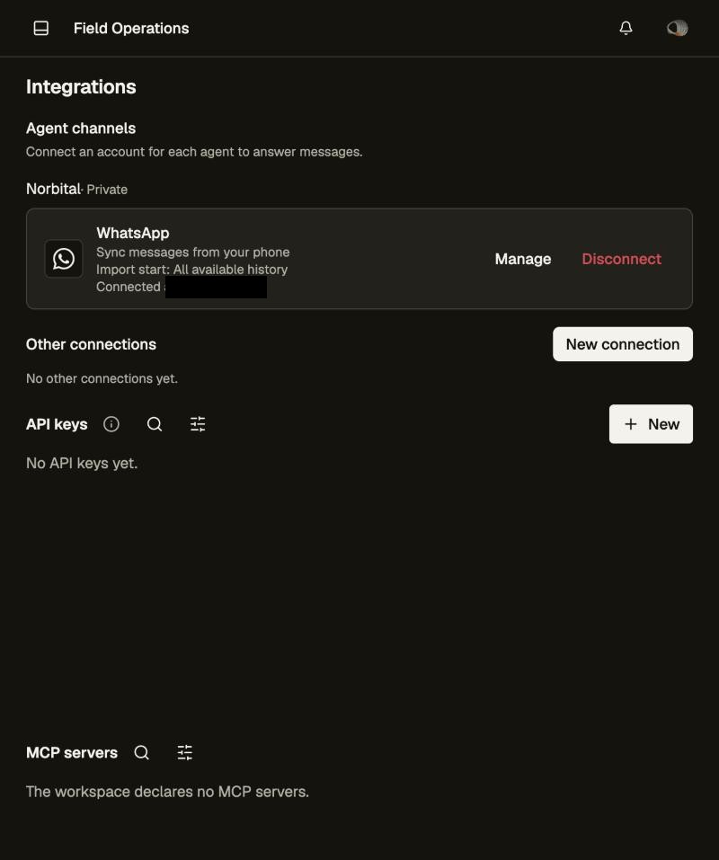

1. For an unpaired WhatsApp channel, choose **Connect**. For an already connected channel,
   choose **Manage**. **Manage** opens that connection's **Connection**,
   **Configuration** and **Messages** tabs; agent connections appear once, above **Other
   connections**. If the host offers
   more than one provider, choose the available provider and follow its displayed steps.
2. For **Unofficial (WhatsApp Web)**, choose **Import start**: **From now**, **Since a chosen
   date**, or **All available history**. This controls which provider history is imported.
   A chosen date begins at midnight in its selected time zone; available history depends on
   what the provider supplies. Keep the existing choice when resuming a paired account.
   Leave **Phone number (optional)** blank and choose
   **Connect** to request a QR code. Scan it with the phone whose number should answer. To
   request a pairing code instead, enter the phone number as digits with the country code
   first, then choose **Connect**. A QR view may also offer **Use a phone number instead**.
   Other providers display their own required credentials and callback instructions. Wait for
   **Connected**, and confirm the displayed account is the intended one.
3. In the instance's **Configuration** tab, verify **Envoy** is **Norbital** and **Active** is
   enabled; **Save** any changes. The source supplies the named connection and its default
   Envoy, while a saved pause survives a rebuild. The connection owns pairing, the deployed Envoy and pause state; the source
   role owns its task, policies and conversation behaviour.
4. Finish the member's Mobile number setup described above. A direct message from an unknown
   number receives the fixed not-recognised notice and does not start a model turn.
5. From a linked member, report the existing job by site and work, for example: “The fixture
   installation at the public yard is complete; the photo is attached.” When a report could
   match several assignments, the Envoy asks which one. It confirms after the update succeeds.
6. Reopen the job to verify its status, summary, photo and **Conversation** entry. Inspect the
   integration's **Messages** tab for inbound/outbound messages, delivery state and errors.

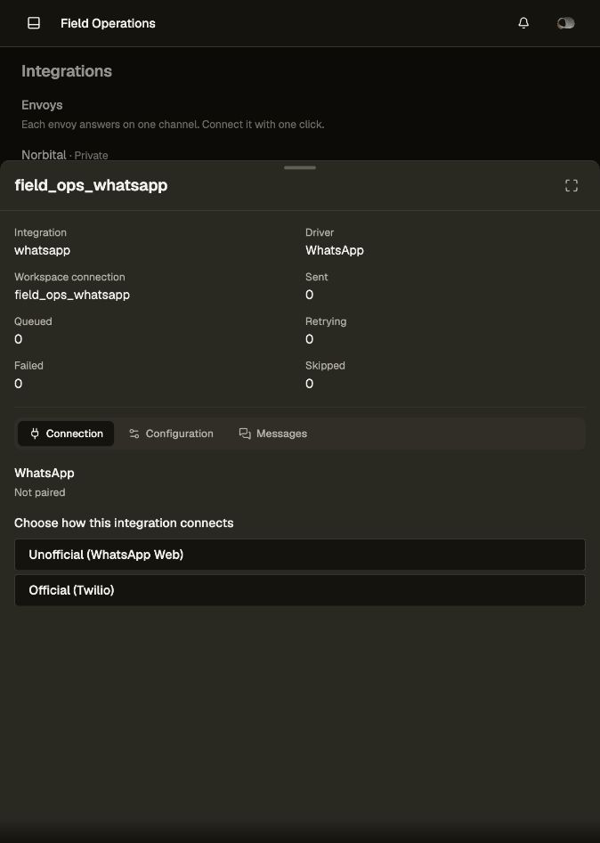

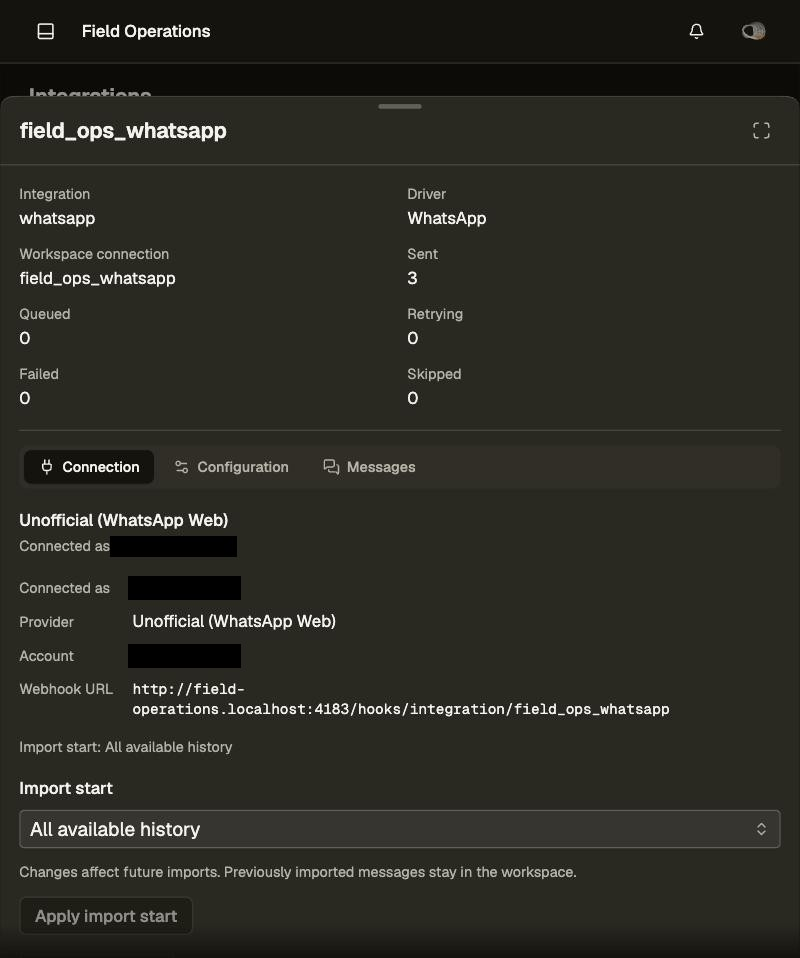

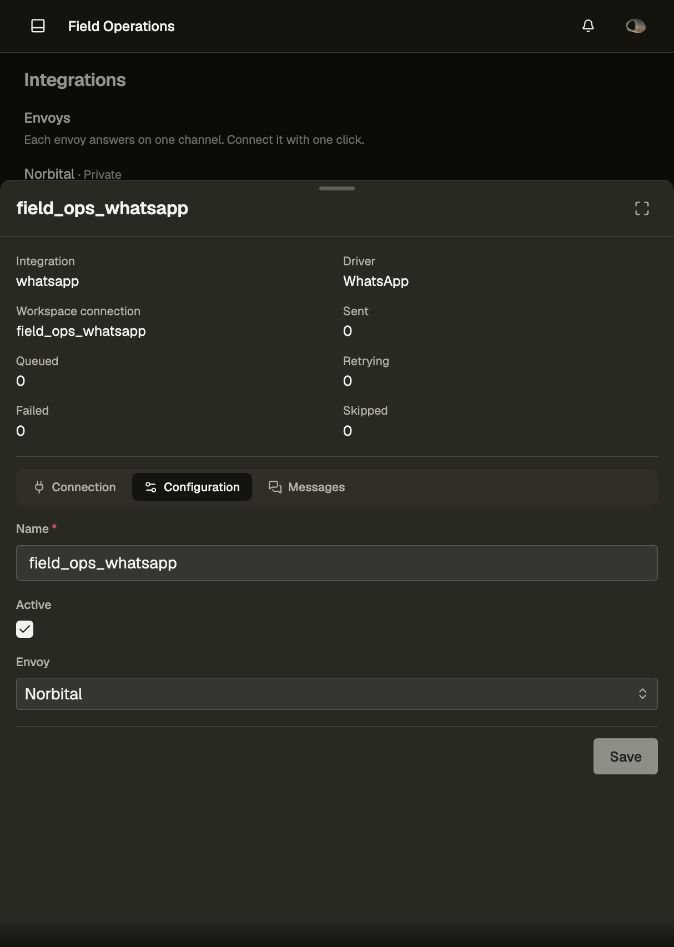

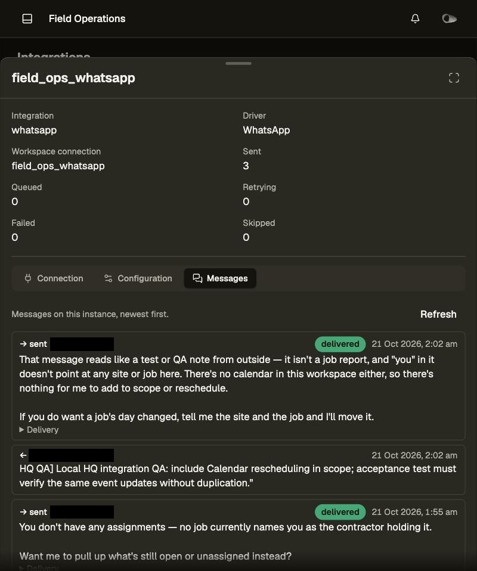

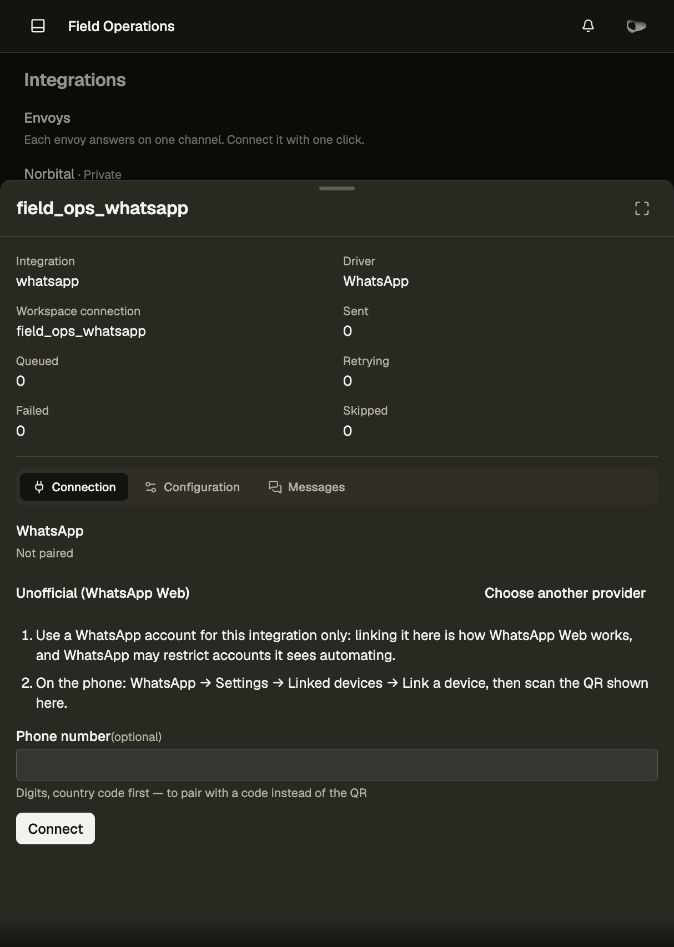

The Envoy's task is to update existing assignments. Its own policy grants no job creation,
deletion or reassignment. A DM combines the linked member's authority with the Envoy's policy,
so a controller or administrator's DM can have broader permissions. A group turn uses only the
Envoy policy, which permits updating any assignment. In groups, a mention or reply is a direct trigger.
This template also enables triage with `triage: {}`, so ordinary linked group messages can be
considered for a response; absence of a mention does not guarantee silence. Delegation is disabled.

Use **Test connection** when the provider offers it, supplying the destination it asks for.
After connecting, use **Manage → Connection → Import start → Apply import start** to change the
boundary for future imports. Previously stored messages remain available.
**Reconnect** repeats setup; **Disconnect** unpairs the session. A source-named connection remains
in the workspace after disconnect. To pause processing, turn **Active** off and save; enable it
again to resume. This private Envoy's Agent transcripts are available to linked members who have
participated in the conversation. A group transcript includes shared group history; it is not
automatically listed for every contractor. Administrators can inspect the integration's raw
messages in **System → Integrations**.

To retain pairing between local sessions, preserve the host's workspace database, file store and
credential-sealing master key together. A new disposable database cannot restore a previous
pairing. Credentials belong to host storage and are never copied into template source or seeds.

The setup screenshots document the local controls and provider choices; pairing codes and
private message contents are excluded. The local walkthrough also verified a real phone pairing,
a linked member's inbound assignment query and its Envoy reply, and reconnection from saved
local state without a new QR code. Automated Envoy tests
use a fake WhatsApp link and scripted model; they validate admission, authority, message/photo
filing and receive limits. Those tests do not establish real-provider delivery of every report
or attachment scenario.

### Envoy probe results (local, 21 October 2026)

Manual probe of the persistent local workspace (`bun run env -- serve --template=field-operations
--port=4183`, origin `http://field-operations.localhost:4183`), signed in as the founder
administrator. Phone numbers and names are covered with solid boxes.

| Probe                                           | Steps                                                                                                                                | Result                                                                                                                                                                                                                                                                                                                                                                                                            |
| ----------------------------------------------- | ------------------------------------------------------------------------------------------------------------------------------------ | ----------------------------------------------------------------------------------------------------------------------------------------------------------------------------------------------------------------------------------------------------------------------------------------------------------------------------------------------------------------------------------------------------------------- |
| 1. Envoy configuration                          | **System → Integrations** → **Norbital · Private** → **Manage**: Connection, Configuration, Messages.                                | **PASS.** WhatsApp shows **Connected** with **Manage**/**Disconnect**; **Configuration** has **Envoy: Norbital**, **Active** on. The server was restarted (normal `serve`, auto-resumed saved state) after pairing and came back Connected with no new QR code.                                                                                                                                                   |
| 2. Envoy conversation                           | A linked member DMs the paired number “What assignments do i have?”; open **Norbius → conversation list → Norbital (DM)**.           | **PASS (existing turn).** The transcript shows two `Read job assignments` steps and a reply that no assignment names the sender as its contractor, which matches the data. The turn was sent before this probe; no new message could be sent during it.                                                                                                                                                           |
| 3. Envoy actions (status update / photo report) | DM a report naming an assigned job (“…is complete; photo attached”), then reopen the job's record, **Conversation** tab and history. | **NOT RUN.** No WhatsApp client for the linked member's number was available to the probe.                                                                                                                                                                                                                                                                                                                        |
| 4. Policy boundary                              | DM a request outside the Envoy policy and verify refusal.                                                                            | **NOT RUN** (same reason). For a DM, the linked member's own authority is added to the Envoy policy (`dm: 'union'`), so a test of the policy alone needs a contractor-only member or a group turn. The policy itself grants read and status/summary updates on **any** assignment, so asking about another person's assignment is allowed, not refused. A boundary test asks to create, delete or reassign a job. |

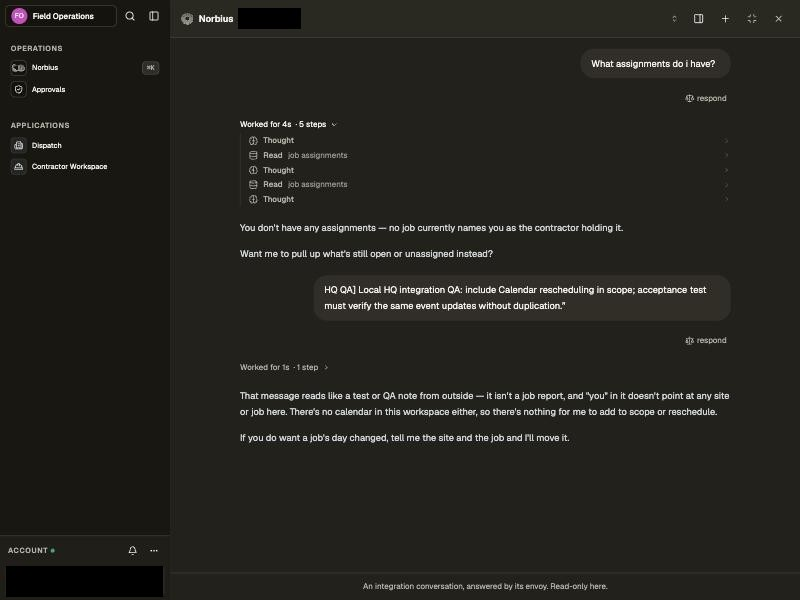

To finish probes 3 and 4, send from the linked member's own WhatsApp to the paired number:
(a) a completion report with a photo for a job assigned to that member, then verify status,
summary, photo and **Conversation** on the job and the Envoy as actor in its history; (b) from a
contractor-only member, “Reassign <job> to someone else” or “Delete <job>”, and verify the reply
refuses and nothing changes.

## Data model

```text
site → job assignment → user (the assignee)
             ↓
       photo evidence
       communication logs   (immutable inbound messages, one per assignment)
```

- **site** — a physical site with client context, a required location and an optional unit number.
  Its label is derived from the selected location; legacy seed sites without coordinates remain
  readable until edited. Past jobs remain attached to the site.
- **job_assignments** — one dispatched day job: the work order (site, day, title, nature,
  description, the dispatch system's reference) and the contractor who holds it, in one row.
  `assignee_user_id` is `user.id` directly — a contractor is a **role**, not a record, a user whose
  team holds `field_ops_contractor` — linked from `assignee_contact` (the contractor's email or phone) and null when no member holds it.
  Controllers file work orders in the dashboard or import them from a sheet; `external_ref` is the
  dispatch system's reference when a sheet carries one (unique, so a re-imported sheet files nothing
  twice) and `source_message_id` is the WhatsApp message the dispatch came from. Status runs `pending` →
  `completed`; whether the work was legitimately done is a suspicion question and is
  never stored on this row (`suspicion_checked_at` is the only suspicion-adjacent column, written by
  the review automation after a run).
- **photo_evidence** — one explicitly filed photo attached to one assignment, with deterministic integrity facts. Channel history and attachments are stored
  separately by the platform; the assignment's message **content** is retained in
  `communication_logs`.
- **communication_logs** — the contractor's inbound messages about one assignment, immutable, one
  row per provider message (idempotent on `source_message_id`), retained independently of agent
  transcripts. The suspicion review reads them.
- **suspicion_reviews** — one audit row per AI review of one assignment's evidence basis, including
  clear decisions; controller-only.
- **suspicious_activity_logs** — an AI or authorized-human suspicion judgement against one
  assignment: an immutable evidence basis, the reason, and an explicit controller resolution that
  is the only way a log closes.

## Automations and integrations

| Automation                        | Trigger                                                          | What it does                                                                                                                 |
| --------------------------------- | ---------------------------------------------------------------- | ---------------------------------------------------------------------------------------------------------------------------- |
| `inspect_photo_evidence`          | scheduled by `photo_evidence.effect.created`                     | Fills each pending photo's SHA-256, PDQ and scene embeddings, integrity flags and near-duplicate matches                     |
| `review_job_assignment_suspicion` | scheduled by `job_assignments.effect`; manual by `assignment_id` | Inspects photos still pending, then reviews every unchecked assignment with AI; logs a suspicion only when judged suspicious |
| `site_handover`                   | manual, selected sites                                           | One JSON file per site (site, jobs, photo evidence) plus a CSV per table, for another system                                 |

### Photo integrity

The host's `ctx.files.image` decodes each photo (JPEG, PNG, HEIC), hashes it (SHA-256 and Meta PDQ)
and reads EXIF; `src/lib/photo-integrity.ts` decides what counts as a duplicate, an anomaly or a
mismatch. A row is born uninspected (empty hash, zero vector). A photo the host cannot read records
`inspection_failed_at` and `inspection_failure_reason` once, is never picked again, and takes no
visual slot. The selected asset, parent and source provenance are immutable: correcting a filing
requires new evidence so every check runs again.

- **Duplicates.** The 256-bit PDQ hash is stored as a 256-dim 0/1 `perceptual_embedding` (L2 metric,
  so L2 distance is √Hamming). The model's `pdq` search index finds near-duplicates within √31
  (PDQ Hamming 31) as `visual_duplicate`; a byte-identical file under another assignment is
  `exact_duplicate`. Both carry `matched_evidence_ids`. A match inside the photo's own assignment is
  a neutral repeat.
- **Geolocation.** EXIF GPS is compared with the job site's map location (500 m tolerance): no GPS is
  `missing_geolocation`, capture beyond tolerance `location_mismatch`.
- **Flags are evidence, not a verdict.** `metadata_anomaly`, `edited_metadata` and `low_quality` are
  also noted. Missing GPS is neutral on its own because WhatsApp commonly strips EXIF; reuse and a GPS
  mismatch are strong signals but never suspicion by themselves. Nothing on the photo row latches
  `suspect`: the judgement belongs to the review and lives in `suspicious_activity_logs`.
- **Scene reuse.** PDQ cannot separate a crop of the same scene from an unrelated pair, so inspection
  also embeds the photo (`ctx.ai.embed` with the `scene` model) into `scene_embedding`, and the
  `scene` search index ranks by cosine. Both indexes read the vector fields the inspection writes
  (`search.indexes` with `vector: '<field>'`), since image facts need the host. The host maps the
  `scene` embedding model; the review context
  reports `scene_embedding_photos` so a review taken without it is visible rather than silently clear.

### The suspicion review

`review_job_assignment_suspicion` pages through every unchecked assignment, including completed
work, and assembles the assignment, its job and site, the deterministic photo facts and bounded recent
`communication_logs`. It passes a bounded visual sample (up to three photos, deterministic selection
weighted by signal, capped at 4 MiB) plus a text context to the workspace's `default` model. Every
review — the canonical basis hash, verdict, model and reason — lands in `suspicion_reviews`, so clear
decisions are auditable too; a `suspicious` verdict appends an idempotent `suspicious_activity_logs`
row. The assignment's `suspicion_checked_at` is stamped only after inference and durable review
persistence succeed, and any other change to the assignment clears it, so the next run judges the
new evidence. A failed review stamps nothing and is retried at the next two-hour slot; the run output
reports assignments, inference invocations and failures. Only a controller's stated resolution closes
a log. The review calls no tools and reads no web page: its inputs are tenant rows and stored photos.

### The WhatsApp envoy

`field_ops_whatsapp` is a conversational entry point for contractors who already have an active
workspace account. Its source role is `src/agent/envoy/+field_ops_whatsapp.envoy.ts`, deployed
on the named WhatsApp instance in `src/+workspace.ts`. Pairing and pause belong to that runtime
instance. An administrator records the contractor's WhatsApp number on that account
(Command center → People); an unknown number is told it is not recognised and gets no model run.

The envoy's whole job is to bring a contractor's **existing** assignments up to date from what
they send. One report is one update on the assignment it is about, carrying:

- the progress it reports — `status`, `completed_at`, `summary`;
- `photo_evidence.create` — one row per photo sent, its file and the message
  `source` (conversation, message, attachment, sender, time) that delivered it;
- `communication_logs.create` — the messages with text that are this assignment's slice
  of the conversation, keyed by the WhatsApp message id so each change traces to its message.

Each filed photo's own create callback stamps it uninspected (as a direct upload is), and the
assignment's update callback clears `suspicion_checked_at`, so the review picks the assignment up
on its next run.

The envoy's authority depends on the conversation:

- **The declared `field_ops_whatsapp` policy** reads assignments, updates
  `status`, `completed_at` and `summary` on any one, and files new photo and message rows under it;
  a group turn runs under this policy alone, so any admitted member's group report may update any
  assignment. The policy grants no assignment creation, deletion or reassignment, work-order
  changes, evidence or log reads, reviews, suspicion data or apps.
- **A DM joins the linked member's own authority** to the envoy's policy; a group turn holds
  the envoy's policy alone, whoever sent the message. A linked controller or administrator may
  therefore bring broader permissions into their DM than the envoy policy itself declares.
- **The private Envoy's Agent transcripts require participation.** Linked members who have
  participated can open their conversation, including a group's shared history. Assignment to a
  job does not itself list that group transcript. Administrators inspect raw channel messages
  through the integration instance.

The `field_ops_whatsapp` connection in `src/+workspace.ts` names an instance of Bolt's built-in
`whatsapp` integration; an administrator pairs it under **System → Integrations**, and the host's
WhatsApp provider holds its paired session and delivers inbound messages, each stored once. The
envoy role `src/agent/envoy/+field_ops_whatsapp.envoy.ts` supplies the policies; the instance's
envoy field (`sys_integration.envoy`) deploys it there. Bolt matches each sender to the registered
mobile number on an active member's account. A private DM joins the linked member's current authority
(the default `dm: 'union'`); a group turn uses the envoy's policy alone. Source teams and native
member admission determine authority, not a sender-supplied identity or team label.
The model sees each message's time, sender and id, and each attachment's stored file, which is
what it files on the assignment. The reply goes back through the same instance.

## Source layout

```text
src/
├── +workspace.ts                   Asia/Singapore, SGD, the app order, the AI model classes, the field_ops_whatsapp connection
├── data/
│   ├── model/<m>/                  +model.ts (fields and refs, exposure, write callbacks, actions, search indexes) and +representation.svelte
│   └── custom_field/photo_source/  where a photo came from: workspace upload or a WhatsApp message
├── access_control/                 policy/: the four +<name>.policy.ts; team/+team.ts
├── agent/                          +agent.md
├── agent/envoy/                    +field_ops_whatsapp.envoy.ts
├── automation/                     inspect_photo_evidence, review_job_assignment_suspicion, site_handover
├── app/                            field_ops_controller (dispatch, sites) and field_ops_contractor (jobs)
├── i18n/                           +messages.ts, +zh.messages.ts
└── lib/                            site keys, photo rules, the review, the sheet import, csv/xlsx readers
seed/                               +seeder.ts reads the private bank tree `field-operations`
```

Apps are deliberately thin because the work happens inside a record: opening an assignment brings up
its job scope, activity, and photo evidence together; opening a site separates upcoming
work from activity history. Each model's `+model.ts` declares what a caller may submit, and its
`create.transform`, `update.transform` and `delete.check` carry the domain rules, so they apply to
every client, function, and agent — not only the UI:

- A dispatched job must reference an existing site. Every job is `pending` until `completed`; a
  contractor contact links the member holding that email or phone and stamps the dispatch time.
- `external_ref` is an imported job's dispatch-system reference and `source_message_id` the
  WhatsApp message's; both are unique idempotency keys.
- A reported location beyond the site tolerance is recorded as an evidence fact and never sets
  `suspect`; completion is stamped by the model's own update callback.
- Photo evidence: JPEG/PNG/HEIC, exactly one parent, fingerprints and integrity flags recorded by
  inspection; its asset, parent, and provenance cannot be swapped after filing.
- Communication logs and suspicion reviews declare no `update` and no `delete`: immutable by
  construction. A suspicion log's judgement is not an update input; only its resolution is.

## Seed

No public rows: a new workspace starts empty. `seed/+seeder.ts` names the seed bank's private tree
`field-operations`, whose rows `bolt seed --bank=<checkout>` loads into a demo environment as they
are, every photo with its JPEG as an asset, and starts `review_job_assignment_suspicion`. The
bank treats transcript job reports and their textual photo references as authoritative; it never
reparents a simulated wrong-site photo, since those contradictions are what this template detects.

The job-assignment import CSV template and its column reference live in `assets/`
([job-assignments-import.README.md](./assets/job-assignments-import.README.md)).

## Checks

```bash
bun install
bunx bolt check   # types, Svelte warnings, layout and declarations
bun run test       # bolt test: builds the template standalone, then the suite and the mounted app sweep
```

Use the private bank checkout read-only. `.norbital/` is generated and never committed. Schema
changes generate an editable SQL migration under `migrations/` and verify the complete history
against the declaration. Commit the SQL, `snapshot.json` and `migrations.lock.json` together.
