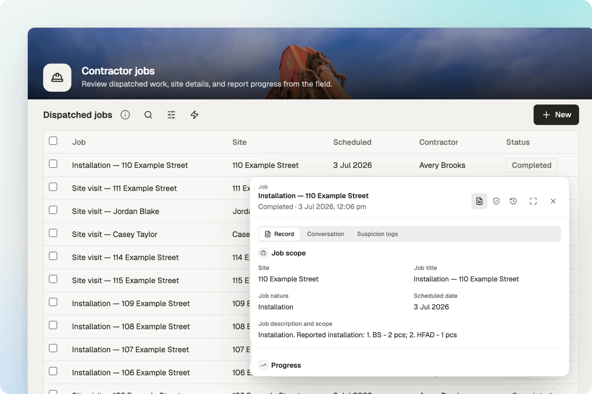

# Field Operations



A focused field-dispatch and site-evidence verification workspace. Controllers schedule dated site jobs,
assign contractors, monitor progress on a live kanban and site map, and verify photographic proof of work
through deterministic integrity checks and bounded AI suspicion reviews — without cluttering dispatch
with costing or payroll.

## Key capabilities

- **Daily dispatch board & route planner:** Group a day's jobs into **Pending** and **Completed** beside
  an interactive site map, plan multi-stop routes (up to 5 stops with Google Maps handoff), and bulk-import
  work orders from CSV/XLSX with full pre-write validation and deduplication.
- **Role-scoped contractor workspace:** Contractors view and report progress, charged value, location and
  evidence photos only on their own assignments — integrity flags and suspicion logs remain strictly hidden
  from field staff.
- **Mechanical photo integrity checks:** Every uploaded photo (JPEG, PNG, HEIC up to 20 MiB) is
  automatically inspected for SHA-256 exact duplicates, 256-bit PDQ perceptual near-duplicates, `scene`
  vector reuse, EXIF GPS distance against the site (500 m tolerance), and metadata anomalies.
- **Auditable AI suspicion review:** `review_job_assignment_suspicion` evaluates unchecked jobs using
  their photo facts, visual sample and inbound messages, logs every verdict in immutable
  `suspicion_reviews`, and opens `suspicious_activity_logs` findings that only a controller can resolve.
- **WhatsApp Envoy & site handover:** Contractors report completions and photos through a private
  WhatsApp Envoy (`field_ops_whatsapp`), and controllers export selected sites as JSON + CSV handover packs.

## Apps and roles

| App                                               | Pages                    | Audience                                                  |
| ------------------------------------------------- | ------------------------ | --------------------------------------------------------- |
| **Dispatch** (`field_ops_controller`)             | Dispatch schedule, Sites | `Field Operations Controllers`, `Contractor (Controller)` |
| **Contractor Workspace** (`field_ops_contractor`) | Dispatched jobs          | `Contractor` (own jobs), controllers (all jobs)           |

- **Controllers (`field_ops_controller`)** manage sites, assignments, imports, reviews, resolutions and
  handover exports; audit ledgers (`communication_logs`, `suspicion_reviews`, `suspicious_activity_logs`)
  are append-only.
- **Contractors (`field_ops_contractor`)** read assigned sites and update progress or upload photos on
  their own jobs (`assignee_user_id = actor.id`), with zero visibility into integrity or suspicion fields.
- **WhatsApp Envoy (`field_ops_whatsapp`)** updates status/summary and files photos/messages on existing
  assignments without permission to create, delete or reassign work or read integrity results.

## Data model

6 models in one site-rooted hierarchy:

- `sites` — physical locations (required map coordinates, optional unit number, derived title).
  - `job_assignments` — dated work orders linked to a member by `assignee_contact` (`pending` →
    `completed`, idempotent `external_ref` / `source_message_id`).
    - `photo_evidence` — immutable uploaded photos (using `photo_source` custom field) with SHA-256, PDQ
      and scene vectors, EXIF facts and integrity flags.
    - `communication_logs` — immutable inbound WhatsApp/message reports per assignment.
    - `suspicion_reviews` — immutable audit rows for every AI review verdict.
      - `suspicious_activity_logs` — open judgements closed only via explicit controller resolution.

## Automations and integrations

| Automation                           | Trigger                              | Purpose                                                                                           |
| ------------------------------------ | ------------------------------------ | ------------------------------------------------------------------------------------------------- |
| `inspect_photo_evidence`             | `photo_evidence` create effect       | Computes SHA-256, PDQ & scene embeddings, EXIF geolocation checks and cross-job duplicate matches |
| `review_job_assignment_suspicion`    | `job_assignments` effect; manual run | Inspects pending photos, runs multimodal AI review, writes `suspicion_reviews` and open findings  |
| `job_assignments_import_work_orders` | Manual (CSV/XLSX import)             | Validates and imports dispatch work orders idempotently                                           |
| `suspicious_activity_logs_resolve`   | Manual (controller resolution)       | Stamps immutable controller decision and closes an open suspicion log                             |
| `site_handover`                      | Manual (selected sites)              | Exports per-site JSON bundle plus job-assignment and photo-evidence CSV files                     |

WhatsApp reporting uses Bolt's built-in `whatsapp` integration paired to a `sys_envoy` row holding
`field_ops_whatsapp`.

## Getting started

```bash
bun install --frozen-lockfile
bunx bolt check
bun run test
bunx bolt build
```

A fresh workspace starts empty; invite controllers and contractors under **Command center → People** and
optionally configure the WhatsApp Envoy under **Settings → Envoys**.

- [Documentation index](docs/README.md)
- [Operator guide](docs/operator-guide.md) (walkthrough, photo integrity, suspicion review, WhatsApp Envoy setup)
- [Dispatch import template](assets/job-assignments-import.template.csv) and [column reference](assets/job-assignments-import.README.md)
- [Source reference](docs/source-reference.md)
