# Field Operations

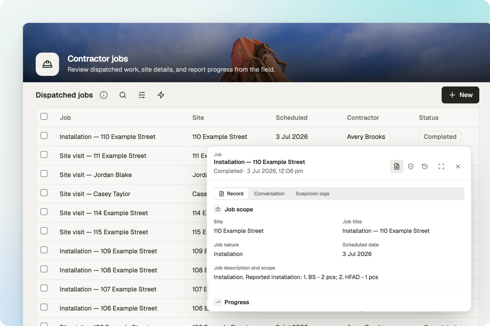

Field Operations 是一个面向建筑现场作业的工作区：为工地排期任务、向承包商派单、跟踪现场进度，并收集照片证据，其完整性由机械化规则检查。它刻意保持专注——不涉及项目成本核算、薪资或项目组合管理。

问题在于：现场服务工作需要在正确的日期把正确的人派到正确的工地，而证明工作已完成的证据必须可信。一张工地照片本身并不构成证据——同一张照片可能被重复使用，照片可能拍摄于别处，而且除非照片中能辨认出工地身份，否则它无法说明拍的是哪个工地。

Field Operations 的解决方式是：先有一条派单流水线（工地 → 任务 → 承包商），再接一条证据流水线（逐张照片的完整性检查、地理定位，以及一次有界的 AI 可疑审查，其发现由调度人员处理）。

## 应用与角色

| 应用                   | 使用者                              | 提供的功能                                                                                                                                                    |
| ---------------------- | ----------------------------------- | ------------------------------------------------------------------------------------------------------------------------------------------------------------- |
| `field_ops_controller` | 派单 / 运营人员（BCA 调度人员看板） | 按日期排列的派单排期（按状态分列的看板，旁边是工地地图）、可疑审查面板、任务分配 CSV 导入，以及工地标签页。                                                   |
| `field_ops_contractor` | 现场承包商                          | 一张列出自己任务分配的表格：任务 · 工地 · 计划日期 · 状态（派单人员还会看到承包商列）。打开一行可查看任务范围、进度、派单时间、位置、任务分配动态和证据照片。 |

标记仅在调度人员看板中可见：照片完整性标记、审查台账以及可疑记录的每个字段只对调度人员呈现。承包商只能看到自己任务分配的进度和自己的证据照片——永远看不到完整性检查结果。

调度人员看板直接从同步支撑的模型中读取任务分配、人员、工地和未处理的可疑记录。其看板卡片和地图点位是这些行的本地投影，因此无需远程查询处理器或刷新控件即可保持实时。

团队（`src/access_control/team/+team.ts`，标识 `field_ops_controllers`、`contractor_controllers`、`contractors`）：**Field Operations Controllers** 和 **Contractor (Controller)** 持有 `field_ops_controller`；**Contractor** 持有 `field_ops_contractor`。承包商是一种角色，而不是一条记录：即所在团队持有 `field_ops_contractor` 的用户。

| 策略                          | 授予的权限                                                                                                                                                                                  |
| ----------------------------- | ------------------------------------------------------------------------------------------------------------------------------------------------------------------------------------------- |
| `field_ops_controller`        | 完全掌控各项运营记录和两个应用；审计台账（沟通、审查、可疑记录）只能追加。                                                                                                                  |
| `field_ops_contractor`        | 按请求者限定范围的授权：被分配的工地及其已派单任务；自己的任务分配（`contractor` 输出 + 限定范围的 `update`，`assignee_user_id = actor.id`）；自己的证据（`contractor` 输出 + `create`）。  |
| `field_ops_whatsapp`          | WhatsApp 使者声明的策略：读取工地和任务分配；更新任一任务分配的状态、完工情况和摘要；在其下提交新的照片和消息行。此策略不授予其他任何写入、删除、证据或日志读取、审查、可疑数据或应用权限。 |
| `suspicion_review_automation` | 审查自动化的权限：其检查的照片库（未检查照片的事实，或为已计算哈希但缺少场景的照片补填场景）、只能追加的审查记录和可疑记录，以及结束审查的唯一 `suspicion_checked_at` 时间戳。              |

## 操作演练

以下路径均相对于工作区。例如，托管工作区会在 `/app/field_ops_controller/dispatch` 前加上其工作区标识。打开记录会在当前页面添加 `?record=<model>/<id>`；`new` 会打开创建表单。关闭记录后返回所在的看板或表格。

| 流程           | 操作者                 | 入口与结果                                                                    |
| -------------- | ---------------------- | ----------------------------------------------------------------------------- |
| 准备人员       | 管理员                 | **指挥中心 → 人员**：接纳活跃成员并选择其源码团队；为 WhatsApp 保存手机号码。 |
| 登记工地和任务 | 调度人员               | **工地 → 新建** 或 **派单任务 → 新建**：定位工地，然后创建带日期的任务分配。  |
| 派单与进度     | 调度人员，然后是承包商 | **派单排期** 和任务的 **进度** 部分：分配承包商、报告工作并完成。             |
| 导入派单工作   | 调度人员               | **派单排期 → 导入**：校验 CSV/XLSX，每个新工单只登记一次。                    |
| 提交并检查证据 | 承包商、使者和调度人员 | 照片记录或 WhatsApp 报告，然后查看任务的 **对话** 和 **可疑记录** 标签页。    |
| 审查与处理     | 调度人员               | **可疑审查**，然后 **处理**：检查证据依据并记录调度人员的结论。               |
| 移交工地       | 调度人员               | **工地 → 工地移交**：从自动化运行中下载所选工地的 JSON 和 CSV 输出。          |
| 配置使者       | 管理员                 | **设置 → 使者**：创建使者，从其卡片连接 WhatsApp，并查看其消息。              |

### 1. 准备负责派单和执行工作的人员

管理员打开 **指挥中心 → 人员**（`/command-center/people`），通过邮箱或国际格式手机号码邀请成员，并选择一个现有团队。派单人员使用 **Field Operations Controllers**，只应看到自己工作的现场人员使用 **Contractor**，若此人同时负责本工作区的派单则使用 **Contractor (Controller)**。保持该成员为 **启用**。团队定义来自源码；人员页面把这些角色分配给具体的人。

对于 WhatsApp，打开该成员，以国际格式输入其 **手机号码**，然后按 **保存**。发送人的号码必须与这个活跃账户一致。任务通过作为承包商联系方式输入的邮箱或电话号码关联到该工作区成员，而不是通过单独的承包商记录或显示名称。

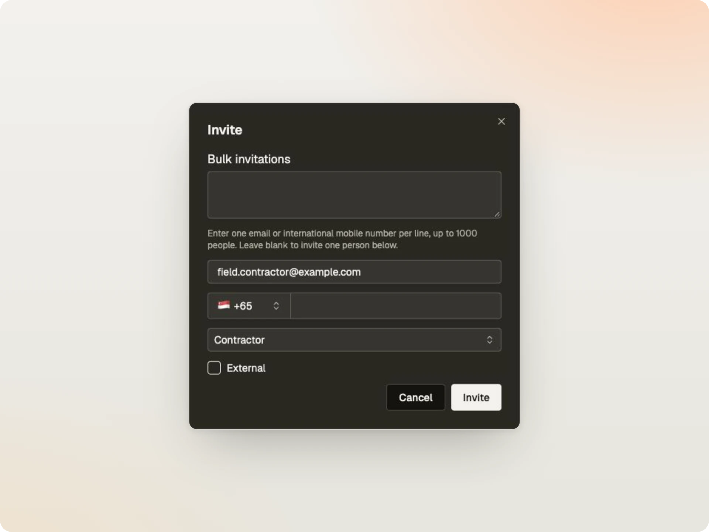

### 2. 定位工地并登记其第一个任务分配

调度人员打开 **调度 → 工地**（`/app/field_ops_controller/sites`）并选择 **新建**。设置 **位置（必填）**，可使用地址搜索、地图图钉、坐标或设备位置。若工作位于某个特定单元，添加 **单元号（选填）**。保存后的工地标题来自所选位置；单元号用于区分同一位置的工作。无需再输入第二个地址。**客户 / 租户**、**工地类型**、**建筑面积（㎡）** 以及派单系统的工地编码均为选填。重复保存相同的地址/单元会被拒绝，而不会生成另一个工地。

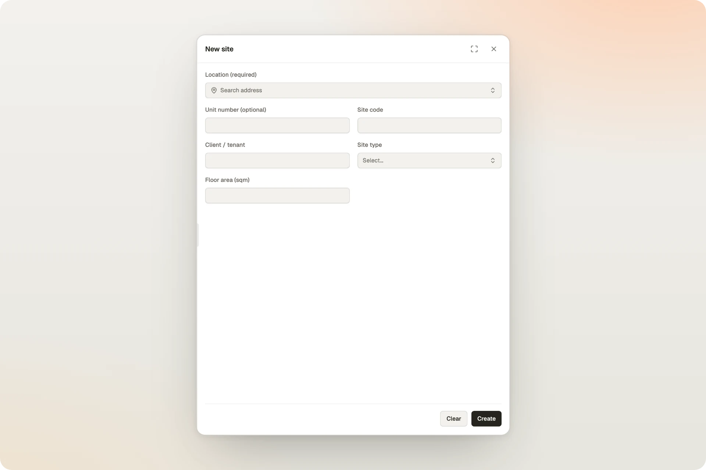

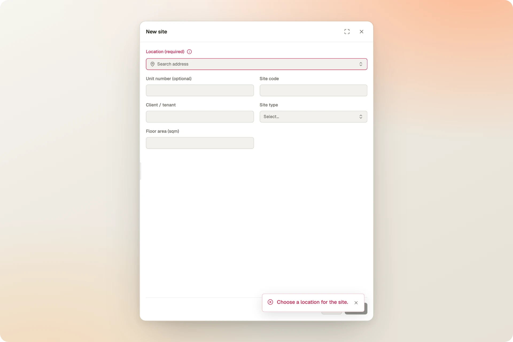

以调度人员身份打开 **承包商工作区 → 派单任务**（`/app/field_ops_contractor/jobs`）并选择 **新建**。填写 **工地**、**任务标题**、**计划日期** 和 **任务描述与范围**；**任务类型** 和 **承包商** 为选填。**按位置新建工地** 可以先通过 **添加工地** 创建位置和单元，无需离开任务分配表单。选择该工地后点击 **创建分配**。

每个新工单的状态都是 **待处理**。输入承包商的邮箱或电话号码会关联持有该联系方式的成员并记录 **派单时间**；若没有成员持有该联系方式，任务就没有承包商，其看板卡片会提示 **未关联承包商**。计划日期是一个新加坡工作日；它与实际派单的时刻是分开的。

### 3. 安排当天派单并报告进度

调度人员打开 **调度 → 派单排期**（`/app/field_ops_controller/dispatch`）。选择派单日期或 **今天**。打开记录时，日期会保留在 `?day=YYYY-MM-DD` 中。看板把当天的工作分为 **待处理** 和 **已完成** 两组，旁边是当天已标注工地的地图。没有工作的日期会显示空看板和地图提示；它不会把较早未完成的工作移到今天的排期中。

打开一个没有承包商的任务并选择 **编辑**。在 **进度** 中输入承包商的邮箱或电话号码，然后保存。关联承包商会记录任务的首次派单时间；它不会改变状态。调度人员也可以在同一部分重新分配工作。

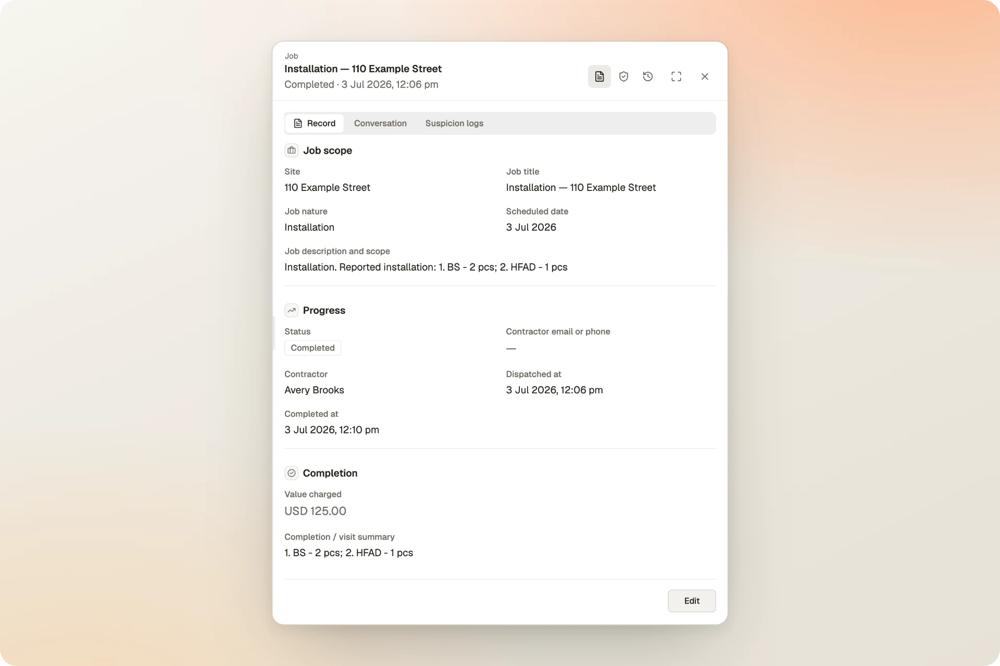

被分配的承包商打开 **承包商工作区 → 派单任务**，只能看到自己的任务分配。使用此页面的调度人员会看到整个工作区的任务分配以及承包商列。使用表格的视图控件按状态筛选，使用搜索查找任务。**任务范围** 标签页保留工地的工单，**进度** 和 **完工** 用于记录报告：

1. 工作进行期间，保持 **状态** 为 **待处理**。
2. 有数据时记录 **收取金额** 和 **完成 / 到访摘要**。展开 **报告位置** 以记录报告的地点。
3. 工作完成后，将 **状态** 设为 **已完成** 并保存。若未填写 **完成时间**，模型会自动补上；之后编辑摘要会保留该完成时间。

承包商可以为自己的任务报告进度、完工情况、收取金额和位置。工单字段和重新分配仍属于调度人员的操作。完工报告还会让该任务分配可以再次接受证据审查；完工并不会了结一项未处理的发现。

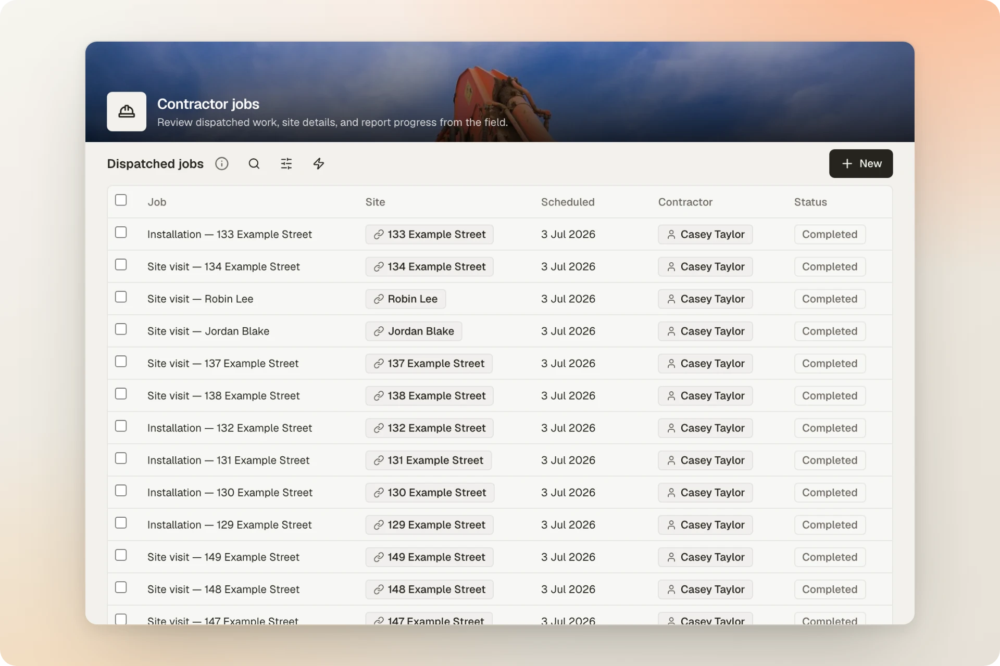

### 4. 查看工地即将进行的工作和历史

从 **工地** 或派单地图打开一个工地。**即将到来的任务** 包括未来的工作和已逾期但尚未完成的任务分配。**活动历史** 列出已分配和已完成的工作，包括派单/完工时间、收取金额、报告位置和摘要。打开列出的任务可查看其范围、对话，以及（调度人员可见的）可疑记录。

修改工地的位置会更新派生出的工地标题。没有位置的现有种子数据工地仍可读取，但编辑时必须填写位置。

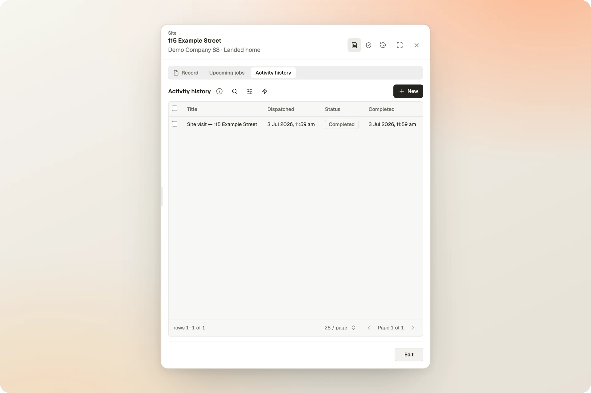

### 5. 导入派单表

在 **派单排期** 上选择 **导入** 并选择一个 CSV 或 XLSX 文件。可从 [CSV 模板](assets/job-assignments-import.template.csv) 及其 [列说明](assets/job-assignments-import.README.md) 开始。每行需要 `site`、`scheduled_for`（`YYYY-MM-DD`）和 `title`。现有工地可以通过编码或匹配的地址和单元来指定。新工地还需要 `latitude` 和 `longitude`；导入不会对地址文本进行地理编码。`unit_number` 为选填，并会覆盖地址中嵌入的单元。选填的工单列包括任务性质、描述、承包商邮箱或电话（`assignee_contact`）以及 `external_ref`。

写入前会检查整张表。无效日期、重复编号或新工地缺少坐标都会产生针对具体行的错误。修正表格后再次导入。成功的导入会报告创建的任务分配数量；选择表格中的计划日期即可在看板上看到它们。每一行都以待处理状态登记；联系方式对应某个成员时会关联该承包商，否则卡片会提示未关联承包商。

重新导入相同的 `external_ref` 会跳过该工单。没有编号时，标题、日期和工地都相同的行会被跳过。因此重复导入成功也不会产生重复工作。

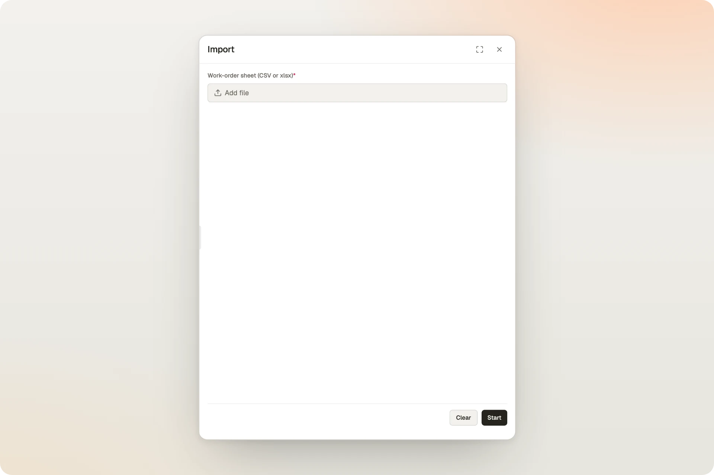

### 6. 提交照片并查看任务分配对话

为有权限的任务分配创建照片证据记录（`?record=photo_evidence/new`）。选择该任务分配，并附上一张不超过 20 MiB 的 JPEG、PNG 或 HEIC 照片。工作区上传会被如此标注；照片提交后，其文件、上级记录和来源都不能替换。若提交有误，请添加正确的证据来更正。

创建表单只要求填写上级记录和照片。来源由系统提供，因此没有需要人工填写的必填来源字段。

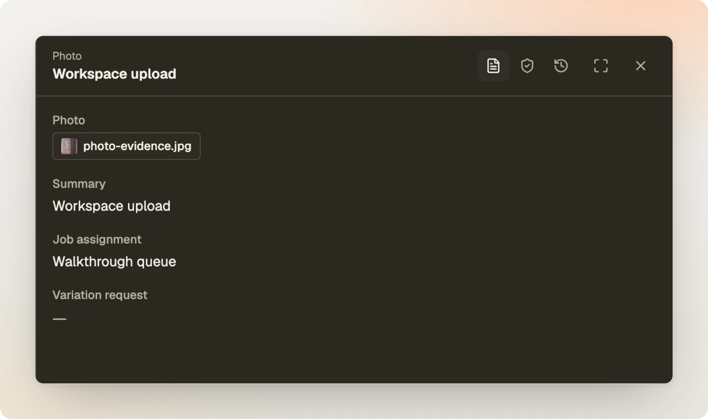

提交照片后，照片的 effect 会安排运行 `inspect_photo_evidence`。调度人员重新打开照片即可看到其完整性事实：没有 EXIF GPS 的照片显示 **没有 GPS 标签**，没有重复项时 **匹配证据 ID** 保持为空。

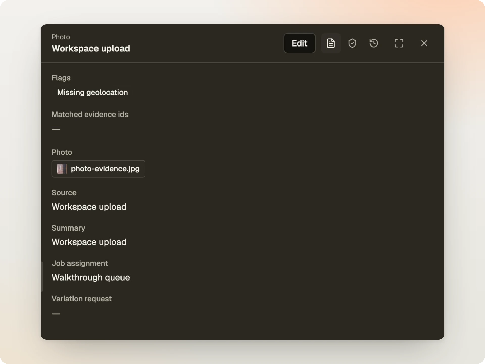

WhatsApp 使者也可以把附件及其来源作为任务分配报告的一部分提交。它按服务商消息逐条保留与该任务分配相关的文字消息，每条只保存一次。打开任务的 **对话** 标签页，按时间顺序阅读消息和照片。选择一张照片可全尺寸打开；滚动离开后，点击 **最新** 可回到最新一项。时间线是只读的，沟通记录来自接收到的报告，而不是在此标签页中手工输入。

承包商能看到自己的消息和照片。调度人员还能看到来源和完整性事实。

### 7. 审查证据并结束一项发现

调度人员在 **派单排期** 上选择 **可疑审查**。该自动化会检查待处理的照片，并审查尚未检查的任务分配，包括已完成的工作。打开 **指挥中心 → 自动化**（`/command-center/automations`）可查看进度、输出数量和任何失败。主机需要为工作区配置 `default` AI 模型以及 `scene`/`default` 嵌入映射，才能使用相应的 AI 功能。

打开任务的 **可疑记录** 标签页。**证据事实** 报告缺少 GPS、照片重复使用或工地不符等观察结果。**其他任务中的相似照片** 显示实际提供给审查的比对。选择任一照片可查看大图。这些事实本身并不意味着该任务可疑。每一次 AI 判断都有一条只读的可疑审查，包含其理由和 **依据与模型**；只有判定为可疑时才会产生一条未处理的判断。

调度人员也可以通过选择任务分配并填写判断来创建一项发现（`?record=suspicious_activity_logs/new`）。要结束一项未处理的判断，请在 **处理结论** 下输入调度人员的结论并选择 **处理**。保存的处理结论会记录由谁、在何时作出决定。它不能被重新打开或改写，原始证据依据仍然可用。其他未处理的判断仍需各自处理。

### 8. 把所选工地移交给另一个系统

在 **工地** 中选择一行或多行，然后选择 **操作 → 工地移交**。成功后，页面会提示 **工地移交成功** 并提供下载链接；同样的输出也保留在 **指挥中心 → 自动化** 下的自动化运行中。每个所选工地会生成三个文件：一个 JSON 包、一个任务分配 CSV 和一个照片证据 CSV。JSON 包含工地详情及其相关记录和照片。文件引用和完整性事实随证据一起导出；此操作只导出记录，不改变其工作流状态。

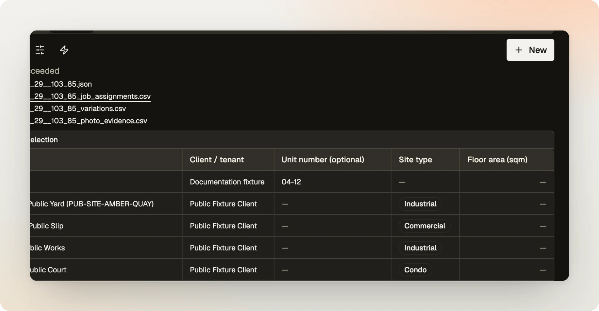

### 9. 连接并运行 WhatsApp 使者

管理员首先在 **设置 → 使者** 下创建使者：一个名为 **Norbital** 的启用中的私有使者，持有 `field_ops_whatsapp` 策略，禁用委派，开启分诊，群组消息设为 `mention_or_reply`，并使用以下任务：

> 你在 WhatsApp 上回答有关任务分配的问题，并根据人们的报告保持它们最新。按消息到达的顺序处理。当一条消息需要处理（报告、照片、更新）时，先用一句简短的话回复你将要做什么，例如“收到——正在把这条附到 4 Ubi View 的任务上。”，然后处理，再简短确认，每个任务一行。查找任务时，对 sites 做一次读取（address 与对方提到的词相似），并带上其 job_assignments 层（order_by scheduled_for）；取该工地今天计划的任务，否则取其最近的待处理任务。只有当两个工地或两个任务同样符合时才提问，绝不凭空编造。一张照片只归属一个任务。然后对该任务执行一次 job_assignments.update，携带报告中的所有内容：只有对方说工作已完成时才把 status 设为 completed（否则不填 status），对方描述了所做工作时填写 summary；photo_evidence.create 每张照片一行——photo 是消息文件中的附件 FileRef，source 为 {kind: "message", integration: "whatsapp", conversation_id: 消息所在的聊天, message_id: 该消息, attachment_id: 附件文件 id, sender_id: 其发送人, sent_at: 其时间}；communication_logs.create 为每条与此工作相关且含文字的消息各建一行——message、sent_at、sender 以及 source_message_id：该消息。照片只能通过这种嵌套创建来提交，绝不直接创建 photo_evidence：直接创建会丢失消息来源。只有在更新成功后才确认。你绝不分配、更改或移除任务的承包商，也绝不主动提出这样做：如果有人要求，回复说承包商由调度人员在派单应用中分配。报告任务时，只陈述你读取过的字段——在说明工作由谁负责之前，先读取 assignee_user_id（以及它指向的人）。

随后其内嵌卡片会提供 WhatsApp 渠道；请连接这一个实例，而不是为同一个使者再创建另一个渠道。**更多 → 系统 → 集成**（`/settings/integrations`）会在 **智能体渠道** 下列出它。

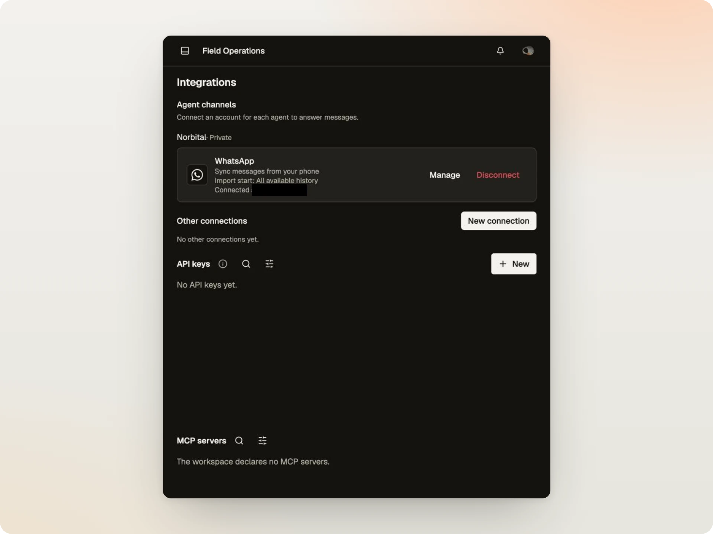

1. 对于尚未配对的 WhatsApp 渠道，选择 **连接**。对于已连接的渠道，选择 **管理**。**管理** 会打开该连接的 **连接**、**配置** 和 **消息** 标签页；智能体连接只出现一次，位于 **其他连接** 上方。如果主机提供多个服务商，请选择可用的服务商并按其显示的步骤操作。
2. 对于 **非官方（WhatsApp Web）**，选择 **导入起点**：**从现在开始**、**从指定日期开始** 或 **全部可用历史记录**。这决定导入哪些服务商历史记录。指定日期从所选时区的午夜开始；可用历史记录取决于服务商提供的内容。恢复已配对的账号时，保留现有选择。将 **电话号码（选填）** 留空并选择 **连接** 以请求二维码。用应作答的那部手机扫描它。若要改为请求配对码，请输入以国家代码开头的纯数字电话号码，然后选择 **连接**。二维码界面也可能提供 **改用手机号码**。其他服务商会显示各自所需的凭据和回调说明。等待显示 **已连接**，并确认显示的账号就是预期的账号。
3. 在实例的 **配置** 标签页中，确认 **使者** 为 **Norbital** 且 **启用** 已开启；有更改时点击 **保存**。保存的暂停状态在重新构建后仍然保留。连接负责配对、已部署的使者和暂停状态；使者行负责其任务、策略和对话行为。
4. 完成上文所述的成员手机号码设置。来自未知号码的私信会收到固定的“无法识别”通知，且不会启动模型回合。
5. 由已关联的成员按工地和工作内容报告现有任务，例如：“公共场地的灯具安装已完成，照片已附上。”当一份报告可能匹配多个任务分配时，使者会询问是哪一个。更新成功后它会确认。
6. 重新打开任务，核实其状态、摘要、照片和 **对话** 条目。在集成的 **消息** 标签页中查看收发消息、投递状态和错误。

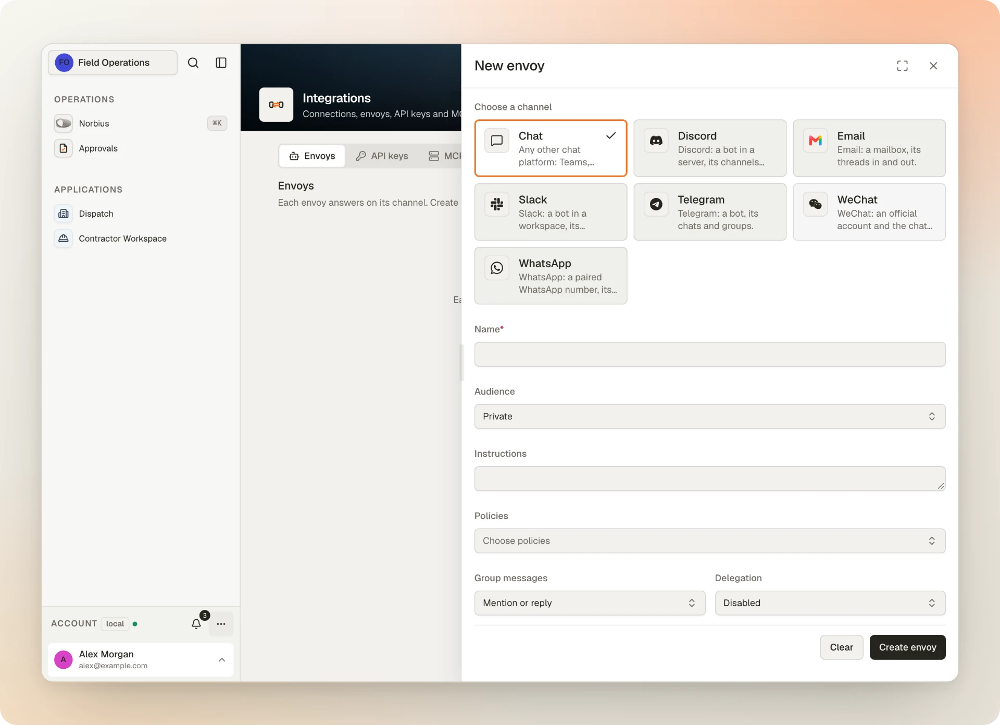

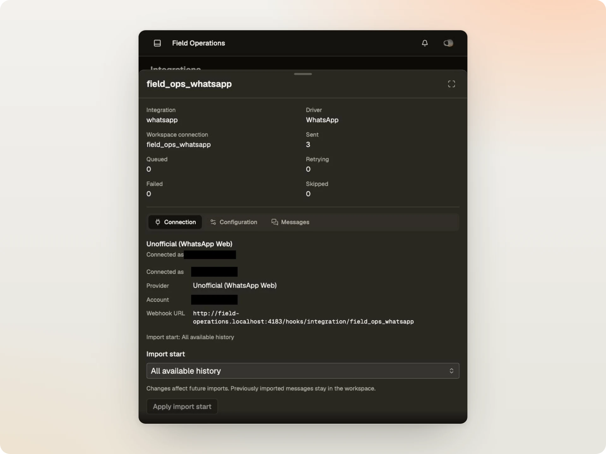

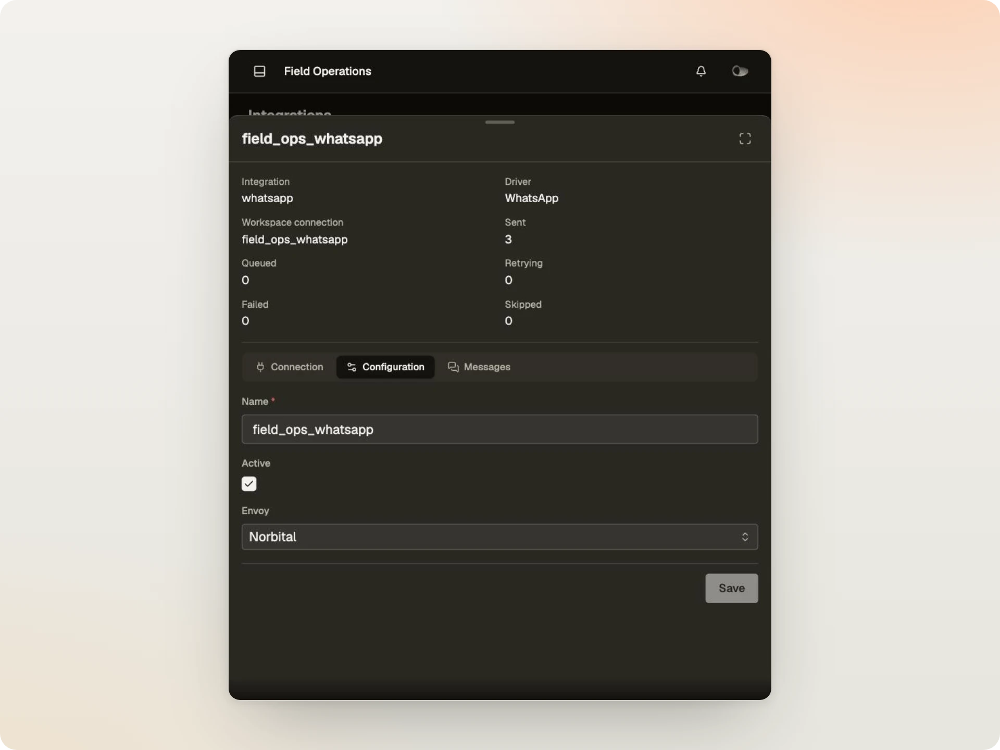

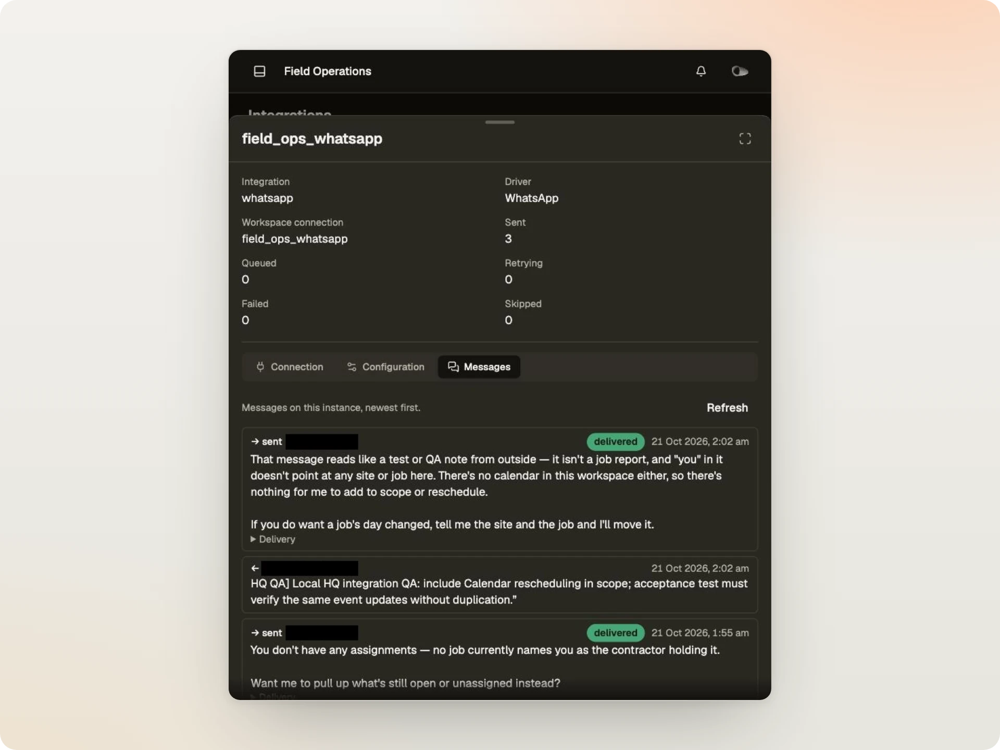

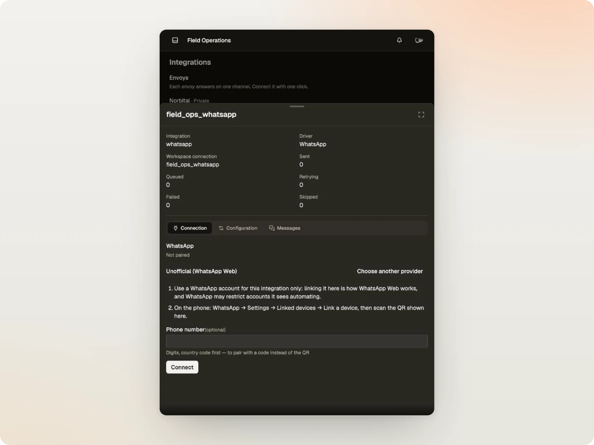

使者的任务是更新现有的任务分配。它自身的策略不授予创建、删除或重新分配任务的权限。私信会把已关联成员的权限与使者的策略合并，因此调度人员或管理员的私信可能拥有更广的权限。群组回合只使用使者策略，该策略允许更新任一任务分配。在群组中，提及或回复是直接触发器。使者还开启了分诊（`triage: true`），因此普通的已关联群组消息也可能被考虑回复；没有提及并不保证使者保持沉默。委派已禁用。

如果服务商提供 **测试连接**，可使用它并提供其要求的目标。连接后，使用 **管理 → 连接 → 导入起点 → 应用导入起点** 更改今后导入的边界。之前存储的消息仍然可用。**重新连接** 会重复设置流程；**断开连接** 会解除会话配对。断开后，连接仍保留在工作区中。要暂停处理，请关闭 **启用** 并保存；再次开启即可恢复。此私有使者的智能体对话记录对参与过对话的已关联成员可见。群组对话记录包含共享的群组历史；它不会自动列给每个承包商。管理员可在 **系统 → 集成** 中查看集成的原始消息。

要在本地会话之间保留配对，请同时保留主机的工作区数据库、文件存储和凭据封存主密钥。新的一次性数据库无法恢复以前的配对。凭据属于主机存储，绝不会复制到模板源码或种子数据中。

设置截图记录了本地控件和服务商选项；配对码和私人消息内容已排除。本地演练还验证了真实手机配对、已关联成员发来的任务分配查询及使者的回复，以及在不需要新二维码的情况下从保存的本地状态重新连接。自动化使者测试使用模拟的 WhatsApp 链接和脚本化模型；它们验证接纳、权限、消息/照片提交和接收限制。这些测试并不能证明真实服务商能在每种报告或附件场景下完成投递。

### 使者探测结果（本地，2026 年 10 月 21 日）

对持久化本地工作区的手动探测（`bun run env -- serve --template=field-operations --port=4183`，来源 `http://field-operations.localhost:4183`），以创始管理员身份登录。电话号码和姓名已用实心方框遮盖。

| 探测                               | 步骤                                                                                                            | 结果                                                                                                                                                                                                                                                                                               |
| ---------------------------------- | --------------------------------------------------------------------------------------------------------------- | -------------------------------------------------------------------------------------------------------------------------------------------------------------------------------------------------------------------------------------------------------------------------------------------------- |
| 1. 使者配置                        | **系统 → 集成** → **Norbital · Private** → **管理**：连接、配置、消息。                                         | **通过。** WhatsApp 显示 **已连接**，并带有 **管理**/**断开连接**；**配置** 中为 **使者：Norbital**，**启用** 已开启。配对后重启了服务器（普通 `serve`，自动恢复保存的状态），恢复后仍为已连接，无需新的二维码。                                                                                   |
| 2. 使者对话                        | 一名已关联成员向已配对号码发送私信 “What assignments do i have?”；打开 **Norbius → 对话列表 → Norbital (DM)**。 | **通过（已有回合）。** 对话记录显示两个 `Read job assignments` 步骤，以及一条回复，说明没有任何任务分配把发送人列为承包商，这与数据相符。该回合发生在本次探测之前；探测期间无法发送新消息。                                                                                                        |
| 3. 使者操作（状态更新 / 照片报告） | 私信一份提到已分配任务的报告（“……已完成；照片已附上”），然后重新打开该任务的记录、**对话** 标签页和历史。       | **未执行。** 探测时没有可用于该已关联成员号码的 WhatsApp 客户端。                                                                                                                                                                                                                                  |
| 4. 策略边界                        | 私信一个超出使者策略的请求，并验证被拒绝。                                                                      | **未执行**（原因同上）。对于私信，已关联成员自身的权限会叠加到使者策略上（`dm: 'union'`），因此若只测试策略本身，需要一个仅为承包商的成员或一个群组回合。策略本身授予对**任一**任务分配的读取和状态/摘要更新，因此询问他人的任务分配是允许的，不会被拒绝。边界测试应要求创建、删除或重新分配任务。 |

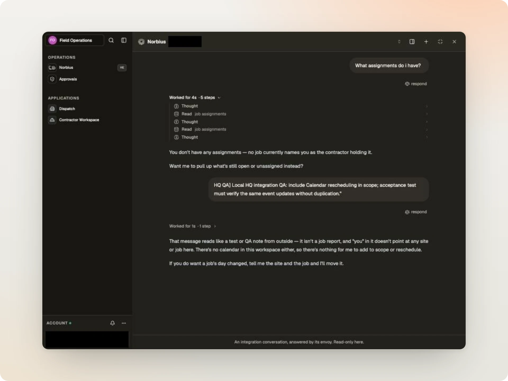

要完成探测 3 和 4，请从已关联成员自己的 WhatsApp 向已配对号码发送：(a) 一份针对分配给该成员的任务、附带照片的完工报告，然后在任务上核实状态、摘要、照片和 **对话**，并在其历史中核实使者作为操作者；(b) 由一个仅为承包商的成员发送 “把 <job> 改派给其他人” 或 “删除 <job>”，并核实回复予以拒绝且没有任何改变。

## 数据模型

```text
site → job assignment → user (the assignee)
             ↓
       photo evidence
       communication logs   (immutable inbound messages, one per assignment)
```

- **site** —— 一个实体工地，带有客户背景、必填的位置和选填的单元号。其标签由所选位置派生；没有坐标的旧种子数据工地在编辑前仍可读取。过去的任务仍附属于该工地。
- **job_assignments** —— 一个已派单的单日任务：工单（工地、日期、标题、性质、描述、派单系统的编号）和持有它的承包商，都在同一行中。`assignee_user_id` 直接就是 `user.id`——承包商是一种**角色**，而不是一条记录，即所在团队持有 `field_ops_contractor` 的用户——由 `assignee_contact`（承包商的邮箱或电话）关联，没有成员持有时为 null。调度人员在看板中登记工单或从表格导入；表格带有派单系统编号时，`external_ref` 即为该编号（唯一，因此重新导入的表格不会重复登记任何内容），`source_message_id` 则是派单所来自的 WhatsApp 消息。状态从 `pending` 变为 `completed`；工作是否真正合规完成属于可疑问题，绝不存储在这一行上（`suspicion_checked_at` 是唯一与可疑相关的列，由审查自动化在运行后写入）。
- **photo_evidence** —— 一张明确提交、附属于一个任务分配的照片，带有确定性的完整性事实。渠道历史和附件由平台另行存储；任务分配的消息**内容**保留在 `communication_logs` 中。
- **communication_logs** —— 承包商就某个任务分配发来的消息，不可变，每条服务商消息一行（按 `source_message_id` 幂等），独立于智能体对话记录保留。可疑审查会读取它们。
- **suspicion_reviews** —— 每次对一个任务分配的证据依据进行 AI 审查时生成的一条审计行，包括判定为无疑点的结果；仅调度人员可见。
- **suspicious_activity_logs** —— 由 AI 或获授权人员针对一个任务分配作出的可疑判断：不可变的证据依据、理由，以及调度人员明确的处理结论——这是结束一条记录的唯一方式。

## 自动化与集成

| 自动化                            | 触发器                                                       | 作用                                                                                 |
| --------------------------------- | ------------------------------------------------------------ | ------------------------------------------------------------------------------------ |
| `inspect_photo_evidence`          | 由 `photo_evidence` 的 create effect 安排                    | 为每张待处理照片填充 SHA-256、PDQ 和场景嵌入、完整性标记以及近似重复匹配             |
| `review_job_assignment_suspicion` | 由 `job_assignments` 的 effect 安排；按 `assignment_id` 手动 | 检查仍待处理的照片，然后用 AI 审查每个未检查的任务分配；只有判定为可疑时才记录可疑项 |
| `site_handover`                   | 手动，所选工地                                               | 每个工地一个 JSON 文件（工地、任务、照片证据），外加每张表一个 CSV，供另一个系统使用 |

### 照片完整性

主机的 `ctx.files.image` 解码每张照片（JPEG、PNG、HEIC），计算哈希（SHA-256 和 Meta PDQ）并读取 EXIF；`src/lib/photo-integrity.ts` 决定什么算作重复、异常或不符。一行在创建时处于未检查状态（空哈希、零向量）。主机无法读取的照片会一次性记录 `inspection_failed_at` 和 `inspection_failure_reason`，之后不会再被选中，也不占用视觉样本位置。所选资源、上级记录和来源都不可变：更正提交需要新的证据，以便所有检查重新运行。

- **重复。** 256 位 PDQ 哈希存储为 256 维 0/1 的 `perceptual_embedding`（L2 度量，因此 L2 距离为 √汉明距离）。模型的 `pdq` 搜索索引会在 √31（PDQ 汉明距离 31）范围内找出近似重复，记为 `visual_duplicate`；在另一个任务分配下字节完全相同的文件记为 `exact_duplicate`。两者都带有 `matched_evidence_ids`。在照片自身任务分配内的匹配属于中性的重复。
- **地理定位。** 将 EXIF GPS 与任务工地的地图位置比较（容差 500 米）：没有 GPS 记为 `missing_geolocation`，拍摄位置超出容差记为 `location_mismatch`。
- **标记是证据，而不是结论。** 还会记录 `metadata_anomaly`、`edited_metadata` 和 `low_quality`。仅缺少 GPS 本身是中性的，因为 WhatsApp 通常会去除 EXIF；重复使用和 GPS 不符是强信号，但本身绝不构成可疑。照片行上没有任何东西会锁定 `suspect`：判断属于审查，存放在 `suspicious_activity_logs` 中。
- **场景重复使用。** PDQ 无法区分同一场景的裁剪图与毫不相干的一对照片，因此检查还会把照片嵌入（使用 `scene` 模型的 `ctx.ai.embed`）到 `scene_embedding` 中，`scene` 搜索索引按余弦相似度排序。两个索引都读取检查写入的向量字段（带 `vector: '<field>'` 的 `indexes` 条目），因为图像事实需要主机计算。主机映射 `scene` 嵌入模型；审查上下文会报告 `scene_embedding_photos`，因此在没有它的情况下进行的审查是可见的，而不会被悄悄判为无疑点。

### 可疑审查

`review_job_assignment_suspicion` 分页遍历每个未检查的任务分配（包括已完成的工作），汇集任务分配、其任务和工地、确定性的照片事实以及有界的近期 `communication_logs`。它把一个有界的视觉样本（最多三张照片，按信号加权的确定性选择，上限 4 MiB）加上文本上下文传给工作区的 `default` 模型。每一次审查——规范化依据哈希、结论、模型和理由——都会写入 `suspicion_reviews`，因此无疑点的判定也可审计；`suspicious` 结论会追加一条幂等的 `suspicious_activity_logs` 行。只有在推理和审查的持久化都成功后，才会给任务分配打上 `suspicion_checked_at` 时间戳，而对任务分配的任何其他更改都会清除它，因此下一次运行会评判新的证据。失败的审查不打任何时间戳，并在下一个两小时时段重试；运行输出会报告任务分配数、推理调用次数和失败次数。只有调度人员陈述的处理结论才能结束一条记录。审查不调用任何工具，也不读取任何网页：其输入是租户的行和已存储的照片。

### WhatsApp 使者

WhatsApp 使者是面向已拥有活跃工作区账户的承包商的对话入口。它是一条持有 `field_ops_whatsapp` 策略的 `sys_envoy` 行（见上文第 9 步），通过 WhatsApp 实例的 `envoy` 字段部署在该实例上。配对和暂停属于该运行时实例。管理员在该账户上记录承包商的 WhatsApp 号码（指挥中心 → 人员）；未知号码会被告知无法识别，且不会触发模型运行。

使者的全部工作就是根据承包商发来的内容，把其**现有**任务分配更新到最新。一份报告就是对其所涉任务分配的一次更新，携带：

- 所报告的进度——`status`、`completed_at`、`summary`；
- `photo_evidence.create`——每张发来的照片一行，包括其文件以及传递它的消息 `source`（对话、消息、附件、发送人、时间）；
- `communication_logs.create`——属于该任务分配那部分对话的含文字消息，以 WhatsApp 消息 id 为键，因此每次更改都能追溯到对应的消息。

每张提交照片自身的 create 回调会将其标记为未检查（与直接上传相同），任务分配的 update 回调会清除 `suspicion_checked_at`，因此审查会在下一次运行时处理该任务分配。

使者的权限取决于对话：

- **声明的 `field_ops_whatsapp` 策略** 读取任务分配，更新任一任务分配的 `status`、`completed_at` 和 `summary`，并在其下提交新的照片和消息行；群组回合只在此策略下运行，因此任何已接纳成员的群组报告都可以更新任一任务分配。该策略不授予任务分配的创建、删除或重新分配、工单更改、证据或日志读取、审查、可疑数据或应用权限。
- **私信会把已关联成员自身的权限** 加入使者的策略；群组回合无论由谁发送消息，都只持有使者的策略。因此，已关联的调度人员或管理员在其私信中可能带入比使者策略本身声明的更广的权限。
- **私有使者的智能体对话记录需要参与过才能查看。** 参与过的已关联成员可以打开其对话，包括群组的共享历史。被分配到某个任务本身并不会列出该群组对话记录。管理员通过集成实例查看原始渠道消息。

WhatsApp 连接是 Bolt 内置 `whatsapp` 集成的一个实例；管理员从使者的卡片进行配对，主机的 WhatsApp 服务商持有已配对的会话并投递接收到的消息，每条只存储一次。`sys_envoy` 行提供策略；实例的使者字段（`sys_integration.envoy`）把它部署到那里。Bolt 把每个发送人与活跃成员账户上登记的手机号码进行匹配。私有私信会合并已关联成员当前的权限（默认 `dm: 'union'`）；群组回合只使用使者的策略。权限由源码团队和原生成员接纳决定，而不是由发送人自称的身份或团队标签决定。模型能看到每条消息的时间、发送人和 id，以及每个附件已存储的文件，也就是它在任务分配上提交的内容。回复通过同一个实例发回。

## 源码结构

```text
src/
├── +workspace.ts                   Asia/Singapore, SGD, the app order, the embedding models
├── data/
│   ├── model/<m>/                  +model.ts (fields and refs, outputs, write callbacks and effects, indexes) and +representation.svelte
│   └── custom_field/photo_source/  where a photo came from: workspace upload or a WhatsApp message
├── access_control/                 policy/: the four +<name>.policy.ts; team/+team.ts
├── agent/                          +agent.md
├── automation/                     inspect_photo_evidence, review_job_assignment_suspicion, site_handover
├── app/                            field_ops_controller (dispatch, sites) and field_ops_contractor (jobs)
├── i18n/                           +messages.ts, +zh.messages.ts
└── lib/                            site keys, photo rules, the review, the sheet import, csv/xlsx readers
seed/                               +seeder.ts reads the private bank tree `field-operations`
```

应用刻意保持精简，因为工作发生在记录内部：打开一个任务分配会同时显示其任务范围、动态和照片证据；打开一个工地会把即将进行的工作与活动历史分开。每个模型的 `+model.ts` 声明调用方可以提交什么，其 `create.transform` 和 `update.transform` 承载领域规则，因此这些规则适用于每个客户端、函数和智能体——而不仅仅是 UI：

- 已派单的任务必须引用一个现有工地。每个任务在 `completed` 之前都是 `pending`；承包商联系方式会关联持有该邮箱或电话的成员，并记录派单时间。
- `external_ref` 是导入任务的派单系统编号，`source_message_id` 是 WhatsApp 消息的编号；两者都是唯一的幂等键。
- 超出工地容差的报告位置会被记录为证据事实，绝不会设置 `suspect`；完工时间由模型自身的 update 回调记录。
- 照片证据：JPEG/PNG/HEIC，恰好一个上级记录，指纹和完整性标记由检查记录；提交后其资源、上级记录和来源都不能替换。
- 沟通记录和可疑审查不声明 `update` 和 `delete`：从结构上就是不可变的。可疑记录的判断不是 update 输入；只有其处理结论是。

## 种子数据

没有公开的行：新工作区从空开始。`seed/+seeder.ts` 指定种子数据库中的私有树 `field-operations`，`bolt seed --bank=<checkout>` 会把其中的行原样加载到演示环境中，每张照片都以其 JPEG 作为资源，然后启动 `review_job_assignment_suspicion`。种子数据库把对话记录中的任务报告及其文字形式的照片引用视为权威；它绝不会给模拟的错误工地照片重新指定上级记录，因为这些矛盾正是本模板要检测的内容。

任务分配导入 CSV 模板及其列说明位于 `assets/` 中（[job-assignments-import.README.md](./assets/job-assignments-import.README.md)）。

## 检查

```bash
bun install
bunx bolt check   # types, Svelte warnings, layout and declarations
bun run test       # bolt test: builds the template standalone, then the suite and the mounted app sweep
```

以只读方式使用私有种子数据库检出。`.norbital/` 是生成的，绝不提交。Schema 更改会在 `migrations/` 下生成一个可编辑的 SQL 迁移，并根据声明验证完整的历史。请把 SQL、`snapshot.json` 和 `migrations.lock.json` 一起提交。

## 维护中的源码参考

请参阅 [源码参考](docs/source-reference.md)，了解当前的应用/页面、模型输出与写入、自动化策略、集成和浏览器截图。该清单会与本模板的声明进行核对；服务商设置和已部署发布版本的就绪情况仍需另行检查。
