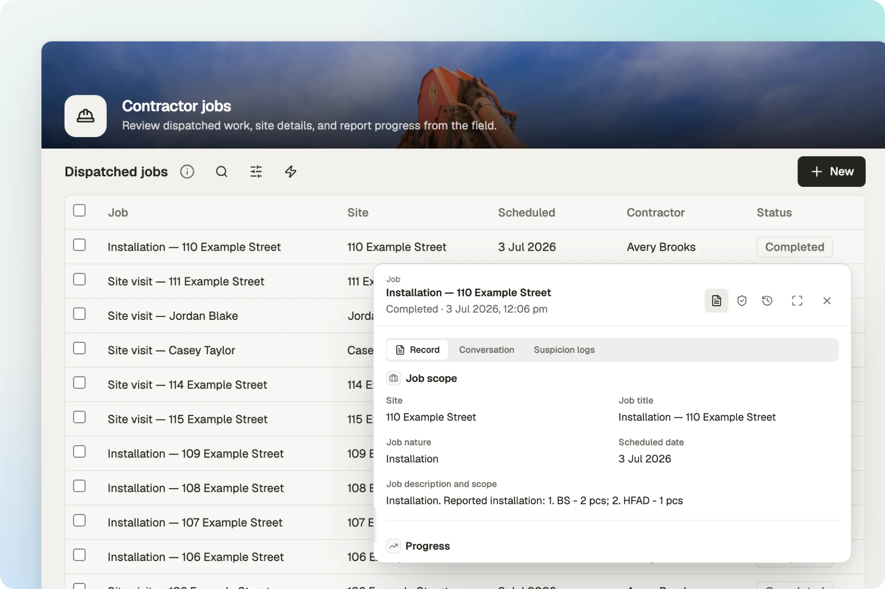

# Field Operations Documentation



Technical documentation index and developer quickstart for the `field-operations`
(`norbital-field-operations`) template workspace.

## Documentation Map

- [Executive Overview (English)](../README.md) · [中文概览](../README.zh.md) — non-technical
  business scope, expected impact, roles, apps, automations, and boundaries.
- [System Architecture & Inner Mechanisms](architecture.md) — runtime topology, relational ER
  schema, site/job/finding lifecycles, photo forensics, multimodal AI suspicion review pipeline,
  sheet import/handover pipelines, and access-control diagrams.
- [Source Reference](source-reference.md) — verified inventory of apps, pages, models, fields,
  constraints, indexes, outputs, automations, teams, policies, rate limits, and supporting modules.
- [Operator Guide](operator-guide.md) — step-by-step walkthrough covering team setup, site and job
  dispatch, CSV/XLSX sheet imports, photo integrity checks, suspicion review, site handover, and
  WhatsApp Envoy pairing.
- [Dispatch Import Column Reference](../assets/job-assignments-import.README.md) and
  [CSV Template](../assets/job-assignments-import.template.csv) — schema and sample sheet for
  `job_assignments_import_work_orders`.

---

## Developer Quickstart

Run commands from the `templates/field-operations` directory:

```bash
bun install --frozen-lockfile   # Install pinned template dependencies
bunx bolt check                 # Verify discovery, schema history, rules, and types
bun run test                    # Run workspace test suites (Vitest + Bolt test kit)
bunx bolt build                 # Compile .norbital/ manifest, check migrations, build release
bun run format                  # Format source and documentation with Prettier
```

### Migrations & Seeding Workflow

- **Schema changes:** Edit model declarations under `src/data/model/` and run `bunx bolt build` to
  generate the next SQL migration under `migrations/` and verify replay against a scratch database.
  Always commit generated SQL files together with `migrations/snapshot.json`,
  `migrations/migrations.lock.json`, and `migrations/physical.json`. Never commit `.norbital/`.
- **Workspace startup & data:** A fresh workspace starts with its three teams and no records. Invite controllers and contractors
  under **System → Command center → People** (`/command-center/people`) and optionally configure the
  WhatsApp Envoy under **Settings → Integrations → Envoys**. Demo environments load fixture data in
  memory via `seed/+seeder.ts` (which chains an initial `review_job_assignment_suspicion` run after
  seeding).
- **Access & connections:** Policies are authored in source under `src/access_control/policy/`; teams are
  `sys_team` rows an administrator edits under **Settings → Organization → Teams**, started by
  `seed/public/sys_team.json`. External channel credentials (such as WhatsApp pairing) belong to the
  host's **Settings → Integrations** sealed store and are never committed to source.

---

## Screenshot Index

| Flow             | Captures                                                                                                                                                                                                                                                                                                                                                                                                                            |
| ---------------- | ----------------------------------------------------------------------------------------------------------------------------------------------------------------------------------------------------------------------------------------------------------------------------------------------------------------------------------------------------------------------------------------------------------------------------------- |
| Dispatch & route | [Application](screenshots/application.webp), [Workspace overview](screenshots/workspace-overview.webp), [Job record](screenshots/job-record.webp), [Contractor jobs](screenshots/contractor-jobs.webp), [Route planner](screenshots/route.webp), [Dark mode](screenshots/route-dark.webp)                                                                                                                                           |
| Sites & imports  | [Sites](screenshots/sites.webp), [New site](screenshots/new-site.webp), [Validation](screenshots/site-validation.webp), [History](screenshots/site-history.webp), [Import](screenshots/dispatch-import.webp)                                                                                                                                                                                                                        |
| Photo & handover | [Photo filed](screenshots/09-photo-filed.webp), [Photo inspection](screenshots/10-photo-inspection.webp), [Site handover](screenshots/13-site-handover.webp)                                                                                                                                                                                                                                                                        |
| People & Envoy   | [Member setup](screenshots/19-member-setup.webp), [Integrations](screenshots/14-envoy-integrations.webp), [Providers](screenshots/15-envoy-provider-choice.webp), [Config](screenshots/16-envoy-configuration.webp), [Messages](screenshots/17-envoy-messages.webp), [WhatsApp](screenshots/18-envoy-whatsapp-setup.webp), [Connection](screenshots/35-envoy-connection.webp), [Transcript](screenshots/36-envoy-conversation.webp) |
