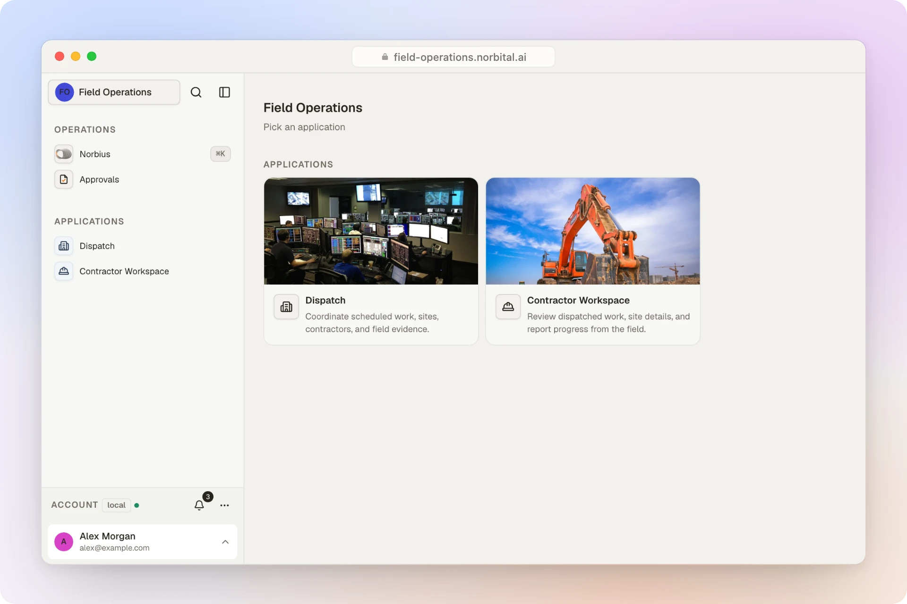
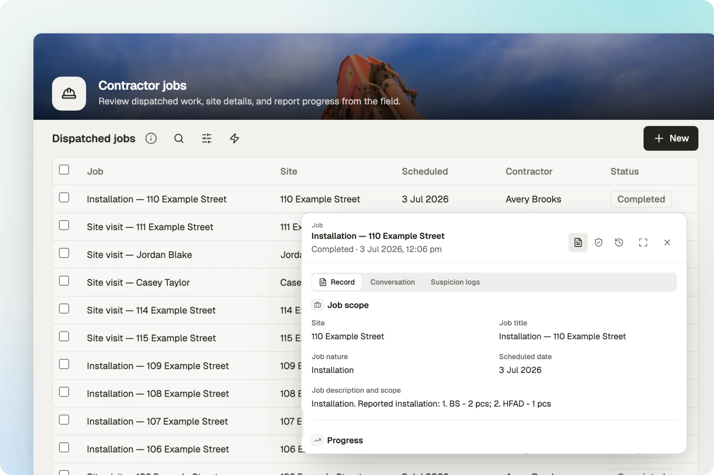

# Source Reference

Complete source inventory for `templates/field-operations` (`norbital_field_operations`), verified
directly against `src/` and `migrations/physical.json`. This describes the local template source,
not a statement that any deployed tenant runs these bytes.

- **Workspace manifest (`src/+workspace.ts`):** `tz: 'Asia/Singapore'`, `locale: 'en-SG'`,
  `languages: ['en', 'zh']`, `currency: 'SGD'`, `ai.embeddings: ['scene', 'default']`
- **Totals:** 6 models, 1 custom field, 2 applications (3 pages), 5 automations, 3 seeded teams,
  4 policies, 0 declared source integrations.

---

## Applications and Pages

| Source application                                                | Title                | Pages                                                                                                                                                          | Purpose                                                                                                                                          |
| ----------------------------------------------------------------- | -------------------- | -------------------------------------------------------------------------------------------------------------------------------------------------------------- | ------------------------------------------------------------------------------------------------------------------------------------------------ |
| [`field_ops_controller`](../src/app/field_ops_controller/+app.ts) | Dispatch             | [`dispatch`](../src/app/field_ops_controller/+dispatch.page.svelte) (Dispatch schedule); [`sites`](../src/app/field_ops_controller/+sites.page.svelte) (Sites) | Daily kanban board + site map, route planning, CSV/XLSX work-order import, on-demand suspicion review, site directory, and site handover export. |
| [`field_ops_contractor`](../src/app/field_ops_contractor/+app.ts) | Contractor Workspace | [`jobs`](../src/app/field_ops_contractor/+jobs.page.svelte) (Dispatched jobs)                                                                                  | Role-scoped work list (own assignments for contractors; workspace-wide with **New** for controllers).                                            |

---

## Models and Exposed Operations

Field counts below report all declared model fields (`total = refs + scalars`), excluding Bolt's
implicit system metadata (`id`, `revision`, `created_at`, `created_by`, `updated_at`, `updated_by`).
No model declares `import_key: true`; bulk ingestion runs through the
`job_assignments_import_work_orders` automation.

| Model                                                                                                                      | Fields                | Read outputs            | Writes                              | Post-commit effects | Representation                                                                                                                        |
| -------------------------------------------------------------------------------------------------------------------------- | --------------------- | ----------------------- | ----------------------------------- | ------------------- | ------------------------------------------------------------------------------------------------------------------------------------- |
| [`sites`](../src/data/model/sites/+model.ts)                                                                               | 9 (0 ref, 9 scalar)   | `default`, `contractor` | `create`, `update`, `delete`        | none                | [`+representation.svelte`](../src/data/model/sites/+representation.svelte)                                                            |
| [`job_assignments`](../src/data/model/sites/job_assignments/+model.ts)                                                     | 17 (2 ref, 15 scalar) | `default`, `contractor` | `create`, `update`, `delete`        | `create`, `update`  | [`+representation.svelte`](../src/data/model/sites/job_assignments/+representation.svelte)                                            |
| [`photo_evidence`](../src/data/model/sites/job_assignments/photo_evidence/+model.ts)                                       | 12 (1 ref, 11 scalar) | `default`, `contractor` | `create`, `update`, `delete`        | `create`            | [`+representation.svelte`](../src/data/model/sites/job_assignments/photo_evidence/+representation.svelte)                             |
| [`communication_logs`](../src/data/model/sites/job_assignments/communication_logs/+model.ts)                               | 5 (1 ref, 4 scalar)   | `default`, `contractor` | `create` (append-only)              | none                | [`+representation.svelte`](../src/data/model/sites/job_assignments/communication_logs/+representation.svelte)                         |
| [`suspicion_reviews`](../src/data/model/sites/job_assignments/suspicion_reviews/+model.ts)                                 | 9 (2 ref, 7 scalar)   | `default`               | `create` (append-only)              | none                | [`+representation.svelte`](../src/data/model/sites/job_assignments/suspicion_reviews/+representation.svelte)                          |
| [`suspicious_activity_logs`](../src/data/model/sites/job_assignments/suspicion_reviews/suspicious_activity_logs/+model.ts) | 10 (4 ref, 6 scalar)  | `default`               | `create`, `update` (one-shot close) | `create`            | [`+representation.svelte`](../src/data/model/sites/job_assignments/suspicion_reviews/suspicious_activity_logs/+representation.svelte) |

### Detailed Field, Constraint & Index Inventory

#### `sites`

- **Fields:** `site_code` (`text?`), `name` (`text`, derived), `site_key` (`text`, hidden, derived),
  `location` (`point?`, required on write), `address` (`text?`), `unit_number` (`text?`),
  `client_name` (`text?`), `house_type` (`enum?`: `hdb_flat | condo | landed | commercial | industrial | other`),
  `floor_area_sqm` (`decimal`, scale `2`, optional).
- **Unique constraints:** `site_code`, `site_key`.
- **Indexes:** GiST on `location`; text search on `name`, `address`, `unit_number`, `site_code`, `client_name`.
- **Nested write layers:** `create` and `update` accept `job_assignments` (`external_ref`, `title`, `nature`, `scheduled_for`, `description`, `assignee_contact`); `update` allows only `create` and `link` verbs.
- **Outputs:** `default` (`all` + nested `job_assignments`); `contractor` (omits `site_key`, includes nested `job_assignments` filtered by policy).

#### `job_assignments`

- **Fields:** `site_id` (`ref -> sites`, `ON DELETE RESTRICT`), `assignee_user_id` (`ref -> sys_user?`, `ON DELETE RESTRICT`),
  `assignee_contact` (`text?`), `external_ref` (`text?`, create-only), `title` (`text`), `nature` (`text?`),
  `scheduled_for` (`date`), `description` (`text`), `dispatched_at` (`instant?`),
  `status` (`enum`: `pending | completed`, default `'pending'`), `completed_at` (`instant?`),
  `amount_charged` (`money?`), `location` (`point?`), `location_address` (`text?`), `summary` (`text?`),
  `source_message_id` (`text?`, hidden, create-only), `suspicion_checked_at` (`instant?`, hidden).
- **Unique constraints:** `external_ref`, `source_message_id`.
- **Indexes:** B-tree on `scheduled_for`, `suspicion_checked_at`, `site_id`, `assignee_user_id`; GiST on `location`; text search on `title`, `nature`, `summary`, `site_id`; HNSW semantic index on `title`, `description`, `summary` (`model: 'default'`, `dim: 1536`, cosine).
- **Nested write layers:** `update` accepts create-only `photo_evidence` (`photo`, `source`) and create-only `communication_logs` (`message`, `sent_at`, `sender`, `source_message_id`).
- **Outputs:** `default` (`all` + `photo_evidence` + `site_id` summary); `contractor` (omits `external_ref`, `assignee_contact`, `source_message_id`, `suspicion_checked_at`).
- **Post-commit effects:** `create` schedules `review_job_assignment_suspicion` (`key: 'suspicion_review'`); `update` schedules it whenever `suspicion_checked_at` clears to `null`.

#### `photo_evidence`

- **Fields:** `job_assignment_id` (`ref -> job_assignments?`, `ON DELETE RESTRICT`, required by create transform),
  `photo` (`file`, accepts `image/jpeg`, `image/png`, `image/heic`, `image/heif`, `application/octet-stream`, max `20MiB`),
  `source_key` (`text`, hidden), `source` (`custom: photo_source`), `sha256` (`text`, hidden),
  `inspection_failed_at` (`instant?`, hidden), `inspection_failure_reason` (`text?`, hidden),
  `inspection_claimed_at` (`instant?`, hidden), `perceptual_embedding` (`vector(256)`, `l2`, hidden),
  `scene_embedding` (`vector(256)?`, `cosine`, hidden),
  `flags` (`enum[]`: `exact_duplicate | visual_duplicate | metadata_anomaly | edited_metadata | low_quality | missing_geolocation | location_mismatch`),
  `matched_evidence_ids` (`text[]`, hidden).
- **Unique constraints:** `source_key`.
- **Indexes:** HNSW `pdq` (`perceptual_embedding`, `l2`, `dim: 256`); HNSW `scene` (`scene_embedding`, `cosine`, `dim: 256`); GIN on `flags`, `matched_evidence_ids`.
- **Write scope:** `create` exposes only `job_assignment_id` and `photo` (stamping `source = { kind: 'workspace_upload' }`); `update` exposes only the 8 inspection/fact fields (provenance is immutable).
- **Outputs:** `default` (`all` + `job_assignment_id: ['title', 'site_id']`); `contractor` (`['job_assignment_id', 'photo', 'source']`).
- **Post-commit effects:** `create` schedules `inspect_photo_evidence` (`key: 'inspect_photo_evidence'`).

#### `communication_logs`

- **Fields:** `job_assignment_id` (`ref -> job_assignments`, `ON DELETE RESTRICT`), `message` (`text`),
  `sent_at` (`instant`), `sender` (`text`, hidden), `source_message_id` (`text`, hidden).
- **Unique constraints:** `source_message_id`.
- **Indexes:** B-tree on `sent_at`, `job_assignment_id`; text search on `message`, `sender`.
- **Write scope:** `create` only (refuses empty trimmed `message`, `sender`, or `source_message_id`).
- **Outputs:** `default` (`all` + `job_assignment_id: ['title']`); `contractor` (`['job_assignment_id', 'message', 'sent_at', 'sender']`).

#### `suspicion_reviews`

- **Fields:** `job_assignment_id` (`ref -> job_assignments`, `ON DELETE RESTRICT`),
  `evidence_id` (`ref -> photo_evidence?`, `ON DELETE SET NULL`), `basis_hash` (`text`, hidden),
  `basis` (`json`, shape `REVIEW_BASIS`), `suspicious` (`bool`), `reason` (`text`), `model` (`text`),
  `reviewed_at` (`instant`), `source_key` (`text`, hidden).
- **Unique constraints:** `source_key`, `one_review_per_basis` (`job_assignment_id`, `basis_hash` `NULLS NOT DISTINCT`).
- **Indexes:** B-tree on `reviewed_at`, `job_assignment_id`, `evidence_id`; text search on `reason`.
- **Write scope:** `create` only.
- **Outputs:** `default` (`all` + `job_assignment_id: ['title']`, `evidence_id: ['source']`).

#### `suspicious_activity_logs`

- **Fields:** `job_assignment_id` (`ref -> job_assignments`, `ON DELETE RESTRICT`),
  `review_id` (`ref -> suspicion_reviews?`, `ON DELETE RESTRICT`),
  `evidence_id` (`ref -> photo_evidence?`, `ON DELETE SET NULL`),
  `resolved_by` (`ref -> sys_user?`, `ON DELETE SET NULL`), `source_key` (`text`, hidden),
  `origin` (`enum`: `automation | human`, default `'human'`), `basis` (`json?`, shape `SUSPICION_BASIS`),
  `reason` (`text`), `resolution` (`text?`), `resolved_at` (`instant?`).
- **Unique constraints:** `source_key` (`<origin>:<job_assignment_id>:<sha256(basis)>`).
- **Indexes:** B-tree on `resolved_at`, `job_assignment_id`, `review_id`, `evidence_id`, `resolved_by`; text search on `reason`, `resolution`.
- **Write scope:** `create` (`job_assignment_id`, `origin`, `basis`, `review_id`, `evidence_id`, `reason`); `update` (`resolution`, `resolved_at`, `resolved_by` — one-shot close only, refuses if already resolved or incomplete). No `delete` verb.
- **Outputs:** `default` (`all` + `job_assignment_id: ['title']`, `evidence_id: ['source']`).
- **Post-commit effects:** `create` notifies the holders of `field_ops_controller` (`Suspicion raised`).

---

## Custom Fields

| Handle         | Declaration                                                                  | Renderer                                                                     | Shape & validation                                                                                                                                                                                          |
| -------------- | ---------------------------------------------------------------------------- | ---------------------------------------------------------------------------- | ----------------------------------------------------------------------------------------------------------------------------------------------------------------------------------------------------------- |
| `photo_source` | [`+custom_field.ts`](../src/data/custom_field/photo_source/+custom_field.ts) | [`+renderer.svelte`](../src/data/custom_field/photo_source/+renderer.svelte) | Tagged union on `kind`: `workspace_upload` (`{}`) or `message` (`integration`, `conversation_id`, `message_id`, `attachment_id`, `sender_id`, `sent_at?`). Rejects blank required strings in `message` arm. |

---

## Automations

All automations run under the reserved system identity with their declared policies. None declares
a static cron schedule; scheduling is driven by model post-commit effects, chained schedules, manual
controller starts, and 2-hour UTC retry slots.

| Automation                                                                                                  | Trigger path                                                                                                                                            | Policies                      | Concurrency                     | Input / Output                                                                                                                                                                                                          |
| ----------------------------------------------------------------------------------------------------------- | ------------------------------------------------------------------------------------------------------------------------------------------------------- | ----------------------------- | ------------------------------- | ----------------------------------------------------------------------------------------------------------------------------------------------------------------------------------------------------------------------- |
| [`inspect_photo_evidence`](../src/automation/+inspect_photo_evidence.automation.ts)                         | `photo_evidence.create.effect` (`key: 'inspect_photo_evidence'`)                                                                                        | `suspicion_review_automation` | `max: 1`                        | Input: none. Output: `{ inspected, failed }`. Inspects up to 50 photos and chains `review_job_assignment_suspicion({ ids })` for settled unchecked jobs.                                                                |
| [`review_job_assignment_suspicion`](../src/automation/+review_job_assignment_suspicion.automation.ts)       | `job_assignments` create/update effects (`key: 'suspicion_review'`), chained from inspection, manual run, 2-hour UTC retries (`key: 'suspicion_retry'`) | `suspicion_review_automation` | `max: 1` (internal fan-out `6`) | Input: `{ ids?, assignment_id? }`. Output: `{ assignment_count, inference_count, failure_count, counts }`. Runs inspection, scene backfill, multimodal review, pairwise scene checks, audit logging, and checked stamp. |
| [`job_assignments_import_work_orders`](../src/automation/+job_assignments_import_work_orders.automation.ts) | Manual (Dispatch schedule **Import** sheet)                                                                                                             | `field_ops_controller`        | default                         | Input: `{ file }` (CSV/XLS/XLSX `<= 5MiB`, 1–5,000 rows). Output: `{ created, sites, skipped }`. Whole-sheet validation, site/job dedupe, atomic commit.                                                                |
| [`suspicious_activity_logs_resolve`](../src/automation/+suspicious_activity_logs_resolve.automation.ts)     | Manual (Finding record footer & Job Suspicion logs panel)                                                                                               | `field_ops_controller`        | default                         | Input: `{ finding: rows<suspicious_activity_logs>, resolution: text }`. Output: void. Stamps `resolution`, `resolved_at`, and `resolved_by` (from `ctx.trigger` member).                                                |
| [`site_handover`](../src/automation/+site_handover.automation.ts)                                           | Manual (Sites table **Site handover** bulk action)                                                                                                      | `field_ops_controller`        | default                         | Input: `{ ids: ref<sites>[] }` (`min_items: 1`). Output: `{ files: file[] }`. Writes 3 files per site (`json` v2 schema + 2 RFC 4180 CSVs).                                                                             |

---

## Teams, Policies & Rate Limits

### Seeded Teams ([`seed/public/sys_team.json`](../seed/public/sys_team.json))

Teams are `sys_team` rows an administrator edits; the base seed pack starts these three.

| Team id                  | Name                         | Parent | Policies               |
| ------------------------ | ---------------------------- | ------ | ---------------------- |
| `field_ops_controllers`  | Field Operations Controllers | none   | `field_ops_controller` |
| `contractor_controllers` | Contractor (Controller)      | none   | `field_ops_controller` |
| `contractors`            | Contractor                   | none   | `field_ops_contractor` |

### Source Policies & Workspace Rate Limits ([`src/+workspace.ts`](../src/+workspace.ts))

| Policy                        | File                                                                                                            | Apps & manual automations                                                                                                                                                                        | Rate limits                                                              |
| ----------------------------- | --------------------------------------------------------------------------------------------------------------- | ------------------------------------------------------------------------------------------------------------------------------------------------------------------------------------------------ | ------------------------------------------------------------------------ |
| `field_ops_controller`        | [`+field_ops_controller.policy.ts`](../src/access_control/policy/+field_ops_controller.policy.ts)               | Apps: `field_ops_controller`, `field_ops_contractor`. Automations: `review_job_assignment_suspicion`, `site_handover`, `job_assignments_import_work_orders`, `suspicious_activity_logs_resolve`. | `act: 600/min`, `read: 600/min`, `agent: 100/h`                          |
| `field_ops_contractor`        | [`+field_ops_contractor.policy.ts`](../src/access_control/policy/+field_ops_contractor.policy.ts)               | Apps: `field_ops_contractor`. Automations: none.                                                                                                                                                 | `act: 600/min`, `read: 600/min`, `agent: 100/h`                          |
| `field_ops_whatsapp`          | [`+field_ops_whatsapp.policy.ts`](../src/access_control/policy/+field_ops_whatsapp.policy.ts)                   | None (assigned to runtime WhatsApp `sys_envoy`).                                                                                                                                                 | `act: 60/min`, `envoys.receive: 30/min per sender & 300/min per subject` |
| `suspicion_review_automation` | [`+suspicion_review_automation.policy.ts`](../src/access_control/policy/+suspicion_review_automation.policy.ts) | None (assigned to `inspect_photo_evidence` and `review_job_assignment_suspicion`).                                                                                                               | `act: 600/min`, `read: 600/min`, `agent: 500/h`                          |

---

## Supporting Modules, Localization & Migrations

- **Domain & engine modules (`src/lib/`):**
  - [`basis.ts`](../src/lib/basis.ts) — `REVIEW_BASIS` & `SUSPICION_BASIS` canonical JSON shapes
  - [`dispatch.ts`](../src/lib/dispatch.ts) — `dispatchFacts`, `memberByContact` (email & SG phone matching), `senderName` (JID/member display resolution)
  - [`site-key.ts`](../src/lib/site-key.ts) — `siteKey` address/postal/unit normalization
  - [`geo.ts`](../src/lib/geo.ts) — `exceedsSiteTolerance` (Haversine `> 500 m`)
  - [`photo-integrity.ts`](../src/lib/photo-integrity.ts) — `imageFlags`, `hexToBinaryEmbedding`, `VISUAL_DUPLICATE_MAX_L2` (`sqrt(31)`), `photoSourceKey`, `uninspectedPhotoFacts`
  - [`sha256.ts`](../src/lib/sha256.ts) — `sha256Text` via WebCrypto
  - [`suspicion-review.ts`](../src/lib/suspicion-review.ts) — `inspectPendingPhotos`, `backfillScenes`, `uncheckedAssignments`, `reviewAssignment`, `nextRetrySlot`
  - [`suspicion-review-verdict.ts`](../src/lib/suspicion-review-verdict.ts) — deterministic `judge()` & `ReviewDecisionInvalid`
  - [`suspicion-review-text.ts`](../src/lib/suspicion-review-text.ts) — `clipText`, `assetName`, character limits (`600` / `256`)
  - [`suspicion-review-failures.ts`](../src/lib/suspicion-review-failures.ts) — `AwaitingInspection`, `ReviewIncomplete`, `ReviewPersistenceFailed`
  - [`suspicion-evidence.ts`](../src/lib/suspicion-evidence.ts) — `reviewCandidatesFrom` candidate extraction from stored review bases
  - [`work-order-sheet.ts`](../src/lib/work-order-sheet.ts) — `IngestSheets`, `sheetRecords`, `decodeWorkOrders`, `SheetInvalid`
  - [`format.ts`](../src/lib/format.ts) — `isMessageKey` guard for i18n lookup
- **Shared Svelte UI components (`src/lib/`):**
  - [`conversation.svelte`](../src/lib/conversation.svelte), [`suspicion-panel.svelte`](../src/lib/suspicion-panel.svelte), [`evidence-basis.svelte`](../src/lib/evidence-basis.svelte), [`photo-dialog.svelte`](../src/lib/photo-dialog.svelte)
- **Localization (`src/i18n/`):** [`+messages.ts`](../src/i18n/+messages.ts) (`en`), [`+zh.messages.ts`](../src/i18n/+zh.messages.ts) (`zh`)
- **Agent briefs (`src/agent/`):** [`+agent.md`](../src/agent/+agent.md) (Norbius runtime brief), [`AGENTS.md`](../src/agent/AGENTS.md) (coding-agent workspace map)
- **Schema migrations (`migrations/`):** `0001_initial.sql`, `0002_schema.sql`, `0003_schema.sql` with `snapshot.json`, `migrations.lock.json`, and `physical.json`
- **Integrations:** None declared in source; pairing and credentials for the WhatsApp channel live in the host's **Settings → Integrations / Envoys** surface.

---

## Browser Evidence

Captured through the browser from a separate local documentation workspace on 30 October 2026. This
shows layout and navigation; it does not certify external providers, automation results, or
deployment.
