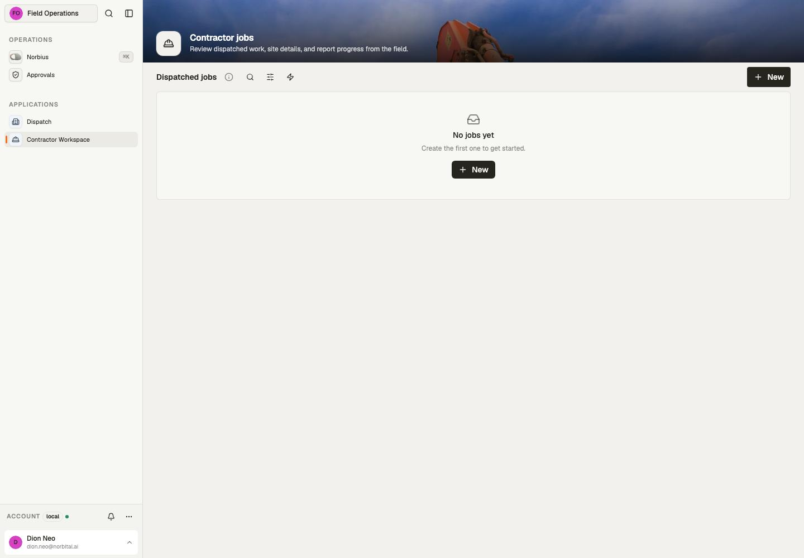

# Source reference

Checked against this template's source and compiled declaration manifest on 30 October 2026.
This is a local source inventory, not a declaration that a deployed tenant runs these bytes.

6 models, 2 applications, 5 automations.

## Applications and pages

| Source application                                              | Title                | Pages                                     | Purpose                                                                   |
| --------------------------------------------------------------- | -------------------- | ----------------------------------------- | ------------------------------------------------------------------------- |
| [field_ops_contractor](../src/app/field_ops_contractor/+app.ts) | Contractor Workspace | jobs: Dispatched jobs                     | Review dispatched work, site details, and report progress from the field. |
| [field_ops_controller](../src/app/field_ops_controller/+app.ts) | Dispatch             | dispatch: Dispatch schedule; sites: Sites | Coordinate scheduled work, sites, contractors, and field evidence.        |

## Models and exposed operations

Outputs fix field visibility. Policies select outputs and scope rows; write columns and checks constrain mutations. Each row links to its owning declaration.

| Model                                                                                                                    | Fields | Read outputs        | Writes                         | Post-commit effects | Syncs |
| ------------------------------------------------------------------------------------------------------------------------ | ------ | ------------------- | ------------------------------ | ------------------- | ----- |
| [communication_logs](../src/data/model/sites/job_assignments/communication_logs/+model.ts)                               | 4      | default, contractor | create                         | none                | none  |
| [job_assignments](../src/data/model/sites/job_assignments/+model.ts)                                                     | 15     | default, contractor | create, update, delete, upsert | created, updated    | none  |
| [photo_evidence](../src/data/model/sites/job_assignments/photo_evidence/+model.ts)                                       | 12     | default, contractor | create, update, delete, upsert | created             | none  |
| [sites](../src/data/model/sites/+model.ts)                                                                               | 9      | default, contractor | create, update, delete, upsert | none                | none  |
| [suspicion_reviews](../src/data/model/sites/job_assignments/suspicion_reviews/+model.ts)                                 | 7      | default             | create                         | none                | none  |
| [suspicious_activity_logs](../src/data/model/sites/job_assignments/suspicion_reviews/suspicious_activity_logs/+model.ts) | 6      | default             | create, update, upsert         | none                | none  |

Upsert is available when both create and update are exposed; it resolves an explicit ID or the model’s natural key and requires an explicit conflict rule.

## Automations

All named runs use the reserved system identity and the listed policies. A manual-start grant controls who may start a run; cron/webhook/schedules use their declared trigger path. Model effects run as their writer and are separate from these named automations.

| Automation                                                                                                | Trigger                        | Policies                    | Purpose                                                                                                                                                                                                                                                                                                                                                                                                          |
| --------------------------------------------------------------------------------------------------------- | ------------------------------ | --------------------------- | ---------------------------------------------------------------------------------------------------------------------------------------------------------------------------------------------------------------------------------------------------------------------------------------------------------------------------------------------------------------------------------------------------------------- |
| [inspect_photo_evidence](../src/automation/+inspect_photo_evidence.automation.ts)                         | started or scheduled from code | suspicion_review_automation | Started when a photo is filed (`photo_evidence.effect.created`): fills its sha256, perceptual and scene embeddings, integrity flags and near-duplicate matches from the host's image facts.                                                                                                                                                                                                                      |
| [job_assignments_import_work_orders](../src/automation/+job_assignments_import_work_orders.automation.ts) | started or scheduled from code | field_ops_controller        | Creates job assignments from a work-order sheet, matching existing sites and skipping filed rows. The complete sheet is checked before sites and jobs commit together.                                                                                                                                                                                                                                           |
| [review_job_assignment_suspicion](../src/automation/+review_job_assignment_suspicion.automation.ts)       | started or scheduled from code | suspicion_review_automation | Started when an assignment is filed or changes (`job_assignments.effect`): inspects photos awaiting facts (fills each one's sha256, perceptual embedding and integrity flags), then reviews every unchecked assignment with AI and creates an idempotent suspicion log only when the model judges the combined evidence suspicious. A review that fails stamps nothing and is retried at the next two-hour slot. |
| [site_handover](../src/automation/+site_handover.automation.ts)                                           | started or scheduled from code | field_ops_controller        | Bundles each selected site with its dispatched jobs and photo evidence into one JSON file plus a CSV per table, for handover to another system.                                                                                                                                                                                                                                                                  |
| [suspicious_activity_logs_resolve](../src/automation/+suspicious_activity_logs_resolve.automation.ts)     | started or scheduled from code | field_ops_controller        | Close this finding with the controller’s conclusion.                                                                                                                                                                                                                                                                                                                                                             |

## Integrations and source roles

- Integration definitions: none.
- Named connections: `field_ops_whatsapp`.
- Source policies: `field_ops_contractor`, `field_ops_controller`, `field_ops_whatsapp`, `suspicion_review_automation`.
- Custom datatypes: `photo_source`.

Pairing and credentials belong to the host's Connections surface; defining a connection does not mean it is paired.

## Browser evidence

Captured through the browser from a separate local documentation workspace on 30 October 2026. This shows layout and navigation; it does not certify external providers, automation results or deployment.
