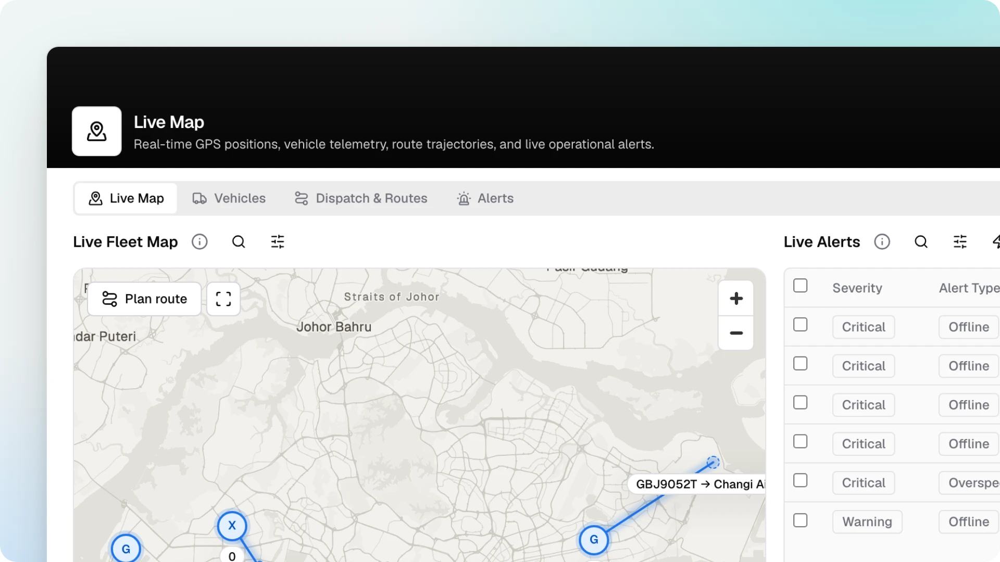

# Fleet Management



A real-time **GPS transponder tracking, live fleet mapping, day-to-day route dispatch, geofencing and
telemetry alerting** workspace — keeping daily dispatch operations cleanly separated from telematics
configuration.

## Industry & Bolt capabilities

- **Industry:** Logistics & Fleet
- **Bolt capabilities:** `data_modeling`, `gps_geospatial`, `third_party_saas`, `scheduled_automations`

## Key capabilities

- **Live fleet map & live alerts dashboard:** Monitor transponder-equipped vehicles on a live MapLibre
  map with hover tooltips and click-to-expand vehicle detail cards, route polylines, and a live
  **Live Alerts** panel right beside the map for immediate exception triage.
- **GPS transponder stream & bulk import:** Ingest GPS fixes (`lat`, `lng`, `speed_kmh`, `heading_deg`,
  `altitude_m`, `ignition_on`, `odometer_km`, `fuel_pct`, `hdop`) via `gps_transponder` (5-minute poll
  woken immediately by HMAC-SHA256 webhooks) or CSV/XLSX log uploads. Every ping lands in append-only
  `telemetry_pings` and atomically refreshes the parent vehicle snapshot and CEL `is_overspeed` flag.
- **Day-to-day route schedule & live ETAs:** View and dispatch daily trips in the **Day-to-Day Schedule**
  or full route ledger (`planned → dispatched → en_route → arrived → completed | cancelled`) with ordered
  `route_waypoints`, automatic vehicle destination sync, and on-demand traffic ETA refreshes via optional
  **Google Routes**.
- **Circular geofences & operational alerting:** Define `depot`, `job_site`, `customer`, `corridor` and
  `restricted` geofences with optional zone speed-limit overrides and enter/exit triggers. Overspeeding,
  geofence crossings, stale/offline transponders (> 30 min) and route delays automatically open
  `seq`-numbered `fleet_alerts` (`open → acknowledged → resolved`).

## How it works

1. **Telemetry ingestion:** `telemetry_pings.syncs.transponder` pulls fixes from a GPS gateway (woken
   instantly by verified HMAC-SHA256 webhooks, with a 5-minute fallback poll) or accepts CSV/XLSX uploads.
2. **Atomic snapshot & rule evaluation:** Each committed ping batch triggers `telemetry_pings.create.effect`,
   which updates the parent `vehicles` snapshot (`last_location`, speed, heading, fuel, status), updates
   any active `routes` ETA, and opens `overspeed` or `geofence_enter`/`geofence_exit` rows in
   `fleet_alerts`.
3. **Dispatch & day-to-day scheduling:** Dispatchers plan trips on `routes` by day; dispatching writes
   `destination_label` and `destination_location` onto the assigned vehicle, and completion clears them
   and seals the route (`closed_locked`).
4. **Proactive monitoring:** `refresh_route_eta` recomputes ETAs (via GPS speed or Google Routes) and
   flags `route_delay`; `check_fleet_health` runs every 15 minutes to flag silent transponders as
   `offline`.

## Apps and roles

| App                  | Pages                                                                             | Audience / role                                               |
| -------------------- | --------------------------------------------------------------------------------- | ------------------------------------------------------------- |
| **Fleet Operations** | Live Map (with Live Alerts), Vehicles, Routes (Day-to-Day Schedule & All), Alerts | `Dispatchers`, `Fleet Managers`, `Drivers` (own routes/reads) |
| **Configuration**    | Connections, Geofences, Drivers                                                   | `Fleet Managers` (isolated telematics & master configuration) |

## Data model

6 models and 1 custom field (`route_waypoints`):

- `vehicles` — transponder-equipped fleet assets (`is_overspeed` CEL computed field, 5-tab Vehicle Hub).
  - `telemetry_pings` (`owned: true`) — append-only GPS transponder stream (`transponder` HTTP/webhook
    sync and `gps_csv` file sync).
- `routes` — `seq`-numbered dispatched trips with ordered `route_waypoints` and `closed_locked` seal.
- `fleet_alerts` — `seq`-numbered exception ledger (`resolved_locked`).
- `geofences` — GPS boundary circles, zone speed overrides and enter/exit alert triggers.
- `drivers` — commercial drivers and license compliance.

## Automations and integrations

| Automation / integration | Trigger / type             | Purpose                                                                                   |
| ------------------------ | -------------------------- | ----------------------------------------------------------------------------------------- |
| `refresh_route_eta`      | Manual (Live Map / route)  | Recomputes live route ETAs from GPS speed or Google Routes and flags `route_delay` alerts |
| `check_fleet_health`     | Every 15 min; manual run   | Detects stale/offline GPS transponders (> 30 min) and opens `offline` alerts              |
| `gps_transponder`        | Webhook-woken / 5-min sync | Pulls live GPS fixes from a transponder gateway (HMAC-SHA256 verified webhook hint)       |
| `google_routes`          | Optional HTTP integration  | Supplies live traffic ETA calculations for active routes                                  |

## Getting started

```bash
bun install --frozen-lockfile
bunx bolt check
bun run test
bunx bolt build
```

A fresh workspace starts empty; add drivers, geofences and your `gps_transponder` / `google_routes`
connections under **Configuration**, or upload GPS logs via CSV/XLSX on a vehicle.

- [Workflow guide](docs/README.md)
- [Source reference](docs/source-reference.md)
