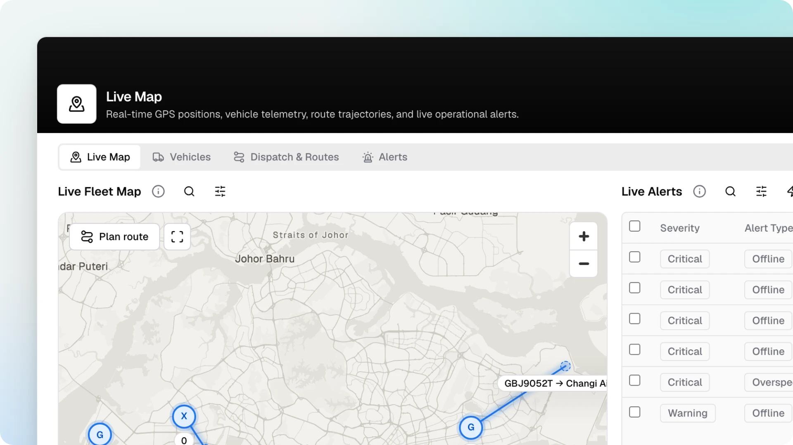

# 车队管理



实时 **GPS 应答器定位追踪、集成实时告警的在线车队地图、按日路线调度、电子围栏与遥测告警**工作区，将日常车队调度与遥测系统配置清晰隔离。

## 行业与 Bolt 核心能力

- **适用行业：** 物流与车队（Logistics & Fleet）
- **Bolt 能力标签：** `data_modeling`、`gps_geospatial`、`third_party_saas`、`scheduled_automations`

## 核心能力

- **实时车队地图与实时告警看板：** 在 MapLibre 地图上实时查看车辆位置、路线轨迹、悬停摘要提示与点击展开详情，并在主看板旁直接呈现**实时告警（Live Alerts）**便于即时处置。
- **GPS 应答器遥测流与批量导入：** 通过 `gps_transponder` 集成（每 5 分钟轮询，支持 HMAC-SHA256 签名 Webhook 即时唤醒）或 CSV/XLSX 批量轨迹上传采集定位数据；每条采样写入只追加的 `telemetry_pings` 并原子刷新车辆实时快照与 CEL 计算字段 `is_overspeed`。
- **按日调度计划与实时 ETA：** 在路线模块提供**按日调度视图（Day-to-Day Schedule）**与完整路线台账（`planned → dispatched → en_route → arrived → completed | cancelled`），支持有序途经点 `route_waypoints`、自动同步车辆目的地及可选 **Google Routes** 路况 ETA 刷新。
- **电子围栏与异常告警：** 配置车场、工地、客户点、主干道与禁行区圆形围栏、区域限速及进出触发条件；超速、越界、应答器离线（> 30 分钟）及路线延误自动生成 `seq` 编号告警（`open → acknowledged → resolved`）。

## 系统运作方式

1. **遥测采集：** `telemetry_pings.syncs.transponder` 由 HMAC-SHA256 Webhook 即时唤醒或按 5 分钟轮询拉取定位，也支持 CSV/XLSX 批量导入。
2. **原子快照与规则触发：** 每次采样写入触发 `telemetry_pings.create.effect`，同步更新车辆最新坐标/速度/状态、刷新在途路线 ETA，并在超速或越界时自动生成 `fleet_alerts`。
3. **按日调度与路线履约：** 调度员按日期编排并派发 `routes`，派发后自动同步车辆目的地，结案后锁定路线记录（`closed_locked`）。
4. **主动巡检：** `refresh_route_eta` 按需重算路况 ETA 并标记延误；`check_fleet_health` 每 15 分钟扫描静默超 30 分钟的应答器并触发离线告警。

## 应用与角色

| 应用         | 页面                                                       | 受众 / 角色                                      |
| ------------ | ---------------------------------------------------------- | ------------------------------------------------ |
| **车队运营** | 实时地图（含实时告警）、车辆、路线（按日调度与全部）、告警 | `调度员`、`车队经理`、`驾驶员`（本人路线与只读） |
| **系统配置** | 外部连接、电子围栏、驾驶员                                 | `车队经理`（独立隔离的遥测与基础配置）           |

## 数据模型

共 6 个模型与 1 个自定义字段（`route_waypoints`）：

- `vehicles` — 配备应答器的车队资产（含 `is_overspeed` CEL 计算字段与 5 标签车辆中心）。
  - `telemetry_pings`（`owned: true`）— 只追加 GPS 采样流水（`transponder` HTTP/Webhook 同步与 `gps_csv` 文件同步）。
- `routes` — `seq` 编号调度路线，含 `route_waypoints` 与结案锁定（`closed_locked`）。
- `fleet_alerts` — `seq` 编号异常告警台账（结案锁定 `resolved_locked`）。
- `geofences` — 圆形电子围栏、区域限速与进出触发规则。
- `drivers` — 商业驾驶员与驾照合规记录。

## 自动化与集成

| 自动化 / 集成        | 触发方式 / 类型           | 用途                                                        |
| -------------------- | ------------------------- | ----------------------------------------------------------- |
| `refresh_route_eta`  | 手动（实时地图 / 路线）   | 基于 GPS 速度或 Google Routes 重算 ETA 并标记 `route_delay` |
| `check_fleet_health` | 每 15 分钟 / 手动         | 扫描超 30 分钟无心跳的应答器并触发 `offline` 告警           |
| `gps_transponder`    | Webhook 唤醒 / 5 分钟同步 | 从应答器网关拉取实时定位（支持 HMAC-SHA256 验签）           |
| `google_routes`      | 可选 HTTP 集成            | 为在途路线提供实时路况 ETA                                  |

## 快速开始

```bash
bun install --frozen-lockfile
bunx bolt check
bun run test
bunx bolt build
```

新工作区初始为空：可在**系统配置**录入驾驶员、电子围栏并绑定 `gps_transponder` / `google_routes`，或在车辆页面导入 CSV/XLSX 轨迹。

- [工作流指南](docs/README.md)
- [源码参考](docs/source-reference.md)
