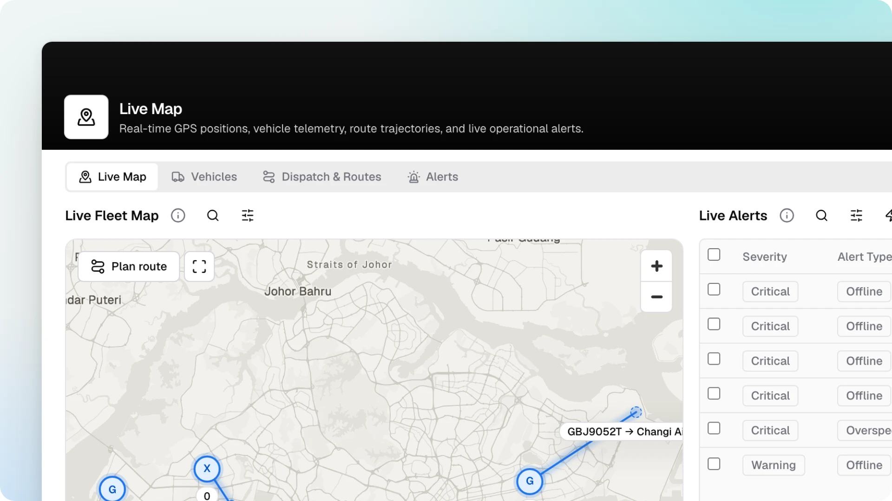

# Fleet Management — Technical Documentation



Technical documentation and developer guide for the **Fleet Management** (`norbital_fleet_management`) Bolt workspace.

## Documentation Map

- **[Architecture & Inner Mechanisms](architecture.md)** — Detailed pure-ASCII diagrams and specifications covering system topology, data ownership ER model, state machines and locks, real-time GPS telemetry ingestion and atomic propagation, route dispatch destination sync, geospatial formulas, proactive monitoring automations, and RBAC.
- **[Source Reference](source-reference.md)** — Exact file-by-file inventory of workspace configuration, models, custom fields, syncs, integrations, apps/pages, automations, shared libraries, policies, migrations, and tests.
- **[Business Overview (English)](../README.md)** / **[业务概览（简体中文）](../README.zh.md)** — Customer-facing scope, roles, apps, automations, and boundaries.

## Workspace Summary

| Dimension                  | Configuration                                                                                                                                   |
| -------------------------- | ----------------------------------------------------------------------------------------------------------------------------------------------- |
| Handle / Name              | `norbital_fleet_management` — Fleet Management (`车队管理`)                                                                                     |
| Locale & Regional Defaults | Timezone `Asia/Singapore`, locale `en-SG`, languages `en` / `zh`, currency `SGD`                                                                |
| Apps (2)                   | `operations` (`live`, `vehicles`, `routes`, `alerts`), `configuration` (`connections`, `geofences`, `drivers`)                                  |
| Record Models (6)          | `vehicles`, `telemetry_pings` (`owned: true`), `routes`, `fleet_alerts`, `geofences`, `drivers`                                                 |
| Custom Fields (1)          | `route_waypoints`                                                                                                                               |
| Syncs (2)                  | `telemetry_pings.syncs.transponder` (HTTP/webhook), `telemetry_pings.syncs.gps_csv` (CSV/XLSX)                                                  |
| Integrations (2)           | `gps_transponder` (HTTP + HMAC-SHA256 webhook), `google_routes` (optional HTTP traffic ETA)                                                     |
| Automations (2)            | `refresh_route_eta` (`mode: 'call'`), `check_fleet_health` (cron `*/15 * * * *`, `rest: '24h'`)                                                 |
| Teams (3) & Policies (4)   | `fleet_administrators`, `fleet_dispatchers`, `fleet_viewers` across `fleet_read`, `fleet_operations`, `fleet_configuration`, `fleet_automation` |

## Developer Quickstart

Run all commands from this template directory:

```bash
bun install --frozen-lockfile   # Install pinned workspace dependencies
bunx bolt check                 # Type-check, compile manifest, and verify migration history
bun run test                    # Run automated Vitest + Effect TestWorkspace suites
bunx bolt build                 # Compile release artifacts and update migrations if schema changed
```

Additional development commands from `package.json`:

```bash
bun run dev                     # Start tethered Bolt dev watcher (`bolt dev`)
bun run format                  # Format source and docs with Prettier
```

## Migration & Seed Workflow

### Schema & Migrations (`migrations/`)

- The database schema is declared declaratively in `src/data/model/**/+model.ts` and `src/data/custom_field/**/+custom_field.ts`.
- Running `bunx bolt build` generates the next editable SQL migration under `migrations/` and replays the entire migration chain against a scratch database to verify parity with the compiled manifest.
- Always commit generated `migrations/*.sql`, `migrations/snapshot.json`, `migrations/migrations.lock.json`, and `migrations/physical.json` together.
- Never commit `.norbital/` — it is generated output.
- Verify migration replay at every prefix with `bunx bolt check` before opening a change.

### Seeding & Local Data (`seed/`)

- A freshly provisioned workspace starts empty: add drivers, geofences, and `gps_transponder` / `google_routes` connections under **Configuration**, register vehicles under **Fleet Operations → Vehicles**, or import historical GPS logs via CSV/XLSX.
- `seed/+seeder.ts` binds the external demo fixture tree (`fleet-management`) for `bolt seed` during managed demo resets.
- Automated tests in `tests/fleet-telemetry-and-routes.test.ts` run strictly against isolated in-memory PGlite databases via `TestWorkspace` (`tests/test-runtime.ts`) using synthetic fixtures — no external PostgreSQL server or live telematics credentials are required.
