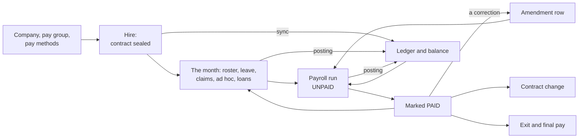
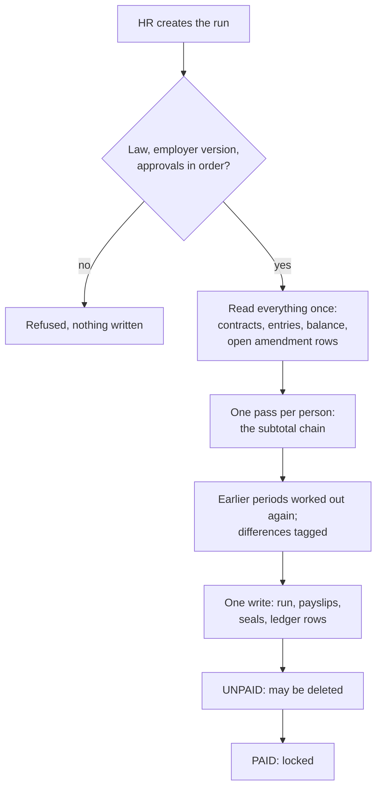
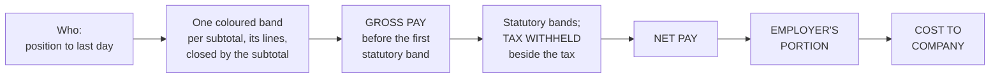

# Core mechanisms, run through

One invented example followed from setting up a company to an exit. Each step says what the HR user does, what the system writes, and where it shows. Structure is in [the architecture](0001-hrms-calculation-architecture.md); correcting any step is in [corrections and integrity](0007-corrections-and-integrity.md); each country's own figures are in [statutory coverage](0009-statutory-coverage.md).

**The example.** A company called "Example Co" has one monthly payroll. It hires "the employee" on 3,000 a month. Every name and figure here is invented. To keep the arithmetic visible, the example's law version is assumed to say:

- proration by calendar days, rounding to 2 places;
- an annual leave row granting 14 days per service year, carrying one window, with a `payout`;
- a no-pay leave row, `NPL`, with `paid_share` 0;
- a medical claim row with a yearly limit of 500.

A real jurisdiction's rows differ; the mechanism does not.



## 1. Set up the company

| HR does                                                                                              | The system writes                                                                                                      | Where it shows        |
| ---------------------------------------------------------------------------------------------------- | ---------------------------------------------------------------------------------------------------------------------- | --------------------- |
| Creates the company and names its jurisdiction                                                       | An `entity`. Once it has versions or contracts its jurisdiction cannot change                                          | Entities              |
| Fills the employer details the law asks for, the bank, the time zone and any pay methods, then seals | An `entity_profile_version`, `DRAFT` then `SEALED`. The law's rules check it; its effects raise the registration tasks | Entities; Obligations |
| Creates the pay group: monthly, pay day 25, cutoff day 1                                             | A `pay_group` with its `payment_schedule`                                                                              | Entities              |
| Publishes the holiday calendar and defines shifts and shift patterns                                 | `holiday`, `shift_definition`, `shift_pattern` rows                                                                    | Entities              |

What to expect:

- **Pay group.** A pay group is one payroll: frequency (monthly, twice a month, every ten days), the pay day of each cycle, how a pay day on a non-working day moves, and the cutoff day. A company with one group never has to name it. A company with two names one on every sealed contract and every run.
- **Cutoff.** With cutoff day 1, a cycle's attendance is its own salary days. With a later cutoff, a monthly cycle's attendance runs from last month's cutoff day to the day before this month's.
- **Pay methods.** Five optional employer methods (the overtime hour, a rest-day multiple, night premium hours, the contribution split over two runs a month, benefits over their tax-free limit). Each applies only where it pays at least the law. Which rows read them in each country is in [statutory coverage](0009-statutory-coverage.md).
- **A change later** is a new sealed employer version, or an `entity_change` filed ahead and sealed on its day.

## 2. Hire

| HR does                                                                                                                                | The system writes                                                                                                                                                                                                   | Where it shows                               |
| -------------------------------------------------------------------------------------------------------------------------------------- | ------------------------------------------------------------------------------------------------------------------------------------------------------------------------------------------------------------------- | -------------------------------------------- |
| Creates the person, or invites them and lets the accepted invitation create the profile                                                | An `employee_profile`                                                                                                                                                                                               | People                                       |
| Drafts the contract: start 16 June, 3,000 monthly, normal hours and days, shift pattern, agreed allowances, the facts the law asks for | An `employee_contract` in `DRAFT`. The law's rules check the terms against the version in force on the first day (minimum wage, hours, category)                                                                    | People                                       |
| Adds the family: a spouse, a child with a date of birth                                                                                | `family` members on the contract. Every count a scheme reads comes from this list                                                                                                                                   | People                                       |
| Seals the contract                                                                                                                     | `SEALED`. The law's effects raise the new-hire tasks. The `ledger` automation is scheduled for this person                                                                                                          | People; Obligations                          |
| Nothing                                                                                                                                | The sync opens the person's `employee_balance` and posts each leave row's `entitled` and each limited claim row's `limit` for the current window. A child's birth date opens the leave rows that name `CHILD_BIRTH` | The employee profile's balance; self-service |

What to expect:

- **One open contract per person.** A draft may overlap the open contract; sealing it waits until that one has its last day. The overlap rule is the person's, so it covers a sister company too.
- **Entitlement is a rule, not a number HR types.** The balance shows `entitled 14` because the row says 14 for this person in this window. If the row prorates a first year or counts service bands, the figure follows that rule.
- **Service** runs from the current unbroken stint. With "count every stint" on the profile, earlier stints count too.
- **A fact known ahead**, such as an expected birth, is filed as a `contract_change` and sealed on its day.

## 3. Roster, attendance and overtime

| HR or the employee does                                                         | The system writes                                                                 | Where it shows |
| ------------------------------------------------------------------------------- | --------------------------------------------------------------------------------- | -------------- |
| Nothing, for an office worker                                                   | Nothing. A day with no roster row is a day worked as the contract's pattern plans | —              |
| Plans a shift worker's month, by hand or by importing the roster workbook       | One `roster_entry` per person and day: the shift, and any planned overtime        | Events → Work  |
| Clocks in and out at the kiosk                                                  | `actual_worked_intervals` on that day's `roster_entry`                            | Events → Work  |
| Marks planned overtime as time off instead of pay, where the law has such a row | `overtime_as_time_off` on the day                                                 | Events → Work  |

What the run will do with it:

- **A supplied roster is the source of truth for that person's cycle.** A planned work day the roster leaves out, with no leave and no published holiday, is an absence. So is a planned work day with no clock. An absence comes off the basic at `PRORATED`; it has no line of its own.
- **Overtime is paid only from the plan.** The clock verifies it and never creates it. A clock on a rest day with no planned overtime pays nothing. If the clock covers at least the employer's `overtime_full_award_percent` of the plan (100 by default), the whole plan is paid. Below that, the clocked time inside the plan is paid, rounded down to the half hour.
- **Overtime taken as time off** pays nothing; the payslip posts the awarded hours to the law's hour-counted leave row.
- **A holiday** applies by its date. Work on it pays the law's holiday row, not the rest-day row. A holiday that replaces one that fell on a rest day is given only to those off on the replaced date.
- **The law's roster rules** refuse a roster day that breaks them. Its roster warnings (daily hours, overtime caps, consecutive days, weekly rest) are worked out when the day is written and kept on the day as findings.
- **Days rostered past a person's last day** are neither absences nor pay.

## 4. Leave

The employee asks for two days of annual leave, 8 and 9 July.

| Step                                    | The system writes                                                                                                                               | Where it shows                         |
| --------------------------------------- | ----------------------------------------------------------------------------------------------------------------------------------------------- | -------------------------------------- |
| The employee submits the request        | A `leave_catalog_entry` with four half-day slots, held for approval. Nothing on the ledger                                                      | Self-service; the reviewer's approvals |
| While it waits                          | The four slots are held: a second request for the same days is refused, and the days count against what is left when another request is checked | —                                      |
| A supervisor approves, then HR approves | On the final decision, in one statement: the request is approved and `leave/ANNUAL_LEAVE/<window>/used +2` posts                                | Events → Leave; the balance            |
| Nothing                                 | The law's effects on the entry run now, under the system identity                                                                               | Obligations                            |

What to expect:

- **A request is refused at once** when the window does not hold the days, when leave already covers a half day, or when an unpaid run holds the person for that date.
- **Rejected or withdrawn**, the record is taken back and nothing was posted. Only the requester can withdraw; a reviewer rejects.
- **HR keying leave for someone** posts in the entry's own write, with no approval step.
- **Paid leave makes no payslip line.** A day of `NPL` does: see the run below.
- **A half day is taken once** across all of a person's leave, until the slot is removed from its entry.
- **A payroll run refuses** while a request it would pay still waits.

## 5. Claims and ad hoc entries

| HR or the employee does                                              | The system writes                                                                                                | Where it shows  |
| -------------------------------------------------------------------- | ---------------------------------------------------------------------------------------------------------------- | --------------- |
| The employee claims 400 of medical costs                             | A `claim_catalog_entry`, held for the same two review steps. On approval: `claim/MEDICAL_CLAIM/<year>/used +400` | Events → Claims |
| Later the same year, claims 300                                      | The row's limit is 500 and 400 is used, so 100 posts. The entry keeps 300; the run pays the 100 that posted      | Events → Claims |
| HR keys a bonus of 1,000 on the bonus row                            | An `adhoc_catalog_entry`. It posts to the ledger only if its row declares accounts                               | Events → Ad hoc |
| HR keys a refund a fund decided, on the generic statutory refund row | An ad hoc entry. It posts to the account its row names; the next run pays it                                     | Events → Ad hoc |

What to expect:

- **A late entry is paid by the next run, once.** Dated in a period that paid the person nothing, it is an ordinary line. Dated in a period the person was paid for, it belongs to that period: the next run carries it under "Adjustments for earlier periods", tagged with the period, with what it moves in contributions and tax.
- **An ad hoc row says** whether it adds or deducts, whether it is the employee's or the employer's cost, and whether it may run off-cycle.
- **A tax instalment the authority directs** (Malaysia's CP38) is an ad hoc entry. It is deducted and counted as tax withheld. It posts to its own account, so the PCB year-to-date the next months read leaves it out.
- **A contribution wrong in a paid month needs no entry.** HR corrects the record that made it wrong and the next run carries the difference (section 10).

## 6. Loans

| HR does                                       | The system writes                                                                 | Where it shows |
| --------------------------------------------- | --------------------------------------------------------------------------------- | -------------- |
| Creates a loan of 1,200 repaid over 12 months | A `loan_catalog_entry`. The row's eligibility rule, if it has one, is checked now | Events → Loans |
| Generates the schedule                        | Twelve `loan_catalog_entry_repayment` rows of 100, one a month                    | Events → Loans |

What to expect:

- **Loans never touch the ledger.** What is outstanding is the principal less the repayments.
- **Each run recovers the instalment dated in its attendance.** A later month's stays open. Recovery is on-cycle only.
- **A recovery that would take net pay below zero refuses the run** and says how; reduce the instalment and run again.
- **An instalment a run took can still be corrected.** HR changes or deletes it, and the next run carries the difference for the period it was taken in.

## 7. The payroll run

HR creates the on-cycle run for July, for Example Co's one pay group.



**What it takes.** Everything is read once, before any payslip.

| Source                      | Taken when                                                                                                               |
| --------------------------- | ------------------------------------------------------------------------------------------------------------------------ |
| Contracts                   | Sealed, of this pay group, in force in the period. One payslip per person, on the contract in force at the period's end  |
| Roster days and leave slots | Dated in the run's attendance window                                                                                     |
| Claims and ad hoc entries   | Not yet paid by any run, dated up to the period's end. One dated in a period the person was paid for goes to that period |
| Loan repayments             | Dated in the attendance window                                                                                           |
| Leave cash-outs             | Not yet paid, whatever their date. An exit's leave is no entry: the last payslip settles it from the balance             |
| Earlier pay                 | The balance's totals for the tax year and the last twelve months                                                         |
| Amended paid periods        | The open amendment rows of the people it pays, and those periods' records and payslips, through the tax year's end       |

**The subtotals, in order.** Suppose July has 31 days and the employee took one day of `NPL`.

```text
BASIC        3,000.00   the contract salary
PRORATED     3,000.00   less days not employed and absences (none in July)
PAID_BASIC   2,903.23   less the NPL line: 3,000 ÷ 31 for one day
...          + allowances, overtime, the 100 claim, the 1,000 bonus, each at the subtotal its row names
statutory    each scheme in dependency order, on the subtotal its law names
NET          after employee contributions, tax and the 100 loan instalment
...          then any difference for an earlier period, each line tagged with its period
```

In June, the joining month, `PRORATED` was 1,500.00: 15 of 30 calendar days from 16 June.

**Statutory contributions and tax.** Each scheme row decides who it applies to and what the employee and the employer pay. A scheme reads only completed subtotals and the schemes it depends on, so a tax row reuses the contribution results. Above zero is a deduction. Below zero, a row whose law has the employer repay pays a refund line; any other row stops at zero and the next run nets it. No line is negative.

**Month-to-date and year-to-date.** A row that needs earlier pay reads the balance: the tax year's totals, or the pay month's where the row keeps month totals. So a second run in the same month charges only what the month still owes.

**What it writes, in one write.**

| Written                     | Detail                                                                                                      |
| --------------------------- | ----------------------------------------------------------------------------------------------------------- |
| The `payroll_run`, `UNPAID` | Company, pay group, period, the law version, salary coverage and pay date. None of these is typed           |
| One `payslip` per person    | Totals and the breakdown as calculated: checkpoints, lines, statutory amounts                               |
| The seals                   | `payroll_run_id` on every roster day, leave slot, claim, ad hoc entry and repayment it priced               |
| The amendment rows it took  | `payroll_run_id` on each `pay_amendment` row it carried; one new row where a recovery is carried forward    |
| Ledger rows                 | Each checkpoint as `pay/…/total`, each scheme as `statutory/…/paid`, for the year and where named the month |

The law's run effects then raise the period's tasks: remittances, filings, payslip issue. See Obligations.

**The run refuses**, and writes nothing, when: no sealed employer version or law covers it; a confirmed change of law for its period is not merged; a later cycle of the group has already run; the group already ran this period; an entry it would pay, or one in a period it works out again, still waits for approval; or a loan recovery would take someone below zero.

**Off-cycle.** An off-cycle run is for what cannot wait: a bonus or severance. HR names the ad hoc entries it pays. Only their people get a payslip, and it pays no salary. Only rows marked `off_cycle_eligible` may be named; a recurring item is refused. Statutory schemes still apply, on the month's total, so the month owes the same as if the entry had gone on-cycle. A leaver's off-cycle run goes on the period of their last day, for their own pay group. An off-cycle run carries earlier periods only when HR names them; it never takes money back. It refuses an entry or amended period another run already took.

## 8. Payslip, salary listing and bank file

| HR does                              | The system writes                                    | Where it shows |
| ------------------------------------ | ---------------------------------------------------- | -------------- |
| Opens the run and reads each payslip | Nothing                                              | Payroll        |
| Exports the salary listing           | A spreadsheet built from the run's payslips          | Payroll        |
| Exports a bank file                  | A bank payment file in one of the template's layouts | Payroll        |

The salary listing is one sheet per run. Every figure is a payslip's own line or total, so each can be traced. An export reads the run; it changes nothing.



- **Who.** Position, department, employee code, name, ID number, date joined, last day. Frozen through the name.
- **Bands.** The law's subtotal chain, in order, each in its own colour. Each band holds the lines that move it (what adds is positive, what takes off negative) and closes on its subtotal. A line identical to its band's subtotal shows once.
- **GROSS PAY** stands before the first band that holds a statutory deduction.
- **TAX WITHHELD** comes right after the band that holds the tax. It counts every tax the payslip withholds: the tax scheme and any instalment the authority directs (Malaysia's PCB and CP38).
- **NET PAY**, then the **employer's portion**, one column per scheme.
- **COST TO COMPANY** = net pay + employee contributions + tax withheld + employer portion.
- A `TOTAL` row sums each column.

While the run is `UNPAID` it can be deleted: its payslips go, its seals come off, the amendment rows it took open again, and its ledger rows are inverted. Runs come off newest first. While it stands, nothing of the people it holds can be changed.

## 9. Marking paid

| HR does               | The system writes                                                                                                 | Where it shows |
| --------------------- | ----------------------------------------------------------------------------------------------------------------- | -------------- |
| Marks the run as paid | The run moves to `PAID`. The paid date is the moment of this move. The entitlement sync is scheduled for everyone | Payroll        |

A paid run cannot be deleted and its payslips never change. The employee sees the payslip in self-service. What the run priced can still be corrected at its source: see the next section.

## 10. Correcting a paid month

July is paid. HR finds that two hours of planned overtime on 14 July were never keyed.

| HR does                                                   | The system writes                                                                                                                                      | Where it shows                            |
| --------------------------------------------------------- | ------------------------------------------------------------------------------------------------------------------------------------------------------ | ----------------------------------------- |
| Opens the roster day of 14 July, adds the hours and saves | The roster day, and one `pay_amendment` row: the employee, the pay group, July. The July payslip does not change                                       | —                                         |
| Creates the August run                                    | It works July out again on the records as they stand, takes the difference from what July paid, and puts it on the August payslip as lines tagged July | Payroll → the run's "Earlier periods" tab |
| Reads the August payslip                                  | Under "Adjustments for earlier periods": the overtime for July, and what it moves in contributions and tax, posted to July's own totals                | The payslip                               |
| Marks August paid                                         | The amendment row stays, held by the August run: it is done                                                                                            | Payroll                                   |

What to expect:

- **HR keys no amount** and picks no period. The correction is the record itself, with its real date.
- **The leave, claim, ad hoc, loan repayment, roster day and holiday forms, and sealing a contract version, ask first:** "This period is already paid". The paid payslip does not change, and the next run carries the difference.
- **Any record of a paid month works the same way:** a roster day, a leave day, a claim, an ad hoc entry, a loan instalment. It can be added, changed, moved to another date or deleted.
- **Many corrections of one month are one difference.** A change put back to what it was carries nothing.
- **The months after it in the same tax year are worked out again too,** so a yearly ceiling or a cumulative tax ends exact. A later tax year is left alone.
- **Net pay never goes below zero.** If a correction takes back more than the month pays, the payslip ends at zero with a line "Recovery carried forward", and the next run takes the rest.
- **While a run is unpaid, the people it holds cannot be corrected.** Delete the run, correct the record, and run again.
- **Company-wide corrections** work the same way for everyone they reach: a holiday published late, an employer version or a law version sealed from its real date.
- **A pay group that has paid keeps its schedule.** A new schedule is a new group, and people move to it from the first of a month.

The whole rule, with what is refused, is in [corrections and integrity](0007-corrections-and-integrity.md).

## 11. Balances and the ledger

Each person has one balance. What a person or HR reads:

| Shown                    | Comes from                                                       |
| ------------------------ | ---------------------------------------------------------------- |
| Entitled                 | The sync, from the row's rule and the contract; HR's manual rows |
| Carried                  | The sync, from the window before                                 |
| Used                     | Leave and claim entries                                          |
| Left                     | `entitled + carried + limit − used`, worked out, never stored    |
| Pay and statutory totals | Payslips                                                         |

Behind every figure is a list of ledger rows: an `ADD` or `DEDUCT` of an amount, on a date, naming the record that caused it. The balance is the sum of those rows and nothing else. An employee reads their own balance and ledger in self-service; HR reads them on the employee profile.

HR can adjust a balance by hand on the employee profile: days added to or taken from a leave row's entitlement, or money on a claim row's limit, with a note saying why. It is one more ledger row. It is never changed; a mistake is an opposite row.

When the law changes an entitlement, the balance moves by the difference. If the law raises the example's 14 days to 18, the sync posts `entitled +4`. Days already taken stay taken.

## 12. Year or window turnover

Nothing is closed and nothing is typed.

| When                                                                         | The system writes                                                                                                                                                    |
| ---------------------------------------------------------------------------- | -------------------------------------------------------------------------------------------------------------------------------------------------------------------- |
| The employee's service year turns (16 June next year)                        | The closing window settles once, under the law and contract of its last day. A new window opens with a new key: `entitled 14`, and `carried` by the row's carry rule |
| A calendar-year row turns on 1 January                                       | The same, for everyone on that row                                                                                                                                   |
| The first pay date of a new tax year                                         | The run reads an empty year: pay and statutory totals start again                                                                                                    |
| A month total passes a year old; a year or service window passes three years | It leaves the balance through a dated ledger row. The ledger keeps every row                                                                                         |

In the example, with 5 of 14 days left at the turn and a carry of one window, the new window shows `entitled 14, carried 5`. Without a carry rule the 5 days lapse.

A tax row settles the year by its own law, inside the ordinary run: there is no year-end step.

## 13. A contract change

The employee is promoted to 3,500 from 1 October.

| HR does                                                             | The system writes                                                                                                                                                                                                            | Where it shows |
| ------------------------------------------------------------------- | ---------------------------------------------------------------------------------------------------------------------------------------------------------------------------------------------------------------------------- | -------------- |
| Opens the sealed contract and chooses Promotion, with the new terms | Dated today or earlier: a new `DRAFT` version; the current version gets its last day, 30 September; the new one is sealed. Dated ahead: `contract_change` rows, sealed into a version by `contract_materialize` on 1 October | People         |
| Nothing                                                             | The sync runs for this person. The balance, the service start and any loan carry on                                                                                                                                          | The balance    |

What to expect:

- **A change starts on the first of a month**, so a run never prices a month on two versions. A hire, a rehire and an exit keep their real dates.
- **Under an unpaid run nothing of the person changes.** Delete the run first.
- **A change may start in a month already paid.** The version is sealed from its real date. If it was signed by that month's pay date, or has no signed date, the month is worked out again and the next run carries the difference on every line. If it was signed later, the paid months do not move: where the law names a back-pay row, the month it was signed in pays what it adds for them as one line of back pay, priced by the law's own rule.
- **A change filed ahead lands in a paid month** when a run covering its date was paid before its day. It does not seal: it stays filed and raises a task. Move it to the first of a month still to run.
- **A wrong version** is voided with a reason and replaced. Draft the replacement first.
- **A transfer** to another company is the same act with a new entity. In the same jurisdiction the balance and loans carry on. To another jurisdiction it is an exit from the old law and a start under the new: see [transfer semantics](transfer-semantics.md).
- **A life event**, such as a birth, is a new version carrying the fact; the leave it opens appears on the balance after the seal.

## 14. An exit

The employee resigns; the last day is 20 November.

| HR does                                                                                           | The system writes                                                                                                                                                                        | Where it shows              |
| ------------------------------------------------------------------------------------------------- | ---------------------------------------------------------------------------------------------------------------------------------------------------------------------------------------- | --------------------------- |
| Opens the contract and chooses Terminate: last day, reason, exit ground, whether to pay out leave | The sealed version ends on 20 November. With no successor in the same jurisdiction, that is an exit                                                                                      | People                      |
| Nothing                                                                                           | The law's exit effects raise the exit duties, each keyed to this exit                                                                                                                    | Obligations                 |
| Nothing                                                                                           | The sync prorates the leaving year's entitlement by the row's rule                                                                                                                       | The balance                 |
| Confirms the loan settlement the Terminate sheet proposes                                         | A final settlement repayment, up to what the employer's final-pay floor leaves. The rest is rescheduled and one task asks HR to chase it                                                 | Events → Loans; Obligations |
| Keys any notice pay or severance as ad hoc entries                                                | Ad hoc entries on the law's rows                                                                                                                                                         | Events → Ad hoc             |
| Runs November                                                                                     | The final payslip: salary for 1 to 20 November, the leave left paid out at the row's `payout`, the loan settlement, the entries. Its posting takes the days, so the balance ends at zero | Payroll                     |

What to expect:

- **The final run is the one covering the last day.** It pays everything up to that day; while the exit stands, no later on-cycle run pays this person.
- **The leave is settled by the final payslip.** Nothing is keyed and nothing waits for approval. A dismissal for misconduct, or HR switching the pay-out off, pays none out.
- **Leave taken beyond what the last day earned** is taken back on the final payslip at the row's `payout`, whatever HR decided.
- **If HR changes the decision, or the exit is cancelled or its date moves, after the final run is paid**, the period is amended: the next run carries the difference and the days follow. Someone no on-cycle run pays any more is paid by an off-cycle run that carries their waiting periods; what they would owe back is named in one task. Tasks are waived and an unpaid loan settlement goes back to instalments; a paid loan settlement stands. See [corrections and integrity](0007-corrections-and-integrity.md#11-when-an-exit-is-cancelled-or-its-date-moves).
