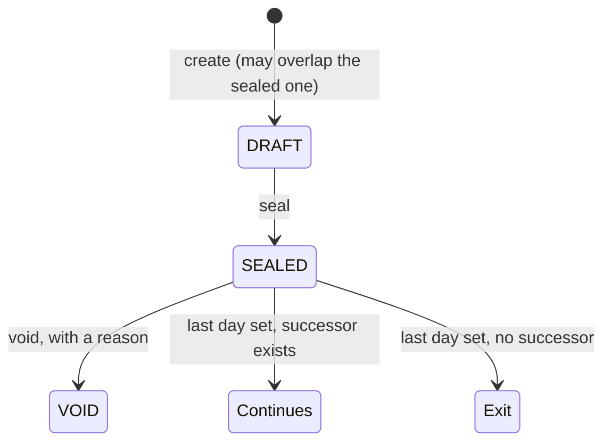

# Transfer semantics

Reference: the rules for contract chains, transfers, voids and exits. The source tree is the final authority.
[The architecture](0001-hrms-calculation-architecture.md) holds the structure and
[corrections and integrity](0007-corrections-and-integrity.md) what follows a cancelled or moved exit.

## 1. Terms

- **Employment** — the continuous relationship between a person and the employer group. It owns
  one `employee_balance`.
- **Contract** — dated terms for one entity and one jurisdiction version. A person has a chain of
  contracts, not a balance per contract.
- **Same-jurisdiction transfer** — the successor contract's `jurisdiction_settings.code` equals the
  predecessor's. Entity may change; the law does not.
- **Cross-jurisdiction transfer** — the successor's jurisdiction code differs. The old employment
  under that law ends; a new employment under the new law begins.
- **Promotion** — same jurisdiction and same entity; `reason` records it; terms change.
- **Life event** — same jurisdiction and same entity; a new contract version carries the event.
- **Termination** — the contract ends with no successor. This is an exit.
- **Void** — a sealed record is cancelled with a reason. It is not a transfer and not a deletion.

The comparison is always by **jurisdiction lineage code**, never by entity id and never by the
version id (two versions of the same law are one jurisdiction).

## 2. Contract state machine

Rules:

1. A replacement is created as `DRAFT` first. A draft may overlap its predecessor.
2. The predecessor gets its last day before the replacement is sealed.
3. Two `SEALED` contracts for one employee must never overlap. The successor starts the day after
   the predecessor's last day. The overlap rule is employee-wide, so it also covers a successor in
   another entity. A draft may overlap; sealing it is refused until the predecessor ends.
4. The successor keeps the employee number; it does not create a new employee profile or balance.
5. A sealed record is read-only except for the fields its state allows. Void is the only way to
   cancel it; there is no delete verb.
6. A void requires a reason and is irreversible. A record a payroll run priced may still be voided:
   no later run uses it, and the void leaves an amendment row for each paid period it covered, so the
   next run works those periods out again.
7. A promotion, life event or transfer starts on the first of a month, so a run never prices a
   month on two versions or two employers. A life event keeps its own real date inside the fact,
   and a paid period reads a fact from the version in force on its date. A
   hire, a rehire and an exit keep their real dates, and a run pays those days by the period's
   proration. A period that holds an older mid-month move pays each employer only its own days.
8. A promotion or life event starting after today is filed as `contract_change` rows, not a draft.
   Nothing reads them until the `contract_materialize` automation seals the version on that day. A
   transfer is never filed this way.

## 3. Balance semantics

`employee_balance` is one row per employee. Payroll reads the row by `employee_id`.

| Scenario                               | Leave                                                              | Loans                                                    | Ledger history      |
| -------------------------------------- | ------------------------------------------------------------------ | -------------------------------------------------------- | ------------------- |
| Promotion, same entity                 | Carry unchanged                                                    | Carry unchanged                                          | Keep                |
| Transfer, same jurisdiction            | Carry unchanged                                                    | Carry, repointed to the successor                        | Keep                |
| Cross-jurisdiction, row has a `payout` | Settled by the old last payslip: paid out, the days post as used   | Transfer or settle                                       | Keep; old rows stay |
| Cross-jurisdiction, no `payout`        | Nothing moves: the old days stay under the old jurisdiction's keys | Transfer or settle                                       | Keep; old rows stay |
| Termination                            | Settled by the last payslip where the row has a `payout`           | Recover from final pay; the rest stays open, with a task | Keep                |

### 3.1 Leave

Leave is jurisdiction law, not a portable company currency. Periods are keyed by jurisdiction, so
the new law's keys start empty and sync opens them from the new contract.

Where the old jurisdiction's leave row has a `payout`, ending the contract with no
same-jurisdiction successor is settled by the old jurisdiction's last payslip, with nothing keyed
and nothing to approve. The days left are paid out unless the contract's `encash_leave` is off or
the exit is a misconduct dismissal (`exit_ground` `MISCONDUCT_DISMISSAL`); days taken beyond what
the last day earned are taken back at the same rate. The payslip's posting takes the days, so the
balance ends at zero. A changed decision, a moved last day or a cancelled exit after that run is
paid amends the period, and the next run carries the difference
([corrections and integrity](0007-corrections-and-integrity.md), section 11).

### 3.2 Loans

A loan is a receivable of the old employer. It does not disappear because the person changes
jurisdiction, and it never touches the ledger.

- **Same jurisdiction** — carry. The loan and its open schedule are repointed to the successor
  contract; for a cross-entity move the loan's `entity_id` and the open repayments move with it.
  Sealed repayments keep their original entity and employment. Payroll selects the open repayments
  by entity and `paid_on`.
- **Cross-jurisdiction** — the old open schedule is deleted first, then for each outstanding loan:
  - **TRANSFER**: when the target settings have a loan catalogue with the same code, create the
    target loan and monthly schedule from the outstanding principal.
  - **SETTLE**: otherwise, or when the user checks **Settle from final pay instead of transferring**,
    create the settlement repayment.
- **Termination** — final pay repays what `final_pay_loan_floor_percent` allows. The rest stays open
  on a recalibrated schedule, and HR gets a task to chase it (`LOAN_RECOVERY:<contract>:exit:<last day>`). If the
  exit is cancelled the task is waived and a final settlement no run took goes back to monthly instalments over the
  loan's period; one a paid run took stands.

Silent carry is unsafe across jurisdictions: the new jurisdiction's payroll reads its own loan
catalogue, so the old loan's `catalog_id` may not exist and the deduction silently stops.

### 3.3 Service continuity

Service for leave bands is a property of the **employment**, not of the latest contract. A
promotion or transfer must not reset annual-leave service.

Service is worked out from the person's contracts, never stored as a second date. With `employee_profile.cumulative_service` on, every
stint under the same jurisdiction lineage counts, rehires included (an employer's practice, giving at least the
statutory continuous service); off (the default), only the current unbroken stint counts. A replacement keeps its
stint's start. A cross-jurisdiction replacement starts new statutory service.
`employee_contract.service_started_on` is only an override for service credited from elsewhere. Sync and the payroll
engine hand the worked-out start to expressions as `service_started_on`, so leave formulas need no change, and the
current unbroken stint's start as `employment_started_on`, for statutes that count employment in the year.

### 3.4 Exit

An exit is read from the chain: a sealed version that ends with no successor of the same jurisdiction lineage. No
separate record holds it. The contract's write raises the `exit` event when a save makes it true (or moves or cancels
it); the law's exit duties are effects on that event, and the write schedules `ledger`, which starts `encashment`. Each task is keyed by the exit (`exit:<contract id>:<last day>`), so a repeat is a no-op.
A moved or cancelled exit is followed by one routine for every jurisdiction (`src/lib/dependants.ts`): it waives the
open tasks of the exit that no longer stands and puts its loan back on instalments
([corrections and integrity](0007-corrections-and-integrity.md), section 11).
The save that ends the version, or moves its end, states its exit answers with it: `exit_ground`, and the exit keys of
`employee_extension_data` the version did not hold (Indonesia's `termination_cause`).

## 4. Payroll consequences

- **Same-jurisdiction transfer** — no final pay and no leave paid out. The successor's payroll continues
  the same balance.
- **Cross-jurisdiction transfer** — the old entity runs its final payroll for the exit period. Leave
  settlement (if any) is paid there. The new entity starts under its own settings; its first run
  must not see the old contract, settings version or employer version.
- **Voided records** — a voided contract is excluded from later runs. A voided employer or
  jurisdiction version cannot cover a later run; the run refuses with
  `No sealed entity version covers <period>` or `No sealed <code> law covers <pay date>`. Historical
  payslips are not rewritten.
- **A period a run holds** — while a run is unpaid, nothing of its people moves: delete the run
  first. Once it is paid, a version may be sealed, ended or voided over its period. The write leaves
  an amendment row for each paid period it reaches and the next run carries the difference
  ([corrections and integrity](0007-corrections-and-integrity.md), section 4).
- **No double payment** — a sealed claim, adhoc or repayment entry is never paid again, and a sealed
  leave entry answers only for its own days in each run's period.

## 5. Operator sequence

1. Open the sealed contract. Its footer offers **Promotion**, **Life event**, **Transfer** and
   **Terminate**.
2. The sheet captures the last day and the new terms; a transfer also takes the entity, the
   jurisdiction settings and the target's statutory categories.
3. Confirm. The sheet creates the dated `DRAFT` successor, carries, transfers or settles the loans,
   sets the predecessor's last day and seals the successor. A termination recovers the loans and
   sets the last day.
4. Run the old entity's final payroll for the exit period; then run the new entity.
