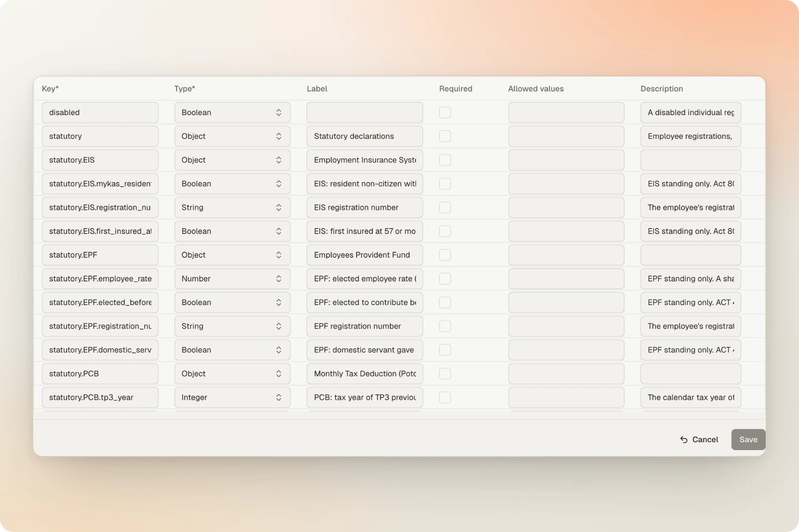

# HRMS


A multi-country HR and payroll workspace for employment records, rosters, leave, claims, loans,
payroll runs and statutory obligations. Jurisdiction law is dated data; the engine holds no
country-specific calculation.

## Apps and roles

The HR controller group holds the controller apps; employee self-service is its own app. The kiosk
is the chromeless attendance device.

| App                   | Pages                                                  | Audience                                                      |
| --------------------- | ------------------------------------------------------ | ------------------------------------------------------------- |
| Entities              | Entities                                               | Legal entities, their dated changes, holidays, shift patterns |
| Events                | Work, Leave, Claims, Ad hoc, Loans, Cases, Work events | Dated employee activity, workplace cases and their evidence   |
| Formats               | —                                                      | Shared export format configuration (no standalone page)       |
| Payroll               | Payroll                                                | Run creation, payslips and exports                            |
| Obligations           | Obligations                                            | Tasks and reminders the law's effects raise                   |
| People                | People                                                 | Employee profiles, stints, terms, parameters and dependants   |
| Settings              | Settings                                               | A jurisdiction's law on a day, its changes and research       |
| Employee self-service | Self-service                                           | Each employee's own records                                   |
| Attendance kiosk      | Clock                                                  | Attendance capture and face enrolment                         |

Teams are source declarations. **Employee** holds `employee`; **Supervisor** and **Production
Manager** add `supervisor`; **L1 Manager** adds `manager`; **HQ Payroll HR** and **Manager (HR
Controller)** hold `hr_controller`; **HR Manager** holds `hr_manager`; **Senior Management** holds
`senior_management`; **Attendance Kiosk** holds `kiosk`.

## How it works

A law, a company and a person's terms are dated rows: what holds on a day is the rows dated on or before it, applied oldest first. A run reads the employment, the entries and the law, walks one subtotal chain to net pay, and writes its payslips and ledger rows in one write. A mistake in a paid period is corrected where it was recorded; the next run carries the difference. The models, automations and policies are described in [the architecture](docs/0001-hrms-calculation-architecture.md).

The salary listing reads saved payslips: one column per used catalogue item, with employee and employer portions apart. Earlier-period differences combine in that item's column; **Line details** retains each line's period, direction, quantity, unit and currency. **Tax withheld** is the saved summary, alongside the separate deduction columns. Paid figures are never recalculated by the export. See [the export walkthrough](docs/0008-mechanisms-walkthrough.md#8-payslip-salary-listing-and-bank-file).

Settings defines which statutory facts the law accepts; the employee's **Statutory parameters** tab holds their dated values, edited in place. The schema editor keeps field names, types, labels and requirements on the same row.



## Seed

- **Public base** — `seed/public/jurisdiction/<CODE>/` holds each of nine jurisdictions (CN, ID,
  JP, MY, PH, SG, TH, TW, VN) as its whole law on 1 December 2025 and the dated changes since:
  catalogues, subtotals, registered rules and effects. `bolt build` writes them as the release's `base` pack.
- **Private demo** — `seed/+seeder.ts` loads private demo rows through `bolt seed`. They never
  enter a release.

## Checks

```bash
bun install --frozen-lockfile
bunx bolt check   # declarations, schema history, policies and types
bun run test      # standalone mechanism and edge-case tests
bunx bolt build   # writes .norbital/ and the release artifact
```

Schema changes generate editable SQL under `migrations/`. Commit the SQL, `snapshot.json`,
`migrations.lock.json` and `physical.json` together. `.norbital/` is generated and never committed.

## Documentation

[The documentation index](docs/README.md) lists every document, one line each.

The workspace agent reads [`src/agent/+agent.md`](src/agent/+agent.md); coding agents start from
[`src/agent/AGENTS.md`](src/agent/AGENTS.md).
