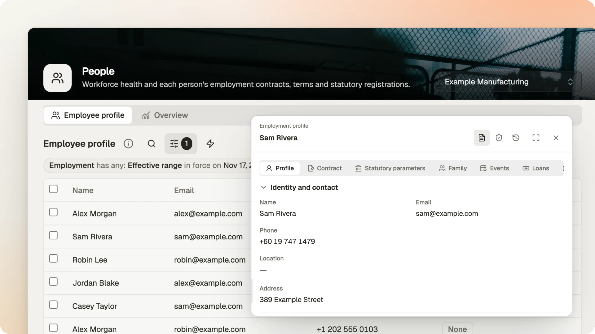

# HRMS

HRMS is a multi-country human resources, attendance, and payroll workspace built for organizations operating across multiple legal entities, pay cycles, and regulatory regimes. It manages the full post-hire lifecycle in one place—from employee onboarding, contracts, shifts, and biometric time capture to leave, expense claims, staff loans, workplace cases, payroll runs, salary listings, bank payment files, and statutory compliance obligations—with nine Asia-Pacific jurisdictions seeded out of the box (China, Indonesia, Japan, Malaysia, Philippines, Singapore, Thailand, Taiwan, and Vietnam).

Instead of stitching together country-specific payroll spreadsheets, manual leave trackers, email approval chains, and ad-hoc back-pay adjustments, HR and finance teams run every entity on one transparent operating model. Statutory rules, company pay methods, and employment terms are maintained as effective-dated records rather than country-specific code, paid payroll runs stay permanently locked for audit integrity, and any retroactive fix made to an earlier record automatically carries only the line-by-line difference into the next run.

## Expected Business Impact

- **Unified multi-country HR and payroll operations:** Consolidates employee records, rosters, leave, claims, loans, and payroll across legal entities and nine seeded Asia-Pacific jurisdictions without maintaining separate per-country spreadsheets or parallel tools.
- **Audit-ready payroll accuracy and controlled retroactive adjustments:** Paid payroll runs and payslips are permanently immutable; when an earlier roster, leave, claim, or contract term is corrected at the source, the workspace recalculates affected periods within the tax year and carries forward only the exact net difference.
- **Tamper-resistant entitlement and expense control:** Leave balances, annual claim caps, carry-over rules, and exit leave settlements are derived from an append-only movement ledger, eliminating manual balance drift, double-booking, and unapproved payouts.
- **Clear governance and confidentiality boundaries:** Role-based permissions separate everyday employee self-service, shared attendance kiosks, line-manager approvals, HR payroll execution, and executive oversight—preventing self-approval and isolating sensitive salary records from shop-floor time clocks.
- **Proactive statutory readiness:** Scheduled weekly monitoring of official government, tax, and social-security publications flags regulatory updates with source citations and prepares dormant effective-dated drafts so HR can verify changes before they ever touch payroll.

## Roles & Access

| Business Role                                   | Workspace Access                            | Key Responsibilities & Boundaries                                                                                                                                                                                                                                                                 |
| ----------------------------------------------- | ------------------------------------------- | ------------------------------------------------------------------------------------------------------------------------------------------------------------------------------------------------------------------------------------------------------------------------------------------------- |
| **Employee**                                    | Employee Self-Service                       | Views own work calendar, employment details, payslips, loan repayments, and live leave or claim balances; uploads personal documents; enrols face for attendance (subject to HR approval); submits leave and expense claim requests.                                                              |
| **Supervisor, Production Manager & L1 Manager** | Employee Self-Service                       | Holds all employee self-service capabilities plus first-step review authority on team leave and claim requests.                                                                                                                                                                                   |
| **HQ Payroll HR & Manager (HR Controller)**     | HR Operations Suite & Employee Self-Service | Full operational authority over entities, people, rosters, events, payroll runs, compliance obligations, and jurisdiction settings; second-step HR approval on staff requests; workbook imports and payroll exports; **exclusive** authority to record manual leave or claim balance adjustments. |
| **HR Manager & Senior Management**              | HR Operations Suite & Employee Self-Service | Full operational and oversight access to the HR Operations Suite, second-step HR approval, and authority to supersede multi-step approval workflows when rapid executive sign-off is needed. Cannot enter direct manual balance adjustments, preserving controller segregation of duties.         |
| **Attendance Kiosk**                            | Attendance Kiosk                            | Isolated sign-in for shared workplace time-clock devices; identifies enrolled active staff within the assigned entity and records clock-in/clock-out punches only, with zero access to salaries, payslips, leave, claims, or HR files.                                                            |

**Governance & Confidentiality Safeguards**

- **No self-approval:** Reviewers can never approve their own leave or expense claim requests.
- **Provisional holds on staff requests:** Employee-submitted leave and expense claims remain provisionally held through two-step review (line supervisor, then HR) unless expedited by an HR Manager or Senior Management. Held entries never alter entitlement ledgers and pause payroll runs covering that employee until decided; HR-entered entries take effect immediately.
- **Payroll run protection:** While an unpaid payroll run is open, edits to included employees are blocked until the run is paid or deleted. Once marked paid, runs and payslips are locked forever and exports read saved figures without recalculating.
- **Human verification gate on law updates:** Automated statutory research never activates law changes on its own; an HR team member must review official citations and explicitly confirm each update before it enters force.

## Apps & Functionality

### HR Operations Suite

| App / Module     | Functionality                                                                                                                                                                                                                                                                                                                                                                                                                                                                                                                                                                                                                                                                                                                                                                                                                                                         |
| ---------------- | --------------------------------------------------------------------------------------------------------------------------------------------------------------------------------------------------------------------------------------------------------------------------------------------------------------------------------------------------------------------------------------------------------------------------------------------------------------------------------------------------------------------------------------------------------------------------------------------------------------------------------------------------------------------------------------------------------------------------------------------------------------------------------------------------------------------------------------------------------------------- |
| **Dashboard**    | Live operational inbox with real-time counts across four queues: approvals waiting on the signed-in reviewer across entities, unpaid payroll runs, open compliance obligations, and proposed statutory law findings awaiting review.                                                                                                                                                                                                                                                                                                                                                                                                                                                                                                                                                                                                                                  |
| **Entities**     | Multi-entity master administration with bulk Excel onboarding (Data Request) and holiday workbook imports. Each entity record manages five areas: **General** (company details, bank account, late-arrival alert thresholds and recipient roles, dated company pay methods, final-pay loan recovery floor, and dated employer statutory parameters), **Pay Groups** (monthly, semi-monthly, ten-day, multi-month, weekly, biweekly, and daily cycles with cutoff and business-day rules), **Shifts**, **Shift Patterns** (weekly or rotating cycles), and publishable **Holidays** (including substitute and shift-adjusted holidays).                                                                                                                                                                                                                                |
| **People**       | Searchable employee directory (active-today default filter, Data Request workbook import, and biometric enrolment status) paired with a workforce **Overview** showing current headcount alongside 12-month hiring and turnover trend charts. Each employee record provides six views: **Profile** (contact info, particulars, face enrolment management, dated statutory parameters, dependants), **Contract** (employment stints newest first, hire/rehire, intra- or cross-entity transfer, termination, and dated pay/allowance terms), **Documents**, **Loans**, **Workplace Cases**, and **Balances** (remaining entitlements plus full movement ledger with HR Controller manual adjustments).                                                                                                                                                                 |
| **Events**       | Seven operational ledgers for dated workforce activity, each supporting Excel workbook import: **Work** (monthly roster and attendance board with statutory working-hour/overtime cap warnings, roster import/export, and overtime report export), **Leave** (half-day morning/afternoon calendar booking and leave cash-out), **Claims** (receipt-backed expense/benefit claims with annual cap checks), **Ad Hoc** (bonuses, severance, statutory refunds/adjustments, and one-off payments), **Loans** (employee advances with automated monthly repayment schedules and recovery tracking), **Cases** (workplace incidents and HR/disciplinary records with severity, dates, and evidence files), and **Work Events** (entity-wide or employee-specific dated conditions such as severe weather, public health events, or stoppages read by pay and leave rules). |
| **Payroll Runs** | Creates on-cycle and off-cycle payroll runs per entity, pay group, and period; displays itemised payslips and earlier-period retroactive differences; marks runs paid (locking figures permanently) or deletes unpaid runs; generates audit-ready **Salary Listing** Excel workbooks (saved figures plus line-by-line details), **Overtime Report** workbooks (period summary plus daily breakdown), and bank payment files (**OCBC FAST** and **Metrobank**).                                                                                                                                                                                                                                                                                                                                                                                                        |
| **Obligations**  | Central register for statutory compliance tasks and reminders—including tax/social-security filings, work-permit and retirement checks, employee exit duties, and unrecovered loan or overpaid-leaver follow-ups—with Open, Fulfilled, and Waived status tracking and evidence attachments.                                                                                                                                                                                                                                                                                                                                                                                                                                                                                                                                                                           |
| **Settings**     | Jurisdiction law-on-a-day viewer and editor covering all nine seeded jurisdictions across seven tabs (**General**, **Lookup**, **Calculation Overview**, **Catalog**, **Registered Rules**, **Registered Behaviour**, and **Change Log**). Edits ask whether a correction applies retroactively ("Always so") or prospectively ("Changes from date"), and HR can trigger on-demand statutory research directly from the Change Log.                                                                                                                                                                                                                                                                                                                                                                                                                                   |

### Employee Self-Service & Time Capture

| App / Module              | Functionality                                                                                                                                                                                                                                                                                                                                                                                                                                                 |
| ------------------------- | ------------------------------------------------------------------------------------------------------------------------------------------------------------------------------------------------------------------------------------------------------------------------------------------------------------------------------------------------------------------------------------------------------------------------------------------------------------- |
| **Employee Self-Service** | Dedicated staff portal with six tabs—**Home** (personal work calendar with an employment switcher for staff holding multiple active stints), **Leave** (requests with live remaining balance checks), **Claims** (submission with receipt upload), **Loans** (read-only repayment status), **Documents** (personal file upload), and **My Payslips** (read-only payslip archive)—plus guided five-pose self-service face enrolment routed to HR for approval. |
| **Attendance Kiosk**      | Full-screen shared time-clock interface scoped to one legal entity, combining on-device facial recognition, liveness anti-spoofing, one-second hold confirmation, 60-second duplicate-punch protection, bilingual English/Chinese voice feedback, and manual name-lookup fallback.                                                                                                                                                                            |

## Automations & Connections

- **Entitlement & Ledger Synchronisation:** Runs automatically on January 1, at upcoming employee anniversary or benefit-window boundaries, and whenever employment terms, statutory rules, or paid payroll runs change—calculating leave entitlements, annual claim limits, closing-window carry-over, and balance retention, and opening an HR compliance obligation if any run requires manual follow-up.
- **Automatic Compliance Duty Creation:** Evaluates jurisdiction rules once employee leave, expense claims, or profile updates are approved and creates deduplicated compliance obligations so statutory deadlines are tracked reliably.
- **Real-Time Late-Arrival Notices:** Monitors live clock-in records against scheduled shift starts and alerts the legal entity's designated roles once per day whenever first clock-in exceeds the configured grace threshold.
- **Weekly Statutory Law Research & Drafting:** Runs every Saturday (and on demand from Settings) to audit official government, tax, and social-security websites for every active jurisdiction, deduplicating findings, recording official citations, and drafting dormant effective-dated law updates for human HR review.
- **Invited-Staff Profile Linking:** Automatically links newly accepted workspace invitations to the matching employee profile (or creates a profile on join) so new hires have immediate self-service access.
- **Workbooks, Bank Payment Files & Regulatory Sources:** Supports structured Excel workbook imports and exports across onboarding, holidays, rosters, activity ledgers, salary listings, and overtime reports; generates fixed-width bank payment files for **OCBC FAST** and **Metrobank**; and queries official public government/regulatory websites during statutory research.

## Scope & Boundaries

- **Included out of the box:** Multi-entity employee administration, shift rostering and biometric attendance capture, leave/claims/loans/workplace case workflows, effective-dated payroll and statutory calculations seeded for nine Asia-Pacific jurisdictions, cross-period retroactive adjustments, payslips, salary listings, overtime reports, OCBC FAST and Metrobank payment file exports, and compliance task tracking.
- **Statutory filings, remittances & legal counsel:** Calculates statutory amounts, tracks obligations, and monitors official regulatory changes for HR verification, but does not electronically file government returns, remit funds to authorities, or provide legal or tax advice. HR remains accountable for verifying statutory updates and completing official submissions.
- **Live bank disbursement & treasury:** Produces bank payment files ready for upload, but does not initiate live bank transfers, execute treasury payment approvals, or reconcile bank accounts.
- **Corporate general ledger & ERP accounting:** Generates audit-ready salary listings and employer-cost summaries for finance, but does not replace corporate general-ledger accounting or ERP sub-ledgers.
- **Recruiting, performance & learning:** Covers post-hire HR operations, time capture, and payroll; applicant tracking, performance reviews, and learning management are outside this workspace.
- **Physical kiosk hardware & connectivity:** The Attendance Kiosk runs in a standard camera-equipped browser; device procurement, mounting, lighting, and local network setup remain outside the software boundary.

## Documentation

- [Technical Documentation & Developer Quickstart](docs/README.md)
- [Inner Mechanisms & Architecture Diagrams](docs/0012-inner-mechanisms-diagrams.md)
- [HRMS Calculation Architecture (Fixed Design Section 0)](docs/0001-hrms-calculation-architecture.md)
- [Core Mechanisms Walkthrough](docs/0008-mechanisms-walkthrough.md)
- [Model Specification](docs/0002-model-specification.md)
- [Statutory Coverage Across Nine Jurisdictions](docs/0009-statutory-coverage.md)
- [简体中文说明 (README.zh.md)](README.zh.md)
