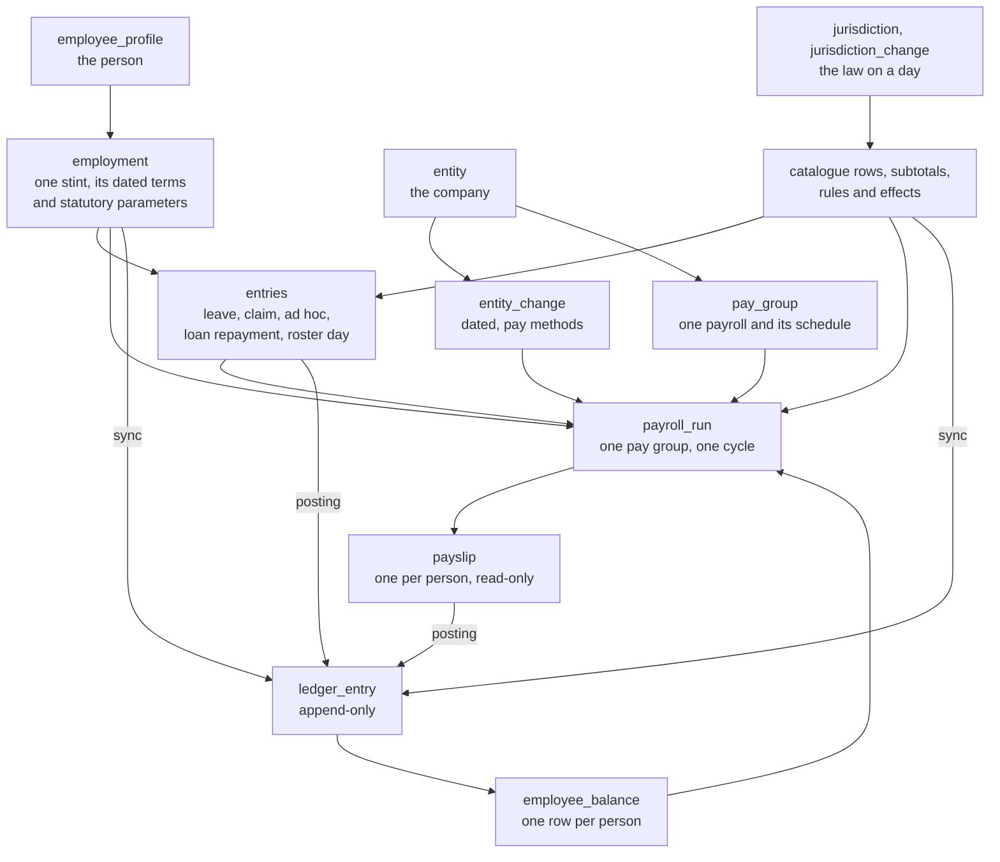
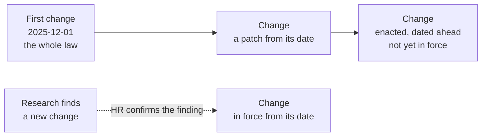
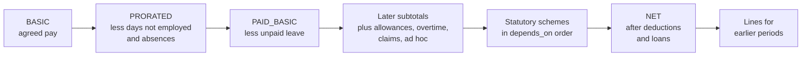
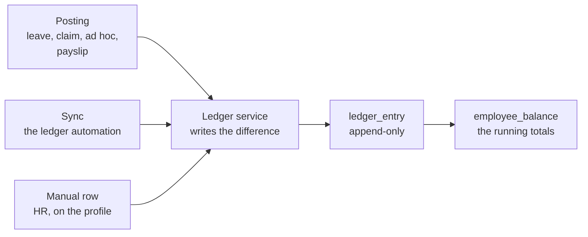

# Architecture

How the HR and payroll workspace is built: who owns what, how the records connect, and what the engine does. Section 0 is the owner's fixed design. The rest describes the source tree as it stands; the source tree is the final authority.

Related: [the mechanisms, run through](0008-mechanisms-walkthrough.md), [corrections and integrity](0007-corrections-and-integrity.md), [statutory coverage in the seed](0009-statutory-coverage.md).

## 0. The design is fixed

The owner's design. Every agent reads it first and wires around it. Only the owner's words change it, and where anything else here disagrees, it wins.

### How to work with it

- A requirement that seems not to fit is a misreading, not a gap. A limit of your code is not a limit of the design. "It doesn't fit" and "this needs a new field" are not findings.
- Add no model field, engine concept, context root, run input or helper module unless told to. Ship no approximation. If a requirement has no home, stop and ask the owner.
- Brief every subagent with this section.

### Catalogues, entries and corrections

- A **catalogue** row holds a family's behaviour: eligibility, conversion, target subtotal and lookup, plus its role fields. Allowance, overtime and statutory are definitions only. Leave, claim, ad hoc, loan, work event and workplace case take entries.
- A **catalogue entry** is one dated event against a catalogue item: what happened, never how it is priced.
- A mistake is corrected on the entry itself, with its real date: edited, moved or deleted, whether or not a run has paid it. The ledger posts the difference, or the inverse for a delete. There is no second entry that undoes a first.
- A statutory row may refund: where its statute has the employer repay, a result below zero pays a refund line and the balance falls; otherwise it stops at zero and the next run nets it. No payslip line and no ledger amount is negative: a difference that takes money back is a deduction line.
- A refund or charge decided outside the system is an ad hoc entry on the law's generic `STATUTORY_REFUND` or `STATUTORY_ADJUSTMENT` row.
- What a run's ad hoc entries post to a statutory account reaches the tax rows as `ctx.posted.<SCHEME>.<employee|employer>`: a benefit in kind the tax row counts.

### Corrections

- **The rule for HR.** HR does two things: it keys records forward, and it corrects a record in place. If something in a paid period is wrong, correct it where it was recorded, with its real date. The system makes the payslip right. The paid payslip does not change. The next payroll run works the period out again and pays the difference. HR sees every difference, period by period, in the run before marking it paid.
- **One mechanism:** what a period should pay now, less what has been paid for it.
- The write that corrects a record of a paid period leaves one amendment row (`pay_amendment`: person, pay group, period) in the same write. A change held for approval leaves it in the approving decision, beside its ledger posting.
- The next on-cycle run that pays the person reads their open rows. From the earliest amended period it works out every paid period through the last paid one of that tax year, oldest first, on the records as they stand now. A later tax year is not worked out again.
- Each difference goes on the run's payslip as a line tagged with its period, and posts to that period. The run takes the rows it carried. A row is kept, marked done by its run.
- A statutory scheme row says which month answers for carried pay (`assessed`). `EARNED`, the default: the scheme is worked out again for the earlier period and its difference is carried. `PAID`: the earlier period's charge stands, and the carried pay counts as wages of the month that pays it. Malaysia's SOCSO, EIS and SKBBK are `PAID`.
- Net pay never goes below zero. What cannot be taken back is one line, "Recovery carried forward", and the next run takes the rest.
- Nothing of a person moves while an unpaid run holds them. Delete the run first.
- A paid payslip is never rewritten. A priced entry may be deleted. A change to a person's terms or statutory parameters, to a company or to a law is a dated row from its real date; a wrong one is corrected, moved or deleted in place ([RFC 0011](0011-dated-changes.md)).
- **The employment, by date.** Facts (family, events, statutory parameters, pay group) are those in force on the date; a dated row is priced under the terms in force on its date. Agreed terms are the change rows signed by the period's pay date. What a later-signed row adds for earlier periods is back pay of the period it was signed in, on the row the law names in `conversions.back_pay`. A law that names none applies a row from its date. A hire signed after its first months follows the same rule.
- The full description is in [corrections and integrity](0007-corrections-and-integrity.md).

### Leave rows

- A leave row says two things. **`paid_share`**: the share of a normal day a day of this leave pays. Empty is 1, no pay is 0, half pay is 0.5, or an expression per half-day slot. It is 0 to 1 and the run refuses anything outside; more than a normal day is a `payout` or overtime, never leave. **`payout`**: what a day paid out pays (days × the statute's day value, so a prorated exit year works). Only cashable rows have one, and its presence makes a row encashable.
- Leave never prices a day off in money. The run factors the salary's unpaid part `(1 − paid_share)` by the jurisdiction's divisor and rest-day rules. Company leave policy goes on the row's `paid_share` or `payout`.
- The no-pay row is `NPL` in every jurisdiction. `paid_share` 0 declares it.
- `PUBLIC_HOLIDAY_IN_LIEU` is its own leave row: 0 by default, a yearly grant only if its rule says so, plus HR's manual adjustments. A public holiday on a rest day is a calendar row that `replaces` it, given only to those off on the replaced date. It is never a leave entry.
- A leave entry shows its slots: employment, catalogue item and every `leave_catalog_entry_day` slot with its sealed state. A slot a run paid is changed or removed on the entry itself; the write leaves its amendment row.
- A leave seal is the slot's `payroll_run_id`; a loan seal is the repayment's. The entry keeps its run roll-up only for attachment and filtering.
- A leave day may be dated in a paid period, no-pay leave included. It is that period's: the next run works the period out again and carries the difference.

### Work events

- A **work event** is a dated real-world condition affecting work, owned by no employee: heat, a storm, an earthquake, an epidemic, a suspension. A workplace case stays employee-specific.
- `work_event_catalog` is configuration: the row is the event type, with no category enum. `work_event` records period, entity, optional employment, location, description and evidence.
- It pays nothing. Allowance, ad hoc and leave rules read events through `ctx.work_events` and remain the rows that post. The run and the leave sync expose entity-wide and employment-specific events.

### Owed, used and manual adjustments

- **Owed** is a catalogue rule plus contract facts. Sync posts the difference per source and never wipes a balance. **Used or paid** comes from entries.
- **HR adjusts a balance by hand** on the employee profile: a manual ledger row, `source` `manual:<id>`, adding or removing signed days on a leave row's `entitled` (or money on a claim row's `limit`) for the window holding its date, with a `note` and no entry behind it. It is immutable; a mistake is an opposite row. Sync never touches it. Carry and settlement count it like any entitled day.
- A closing period settles once on its last day. A share by completed months counts that day as served, and a service band is the one the period started in.
- Service comes from the contracts. `employee_profile.cumulative_service` (default false): on, every stint counts, rehires included; off, the current unbroken stint. `service_started_on` only credits service from elsewhere.

### Exits

- An **exit** is a stint with a last day and no later stint of the person under the same law. No record copies it.
- The stint's write raises `exit` for the law's exit duties and, in its own effect, keeps the exit's other tasks in step: it waives or reopens the exit's duty tasks and rebuilds a cancelled exit's loan schedule (owner, 2026-11-13). The last payslip settles the leave from the stint's `encash_leave`, which the termination form asks, checked by default; nothing waits for approval.
- **The last payslip settles the leave.** Nothing is keyed, nothing waits for approval and no law effect raises a task for it. The stint carries HR's decision `encash_leave` (default on), set in the termination sheet and changeable on the ended stint.
- The on-cycle run whose salary period holds the last day reads, for each leave row with a `payout`, what is left in its newest window as that period saw it. Days left are paid out, unless HR switched it off or the exit is a dismissal for misconduct. Days taken beyond what the last day earned are taken back at the same payout rate, whatever HR decided.
- The payslip lists them under `cash_out`, and its own posting moves the row's `used` days, so the balance ends at zero. Deleting the run undoes it.
- Changing the decision, moving the last day or cancelling the exit after that run is paid amends the period: the next run carries the difference and the days follow. Someone no on-cycle run pays any more is paid by an off-cycle run that carries their waiting periods. Such a run takes nothing back; one task names what they would owe.
- A cash-out for someone still employed is an ordinary leave entry HR keys (`encashment: true`): written directly, corrected or deleted in place like any entry.

### Company methods

- The employer's method applies where it pays at least the law, otherwise the law: "keep it to the company's calculated rates UNLESS it is not compliant".
- The methods are the company's `pay_methods`, by date, each floored at the statute per day or shift. One exception, by the owner's decision of 2026-11-12: Malaysia's holiday-worked pay under `CONTRACT_WEEKLY` is the clocked shift hours × 2 × the company's hour, as the company's pre-approved payroll vendor computes it, without the Act's two-day floor:

| Method                       | Values                                | Meaning                                                                                                                                                                                   |
| ---------------------------- | ------------------------------------- | ----------------------------------------------------------------------------------------------------------------------------------------------------------------------------------------- |
| `overtime_hour_basis`        | `STATUTORY`, `CONTRACT_WEEKLY`        | `CONTRACT_WEEKLY`: monthly wage × 12 ÷ (52 × contract weekly hours)                                                                                                                       |
| `rest_day_hourly_multiplier` | a number, or empty                    | A multiple of the hour rate for every rest-day hour; empty pays the law                                                                                                                   |
| `night_differential_basis`   | `WORKED`, `CLOCK_SPAN`, `WHOLE_NIGHT` | `CLOCK_SPAN`: night premium on every clocked hour in the window at the ordinary hour rate, breaks included. `WHOLE_NIGHT`: a worked night shift earns eight full hours of premium         |
| `contribution_split`         | `EVEN`, `FIRST_RUN`                   | `EVEN`: half a month's contributions on each payslip of a twice-monthly group. `FIRST_RUN`: the whole month on the first, on an estimate, and the second settles the month's actual wages |
| `benefit_exclusion`          | `POOLED`, `EXCESS_TAXED`              | `EXCESS_TAXED`: a benefit paid past its own tax-free limit is taxed in the month, not pooled in the yearly exclusion. Withholding timing only; the year's tax is the same                 |
| `health_billing`             | `CURRENT`, `ARREARS`                  | `ARREARS`: a month's health insurance is charged on the next month's payslip. Over an employment the same contributions are paid                                                          |
| `paid_leave`                 | leave codes                           | Leave the employer pays in full by its own policy where the law's row leaves it unpaid (e.g. emergency leave). Not required by law (owner, 2026-11-13)                                    |

- Company leave policy that pays more than the law is `paid_leave`; the law's rows stay as the statute has them. An employee-borne income-tax share is a contract term. A company's rounding follows the same rule.
- A one-off month is a recorded difference, not a method.

### Attendance and roster

- Roster mapping is seed, not engine. Every employee with attendance gets a roster; the shift pattern supplies the plan. Office staff are not exempt.
- The roster is the cycle's source of truth: a planned shift or overtime pays only when the clock covers it.
- `ABS` is not a shift code and not a roster row. The engine reads a planned work day the roster leaves out (with no leave and no published holiday), or a planned `WORK` day with no clock, as an absence. A public holiday or a leave slot is not an absence.
- The engine does not infer the worker class. The presence of the person's roster for the cycle declares the roster the source of truth.
- Attendance stays as recorded. Pay with no attendance behind it is flagged, never invented.
- Contract hours and days come from the employee's contract, not from the shift.

### Basic checkpoints

- `BASIC` is the contract salary. `PRORATED` is `BASIC` less joiner and leaver proration and `ABS`. `PAID_BASIC` is `PRORATED` less the `NPL` catalogue lines.
- Everything else (allowances, overtime, claims, ad hoc, loans) points after `PAID_BASIC`. `ORDINARY_WAGES` and every statutory base read the reduced amount.
- `NPL` is a catalogue line at `PAID_BASIC`, never a `NET` deduction and never folded into `BASIC`. `ABS` and contract-date proration are system adjustments with no catalogue.
- Day rate: Malaysia uses `YEAR` (monthly × 12 ÷ (52 × contract days a week)). A fixed divisor remains only where a jurisdiction names it.
- On `CALENDAR_DAYS` proration only the days actually absent are deducted: a rest day inside a stretch stays paid.
- An "incentive (OT)" paid outside attendance is an ad hoc entry on the `INCENTIVE_OT` row. In Malaysia it is EPF, SOCSO and EIS wages, and PCB taxes it in the month as additional remuneration. Attendance overtime excludes incentive hours; the roster's planned overtime is cleared on those days.
- The salary listing export follows the subtotal chain: each checkpoint is a coloured band of the lines posted to it, closed by the checkpoint's own figure, so proration shows as the prorated subtotal. Then gross, tax withheld (CP38 included) beside the tax line, net, the employer's portion and the cost to the company. Nothing in it names a code; every figure is the payslip's own.

### Holidays

- A `holiday` is the company's day. With `employee_id` set it is that person's alone: the day they keep the holiday when their shift put it on another date (a night guard whose holiday shift starts as the holiday ends). The run reads it for that person only; company calendars leave it out.
- Contract normal hours come from the contract; where 7.5 hours a day is normal, a 9-hour shift has 1.5 hours beyond normal. In Malaysia, holiday work is two days' wages within normal hours plus 3× the hourly rate beyond. An employer on its own hour (`overtime_hour_basis` `CONTRACT_WEEKLY`) pays the clocked shift hours within normal hours × 2 × that hour where it is at least the Act's two days at monthly ÷ 26, otherwise the Act.

### Ledger and balance

- The ledger moves three ways only: **posting**, when a record is written (a leave, claim or ad hoc entry declaring accounts, or a payslip); **sync**, when an entitlement may have changed (a contract or fact, an entity, a new law, a period ending); and **HR's manual adjustment**. One service writes it.
- A ledger row is written only with its record, and for a record held for approval only in the approving decision's own statement. If the ledger cannot move, the approval does not pass.
- No write holds a lock across statements. No interactive transaction.
- Loans stay out: a loan and its repayments are their own record. Workplace cases never move a balance.
- Append-only. An amount is never negative. An edited record posts the difference and a deleted one the inverse.
- `employee_balance` is one row per person, the ledger's projection keyed by family, code, period and measure: accumulated values and entitlements only. No notes, flags, dates or guards.
- Earlier runs come from the balance. A run reads payroll history for one thing only: an amended paid period, which it works out again against that period's payslips. The period is in the key: a new year is a new key, nothing closes, and old periods leave through dated entries.
- The invariants, the integrity check and the way forward and back for each act are in [corrections and integrity](0007-corrections-and-integrity.md).

### Linear computation and subtotals

- One chain per law: no stages, phases or branches. The first subtotal opens with base pay; each later one is the previous plus its lines; statutory schemes run in `depends_on` order; checkpoints rebuild with the statutory lines and the last is net pay.
- A subtotal is a checkpoint used by catalogues and may be any figure. Separate pay with subtotals, never by inspecting lines.

### Jurisdiction settings and lookup

- A jurisdiction's law captures behaviour for the jurisdiction. A change of law is a dated patch: the first change holds the whole law, each later one only what changed from its date, and the law on a day is the changes dated on or before it, applied oldest first.
- Seed from **December 2025**, each change dated the day a change in law took effect. A change already enacted with a later date of effect is seeded in advance as its own change from that date (owner, 2026-11-13).
- Nothing in a law has an id: an entry names its catalogue row by code, a catalogue row its subtotal, a subtotal its predecessor. Pickers list the rows of the law in force on the day.
- `lookup` holds only shared tables and constants, each with a declared shape. A row's local lookup wins. A value read by one row lives on that row.
- One typed `conversions` block declares `day`, `hour`, `proration` and `rounding`, and `back_pay` where the law prices back pay on a row of its own. The engine computes the day and hour rates once per run; a row never derives its own.
- A law that ties a contribution to a work pass reads `terms.work_authorisation_expires_on`, the day a foreign worker's pass ends, an extension included.

### Registered rules and effects

- A rule validates on an event. An effect is a side effect of one, and a check on a finished payslip is an effect that raises an obligation.
- Reads happen once, up front, for the whole batch, never per payslip.
- A rule or effect states what it does in a human `description`; `references` stays the law, article and quote.

### Payroll run and pay groups

- Two kinds, and these are their names: **on-cycle payroll** and **off-cycle payroll**. `payroll_run` is thin: on-cycle takes the cycle, the entity from page scope; off-cycle takes who and what it is for.
- A `pay_group` is one payroll of a company: its name and its schedule (frequency, pay days, cutoff). Every schedule is a group; the company carries none. A person's terms name their group (a move is a terms row from the first of a month), and a run is for one group: company, group, cycle. Its attendance window, pay date and "a later cycle has run" are that group's. A company with one group needs none named. A group that has a paid run keeps its schedule: its name and pay day may change, what moves pay may not. A new schedule is a new group, and people move to it by terms rows from the first of a month.
- Off-cycle pays named ad hoc entries and bonus runs, with one-off lump sums such as severance. It may also carry the waiting earlier periods HR names, which is how someone who has left is paid what a correction owes them. Recurring items are on-cycle only: a tax instalment, zakat, rent, benefit in kind, allowance or overtime never runs off-cycle. Only ad hoc rows carry `off_cycle_eligible`; statutory schemes always apply.
- Everything else derives from the pay group's schedule, cutoff day and the law in force; none of it is typed. `pay_date` is the day the schedule pays, and the calculation reads it. The date people see is the moment the run moved to `PAID`; it shows only then and is never typed.
- A run is `UNPAID` or `PAID`, payment is per run, and a payslip has no status and is read-only forever.
- An unpaid run can be deleted: its payslips go, every entry it sealed keeps its row with `payroll_run_id` null, the amendment rows it took open again, and the balance returns through inverse ledger entries. A paid run is never deleted; what it priced is corrected at its source.
- Year-to-date only moves forward. A run a later run counted cannot be deleted for anyone paid in both, so runs come off newest first. A skipped on-cycle period cannot run behind a later one.

### Configuration ownership

- Every value has one owner. Read by one row, it lives on that row; settings hold shared rate tables only.
- No variable allowances. An allowance is the agreed flat amount on the contract or a catalogue rule that computes it, never typed per payslip. `conversion` and `eligibility` are the pricing rule. A conversion reading `terms.allowances.<CODE>.amount` is a flat agreed amount, and the contract editor offers only those rows. The run prices every row through eligibility; no flag.
- The row declares `include_in_rate` when the law counts it in the wage a day or hour rate divides.
- No constant hoisting: a constant read by one formula lives with that formula or on its row.
- A catalogue row keeps its program with a declared boundary: per-family typed params, one input root set, one output type. The build checks the roots and the run decodes the output. Expressions are JavaScript with one checker. `reads` values are explicit `{ var: ... }` or literals, never bare `ctx.` strings.
- Extension schemas are flat: no `facts`, `term_facts`, `exit_facts` or `elections`; `statutory.<SCHEME>` and `events[]` stay nested. A field exists only because a formula reads it or the salary listing shows it.
- The ledger period is a typed template and the measure a typed union; the write boundary refuses an unknown code.

### Screens

- A catalogue row's identity is `code` plus `description`. Saving a value of the law asks one question: was it always so, or does it change from a date?
- All top-level settings sections are tabs (general, lookup, calculation overview, catalog, registered rules, registered behaviour, change log) with `More` only for overflow. The sidebar highlights the active child, never the group.
- The calculation overview leads with the description; code, expression, eligibility and references sit behind its info control.
- The profile is one screen with vertical sections. Face enrolment sits inside Profile; two columns where width allows; a nested vertical tab rail.
- Selection is visible. A leave half-day is filled when selected, dimmed and blocked when unavailable. The leave, claim, ad hoc, loan repayment, roster day and holiday forms, and a change to a person's terms, parameters, dependants or stint, ask before a save that reaches a paid period; the server writes the amendment row whatever a form asked. The payslip groups carried lines under "Adjustments for earlier periods", and the run lists the periods it carried and those waiting under "Earlier periods".

### Simplicity

- Thin and light: delete before adding, prefer the existing mechanism. About 80 people stay under 2 s of CPU, on the fewest round trips. A run works out at most 240 earlier person-periods beyond the people it pays; the rest wait for the next run.
- A run reads once, at admit: everything its window needs, in one request, before any payslip. Every entry family is read by the run's own window only (roster days, leave slots, claims, ad hoc entries and loan repayments dated in its attendance window), never earlier history, except the amended paid periods it works out again: those are read once too, in one further request. Each payslip is one linear computation that reads and evaluates nothing twice.
- A late claim or ad hoc entry dated in a period that paid the person nothing is read as unpaid and priced by the next run, as is an unsealed cash-out entry. One dated in a period the person was paid for is that period's: carried, and tagged with it. A roster day, a leave day or an instalment may be dated in a paid period; missed attendance and overtime found after its month is paid are keyed on their own roster day.
- Consumed entries are sealed in one write: leave, claim, ad hoc, roster and loan repayment (the repayment, not its loan). The seal says a run priced the entry; it does not lock it. A record whose date moves loses its seal, so the period it joins prices it. Effects work in bulk: one read per batch, one write per effect.
- Seed expressions are read by customers: statute citations, never working notes.
- Tests prove mechanisms with agnostic fixtures; they do not certify a country's figures.

## 1. The idea

Everything the system knows about the law lives in **catalogues**, inside the jurisdiction's law, which changes by date. Everything that is true of a person lives on their profile and their **employment**: one stint with one company, with what was agreed and what the law is told of the person in rows that change by date. Everything that happens once is an **entry** against a catalogue row. A payroll **run** reads these and works through one straight calculation, from pay down to net pay. The **ledger** records every movement of a balance, and the **balance** holds the running totals. A **rule** refuses a bad write; an **effect** raises a task after a good one. A mistake is corrected where it was recorded; a paid payslip is never rewritten, and the next run pays the difference.

Three owners hold everything:

| Owner         | What it is                                                                                                    | Where it lives                                    | Who changes it                                           |
| ------------- | ------------------------------------------------------------------------------------------------------------- | ------------------------------------------------- | -------------------------------------------------------- |
| The law       | One law per jurisdiction, changed by dated changes: catalogues, subtotal chain, conversions, rules, effects   | `seed/public/jurisdiction/**`, then the workspace | HR, by editing the law or confirming a researched change |
| The company   | The entity, its dated changes and pay methods, its pay groups, holidays, shifts, and each person's employment | The workspace's records                           | HR                                                       |
| Template code | The models, the payroll engine, the ledger service, automations, policies and pages                           | `src/`                                            | Engineers, within section 0                              |

The template code holds no country's rate, threshold or formula. A country's behaviour is data in its law.

## 2. The data model



Every fact has one owner. A value is read from its owner; it is not copied into a second model.

| Owner                                 | Owns                                                                                                                                                              | Does not own                                                         |
| ------------------------------------- | ----------------------------------------------------------------------------------------------------------------------------------------------------------------- | -------------------------------------------------------------------- |
| `jurisdiction`, `jurisdiction_change` | Legal definitions, statutory schemes, conversions, rounding, the tax year                                                                                         | Employer operating hours, agreed pay                                 |
| `entity`, `entity_change`             | Legal identity, registrations, bank, time zone, the jurisdiction code; by date, pay methods, the two percentages and the statutory data the law asks of a company | Employee pay terms, any pay schedule                                 |
| `pay_group`                           | One payroll of a company: payment schedule, non-working weekdays, cutoff day                                                                                      | Anything else about the company                                      |
| `employee_profile`                    | Name, contact, documents, login, face enrolment, date of birth, identity number, gender, birth city, bank, whether every stint counts as service                  | Anything that changes by date                                        |
| `employment`                          | One stint with one company: employee number, first and last day, credited service, the exit answers, dated events                                                 | What was agreed, what the law is told                                |
| `contract_terms`                      | By date, what was agreed: engagement, rate and its unit, normal hours and days, agreed allowances, shift pattern, pay group, and the day it was signed            | Statutory law                                                        |
| `statutory_parameters`                | By date, what the law is told of the person: residency, work pass, marital status, nationality and the fields the law's employee extension schema declares        | Agreed pay                                                           |
| `dependant`                           | One member of a person's family, dated by its birth or expected date                                                                                              | Counts and flags a scheme reads: they are worked out                 |
| Catalogue rows                        | Eligibility, conversion, target subtotal, lookup and the role fields its family declares                                                                          | Employee-specific amounts                                            |
| Catalogue entries, `roster_entry`     | Dated employee activity and its evidence                                                                                                                          | Pay calculation results                                              |
| `ledger_entry`, `employee_balance`    | Posted movements and their cumulative projection                                                                                                                  | Calculation inputs other than totals                                 |
| `payroll_run`, `payslip`              | Run state, coverage, the seals on what it paid, per-person totals and the breakdown as calculated                                                                 | Figures a later run reads, except an amended period worked out again |
| `pay_amendment`                       | One paid period of one person to work out again, and the run that carried it                                                                                      | What changed, or any amount                                          |
| `obligation`                          | A task or reminder raised by an event, with its state                                                                                                             | Money or balances                                                    |

A person, a company and a law have no lifecycle. A plain field is edited in place, and a dated row is added, edited, moved or deleted. The employment on a day is the fold of the stint's `contract_terms` and `statutory_parameters` rows dated on or before it, with the profile's particulars and the person's dependants (`employmentOn` in `src/lib/person.ts`). A terms or parameters row is dated the first of a month, or the stint's first day; a stint's first and last days are real dates. Stints of one person do not overlap. The company on a day is the fold of its `entity_change` rows dated on or before it; a field no change has set holds its default. A run prices on the company as it stands on the last day of its salary period. Field-level detail is in [the model specification](0002-model-specification.md); stints, transfers and exits are in [transfer semantics](transfer-semantics.md).

### One owner per fact

Before a field is added, five questions decide whether it has a second owner. A "yes" is a design defect.

1. Can two models, two settings keys, or a model and a settings key answer for it?
2. Can it disagree with another field? Then one of them is derived.
3. Does one switch answer more than one independent question?
4. Would renaming the thing it names break it silently (a field named by a string)?
5. Can the type hold a combination that cannot run?

| Fact                                                   | Owner                                                 |
| ------------------------------------------------------ | ----------------------------------------------------- |
| What was agreed: rate, hours, allowances               | `contract_terms`                                      |
| What the law is told of a person                       | `statutory_parameters`                                |
| How this law converts: day, hour, proration, rounding  | The law's `conversions` block                         |
| Whether an allowance is in the rate a day or hour uses | That `allowance_catalog` row (`include_in_rate`)      |
| Whether an allowance line follows absence              | That row's `conversion`, by reading `ctx.paid_share`  |
| What one catalogue row pays or decides                 | That row's `lookup`                                   |
| A rate table read by many rows                         | The law's `lookup`, with a declared shape             |
| Which period a checkpoint or scheme posts to           | That `subtotal` or statutory row (`balance_window`)   |
| Which paid periods are worked out again                | The open `pay_amendment` rows, never a date or a seal |
| Which period a payslip line belongs to                 | The line's `period`; empty is the payslip's own       |
| Which row prices back pay                              | `conversions.back_pay` in the law                     |

Three tests guard this: `tests/configuration/configuration_ownership.test.ts` (every `lookup` key of a law is a shared table, every row's params match its declared shape, no contract-term duplicate, no bare `ctx.` read), `tests/configuration/extension_fields.test.ts` (every extension field has a reader) and `tests/configuration/lookup_keys.test.ts` (no declared key without a reader).

## 3. The law by date

A law is one `jurisdiction` row (`code` such as `MY` or `SG`, name, currency, time zone, tax year start) and its `jurisdiction_change` rows. A change has a `jurisdiction_code`, an `effective_from` and a `law` document keyed by family, then row code, then field.

- The first change holds the whole law: `conversions`, `ledger`, `lookup`, `work_regions`, the two extension schemas, the subtotal chain, the nine catalogue families, registered rules and registered effects.
- Each later change is a patch: only what changes from its date. A field or a row set to `null` is removed. A table or an expression is replaced whole.
- The law on a day is the fold: the changes dated on or before it, applied oldest first (`src/lib/dated.ts`, `src/lib/law.ts`). A day before the first change answers to the first change.
- Nothing in a law has an id. A catalogue row names its subtotal by code (`subtotal`), a subtotal its predecessor (`previous`), and an entry its catalogue row (`catalog_code`).
- The seed starts on 1 December 2025. Each later change is dated the day a change in law took effect.
- A change already enacted with a later date is seeded in advance, as its own change from that date. It is not in force until its day.
- A change may be edited, moved or deleted. A value wrong since it was set is corrected on the change that set it, and every later day follows.



### How the law is chosen for a date

| Reader                                | Law it uses                                                                                                              |
| ------------------------------------- | ------------------------------------------------------------------------------------------------------------------------ |
| A payroll run                         | The law of the entity's jurisdiction code on the run's pay date. It reads only that law's rows                           |
| The pay date itself                   | On-cycle: the day the pay group's schedule pays that cycle. Off-cycle: the day the run is created                        |
| A terms or parameters row being saved | The law in force on the row's date and on each later change date of its stint (rate, normal time, category, work region) |
| An entry being keyed                  | The catalogue row picked, from the law in force on the day                                                               |
| An entry in a later run               | The row of the entry's `catalog_code` in the law the run prices on                                                       |
| A paid period worked out again        | The law as it stands now on that period's pay date, so a change corrected or dated back applies                          |
| HR's manual balance row               | The law in force for the person on the row's date                                                                        |
| The entitlement sync                  | The rows in force on the day it runs. A change dated later syncs on its day                                              |

A run refuses when no law is in force on its pay date. A run and a payslip store no reference to the law: the pay date names it.

### How the law changes

1. HR edits a value in Settings. Saving asks one question: was it always so, or does it change from a date? "Always so" corrects the change that set the value. "From a date" writes a patch on that date.
2. The `statutory_research` automation reads official sources for each jurisdiction in use and files what it finds as a `statutory_finding` in state `PROPOSED`, with its dated `jurisdiction_change` rows, each naming the finding.
3. A person verifies the finding. Confirming it needs an official https source, its quoted text, and its changes drafted. A finding that needs the template extended cannot be confirmed as data.
4. A change that names a finding is in force only while that finding is `CONFIRMED`. Confirming puts its changes in force, each from its date. Rejecting takes them out.

Every write to `jurisdiction_change`, and every finding moved into or out of force, is checked on the folded law at the change's date and at every later change date:

- Expressions parse and read only their family's context roots.
- The subtotal chain is linear, and every row posts to a subtotal of the law.
- Statutory dependencies are acyclic.
- Row params and lookups match their family's declared shape, a leave share is 0 to 1, and the conversion arms agree.
- The first change stays the first.
- No catalogue code is removed while an entry dated in that span names it.

The same write carries the amendment rows of the paid periods it reaches and schedules the entitlement sync: at once for a change in force today, otherwise on its day. A change to a row's `references`, `description` or `name`, or to an extension schema, reaches no paid period.

A `jurisdiction` keeps its currency, time zone and tax year start once a period is paid under it.

What each seeded jurisdiction holds, change by change, is in [statutory coverage](0009-statutory-coverage.md). How to author a law is in [the seed specification](0003-jurisdiction-seed-specification.md).

## 4. Catalogue rows

A catalogue row describes how one thing behaves: one leave type, one allowance, one statutory scheme. Every row carries `code`, `description`, a `lookup` (the statute's numbers), `references` (the law, article and quote) and, where it produces a pay line, the `subtotal` it lands on, named by code.

| Family         | Has entries           | What a row declares                                                       | Pay line                                | Ledger                                              |
| -------------- | --------------------- | ------------------------------------------------------------------------- | --------------------------------------- | --------------------------------------------------- |
| Allowance      | No                    | `eligibility`, `conversion`, `include_in_rate`                            | Cash to the employee                    | None                                                |
| Overtime       | No (reads the roster) | `eligibility`, `conversion`, `direction`                                  | Cash to the employee                    | None                                                |
| Statutory      | No                    | `kind`, `depends_on`, `eligibility`, `employee_amount`, `employer_amount` | Employee deduction and employer cost    | `statutory/<code>.<party>/…/paid`, from the payslip |
| Leave          | Yes, in half days     | Entitlement in `lookup`, `paid_share`, `payout`                           | The unpaid part of a day; days paid out | `leave/<code>/…/used`, `entitled`, `carried`        |
| Claim          | Yes                   | `conversion`, optional `eligibility`, optional `annual_limit`             | Reimbursement                           | `claim/<code>/…/used`, `limit`                      |
| Ad hoc         | Yes                   | `eligibility`, `conversion`, `direction`, `party`, `off_cycle_eligible`   | `ADD` or `DEDUCT`, employee or employer | Only what `lookup.accounts` names                   |
| Loan           | Yes, with repayments  | Optional `eligibility`, checked when a loan is created                    | Recovery of each instalment             | None: loans stay out of the ledger                  |
| Work event     | Yes (`work_event`)    | The event type                                                            | None                                    | None                                                |
| Workplace case | Yes                   | The case type and the inputs it requires                                  | None                                    | None                                                |

Notes:

- Only ad hoc rows state a `direction` and a `party`. `party EMPLOYER` is employer cost and never enters net pay. A quantity below zero flips its entry's line.
- A refund or charge decided outside the system is keyed on the generic `STATUTORY_REFUND` or `STATUTORY_ADJUSTMENT` row, which names the account it moves. A contribution that was wrong in a paid period needs no entry: correct the record and the next run carries the difference.
- A leave entry is a list of dated half-day slots (`AM`, `PM`). Its quantity is the number of slots ÷ 2. A row that counts in hours takes half the agreed normal day for each slot.
- A claim on a row with a yearly limit pays what the limit leaves. The run pays what the ledger posted.
- An entry carries `entity_id`, `employment_id`, `catalog_code`, evidence and an optional `payroll_run_id`. The run that pays it sets `payroll_run_id`. The entry may still be corrected: its write leaves an amendment row for the paid period.

Each family may read only its declared context roots. An expression is a deterministic JavaScript function body with an explicit return, run by a bounded interpreter. A missing value is unknown, never zero. There is no database access, no clock and no undeclared call.

| Root                                      | Holds                                                                               |
| ----------------------------------------- | ----------------------------------------------------------------------------------- |
| `ctx.subject`                             | The employee, the employment on the day and the employer                            |
| `ctx.entry`                               | The catalogue entry and its quantity                                                |
| `ctx.lookup`                              | The jurisdiction's shared lookup under the row's own                                |
| `ctx.balances`                            | `ytd`, `statutory_contribution`, `month`, `years`                                   |
| `ctx.base_pay`                            | The running checkpoint                                                              |
| `ctx.month_wage`, `day_rate`, `hour_rate` | The person's monthly wage and the rates the jurisdiction derives                    |
| `ctx.calendar_days`, `working_days`       | Days of the salary period                                                           |
| `ctx.paid_share`                          | The share of the period paid (allowances)                                           |
| `ctx.subtotals`, `ctx.statutory`          | Completed earlier subtotals and schemes only                                        |
| `ctx.posted`, `ctx.encashment`            | What this run's ad hoc entries post to a statutory account; leave paid out in money |
| `ctx.overtime`, `ctx.work`                | The run's overtime pay; the period's roster days and their priced hours             |
| `ctx.work_events`                         | Dated work events that reach this employment                                        |
| `ctx.run`                                 | The run row: its kind, period, salary coverage and pay date                         |
| `ctx.event`, `ctx.used`, `ctx.as_of`      | Leave: the fact that opened the row, days used before the slot, its date            |
| `ctx.reads`, `ctx.before`, `ctx.after`    | Rules and effects: their declared reads and the row either side of a write          |

The employment in `ctx.subject` is the stint as it stands on the day (`employmentOn` in `src/lib/person.ts`): its own fields (`id`, `employee_number`, `effective_range`, the exit answers, `events`), `engagement`, `pay_group_id`, `terms` (the agreed terms in force, with `signed_on`, residency and the work pass), `payroll` (date of birth, identity number, gender, birth city, marital status, nationality, passport number), `family` (the person's dependants), `bank` and `employee_extension_data` (the `parameters` in force). It also carries `service_started_on` (the service start `cumulative_service` decides) and `employment_started_on` (the start of the current unbroken employment).

## 5. What the engine computes and what catalogues declare

| The engine (template code)                                                     | The catalogue (law data)                                          |
| ------------------------------------------------------------------------------ | ----------------------------------------------------------------- |
| Which stints, entries and roster days a run takes                              | Who a row applies to (`eligibility`)                              |
| `month_wage`, `day_rate`, `hour_rate`, calendar and working days, once per run | Which basis converts a month to a day and an hour (`conversions`) |
| Joiner and leaver proration, absences, the unpaid part of leave                | The proration basis and each leave row's `paid_share`             |
| Walking the subtotal chain in order; adding each row's lines to its subtotal   | The chain itself and each row's `subtotal`                        |
| Statutory order from `depends_on`; refusing a cycle                            | Each scheme's amounts and what it depends on                      |
| Rounding by the law's mode and scale                                           | The mode and scale                                                |
| Below zero: refund line or stop at zero                                        | `lookup.below_zero: 'REFUND'` on the row whose statute repays     |
| Overtime awarded from the plan and the clock                                   | The multiples, and how a day type is paid                         |
| What the run seals and what the payslip posts                                  | Which period a checkpoint posts to (`balance_window`)             |

The engine is one pure pass per person. It reads nothing beyond its input and writes nothing.

What does not change within a run is worked out once: a time zone's date formatter, a row's decoded object and lookup, a period's list of days, and the catalogue maps. A roster day's intervals are kept as epoch milliseconds. Measured on 50 people, the calculation takes about 0.7 ms a person on the Singapore pack, 1.2 ms on Indonesia, 1.5 to 2.4 ms on Malaysia and 2.9 ms on the Philippines.

### Conversions

Each law declares one typed block:

- `conversions.day`: `CALENDAR_DAYS` (the month's calendar days), `WORKING_DAYS` (its ordinary working days), `YEAR` (monthly × 12 ÷ (52 × contract days a week)), `YEAR_REST_DAYS` (× 12 ÷ (365 − 52 × rest days)), `HOUR` (the hour rate × contract hours a day), or `FIXED` with its `days`.
- `conversions.hour`: `CONTRACT_HOURS` (day ÷ contract normal hours), `CONTRACT_WEEKLY` (monthly × 12 ÷ (52 × contract hours a week)), or `FIXED` with its `hours`.
- `conversions.proration`: `CALENDAR_DAYS`, `WORKING_DAYS` or `DAY_RATE`. `DAY_RATE` prices each missed day at `ctx.day_rate`, whether it is leave, an absence, a joiner's missing day or a leaver's.
- `conversions.rounding`: `{ mode, scale, day_rate }`. The mode is `HALF_UP`, `HALF_EVEN`, `UP`, `DOWN` or `TRUNCATE`; the scale is 0 to 12. `day_rate` is `RATE` (the default: the day rate is rounded before it multiplies the days) or `AMOUNT` (only the amount is rounded). The Philippines uses `AMOUNT`.
- `conversions.back_pay`: optional, the code of the ad hoc row that prices back pay. Named, a terms row signed after periods it reaches pays what it adds for them as back pay of the period it was signed in. Left out, a row applies from its date.
- `ledger.ytd_scope`: `JURISDICTION` or `EMPLOYER`. `EMPLOYER` restarts pay and statutory totals when a person changes employer.

The terms state the rate as `MONTHLY`, `DAILY` or `HOURLY`. A daily or hourly rate already is its day or hour. On an overtime row, `ctx.hour_rate` is the higher of the jurisdiction's hour and the employer's `overtime_hour_basis` hour.

### The chain



1. **`BASIC`** is base pay from the terms in force: the monthly salary, the daily rate × working days, or the hourly rate × ordinary hours.
2. **`PRORATED`** takes off days not employed and absences.
3. **`PAID_BASIC`** takes off the unpaid part of leave: each slot's `(1 − paid_share)`, posted as an `NPL` line. Paid leave creates no line.
4. **Each later subtotal** is the one before it plus every line whose row points at it: allowances, overtime, claims, ad hoc entries, cash-outs, back pay.
5. **Statutory schemes** evaluate in `depends_on` order. Each sees only completed subtotals and earlier schemes.
6. **The last subtotal is net pay**, after deductions and loan recovery.
7. **Differences for earlier periods** are added last: each line tagged with its `period`, and "Recovery carried forward" where they would take net pay below zero.

An allowance takes the same share as the salary when its conversion reads `ctx.paid_share`; otherwise it pays whole.

A terms or parameters row is dated the first of a month, or the stint's first day, so a month is priced on one set of terms. A stint's first and last days are real dates, and the period's proration pays those days. A roster day, and its overtime, is priced under the terms in force on its date.

### Month-to-date and year-to-date

A payslip posts each checkpoint as `pay/<subtotal>/<period>/total` and each scheme as `statutory/<scheme>.<party>/<period>/paid`, in the tax year of its pay date, and also in the pay month where the row declares `balance_window: MONTH`. A formula reads them as:

| Read                                  | Holds                                           |
| ------------------------------------- | ----------------------------------------------- |
| `ctx.balances.ytd`                    | This tax year's pay totals                      |
| `ctx.balances.statutory_contribution` | This tax year's statutory totals                |
| `ctx.balances.month`                  | The last twelve months, as `<pay month>.<code>` |
| `ctx.balances.years`                  | Each tax year still held                        |

`jurisdiction.tax_year_start_month` sets the year. The first run of a new year, a new jurisdiction, or a new employer under `ytd_scope: EMPLOYER` reads an empty year.

Where a statute fixes an amount on the month's total, a month's runs are one month: the formula reads what earlier runs of the month paid and charges the rest. So a bonus owes the same inside the on-cycle run or off-cycle, before or after it. A wrong payment in a paid period is corrected at its source: the next run works that period out again, its statutory rows included, and carries the difference to that period's own totals.

## 6. Ledger and balance

`src/lib/ledger/` is the only writer of `ledger_entry` and `employee_balance`.

Every value has a four-part key, `<family>/<code>/<period>/<measure>`:

```text
leave     / ANNUAL_LEAVE  / MY.S.2026-03-05 / used
claim     / MEDICAL_CLAIM / MY.Y.2026-01-01 / limit
pay       / GROSS         / MY.Y.2026-01-01 / total
statutory / EPF.employee  / MY.M.2026-06-01 / paid
```

Measures are `entitled`, `carried`, `used`, `limit`, `total` and `paid`. A period is `<scope>.<letter>.<window start>`. Scope is the jurisdiction code, with the entity added for pay and statutory totals under `ytd_scope: EMPLOYER`.

| Window       | Letter | Used by                                                 |
| ------------ | ------ | ------------------------------------------------------- |
| Year         | `Y`    | Tax year, calendar-year leave, yearly claim limits      |
| Month        | `M`    | Month totals                                            |
| Service year | `S`    | Leave by anniversary, with an optional offset in months |
| Block        | `B`    | A fixed block of months of service                      |
| Event        | `E`    | Leave opened by a dated fact of the person              |
| Lifetime     | `L`    | A grant for the whole of service                        |

What is left is never stored: `entitled + carried + limit − used`. A row with no figure has no limit.

A ledger row is `balance_id`, `operation` (`ADD`, `DEDUCT`), `account`, `code`, `period`, `measure`, `amount` (never negative), `unit`, `effective_on`, `source` and an optional `note`. `source` is plain text such as `leave_catalog_entry:<id>`, so a movement outlives what caused it.

### Three ways in



| Way               | When                                              | Source                                    | Moves                                                             |
| ----------------- | ------------------------------------------------- | ----------------------------------------- | ----------------------------------------------------------------- |
| Posting           | A record is written, or approved                  | Leave entry                               | `leave/<code>/<period>/used`, per half day                        |
|                   |                                                   | Claim entry                               | `claim/<code>/<period>/used`                                      |
|                   |                                                   | Ad hoc entry with accounts                | What `lookup.accounts` names                                      |
|                   |                                                   | Payslip                                   | `pay/…/total` and `statutory/…/paid`                              |
| Sync              | An entitlement may have changed                   | The catalogue rule and the person's facts | `leave/<code>/<period>/entitled`, `carried`; `claim/…/limit`      |
| Manual adjustment | The HR controller keys it on the employee profile | `manual:<id>`                             | `leave/<code>/<period>/entitled` or `claim/<code>/<period>/limit` |

Each source says what it should have posted, and the service writes only the difference from what it has posted. So repeating any posting or sync writes nothing, an edit writes the difference, and a deleted record's movements are inverted exactly. A movement and the balance it moves commit as one write. Every balance move is guarded by the balance's revision, so two writers cannot lose an update.

### Entitlement sync

The `ledger` automation works out what each person is owed for each leave or claim row and posts the difference from what was applied. Days already taken stay taken.

| When                                                                                   | Who is synced |
| -------------------------------------------------------------------------------------- | ------------- |
| A stint or a dependant is written; a terms or parameters row in force today is written | That person   |
| A terms or parameters row dated ahead reaches its day                                  | Everyone      |
| A profile changes how service counts, or its date of birth or gender is corrected      | That person   |
| A leave posting or manual row is dated in an earlier year                              | That person   |
| A change of law is written, or its day comes; a finding is confirmed or rejected       | Everyone      |
| A company change is written, or its day comes                                          | Everyone      |
| A run is marked paid                                                                   | Everyone      |
| The next day anyone's window turns                                                     | Everyone      |
| 1 January                                                                              | Everyone      |

```text
EVENT                         APPLIED   DIFF   TAKEN   LEFT
Joins, entitled to 14            14     +14      0      14
Takes 3 days                     14       –      3      11
The law raises it to 18          18      +4      3      15
The law lowers it to 16          16      −2      3      13
```

A new window starts the balance again, because a new window is a new key:

| Rule on the row                      | Next window                                                       |
| ------------------------------------ | ----------------------------------------------------------------- |
| No `carry`                           | The new entitlement; unused days lapse                            |
| `carry: { windows: 1 }`              | New + the smaller of what was left and what was granted           |
| `carry: { windows: 1, max_days: n }` | As above, the carried part at most n                              |
| `carry.statutory_grant_carries`      | Statutory days carry in full; company days above them up to a cap |
| `per_months`                         | What was left + new; nothing lapses                               |

The window that closed settles first, once, under the law and the terms of its last day. The agreed `annual_leave_carry_limit_days` caps what it carries.

The row's `lookup` holds the rule:

| Key                                             | Effect                                                               |
| ----------------------------------------------- | -------------------------------------------------------------------- |
| `grant_days`, `service_bands`                   | The figure: flat, or by completed months of service                  |
| `window`, `rolling_months`, `per_months`        | Which window it counts in                                            |
| `eligibility`                                   | Gender, marital status or part-time only                             |
| `proration: COMPLETED_MONTHS`                   | Before the first band, a share of the first year by completed months |
| `part_time_pro_rata`, `part_time_service_bands` | A part-timer's share, or their own bands                             |
| `extra_days`                                    | Days a class of work or a fact of the person adds                    |
| `opened_by`                                     | The dated facts that open the row, each as its own event window      |
| `entitlement`                                   | The row's own statutory test, as an expression                       |
| `accounts`                                      | The entry draws on another row's account instead of its own          |
| `pay_steps`                                     | The share each month of an event loses, read by `paid_share`         |

### Dated facts open leave

A birth, a marriage, a bereavement or a long illness is a fact about a person. A child is a `dependant`, dated by its birth or expected date. Anything else is an item in the stint's `events` (`kind`, `on`, optional `opened_on` and `ended_on`). Writing either triggers sync, and each leave row whose `opened_by` names the kind opens for that event, in its own period. Days left from one birth do not stack onto the next. Two children born on one day are one birth.

A fact keeps its real date: a child registered late opens its leave on the birth date. A terms row, a parameters row or a company change dated ahead is a row not yet in force. Nothing materialises it, and the ledger syncs on its day.

### Old periods

Sync takes old periods off the balance through dated movements: a month total more than a year old, and a year or service window that began more than three years back. Blocks, events and lifetime grants stay. The ledger keeps every row.

## 7. Rules, effects and tasks

- A **registered rule** validates a write. It names a target model, the events (`create`, `update`, `delete`), its declared reads and a validation expression. It runs inside the target model's write and refuses with the rule's own message.
- A **registered effect** runs after a commit. It names a source model, the events (`create`, `update`, `delete`, `exit`), its reads, a condition and an expression that returns the records to write. Every seeded effect creates an `obligation`.
- An **obligation** is a task or reminder: entity, optional person and employment, title, optional due date, an `occurrence_key` that keeps it to one, and a state. `OPEN → FULFILLED` or `OPEN → WAIVED`; a waived task can be reopened; a fulfilled one keeps its record. It holds no money and posts nothing.
- **The employment in a rule.** A rule or effect on `employment` runs on a write to a stint, to its `contract_terms` or to its `statutory_parameters`. Its entry is the employment on the written row's day: on the terms and parameters in force that day, with `effective_range` from the first day those terms stood to the stint's last day. `ctx.before` is the employment as it stood without the write, and is null for a hire. `exit` runs when a stint becomes an exit; its entry is the employment on the last day.
- **The company in a rule.** A rule or effect on `entity_change` reads, as its entry, the folded company on the change's date. One on `entity` reads an update of the company's own fields. Every other rule reads the company through `ctx.subject.employer`, as it stands on the row's own day.

A leave or claim entry's effects run in the `registered_effects` automation, under the system identity, once the entry is not waiting for approval. A check with a deadline ahead, such as a permit or a retirement date, sits on the payslip and runs at every run; its `occurrence_key` keeps it to one task. A run effect looks for its own task before raising it.

## 8. Automations

All run as the system identity under their declared policy. Each is safe to run again.

| Automation           | Started by                                                                                                                                    | What it is for                                                                                                                                         |
| -------------------- | --------------------------------------------------------------------------------------------------------------------------------------------- | ------------------------------------------------------------------------------------------------------------------------------------------------------ |
| `ledger`             | A write to a stint, its dated rows, a dependant, a profile, a law or a company change; a run marked paid; each window boundary; 1 January; HR | Syncs entitlements, one run at a time. A whole-workspace pass also retires old periods, schedules the next boundary and ends with the integrity check. |
| `registered_effects` | A leave or claim entry written or posted; a new profile                                                                                       | Applies the law's effects for records whose writer cannot read the law                                                                                 |
| `statutory_research` | Every Saturday at 03:00 UTC; HR                                                                                                               | Reads official sources and files proposed findings and their dated changes. A change is not in force until a person confirms its finding               |
| `invitation_profile` | Every minute while the workspace is in use                                                                                                    | Creates one employee profile per accepted staff invitation and links it to the user                                                                    |

`ledger` and `registered_effects` hold `payroll_execution`. `statutory_research` holds `configuration_execution`. `invitation_profile` holds its own policy. A sync or follow-up that fails for good raises a task.

## 9. Roles and approvals

| Team                                   | Policy                   | May do                                                                                                                |
| -------------------------------------- | ------------------------ | --------------------------------------------------------------------------------------------------------------------- |
| Employee                               | `employee`               | Read their own records, balance, ledger and payslips. Request leave and claims. Upload their documents                |
| Supervisor, Production Manager         | `employee`, `supervisor` | The same, and decide the first review step of leave and claim requests                                                |
| L1 Manager                             | `employee`, `manager`    | The same, and decide the first review step                                                                            |
| HQ Payroll HR, Manager (HR Controller) | `hr_controller`          | All HR records, configuration and payroll runs. Alone: manual balance rows. Decide the HR review step                 |
| HR Manager                             | `hr_manager`             | All HR records, configuration and payroll runs. Decide the HR review step. May decide a request in place of its steps |
| Senior Management                      | `senior_management`      | The same grants as the HR Manager. May decide a request in place of its steps                                         |
| Attendance Kiosk                       | `kiosk`                  | Record clock times for people and enrol a face                                                                        |

HR policies may start `ledger` and `statutory_research` by hand.

| Request                          | Who asks     | Steps                                                                           | When it posts                                     |
| -------------------------------- | ------------ | ------------------------------------------------------------------------------- | ------------------------------------------------- |
| Leave or claim from self-service | The employee | 1. Supervisor review (Supervisor, L1 Manager, Production Manager). 2. HR review | On the final approving decision                   |
| Leave or claim keyed by HR       | HR           | None                                                                            | In the entry's own write                          |
| A correction of a paid period    | HR           | None                                                                            | In the record's own write, with its amendment row |

A requester cannot decide their own request. Each step is decided once. A rejection takes back the record the request made. The requester alone can withdraw. A payroll run refuses while an entry it would pay still waits for its decision.

## 10. Code layout

```text
src/lib/
  ledger/
    core.ts             the difference, periods, windows, what a formula reads
    entitlement.ts      the leave entitlement rule
    service.ts          posting, sync, retention, the ledger checks
  payroll_engine/
    engine.ts           the calculation, subtotal chain, statutory order
    run_calculation.ts  what a run reads, calculates and seals
    amended.ts          paid periods worked out again, and what a run carries for them
    expressions.ts      the expression interpreter and its helpers
    registrations.ts    rule and effect dispatch
    pay_cycle.ts        cycles, pay dates, attendance windows
    loan_schedule.ts    loan schedules and final recovery
  law.ts                the law on a day: what a run, a write or a screen reads
  person.ts             the employment on a day: the fold of a stint's dated rows, exits, service starts
  dated.ts              the fold of dated changes, the reach of a change, a correction
  amendments.ts         the amendment rows a write carries; every model a run reads and its rule
  dependants.ts         what an exit raised, moved or cancelled leaves behind
  integrity.ts          the ledger check
  export_format_configuration/  salary listing and bank files
src/data/model/         the models, each with its write rules
src/automation/         the four automations
src/access_control/     teams and policies
src/app/                HR controller apps, employee self-service
```

## 11. Screens

- HR Controller holds Entities, People, Events, Payroll runs, Obligations, Formats and Settings.
- Settings is one screen for a jurisdiction and a day. Its tabs: General (currency, calendar, conversions, ledger, work regions, extension schemas), Lookup (the shared tables), Calculation overview, Catalog, Registered rules, Registered behaviour and Change log (the timeline of the law's changes, and the research findings). Each shows the law in force on the chosen day. A change opens to show what it changed. Saving a value asks whether it was always so or changes from a date.
- Events lists each entry family on its own page: leave, claims, ad hoc, loans, workplace cases, the work month board and work events.
- An employee profile's tabs: Profile (face enrolment inside it), Contract (the stints, newest first, each a timeline of its terms from the hire to the last day), Statutory parameters (the same timeline of what the law is told), Family (the dependants), Events, Loans, Workplace cases, and Balances (a balance overview of what is left today, and the ledger where HR adds manual adjustments).
- Each dated tab shows what is in force today above its timeline. A timeline row shows its date and only what it changed, and opens its own record to be edited, moved or deleted. Hire or Rehire, Transfer and Terminate are single sheets on the Contract tab, each one write.
- A rule's or effect's `reads` show the record id as a variable chip and the rest of the filter in the shared filter editor; every expression is a read-only code block.
- A self-service leave or claim form hides the employment picker when the page already knows the employment.
