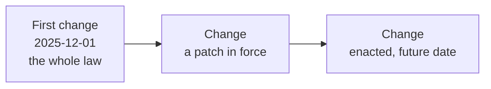

# Jurisdiction seed specification

Reference: how a jurisdiction's law is authored in the public seed. [The model specification](0002-model-specification.md) defines the models and [the architecture](0001-hrms-calculation-architecture.md) the engine. What the seed holds today is in [statutory coverage](0009-statutory-coverage.md).

## 1. Sources and scope

The public seed is `seed/public/jurisdiction/<CODE>/`: the law of nine jurisdictions (CN, ID, JP, MY, PH, SG, TH, TW, VN), each as one `jurisdiction` row and its dated changes. `bolt build` writes it as the release's `base` pack.

Public law belongs there. People, teams and entity rows are private data, loaded through `seed/+seeder.ts` and `bolt seed`; they never enter a release. Personal records are never copied into the public seed.

## 2. Layout

```text
seed/public/jurisdiction/
  MY/
    jurisdiction.json          the `jurisdiction` row
    jurisdiction_change.json   its changes, oldest first
  SG/
    ...
```

One folder per jurisdiction, one JSON file per model: the file name is the model. Each file is a list of rows that carry their `id` and stored fields and load as stored.

## 3. Row shapes

### `jurisdiction.json`

One row: `id`, `code`, `name`, `currency`, `timezone`, `tax_year_start_month`.

### `jurisdiction_change.json`

One row per change: `id`, `jurisdiction_code`, `effective_from` and `law`. A seeded change carries no `finding_id`.

`law` is keyed by family, then by row code, then by field:

```text
law
  conversions                 day, hour, proration, rounding, optional back_pay
  ledger                      ytd_scope
  lookup                      <table or constants key> -> value
  work_regions                <region key> -> display name
  employee_extension_schema   the statutory data the law asks of a person
  entity_extension_schema     the statutory data the law asks of a company
  subtotal                    <code> -> row
  allowance_catalog           <code> -> row
  overtime_catalog            <code> -> row
  statutory_contribution_catalog
  leave_catalog
  claim_catalog
  adhoc_catalog
  loan_catalog
  work_event_catalog
  workplace_case_catalog
  registered_rule             <code> -> row
  registered_effect           <code> -> row
```

- A row's code is its key. A row holds no `id` and no `code` field.
- Rows name each other by code: a catalogue row its `subtotal`, a statutory row its `employer_cost_subtotal`, a subtotal its `previous`. The first subtotal has no `previous`.
- A row's fields are those [the model specification](0002-model-specification.md#4-catalogues) lists for its family.

## 4. Changes

- The first change is the whole law on 1 December 2025.
- Each later change is the patch a change in law made on its date. It has the same keys and holds only what changes.
- A field set to `null` is removed. A row set to `null` is removed. A table or an expression is replaced whole: a patch states the whole new value of a field, never a part of it.
- The law on a day is the fold: the changes dated on or before it, applied oldest first.
- A change exists only because something changed that day.
- A change already enacted with a later date of effect is seeded in advance, as its own change from that date.
- A change not yet enacted is not seeded. Research files it as a `statutory_finding` with its `jurisdiction_change` rows, and it is in force once a person confirms the finding.
- A value wrong since it was set is corrected on the change that set it, never copied into a later one.
- A reference's `effective_from` is the date its source took effect. A later change does not rewrite it.



## 5. Authoring rules

### Formulas

Formulas select an evidenced base and assess an amount. The ledger service owns balance admission and posting; the engine owns dependency order and rounding.

- A jurisdiction's shared tables and shared constants live in its global `lookup`, each with a declared shape. A value read by one row lives on that row's own `lookup`, which wins over the global one.
- Every `lookup` key is read by an expression or by code. Global `lookup` keys must be shared values; a single-reader value belongs to its row.
- Employee extension schemas are flat: no `facts`, `term_facts`, `exit_facts` or `elections` bucket. `statutory.<SCHEME>` and `events[]` stay nested.
- Statutory bases come from completed subtotals and explicit catalog references. A tax formula reuses contribution results rather than reproducing their maths.
- Legal distinctions and dated exceptions are preserved. Splitting a formula across more fields does not count as simplification.
- Minification, opaque helpers and copied orchestration are rejected.
- Expressions carry statute citations, never working notes.
- A rule or effect validates nothing the model's own write boundary already checks (the agreed rate, normal time, category, work region and shift length). Seed JSON holds law, not guards.
- The extension schemas are authored in the seed, on each law's first change. After a change to a row param, run `bun run registry:generate`: it rewrites `params.ts` from the seed. `bolt check` does not; `tests/configuration/configuration_ownership.test.ts` fails until they match.
- A seed edit or audit across the law packs is one agent per jurisdiction, each with the same brief.

### Structure

- `subtotal` rows carry `name`, `previous`, `balance_window` (`MONTH` or `YEAR`) and optional `calculation`. The first computes base pay; later rows accumulate producer lines. Statutory rows carry `balance_window` too. Do not seed output bindings, phases, channels, order fields or subtotal-held catalogue lists.
- Static catalogues hold confirmed definitions and leave `subtotal` out when they create no pay line. Non-static catalogues own their entries, which name their row by `catalog_code`.
- The law must hold on every change date: expressions parse and read only their family's roots, the chain is linear, statutory dependencies are acyclic, and every `subtotal` a row names is a subtotal of the law that day. A patch that removes a row also changes or removes every row that names it.
- `conversions.rounding.day_rate` is `RATE` (the default) or `AMOUNT`. `RATE` rounds the day rate before it multiplies the days; `AMOUNT` rounds only the amount. The Philippines uses `AMOUNT`.
- `conversions.back_pay` names the ad hoc row that prices back pay, where the law prices it apart from ordinary pay: Singapore names `ADDITIONAL_BACKPAY` and Indonesia `RETROACTIVE_PAY`. Every other law leaves it out, so a terms row there applies from its date.
- Seed no refund or adjustment row per scheme, and no effect for a contribution correction. A contribution wrong in a paid period is corrected at its source and the next run carries the difference. The generic `STATUTORY_REFUND` and `STATUTORY_ADJUSTMENT` rows hold a refund or charge decided outside the system. A row a statute's own procedure needs stays: Malaysia's `NO_PAY_ADJUSTMENT` and `NO_PAY_REFUND`, Japan's `SOCIAL_INSURANCE_ADJUSTMENT` and `SOCIAL_INSURANCE_REFUND`.
- A tax row that counts what an ad hoc entry posts to a statutory account reads it as `ctx.posted.<SCHEME>.<employee|employer>` (Indonesia's `EMPLOYER_PAID_BENEFIT`, a benefit in kind).

### Data

- Seed balances as ledger movements, never as direct projection writes.
- Seed no payroll runs, payslips, YTD or per-run statutory results.
- Suspensions and work stoppages are work events.
- The public seed names no customer.
- Register work limits against roster creation and change; planned-work refusal is distinct from recording an actual violation.
- Amounts in expected results are independently calculated, never copied from the formulas.

## 6. Acceptance

A jurisdiction is accepted when its boundary scenarios pass: overtime inclusion, allowances, balance limits, a correction of a paid period and its retry, a run holding its people, dependent contributions, exits and carry-forward, where applicable.

Tests prove those mechanisms with synthetic inputs; they do not certify a seeded legal value. How legal values are verified is in [statutory coverage](0009-statutory-coverage.md#how-it-is-verified).

Fixtures carry actual employment dates, zero payroll YTD, source-linked leave and claim movements, and independently reconciled balance controls.
