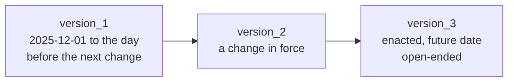

# Jurisdiction seed specification

Reference: how a jurisdiction's law version is authored in the public seed. [The model specification](0002-model-specification.md) defines the models and [the architecture](0001-hrms-calculation-architecture.md) the engine. What the seed holds today is in [statutory coverage](0009-statutory-coverage.md).

## 1. Sources and scope

The public seed is `seed/public/jurisdiction/<CODE>/version_<v>/`: the sealed versions of nine jurisdictions (CN, ID, JP, MY, PH, SG, TH, TW, VN). `bolt build` writes it as the release's `base` pack.

Public law belongs there. People, teams and entity rows are private data, loaded through `seed/+seeder.ts` and `bolt seed`; they never enter a release. Personal records are never copied into the public seed.

## 2. Layout

```text
seed/public/jurisdiction/
  MY/
    version_1/
      jurisdiction_settings.json
      subtotal.json
      allowance_catalog.json
      overtime_catalog.json
      statutory_contribution_catalog.json
      leave_catalog.json
      claim_catalog.json
      adhoc_catalog.json
      loan_catalog.json
      work_event_catalog.json
      workplace_case_catalog.json
      registered_rule.json
      registered_effect.json
```

One folder per version, one JSON file per model type: the file name is the model. Rows carry their `id` and stored fields and load as stored. `settings_id`, `previous_id` and `subtotal_id` hold the ids of the rows they name.

## 3. Versions

- A change of law is a new version, never an edit to a sealed one.
- A lineage is numbered in date order, sealed and unbroken. Its last version is open-ended.
- The seed starts on 1 December 2025.
- A version starts on the day a change in law took effect, and exists only because something changed that day.
- A change already enacted with a later date of effect is seeded in advance, as its own version from that date.
- A change not yet enacted is not seeded. Research files it as a `statutory_finding` with its `statutory_change` rows, and `statutory_materialize` merges it as the next version.
- The folder number is a sequence, never a date. The date is the version's `effective_range`.



## 4. Authoring rules

### Formulas

Formulas select an evidenced base and assess an amount. The ledger service owns balance admission and posting; the engine owns dependency order and rounding.

- A jurisdiction's shared tables and shared constants live in its global `lookup`, each with a declared shape. A value read by one row lives on that row's own `lookup`, which wins over the global one.
- Every `lookup` key is read by an expression or by code. Settings keys must be shared values; a single-reader value belongs to its row.
- Employee extension schemas are flat: no `facts`, `term_facts`, `exit_facts` or `elections` bucket. `statutory.<SCHEME>` and `events[]` stay nested.
- Statutory bases come from completed subtotals and explicit catalog references. A tax formula reuses contribution results rather than reproducing their maths.
- Legal distinctions and dated exceptions are preserved. Splitting a formula across more fields does not count as simplification.
- Minification, opaque helpers and copied orchestration are rejected.
- Expressions carry statute citations, never working notes.
- A rule or effect validates nothing the model's own write boundary already checks (a contract's rate, normal time, category, work region and shift length). Seed JSON holds law, not guards.
- After a change to a lookup key or a row param, or to an extension field in `src/lib/payroll_engine/extension_schema.json`, run `bun run registry:generate`: it rewrites `tables.ts` and `params.ts` from the seed and copies the latest extension schemas into each seed version. `bolt check` does not; `tests/configuration/configuration_ownership.test.ts`, `tests/configuration/extension_fields.test.ts` and `tests/configuration/lookup_keys.test.ts` fail until they match.
- A seed edit or audit across the law packs is one agent per jurisdiction, each with the same brief.

### Structure

- `subtotal` rows carry `code`, `name`, `previous_id`, `balance_window` (`MONTH` or `YEAR`) and optional `calculation`. The first computes base pay; later rows accumulate producer lines. Statutory rows carry `balance_window` too. Do not seed output bindings, phases, channels, order fields or subtotal-held catalogue lists.
- Static catalogues hold confirmed definitions and leave `subtotal_id` null when they create no pay line. Non-static catalogues own their entries.
- `conversions.rounding.day_rate` is `RATE` (the default) or `AMOUNT`. `RATE` rounds the day rate before it multiplies the days; `AMOUNT` rounds only the amount. The Philippines uses `AMOUNT`.
- `conversions.back_pay` names the ad hoc row that prices back pay, where the law prices it apart from ordinary pay: Singapore names `ADDITIONAL_BACKPAY` and Indonesia `RETROACTIVE_PAY`. Every other law leaves it out, so a contract version there applies from its start.
- Seed no refund or adjustment row per scheme, and no effect for a contribution correction. A contribution wrong in a paid period is corrected at its source and the next run carries the difference. The generic `STATUTORY_REFUND` and `STATUTORY_ADJUSTMENT` rows hold a refund or charge decided outside the system. A row a statute's own procedure needs stays: Malaysia's `NO_PAY_ADJUSTMENT` and `NO_PAY_REFUND`, Japan's `SOCIAL_INSURANCE_ADJUSTMENT` and `SOCIAL_INSURANCE_REFUND`.
- A tax row that counts what an ad hoc entry posts to a statutory account reads it as `ctx.posted.<SCHEME>.<employee|employer>` (Indonesia's `EMPLOYER_PAID_BENEFIT`, a benefit in kind).

### Data

- Seed balances as ledger movements, never as direct projection writes.
- Seed no payroll runs, payslips, YTD or per-run statutory results.
- Suspensions and work stoppages are work events.
- The public seed names no customer.
- Register work limits against roster creation and change; planned-work refusal is distinct from recording an actual violation.
- Amounts in expected results are independently calculated, never copied from the formulas.

## 5. Acceptance

A jurisdiction is accepted when its boundary scenarios pass: overtime inclusion, allowances, balance limits, a correction of a paid period and its retry, a run holding its people, dependent contributions, exits and carry-forward, where applicable.

Tests prove those mechanisms with synthetic inputs; they do not certify a seeded legal value. How legal values are verified is in [statutory coverage](0009-statutory-coverage.md#how-it-is-verified).

Fixtures carry actual employment dates, zero payroll YTD, source-linked leave and claim movements, and independently reconciled balance controls.
