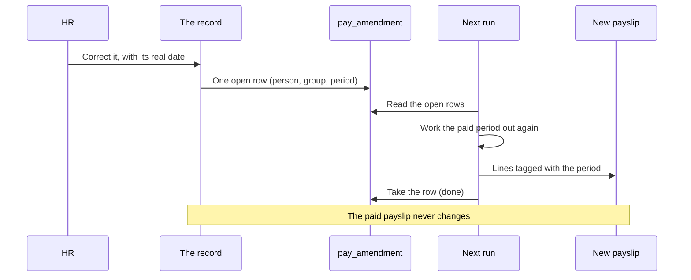
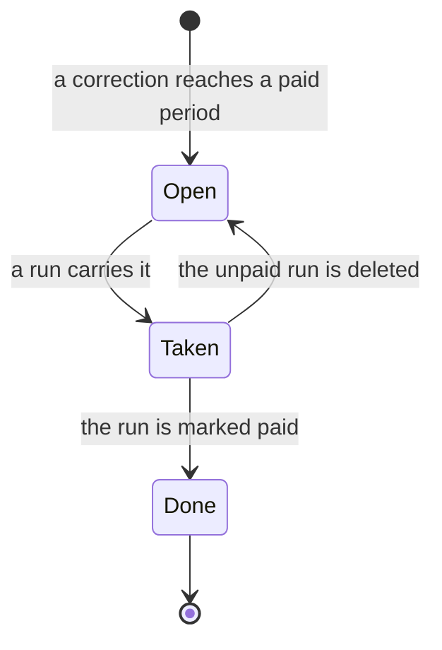

# Corrections and integrity

How a mistake in a paid period is corrected, what must always be true of the ledger, and how the workspace checks it. Structure is in [the architecture](0001-hrms-calculation-architecture.md); the ordinary flow is in [the mechanisms, run through](0008-mechanisms-walkthrough.md).

## 1. The rule for HR

If something in a paid period is wrong, correct it where it was recorded, with its real date.
The paid payslip does not change. The next payroll run works the period out again and pays the difference.
You see every difference, period by period, in the run before you mark it paid.

**Example: missed overtime.** Two hours of overtime on 10 March were not keyed, and March is paid. HR opens the roster day, adds the hours and saves. The March payslip does not change. The April payslip shows, under "Adjustments for earlier periods", the overtime for March and what it moves in contributions and tax, each tagged March. HR works out nothing and keys no amount.

**Example: a backdated raise.** In September the company signs a raise from 1 June. HR seals the new contract version from 1 June with its signed date. September's payslip shows the new salary and one line of back pay for June to August, with September's contributions and tax worked out on it by the law's own rule for back pay. June to August do not change.

A record of a period nobody has been paid for is simply edited or deleted. Nothing below applies to it.

## 2. How it works

One mechanism: **what a period should pay now, less what has been paid for it.**

1. **HR corrects the record.** The save writes one **amendment row** (`pay_amendment`): this person, this pay group, this pay period. The record and the row commit together or not at all. A change held for approval writes its row when it is approved (section 6).
2. **The next on-cycle run that pays the person reads their open rows.** They say exactly where to start. Nothing is guessed from dates or seals.
3. **From a person's earliest amended period it works out every paid period through the last paid one of that tax year,** oldest first. Each is worked out on the records as they stand now, with the coverage and pay date its own run stored, the law in force on that pay date, its own pay group's schedule, and the balance that period saw.
4. **For each it takes the remainder:** what the period should pay now, less its payslip's own lines and anything a later payslip already carried for it. Every line: earnings, deductions, contributions, tax.
5. **The remainders go on this payslip as lines tagged with their period** (`period` on the line), and are posted to that period's ledger keys. The payslip's breakdown lists where each carried difference posts (`carried`). The run takes the rows it carried, so no other run can.
   A statutory scheme says which month answers for carried pay (`assessed` on its row). `EARNED`, the default: the scheme is worked out again for the earlier period and its difference is carried. `PAID`: the earlier period's charge stands, and the carried pay counts as this month's wages for that scheme (Malaysia's SOCSO, EIS and SKBBK, which are charged on wages paid in the month).
6. **A later tax year is not worked out again.** The year so far is keyed by its tax year, so a later year reads nothing of it.
7. **Net pay never goes below zero.** If taking money back would push it below, one line, "Recovery carried forward" (`RECOVERY_CARRIED`), brings it to exactly zero, and the run writes an amendment row for its own period so the next run takes the rest.

The remainder is a state, not a history. Any number of edits, deletes and changes back to the old value come out the same: one difference, or none.

Where it shows:

- **The leave, claim, ad hoc, loan repayment, roster day and holiday forms, and sealing a contract version,** ask before a save that reaches a paid period: "This period is already paid", with what happens to the pay. The question is the form's (`src/lib/ui/payroll/paid_period.svelte.ts`). The server writes the row for every record, whatever a form asked.
- **The payslip** groups the tagged lines under "Adjustments for earlier periods", by period.
- **The run** has an "Earlier periods" tab: the amended periods it carried, and those waiting for the next run.
- **An off-cycle run** may name waiting periods to carry ("Earlier periods to carry"). It works them out the same way and takes their rows. Someone it pays nothing else gets a payslip of the carried lines alone. This is how someone no on-cycle run pays any more is paid what they are owed.

## 3. How a period reads the contract

Three rules.

1. **Facts come from the version in force on the date.** Family, person details, events, statutory set-up, pay group. A dated row (roster day, leave, claim, ad hoc entry) is priced under the version in force on its date, whatever version it points at. Where two roster days of one person share a date, the one of the version covering that date counts.
2. **Agreed terms come from the latest version signed by the period's pay date.** Rate, hours, days, agreed allowances: the contract's `terms`, by `terms.signed_on`. A version with no signed date counts as signed in time. So a raise signed later changes nothing in the periods before it.
3. **What a later-signed version adds for earlier periods is back pay of the period it was signed in.** The run works it out (each earlier period's earnings with the version's terms, less its earnings without), puts the sum on the law's own back-pay row before it calculates, and that period's schemes price it with the formula they already have. It is never keyed and never stored. The law names the row in its `conversions.back_pay`. A law that names none has no such case: a version there applies from its start.

What follows:

- A raise signed this month is paid by the ordinary run. No amendment row exists.
- A raise signed in a period already paid (keyed late, or later voided and replaced) amends that period like any other correction. Its back pay is worked out again from the versions as they stand, and the difference, contributions included, is carried.
- A raise that was signed in time and only keyed late was due all along: its paid periods are worked out again, each under its own ceiling.
- A baby registered late is a fact: the months since the birth are worked out again as they were due, even when the same version also holds a later-signed raise.
- A hire signed after its first months has no terms signed in time, so those months pay nothing of their own and all of it is back pay of the signing month. HR who mean it was due all along enter the true earlier signed date, or leave it empty.

## 4. What writes an amendment row

| What HR does, dated in a period the person has a payslip for                                         | Rows written                                                                                               |
| ---------------------------------------------------------------------------------------------------- | ---------------------------------------------------------------------------------------------------------- |
| Adds, changes or deletes a roster day, leave day, claim, ad hoc entry or loan repayment              | That person, that period                                                                                   |
| Moves one of those to another date                                                                   | The period it left and the period it joined                                                                |
| Seals, voids or replaces a contract version whose facts, or terms signed in time, reach paid periods | Every paid period it reaches                                                                               |
| Seals, voids or replaces a version signed after periods it reaches                                   | None while its signing period is unpaid; otherwise the signing period                                      |
| Publishes or corrects a holiday, a work event or an employer version in paid time                    | Every person and paid period it reaches                                                                    |
| Writes, corrects, moves or deletes a change of law, or confirms or rejects its finding, in paid time | Every person and paid period the change reaches: from its date to the next change that sets the same value |
| Changes how a person's service counts (`cumulative_service`)                                         | Every period that person was paid for                                                                      |
| The run defers a recovery                                                                            | That person, the run's own period                                                                          |
| A filed `contract_change` reaches its day after a paid run already covers its date                   | None. The change stays filed and raises a task: move it to a month still to run                            |
| Anything in a period not yet paid; a raise from next month                                           | None                                                                                                       |

- One open row serves a person and period, however many corrections.
- An entry a paid payslip priced may be changed or deleted: the write carries its row. A deleted roster day is not a day off; the shift pattern takes over.
- A record whose date moves loses its run seal (`payroll_run_id`), so the period it joins prices it.
- A late claim or ad hoc entry dated in a period the person was paid for is that period's: it is carried and tagged. One dated in a period that paid the person nothing is priced by the next run as an ordinary line.
- Contract and employer versions stay dated and frozen. A change is a new version from its real date; a wrong one is voided and replaced.
- A change of law is a dated row from its real date. A wrong one is corrected, moved or deleted in place. A change to a row's `references`, `description` or `name`, or to an extension schema, writes no rows.
- **A change of pay schedule writes no rows.** A pay group that has a paid run keeps its schedule. A company that starts paying monthly makes a monthly group and moves people to it by contract versions from the first of a month. Old periods keep their group and are worked out on its schedule; the run that pays the person now carries the difference.

## 5. The constraints

1. **A paid payslip is never rewritten.**
2. **No write reaches a paid period's inputs without its row in the same write.** One helper does it (`src/lib/amendments.ts`). `RUN_INPUTS` there lists every model a run reads with its rule: its write carries rows, it refuses a change paid periods were worked out on, or it prices nothing. A test fails when a run reads a model with no rule.
3. **Nothing of a person moves while an unpaid run holds them.** The run holds what it priced and everything dated before it; a record dated after its window is free. Delete the run first.
4. **A row is carried by one run.** A run takes a row only while no run holds it; deleting an unpaid run frees its rows.
5. **Net pay never goes below zero.**
6. **A run works out a bounded number of earlier person-periods:** 240 beyond the people it pays. People are taken whole, the earliest amended first. The rest wait and are shown as waiting.
7. **A pay group with a paid run keeps its schedule.** Its name and pay day may change; what moves pay may not. The same holds for a shift pattern paid periods follow and a shift paid days use.
8. **A run stays one write:** it reads, prices everyone, and writes the run, its payslips, seals, postings and the rows it took together. It links each row at the revision it read, so a row changed in between is a conflict.

## 6. Approvals

Two things are held for approval: an employee's own claim and leave request (supervisor, then HR). HR's own writes are direct.

| Case                                                          | What happens                                                                                                                   |
| ------------------------------------------------------------- | ------------------------------------------------------------------------------------------------------------------------------ |
| A held change reaches a paid period                           | Its row is written by the approving decision, beside its ledger posting, on the records as they then stand. Not at the request |
| The request is rejected                                       | No row was ever written. Nothing to undo                                                                                       |
| The period is paid between the request and the decision       | The decision sees it paid and writes the row                                                                                   |
| The request is dated under an unpaid run                      | Refused at once: the run holds the person                                                                                      |
| The decision comes while an unpaid run holds the person       | The decision is refused and the request stays pending. Decide it after the run is paid or deleted                              |
| A period worked out again holds a record still under approval | The run refuses, as it does for its own period. Decide it, then run                                                            |
| An employee dates a request in a paid period                  | HR review is the last step of the flow, so HR's approval is the confirmation of the paid-period warning                        |

One open row serves a person and period however many edits, which is why the row is written at approval: a rejected request then has nothing to take back.

## 7. What it guarantees

- A paid payslip is never changed.
- After the run, what has been paid for an amended period equals what it should pay now, line by line.
- Any number of edits, deletes and changes back come out as one difference or none.
- A delete and a date move take back and give exactly what was paid.
- Contributions land in the period earned, under that period's ceiling.
- A cumulative tax, a yearly ceiling and a figure a later period worked out once from the year so far all end exact, also when the correction comes after the year has closed.
- A set-up wrong over several months is collected month by month, with no lump and no double.
- A raise sealed late pays each month's difference on every line, each month under the law of its own pay date.
- A raise signed later is back pay of the signing month, priced by the law's own row; changing or voiding it afterwards returns the contributions too.
- A change of pay schedule leaves old periods exact.
- A late-registered child corrects the tax of the months since, and the leave opens on the real birth date.
- Balances end where a never-wrong history would have left them.
- Net pay is never below zero; a deferred recovery is taken back exactly once.
- A deleted run leaves its rows open, and making it again gives the same payslip.

What stays with HR:

- **Someone who has left and still owes.** Their last payslip ends at zero, and the run raises one task (`recovery:<contract>:<period>`) naming the amount to recover outside payroll. An off-cycle run refuses to carry what would take money back from someone it pays too little. What they are owed is paid by an off-cycle run that carries their waiting periods.
- **Closed years.** The run computes amounts. Late interest to a fund, amended yearly filings and any legal limit on recovering an old overpayment stay with HR.
- **A refund or charge decided outside the system.** HR keys it on the law's generic `STATUTORY_REFUND` or `STATUTORY_ADJUSTMENT` row.

## 8. What it refuses

| Attempt                                                                       | The screen says                                                                                                                                        |
| ----------------------------------------------------------------------------- | ------------------------------------------------------------------------------------------------------------------------------------------------------ |
| Correct anything of a person an unpaid run holds                              | "Run 14 holds this person and is not paid yet. Delete it, correct this, and run again."                                                                |
| Change what moves pay on a pay group with a paid run                          | "This group has paid runs. Make a new group for the new schedule, and move people to it from the first of a month."                                    |
| Edit a shift pattern paid periods follow                                      | "Paid periods follow this pattern. Make a new pattern from the date it changes."                                                                       |
| Edit a shift that paid roster days used                                       | "Paid days use this shift. Correct the roster days themselves, or make a new shift."                                                                   |
| Delete a paid run                                                             | Refused: a paid run is locked. Correct the record where it was recorded                                                                                |
| Start a contract change inside a month (not a hire, rehire or exit)           | "A contract changes from the first of a month. Date the event as it happened; the version starts on the first."                                        |
| An off-cycle run naming an entry or period another run already took           | "An entry or amended period it names is already attached to another payroll run."                                                                      |
| An off-cycle run that would take someone below zero                           | "This run would take someone below zero. Leave the deduction for the next on-cycle run."                                                               |
| An off-cycle run whose carried periods take back more than it pays the person | "What this run carries would take money back from someone it pays too little. Leave it for their next on-cycle run, or recover it from them directly." |
| A correction reaching more than 10,000 person-periods                         | "This reaches too many paid periods for one save. Correct it by pay group or by year."                                                                 |
| Key an amendment row by hand                                                  | "A correction leaves this row itself. Correct the record where it was recorded."                                                                       |
| Type over a sealed version                                                    | No such action exists: void and replace                                                                                                                |
| Change a paid payslip                                                         | No such action exists                                                                                                                                  |

Nothing else is refused. A record a run priced may be changed or deleted, a no-pay day may be dated in a paid period, and a contract version may be sealed over paid periods. Each leaves its amendment row.

## 9. The `pay_amendment` model

One paid pay period of one person to work out again.

| Field            | Kind                                  | Why                                                     |
| ---------------- | ------------------------------------- | ------------------------------------------------------- |
| `employee_id`    | ref                                   | Whose period                                            |
| `pay_group_id`   | ref                                   | With `period`, names the one paid run to work out again |
| `period`         | text                                  | The paid cycle, as its run names it                     |
| `payroll_run_id` | optional ref, `on_delete: 'set_null'` | Empty is open. Set: that run carried it                 |

- Unique on (`employee_id`, `pay_group_id`, `period`) while `payroll_run_id` is empty.
- Nobody keys a row. Only the write that corrects a paid period, or a run deferring a recovery, leaves one.
- A run takes its rows through its `amendments` link layer, in its own write, only while they are still empty. Deleting an unpaid run sets them back to empty. A row a paid run holds is done, and is kept.

- No field is added to any other record. A payslip breakdown line gains an optional `period`, and the breakdown gains `carried: [{ run_id, period, postings }]`. The run's ledger plan posts the carried differences under its own source, `payroll_run:<id>`.

The balance a period saw is rebuilt, not stored: pay and contribution totals from the payslips before it and what this run has already carried for earlier periods; leave and claims from today's balance less what was recorded after the period closed.

## 10. The ledger moves only with its record

Every ledger row is written with the record that caused it, and only once that record stands. If the ledger cannot move, the write does not pass.

- **One writer.** Only `src/lib/ledger/service.ts` writes `ledger_entry` and `employee_balance`. An administrator's direct write is refused too.
- **A record carries its postings.** A leave, claim or ad hoc entry, a payroll run and HR's manual adjustment each carry their ledger rows in their own write. The rows commit in the same statement as the record. A correction's amendment row rides the same way.
- **An edit posts the difference; a delete posts the inverse.** The ledger keeps every row.
- **Held for approval, nothing posts.** While a request waits, nothing is on the ledger. On the final approving decision the request's state change, the postings and any amendment row commit as one statement. A refusal, a conflict or a failure leaves the request waiting and the ledger untouched.
- **A waiting request still holds its days.** The balance does not show it, but the check before a second leave entry counts it, so the same days cannot be asked for twice.
- **No balance row, no entry.** An entry or a payslip for a person whose balance row is not open is refused, in the approving decision too.
- **A run is not a decision.** A run refuses when an entry it would pay still waits for its decision, whoever runs it, including the reviewer whose step it is.
- **Sync.** Entitlements owed by rule are settled by the `ledger` automation: one read, then one write per 50 balances. It writes the difference between what is owed and what is posted, so a retry writes nothing twice.
- **The law's effects on an entry** run under the system identity, whoever keyed the entry, and only once it stands. A request still waiting raises nothing; its posting on approval raises them.
- **No locks.** No write holds a lock across statements, and nothing here uses a transaction that spans statements. Every write above is one short statement.

HR's manual balance row is immutable. A mistake in one is a second row the other way.

## 11. When an exit is cancelled or its date moves

An exit's tasks name it in their `occurrence_key`: `exit:<contract id>:<last day>`. A moved last day is another fact, so its key changes.

The leave is not a dependant. The last payslip settles it from the contract and the balance, with nothing keyed (section 0 of [the architecture](0001-hrms-calculation-architecture.md#exits)). Changing `encash_leave`, moving the last day or cancelling the exit after that run is paid amends the period: the next run carries the difference, and its posting moves the days back. Under an unpaid run nothing moves; delete the run first.

The rest follows in the same write. The contract's effect, for every exit raised, moved or cancelled, runs the routine in `src/lib/dependants.ts`: a cancelled exit's loan back on its instalments, then the exit's tasks. It is safe to repeat; it schedules `ledger` for the people's entitlements.

What the routine does to each dependant of an exit that no longer stands:

| Dependant                                    | In no run                                          | Under an unpaid run  | In a paid run                                          |
| -------------------------------------------- | -------------------------------------------------- | -------------------- | ------------------------------------------------------ |
| Exit tasks (the law's duties, the loan task) | Open ones are waived                               | Open ones are waived | Open ones are waived; a fulfilled one keeps its record |
| Loan final settlement                        | Back to monthly instalments over the loan's period | Untouched            | Stands                                                 |

Then, for an exit that stands (the new last day of a moved exit, or an exit raised again), the tasks the routine waived are opened again. None is raised twice.

No law carries a waiving effect. Exit tasks are waived by this routine, the same way for every jurisdiction.

## 12. Invariants

A hard invariant must always hold. A watch can be reached by a legitimate act and is only reported.

| #   | Invariant                                                                                    | Enforced by                                                                     |
| --- | -------------------------------------------------------------------------------------------- | ------------------------------------------------------------------------------- |
| H1  | A balance figure equals the signed sum of its ledger rows per account, code, period, measure | The one writer; checked by the integrity check                                  |
| H2  | Every ledger row names its source, period, measure and amount                                | A database check on `ledger_entry`                                              |
| H3  | A ledger source that still holds something exists                                            | Deletes carry inverse postings; checked by the integrity check                  |
| H4  | Only posting, sync and HR's manual row write the ledger and the balance                      | The model write rules and the one writer                                        |
| H5  | One open amendment row per person, pay group and period; a row is carried by one run         | Database uniqueness on `pay_amendment`; the run's link layer                    |
| H6  | An entry sealed by a run has that run's payslip for its person                               | The run's own write; checked for unpaid runs and runs paid in the last 2 months |
| H7  | Sealed contracts never overlap; states move one way; one on-cycle run per group and period   | Database constraints and state rules; the run's coverage check                  |
| H9  | No open exit task on a contract that is not an exit, or for a last day that moved            | The routine in section 11; checked by the integrity check                       |
| W1  | An entitlement, or what is left of it, below zero                                            | Reported by the integrity check                                                 |

A manual deduction may take a window below zero: days taken stay taken, and HR's row is HR's decision. W1 reports it.

## 13. The integrity check

`src/lib/integrity.ts` reads the workspace in one request and returns findings for H1, H3, H6, H9 and W1. It raises one task per finding, keyed `integrity:<invariant>:<subject>`.

- It only raises tasks. It repairs nothing and writes nothing else.
- A finding with an open task raises nothing more. One that returns after its task was closed raises a dated task.
- It is the last step of the `ledger` automation's whole-workspace pass, not an automation of its own. It adds no wake-up and nothing to start.

## 14. How it is tested

Every case goes through the models' own acts. A law pack is only the fixture, and a figure is compared with a history in which the record was never wrong.

| Behaviour                                                                                                      | File                                              | Test                                                                                                                |
| -------------------------------------------------------------------------------------------------------------- | ------------------------------------------------- | ------------------------------------------------------------------------------------------------------------------- |
| A correction leaves one open row; the paid payslip stands; the next run carries tagged lines and takes the row | `tests/corrections/paid_period.test.ts`           | "missed overtime keyed after its month is paid is carried by the next run, tagged with its month"                   |
| A delete takes back exactly what was paid                                                                      | `tests/corrections/paid_period.test.ts`           | "a claim a run paid is deleted: the next run takes back exactly what was paid for it"                               |
| A date move amends the period left and is paid by the period joined                                            | `tests/corrections/paid_period.test.ts`           | "a paid claim moved to an unpaid month: taken back for the month it left, paid by the month it joined"              |
| Many edits and a change back come out as nothing                                                               | `tests/corrections/paid_period.test.ts`           | "edited many times and back to what it was: one open row, and nothing to carry"                                     |
| An unpaid run holds its people                                                                                 | `tests/corrections/paid_period.test.ts`           | "nothing of a person moves while an unpaid run holds them"                                                          |
| A deleted run frees its rows; the run made again is the same                                                   | `tests/corrections/paid_period.test.ts`           | "a run that carried is deleted: its rows open again, and the run made again is the same payslip"                    |
| Net pay stops at zero; the rest is taken once                                                                  | `tests/corrections/paid_period.test.ts`           | "a recovery larger than the pay: net pay stops at zero, and the next run takes the rest once"                       |
| Recalculation stops at the tax year's end                                                                      | `tests/corrections/paid_period.test.ts`           | "a correction after its tax year closed: that year alone is worked out again"                                       |
| A version sealed late, with no signed date, is due from its start, on every line                               | `tests/corrections/reach.test.ts`                 | "a raise three months back: each month carries its own difference, on every line"                                   |
| A later-signed raise is back pay of the signing period                                                         | `tests/corrections/back_pay.test.ts`              | "signed later: the paid month does not move, and the signing month pays it as back pay"                             |
| A raise signed in time and keyed late amends its paid periods                                                  | `tests/corrections/back_pay.test.ts`              | "signed in time and keyed late: it was due, so the paid month is worked out again"                                  |
| Voiding a carried raise returns the back pay and its contributions                                             | `tests/corrections/back_pay.test.ts`              | "carried, then voided and replaced by a smaller one: the back pay and its contributions come back"                  |
| An old period is worked out on the group that paid it                                                          | `tests/runs/pay_group_corrections.test.ts`        | "a period the old group paid is worked out on that group, and the new group carries it"                             |
| A paid group keeps its schedule                                                                                | `tests/runs/pay_groups.test.ts`                   | "a group with a paid run keeps its schedule; its name and pay day still change"                                     |
| A company-wide correction amends everyone it reaches                                                           | `tests/corrections/company_and_approvals.test.ts` | "a holiday published in a paid month amends everyone the company paid for it"                                       |
| A shift paid days used refuses the edit                                                                        | `tests/corrections/company_and_approvals.test.ts` | "a shift paid days used keeps its hours"                                                                            |
| A fact is read from the version in force on the date                                                           | `tests/corrections/parity.test.ts`                | "children corrected from 1 to 2: the next payslip carries the difference"                                           |
| A held change writes its row at approval                                                                       | `tests/corrections/company_and_approvals.test.ts` | "its amendment row is written by the approving decision, not by the request"                                        |
| A rejection leaves nothing                                                                                     | `tests/corrections/company_and_approvals.test.ts` | "a rejected request leaves no row"                                                                                  |
| A request under an unpaid run is refused                                                                       | `tests/corrections/company_and_approvals.test.ts` | "a request dated under an unpaid run is refused at once"                                                            |
| Every model a run reads has a rule for a paid period                                                           | `tests/corrections/amendment_gate.test.ts`        | "every model it reads is named with what its write does to a paid period"                                           |
| Each such model carries its rule in its own write                                                              | `tests/corrections/amendment_gate.test.ts`        | "`<model>`: its write carries the amendment rows"; "`<model>`: a change paid periods were worked out on is refused" |

The ledger and the exit routine:

- `tests/ledger/integrity.test.ts`: a workspace worked through its real acts has no finding; each invariant, broken on purpose, yields exactly its finding; the check raises each finding once.
- `tests/ledger/integrity_random.test.ts`: seeded random sequences of real acts, with the acts that try to break the ledger. `HR_SEED` replays one sequence and `HR_STEPS` lengthens it.
- `tests/corrections/mistakes.test.ts`, `tests/ledger/cash_out.test.ts`, `tests/law_versions/version_lifecycle.test.ts`, `tests/law_versions/law_change_writes.test.ts`, `tests/law_versions/law_change_by_mistake.test.ts`, `tests/loans/loan_lifecycle.test.ts`, `tests/runs/approvals.test.ts`, `tests/ledger/usage_limits.test.ts`: each act and its way back.

## 15. States with no automatic way back

Each has its manual way out.

| State                                                                        | Manual way out                                                                    |
| ---------------------------------------------------------------------------- | --------------------------------------------------------------------------------- |
| Someone who has left still owes after their last payslip                     | One task names the amount; it is settled outside payroll                          |
| A paid loan final settlement, and the exit was cancelled                     | It stands. The open schedule is untouched and the loan task is waived             |
| A fulfilled task whose cause was cancelled                                   | It keeps its record                                                               |
| The contract page settles a leaver's loan in several acts and stops half way | HR regenerates the schedule from the loan form                                    |
| The latest contract version voided before a replacement is drafted           | It reads as an exit until the replacement is drafted. Draft the replacement first |
| More amended periods than one run works out                                  | They wait, shown as waiting, and the next run takes them                          |
