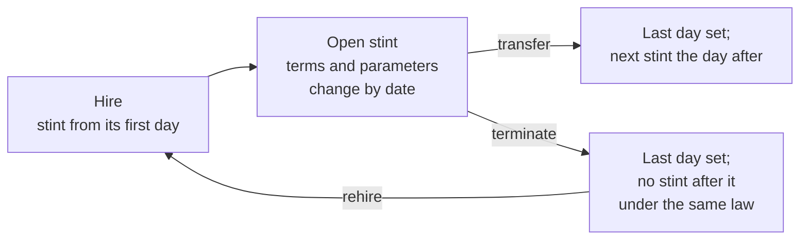

# Transfer semantics

Reference: the rules for stints, transfers, service, loans and exits. The source tree is the final authority. [The architecture](0001-hrms-calculation-architecture.md) holds the structure, [dated changes](0011-dated-changes.md) a change inside a stint, and [corrections and integrity](0007-corrections-and-integrity.md) what a write over a paid period does and what follows a cancelled or moved exit.

## 1. Terms

- **Stint** — one `employment`: a person with one company, from a first day to a last day. A person has a list of stints and one `employee_balance`, not a balance per stint.
- **Same-jurisdiction transfer** — the next stint's jurisdiction code (its company's `settings_code`) equals the one before. The company changes; the law does not.
- **Cross-jurisdiction transfer** — the next stint's jurisdiction code differs. The employment under the old law ends; a new one under the new law begins.
- **Rehire** — a new stint after a gap.
- **Change of terms** — a `contract_terms` row inside the stint: a raise, a promotion, a new pay group. The stint goes on.
- **Life event** — a `dependant` or an item in the stint's `events`, with its real date. The stint goes on.
- **Termination** — the stint gets a last day and no stint follows it under the same law. This is an exit.

The comparison is always by **jurisdiction code**, never by entity id: a law is one jurisdiction whatever changes it has had.

## 2. Stints

1. A stint has no state. It is open while it has no last day.
2. Stints of one person never overlap. The rule is the person's, so it covers a stint with another company. A new stint waits until the open one has its last day.
3. A transfer ends one stint and starts the next the day after, in one write. The next stint starts on the first of a month, so a run never prices a month on two employers.
4. The next stint keeps the employee number. It creates no new employee profile and no new balance.
5. A hire, a rehire and an exit keep their real dates, and a run pays those days by the period's proration. Each company pays only the days of its own stint.
6. A stint's dates, credited service, events and exit answers are edited on the stint. A first day moves with the rows dated on it.
7. A stint with a payslip or an entry is never deleted ([a stint keyed by mistake](0011-dated-changes.md#5-decisions)).

## 3. Balance semantics

`employee_balance` is one row per employee. Payroll reads the row by `employee_id`.

| Scenario                               | Leave                                                              | Loans                                                    | Ledger history      |
| -------------------------------------- | ------------------------------------------------------------------ | -------------------------------------------------------- | ------------------- |
| Change of terms, same stint            | Carry unchanged                                                    | Carry unchanged                                          | Keep                |
| Transfer, same jurisdiction            | Carry unchanged                                                    | Carry, moved to the next stint                           | Keep                |
| Cross-jurisdiction, row has a `payout` | Settled by the old last payslip: paid out, the days post as used   | Transfer or settle                                       | Keep; old rows stay |
| Cross-jurisdiction, no `payout`        | Nothing moves: the old days stay under the old jurisdiction's keys | Transfer or settle                                       | Keep; old rows stay |
| Termination                            | Settled by the last payslip where the row has a `payout`           | Recover from final pay; the rest stays open, with a task | Keep                |

### 3.1 Leave

Leave is jurisdiction law, not a portable company currency. Periods are keyed by jurisdiction, so the new law's keys start empty and sync opens them from the new stint.

A stint that ends with no stint after it under the same jurisdiction is an exit from the old law, and the old jurisdiction's last payslip settles its leave as [section 0](0001-hrms-calculation-architecture.md#exits) says. The misconduct ground is `exit_ground` `MISCONDUCT_DISMISSAL`.

### 3.2 Loans

A loan is a receivable of the old employer. It does not disappear because the person changes jurisdiction, and it never touches the ledger.

- **Same jurisdiction** — carry. The loan and its open schedule move to the next stint and its company. Repayments a run took keep their original company and stint. Payroll selects the open repayments by entity and `paid_on`.
- **Cross-jurisdiction** — the old open schedule is deleted first, then for each outstanding loan:
  - **TRANSFER**: when the target law has a loan row with the same code, create the target loan and monthly schedule from the outstanding principal.
  - **SETTLE**: otherwise, or when the user checks **Settle from final pay instead of transferring**, create the settlement repayment.
- **Termination** — final pay repays what `final_pay_loan_floor_percent` allows. The rest stays open on a recalibrated schedule, and HR gets a task to chase it (`LOAN_RECOVERY:<employment>:exit:<last day>`). If the exit is cancelled the task is waived and a final settlement no run took goes back to monthly instalments over the loan's period; one a paid run took stands.

Silent carry is unsafe across jurisdictions: the new jurisdiction's payroll reads its own loan catalogue, so the old loan's `catalog_code` may name no row there and the deduction silently stops.

### 3.3 Service continuity

Service for leave bands is a property of the person's stints, not of the latest one. A change of terms or a transfer must not reset annual-leave service.

- Service is worked out from the person's stints, never stored as a second date (`startsOf` in `src/lib/person.ts`).
- A stint that starts the day after another ended under the same jurisdiction code continues its employment; a gap starts a new one.
- With `employee_profile.cumulative_service` on, every stint under the same jurisdiction code counts, rehires included (an employer's practice, giving at least the statutory continuous service); off (the default), only the current unbroken employment counts.
- A cross-jurisdiction transfer starts new statutory service.
- `employment.service_started_on` is only an override for service credited from elsewhere.
- Sync and the payroll engine hand the worked-out starts to expressions as `service_started_on` and `employment_started_on`, so leave formulas read one field.

### 3.4 Exit

- An exit is read from the person's stints: a stint with a last day and no later stint under the same jurisdiction code (`isExit` in `src/lib/person.ts`). No separate record holds it.
- The stint's write raises the `exit` event when a save makes it true, moves it or cancels it. The law's exit duties are effects on that event; their entry is the employment on the last day. The write's own effect keeps the exit's other tasks and loan in step.
- Each task names the stint and its last day (`…:<employment id>:exit:<last day>`), so a repeat is a no-op.
- A moved or cancelled exit is followed by one routine for every jurisdiction ([corrections and integrity](0007-corrections-and-integrity.md#11-when-an-exit-is-cancelled-or-its-date-moves)).
- The save that ends the stint, or moves its end, states its exit answers with it: `exit_ground`, `reason`, `encash_leave` and `final_pay_due_on`.

## 4. Payroll consequences

- **Same-jurisdiction transfer** — no final pay and no leave paid out. The next company's payroll continues the same balance.
- **Cross-jurisdiction transfer** — the old entity runs its final payroll for the exit period. Leave settlement (if any) is paid there. The new entity starts under its own law; its first run reads nothing of the old stint, law or company.
- **No double payment** — a sealed claim, adhoc or repayment entry is never paid again, and a sealed leave entry answers only for its own days in each run's period.

## 5. Operator sequence

1. Open the person's profile, Contract tab. An open stint offers **Transfer** and **Terminate**; the tab offers **Hire** or **Rehire**.
2. **Transfer** is one sheet: the company, the first of the month the next stint starts, the terms and statutory parameters carried over, and what happens to the loans. Confirming ends the stint the day before, starts the next, and carries, transfers or settles the loans.
3. **Terminate** is one sheet: the last day, the reason, the exit ground, whether to pay out leave, and what final pay recovers of the loans. Confirming sets the last day and writes the loan rows in one write.
4. Run the old entity's final payroll for the exit period; then run the new entity.
