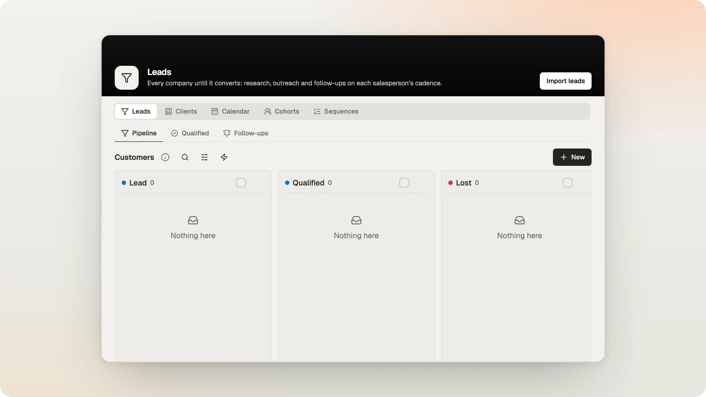

# CRM



A company CRM and operations workspace. Leads enter one company table by hand, from a CSV or from Apollo (one company per domain, one
PIC per email), are researched on the web with sources, get a first outreach drafted from the sample that fits their
PIC, get 3–5 potential projects proposed, are sent cold outreach in Apollo cohorts, and are followed up on each
salesperson's cadence by direct message until they convert into clients. Client PICs'
messages from WhatsApp, email, Telegram, Slack and Discord are filtered by System 1 and filed; their text, images and
voice notes, and recorded meetings, are extracted into each job's requirements, dates and decisions. Every document,
outreach email and research prompt is a configurable template filled from the record's values: documents preview live,
download or send as PDF, and each uploaded signed copy is tagged with the values it was signed on.

This README is the operator walkthrough and implementation reference. The [documentation index](./docs/README.md)
links the supporting design documents. [Verification scope](#verification-scope) distinguishes
observed results from workflows that still need a live external-account test.

## Start here

| Surface                   | What to use it for                                                                                                                         |
| ------------------------- | ------------------------------------------------------------------------------------------------------------------------------------------ |
| **CRM → Dashboard**       | First page: calendar, upcoming appointments and tasks, follow-ups and pipeline statistics                                                  |
| **CRM → Leads & clients** | One company directory, filtered by stage; cohort membership on each row and company record                                                 |
| **CRM → Tasks**           | Tasks and follow-ups, owner, due date and native completion; these same rows appear in the calendar                                        |
| **Company → Jobs → job**  | Requirements, scope, decisions, PIC, SOW signer, activities, documents and files                                                           |
| **Configuration**         | Four flat pages: Message rules, Connections, Templates and Sequences. Signatory, outreach settings and classified messages open in context |

The **Sales** team (`hq-sales`) holds the shared CRM `sales` policy. Each member manages their own
personal connections and sync settings; another member cannot read or manage those connection
configurations. `hq_automation` and `calendar_activities` provide the automations' run-as authority.
Teams, policies and approval flows are authored in source, not edited in this workspace.

### Prerequisites

| Capability                       | Required before the demonstration                                                                        | Observable readiness                                                                     |
| -------------------------------- | -------------------------------------------------------------------------------------------------------- | ---------------------------------------------------------------------------------------- |
| CRM                              | Signed-in Sales member; customer with at least one job and saved PIC email/phone                         | Customer, job and contact records open and save                                          |
| Gmail                            | Host Google OAuth client; Gmail API; Google account permitted by the OAuth consent configuration         | Connections offers **Connect**, Google consent returns to HQ, status becomes Connected   |
| Google Calendar                  | Same host Google OAuth client; Calendar API; authorized Google account                                   | Connected instance imports the `primary` calendar by default                             |
| WhatsApp                         | Personal WhatsApp provider available on the host; account owner's phone                                  | Pairing QR or phone-number code appears; scanning/entering it reaches Connected          |
| Transcription and job generation | Host ingest (Norbital Convert with a transcription model) and the workspace's `default` model            | Recording reaches Ready; Generate job draft completes                                    |
| Voice profiles                   | Completed transcript, accessible audio, browser model/audio support and PIC consent                      | Speakers can be tagged; profile-saved confirmation appears                               |
| Documents                        | Document templates in the catalogue; the organization's legal details in Configuration; host PDF convert | Documents tabs render the filled template; Download PDF and Send work                    |
| Leads                            | An Apollo workspace connection with its API key (optional); host web search for research                 | Import creates leads once; a new lead gets Research, use cases and an outreach follow-up |
| Reminders by direct message      | A workspace WhatsApp, Telegram, Slack, Discord or email account (no owner), paired; member handles       | Each owner receives the reminder in the inbox and as a DM on that channel                |

Being signed in to Gmail in another browser tab supplies the Google session. HQ still needs its own
**Connect** consent flow. A disabled **Connect** or “not available on this host” means the host's
provider/OAuth setup is missing, rather than an unpaired Google account.

### Local review

From the realm root, run `bun run env -- serve --template=norbital-hq --persistent` and open
`http://localhost:4180`. The environment CLI retains the workspace database, files and encryption
key together. Credentials are sealed in that database; an environment file alone does not preserve
a pairing. Provider setup is separate from this source walkthrough and screenshot verification.

### Choose the import start before pairing

These per-connection controls were exercised locally on 21 October 2026 for Gmail and WhatsApp
(see the verification ledger). They apply only to providers that explicitly support an import start.

| **Import start** choice   | Meaning                                                                                                                                                                                                                                          |
| ------------------------- | ------------------------------------------------------------------------------------------------------------------------------------------------------------------------------------------------------------------------------------------------ |
| **From now**              | Default for a new supported connection. The host freezes the containing whole second when Connect/Apply is submitted; the whole starting second is included (up to one second of overlap). Reopening/retrying does not move that saved boundary. |
| **Since a chosen date**   | Enter **Start date** and an IANA **Time zone**, for example `Asia/Seoul`. The boundary is midnight at the start of that date in that zone, inclusive.                                                                                            |
| **All available history** | Removes the timestamp boundary; imports only history the provider can actually supply.                                                                                                                                                           |

Before **Connect**, select the intended scope. To include a QA message already received earlier,
choose a date preceding its source timestamp rather than From now. After pairing, open
**Manage → Import start**, change the scope and choose **Apply import start**. The saved summary
shows the frozen date/time and zone; **Import start updated** confirms the change. The operation
retains the account's credentials and does not require a fresh QR or Google consent. Widening Gmail's
scope rewinds its mailbox import cursor and replays matching requested history; stable source IDs
prevent duplicate activities. WhatsApp makes retained raw messages eligible under the wider boundary
and applies it to future/redelivered SDK chunks. Its linked-device SDK supplies only available
history: changing the cutoff does not guarantee that older, already acknowledged chunks are resent,
and does not introduce re-pairing.

Timestamp import starts are supported for **Gmail/IMAP/Microsoft mailbox providers** and the
**Baileys WhatsApp provider**. Google Calendar and other providers do not offer this control unless
they declare a supported capability. There is no Calendar cutoff implied by this message setting.

Each provider defines its boundary. A different integration can expose its own validated conditions,
such as a source record ID or sequence, through native setup fields. Its driver must implement
validation and record eligibility before that control is offered.

Gmail uses the mailbox's authoritative **INTERNALDATE**, not a sender-supplied Date header.
WhatsApp uses its SDK source message timestamp. A source at/after the saved instant is eligible;
messages without a source timestamp are skipped while a timestamp boundary is set. Filtering occurs
before older media/content is fetched where supported, and the host checks source timestamps again
before ingestion. HQ also excludes older unprocessed messages from new capture/classification after
a cutoff change. Already stored/filed activities and customer/job records remain; this control does
not delete business history. Messages without an authoritative source timestamp stay excluded while a
timestamp boundary is set, for every provider.

### Gmail

1. Select **Gmail → Connect** and continue with the already signed-in Google account, or choose the
   intended account in Google.
2. Review and accept the requested mailbox access. Complete any Google account verification in the
   Google window. Return to HQ and wait for Connected.
3. Open **Configuration → Logs**. Gmail reads eligible **INBOX history** within the saved Import
   start, then watches new INBOX changes. From now excludes older inbox history. There is no Google folder selector in this setup flow; Sent and every other folder
   are not automatically imported.
4. Have a saved customer PIC send a distinctive job-related message to that inbox. Verify its subject,
   Source type, Classification and Classification reason in Logs, then open the matched job's
   **Activities** to see it in context.

### WhatsApp

1. Select **WhatsApp → Connect**. On the account owner's phone, open WhatsApp **Settings → Linked
   devices → Link a device**, then scan HQ's QR code.
2. If using the phone-number pairing option, enter the phone digits and use the displayed pairing
   code in WhatsApp's linked-device flow. This is an alternative to scanning the QR.
3. The QR disappears when WhatsApp accepts the link; wait for **Connected as [account]** in HQ.
   The provider supplies available phone history within the chosen import scope. Have a saved PIC send a
   distinctive job-related WhatsApp message, then verify it in **Configuration → Logs** and the
   matched job's **Activities**.
4. If the QR expires or the phone unlinks the session, reopen the pairing/reconnect flow and pair
   again. Use **Try again** for a setup error, or **Cancel pairing** to abandon pending setup.
   Reconnect delivery is deduplicated by source identity.

Pairing and live message intake are separate checks. A QR or Connected label alone does not prove a
message was synchronized, classified and filed. These personal connections synchronize only; this
UI does not offer replies through a member's personal Gmail or WhatsApp account. Workspace outbound
connections have a separate lifecycle.

### Google Calendar

1. Select **Google Calendar → Connect** and complete Google's calendar consent. Gmail and Calendar
   require their own connected instances even when they use the same Google account.
2. Open **Calendar**. The default source is the account's `primary` calendar. All imported events are
   visible here, including events without a matched customer.
3. Create a Google Calendar event with a saved customer PIC as attendee or organizer, then verify its
   title, time and customer association in HQ. Sync is two-way: editing a meeting's schedule, title,
   description, location or guests in HQ (or cancelling it) writes to its owner's Google Calendar, and
   a meeting created in HQ is created there. Guests are emailed only when **Email guests about this
   change** is ticked on that save. If Google changed the event first, HQ takes Google's version and
   shows the conflict on the meeting. A calendar connected before two-way sync keeps importing and
   asks to **Reconnect** once, to grant event write access.
4. CRM matching requires a non-self attendee/organizer whose email matches a saved customer PIC;
   declined participants are excluded. A self-only appointment remains visible in Calendar without
   becoming a customer activity. Open a matched event and follow **Client activity** to its linked
   CRM meeting. One active job
   can be selected automatically; several plausible jobs require review/manual assignment.
5. Reschedule the source event, then cancel it. Verify HQ updates the existing entry/activity,
   retaining manual filing and notes rather than creating duplicate meetings.

Day, week and month views retain source time zones, all-day dates and recurrence metadata. Crowded
month days open the day view. Local hosts refresh calendar syncs every five minutes; hosted calendars use
Google push notifications through a publicly reachable HTTPS callback. Cancellations are retained
as cancelled source entries. Calendar source identity includes the calendar and event, so recurrent
instances and reconnects remain distinct and stable.

### Intake rules, review and reassignment

In **Configuration → Sync & classification**, keep **Customer PICs only (default)** for the normal
flow. It matches saved emails, phones and recognized WhatsApp group participants before using AI.
Use **All messages** only when that is the intended capture scope. **Supplementary classification
SOP** adds relevance guidance (up to 8,000 characters); save with **Save settings**. Job **Capture
rules** add job-specific guidance. Neither replaces customer identity and confidence checks.

The sync trigger runs every minute and imports 25-item batches; a full batch schedules the next
batch immediately so backlogs continue without waiting another minute. Unfinished routing retries
every five minutes. Logs show **Awaiting classification**, **Filed**, **Ignored** or **Needs review**, with the reason. A
confident customer match without a confident job match is not proof of successful job filing.
Expand a message in the job timeline and open **Details · Reassign** to inspect/correct its customer
and job. Manual filing is preserved. PIC/filter changes replay eligible captured history; messages
previously ignored by the hard filter can be reconsidered. Confident model exclusions and manual
filing are preserved.

### From a connected message to job evidence and SOW content

The source implements this chain. A successful pairing alone does not demonstrate the whole chain;
verify the same distinctive message at every step.

| Step                         | Observable result and source                                                                                                                                                                                                                                                                                                                                                                                                     |
| ---------------------------- | -------------------------------------------------------------------------------------------------------------------------------------------------------------------------------------------------------------------------------------------------------------------------------------------------------------------------------------------------------------------------------------------------------------------------------- |
| 1. Read                      | The Gmail/WhatsApp provider imports the original into `sys_message` with stable source identity. Gmail reads INBOX; the phone provider supplies available WhatsApp history.                                                                                                                                                                                                                                                      |
| 2. Capture                   | [`sync_messages`](./src/automation/+sync_messages.automation.ts) creates one `activities` message for that source, retaining content, sender, transport and time. It begins Awaiting classification.                                                                                                                                                                                                                             |
| 3. Filter and classify       | [`classify_messages`](./src/automation/+classify_messages.automation.ts) checks the personal PIC filter, existing customers/jobs, personal SOP and job Capture rules. A useful route requires clear direct evidence and at least 0.85 confidence for relevance/certainty/customer/job. The activity gets customer, contact, job, classification and reason; uncertainty remains pending/review and unrelated content is ignored. |
| 4. Build job evidence        | An activity's creation or relevant update (the `activities` model effect) queues [`update_requirements`](./src/automation/+update_requirements.automation.ts). It reads that job's discovery plus assigned non-message activities and **Filed/useful messages only**, including available detail, notes and transcript segments. Reassigning evidence also refreshes its former job.                                             |
| 5. Extract the scope of work | AI updates the job's `overview`, `definitions`, `implementation_scope`, `data_migration`, `milestones`, `uat_tests` and `fees`, each item citing its source activities. Items a person edited are kept. A failure shows as `generation_error` on the job's Record.                                                                                                                                                               |
| 6. Preview the SOW           | The job's **SOW** tab renders the latest SOW template with those values, live. Nothing is stored until a signed copy is uploaded.                                                                                                                                                                                                                                                                                                |

The message must map to an **existing** job; this pipeline does not create a job, invent fees/dates,
change commercial fields, change job status or rewrite manually entered Discovery. Setting a lead
PIC can help people understand the job but is not a routing prerequisite or bypass of confidence.
Use distinctive job wording and Capture rules when several jobs are plausible. Inspect Logs for the
classification reason, the job Activities entry for the message, the job's Record for cited sources,
and the SOW tab for the resulting scope. The live connector → classifier → activity → job-output chain
was demonstrated on 21 October 2026 (see Manual probe evidence, probe 2).

## 3. Record or upload, transcribe and create PIC voice profiles

The supported profile workflow is **record/upload → separate speakers → assign PIC → consent → save
profile → recognize in a later meeting**. A PIC does not have a separate recorder on its contact page.
Speaker separation identifies different voices in one recording; it does not by itself establish
which PIC each voice belongs to.

1. Open the customer's or the job's **Activities** tab and choose **Record meeting**. Allow
   microphone access, have the speakers take clear turns (a timer runs), then choose **Stop and
   upload**. **Upload recording** files an existing audio/video file (maximum 20 MiB) instead. Either
   saves a meeting under the customer (and job) and opens it.
2. Saving the recording automatically queues server transcription with speaker separation; nothing
   else needs to be started. The meeting's header says which step it is at: **Transcribing…**, then
   how many speakers still need a name, then **Write minutes**.
3. Open **Transcript**. The state changes from **Transcribing** to **Ready** and the transcript
   contains timestamped turns such as S1 and S2. A recording with no detected speech shows that
   result.
4. Open **Speakers**, open each speaker row and set **Contact** to the matching customer PIC. Use
   **Name** for a display label when a person is not a saved contact. Save and check the transcript
   now displays the assigned names.
5. In **Voice identification**, analysis starts when a speaker is assigned or saved customer profiles
   exist. **Analyse voices** is also available. First enrollment shows a checkbox confirming the PIC
   agreed to storage of a biometric voiceprint for future recognition. Check it only after that
   consent: the profile saves immediately and reports **[name]’s voice profile saved**. With existing
   consent, a new assigned voice sample saves automatically. A retry button is available when needed.
6. Open that PIC's contact record. **Saved from [count] meetings** confirms the profile is attached to
   the PIC. **Remove voice profile** clears its voiceprint, consent and profile metadata.
7. Create another meeting with a fresh recording of the same speakers. After transcription, open
   **Speakers** and wait for browser analysis. Clear matches to consented profiles from this customer
   auto-assign; uncertain matches offer **Tag as [name]?** and unknown/ambiguous voices stay manual.
   Inspect the resulting assignments and named transcript before accepting the demonstration.
8. Choose **Write minutes** after naming the speakers. Review **Minutes** for the summary and decisions, then
   **Action items** for follow-ups. Correct the owner, due date and status where needed. Generated due
   dates are reviewable defaults unless the meeting actually agreed them; do not treat a proposed
   date as a customer commitment.

Voice comparison runs in the browser using the bundled CAM++ model; transcription runs on the host.
Recognition requires opening **Speakers**, available/decodeable audio and enough separated speech
(at least one second; up to 60 seconds is sampled per voice). Automatic matches require cosine
similarity at least 0.8 and a 0.1 lead over the next candidate; a lower match from 0.6 can be suggested.
The server rechecks automatic matches. A PIC is not auto-assigned to two voices in the same meeting,
and a sample is enrolled once per PIC per meeting. A single recording/model test cannot establish
recognition accuracy across devices, noise, languages or overlapping speech.

Replacing or removing a recording clears its old transcript, speaker rows and generated notes so
that stale identities are not carried into new audio. Inspect/assign the newly separated speakers
again; saved PIC profiles can still auto-match when Speakers opens. Profile removal does not delete
prior meeting transcripts or their manually assigned names.

## 4. Leads: import, research, outreach and cadence

A company is a **lead** until it converts. **CRM → Leads & clients → Import leads** takes a CSV or spreadsheet (headers such
as Company, Domain or Website, Name or First/Last name, Title, Email, Phone, in any case) or, with no file, pulls the
saved contacts of each connected Apollo account (also every morning at 07:00). Every lead goes through one plan: a
company is matched by its domain, else its `company_key`, and a PIC by email, so a re-import adds nothing twice; new
leads belong to the member who imported them (or the chosen salesperson).

A company is one row however it arrives — the form, the agent, a spreadsheet or Apollo. The database computes its
`company_key` (the legal name in lower case, `&` as `and`, punctuation and a trailing legal form such as Pte. Ltd. or
Sdn. Bhd. dropped) and holds it unique, and `domain` and `uen` too; creating a company already on file is refused
with the existing record's name. The name is the key because it is the one identity every path carries: imports never
carry a UEN and not every lead has a domain.

Each company created without research is researched once (`research_lead`), however it was created: every research
prompt of the catalogue is filled with the lead and its PIC and answered with the host's web search, citing every claim; System 1 reads the PIC's seniority from their title,
and the angle and proposed use cases follow what that PIC answers to — an owner's oversight, turnover and handover
stress and compliance exposure; a junior's simpler job and credit with their boss. A lead nobody has spoken to yet
then gets its first outreach: System 1 picks the outreach sample that fits the PIC, and the draft becomes a follow-up
for the owner. Nothing else researches it again but **Re-research** on the company. The record footer follows the started run and its current research stage; the **Runs** tab keeps research and profile runs available after reopening.

With one active Apollo connection, research first fills only what the lead lacks (Apollo Organization and People
Enrichment: industry, description, website, address; the PIC's title, email and phone), never overwriting a value.
After the research, the owner's prompt in **Configuration → Outreach** (`outreach_settings`, a runtime record; each
edit is a new `prompt_version`) proposes 3–5 **potential projects**: one sentence each naming an app the delivery team could
build, such as "Driver dispatch board with proof-of-delivery photos". They show on the company's **Potential
projects** tab, where each row's menu keeps or discards it; re-research replaces only the still-proposed ones.

### Cold outreach: sequences and cohorts

Cold outreach reaches leads before a meeting is arranged, by email or phone, through Apollo.

1. **Configuration → Sequences**: a sequence is the template, ordered steps (`day_offset`, email or call, subject, body) whose
   text uses `{{first_name}}`, `{{company}}`, `{{potential_projects}}` (the company's kept projects as bullets) and
   `{{sender_name}}` (Configuration → Outreach). **Preview** renders every step for a chosen PIC.
2. **CRM → Leads & clients → Cohorts**: a cohort names its sequence; add leads (a PIC and their company). A lead is in only one active
   cohort at a time, enforced by the database; marking a cohort **Done** releases its leads for the next one.
3. **Launch** (`launch_cohort`; Norbius asks first): Apollo's API creates and edits sequence steps (Create/Update a
   Sequence, `emailer_steps`: https://docs.apollo.io/reference/create-sequence,
   https://docs.apollo.io/reference/update-sequence), so the workspace is the only place a template is authored. A draft's
   steps are pushed to its Apollo sequence (created when the cohort names none); `{{first_name}}` and `{{company}}`
   become Apollo's own placeholders, `{{sender_name}}` is filled in, and `{{potential_projects}}` becomes the
   placeholder of the `potential_projects` contact custom field, which launch creates once and sets on each lead's
   Apollo contact to their rendered bullets. The members are then enrolled from the Apollo connection's mailbox
   (`email_account_id`). Launching again enrols leads added since.
4. **Sync from Apollo** (`sync_cohort`): reads the sequence's outreach emails and records each lead's step reached,
   reply, bounce and unsubscribe. A booked meeting is recorded by a person on the member row.

Apollo setup: pair the Apollo connection with a master API key (sequence endpoints need one), set its mailbox
(`email_account_id`), and check that Configuration → Outreach's Apollo placeholder matches what Apollo's variable
picker shows for the `potential_projects` field.

Drag a card to **Qualified**, **Lost** or convert it. Every morning a qualified lead without an open follow-up gets one,
due `follow_up_days` after it was last touched, and the reminders below reach its owner.

## 5. Scope of work and documents

### The job's extracted scope of work

A job stores only its PIC, its SOW signer and the structured scope of work and decisions extracted from its filed
activities (with their images and documents, and voice notes through their transcripts), meeting transcripts and
files: overview, definitions, requirements (implementation scope), data migration, milestones and timeline, UAT test
cases, fees and decisions. Its **Record** tab shows each item as **Extracted** or **Edited**, with the activities and
files it came from. Edit the record to correct an item: an edited item is kept when extraction runs again. Extraction
runs automatically when relevant activity is filed; **Re-extract from activities** runs it on demand. An extraction
failure shows on the Record.

### Documents: preview, download, send and upload the signed copy

Every document is a row of the **Configuration → Templates** catalogue of kind _Document to sign_: its key (`nda`,
`msa`, `sow`, …), whether it is filled from a company or a job, the placeholders it requires and its Markdown. A
company's and a job's **Documents** tab lists the documents of that scope and previews the latest version filled with
the current values, live. Placeholders: `{{company}}`, `{{uen}}`, `{{address}}`, `{{website}}`, `{{industry}}`,
`{{contact_name}}`, `{{contact_title}}`, `{{contact_email}}`, `{{provider_company}}`, `{{provider_uen}}`,
`{{provider_address}}`, `{{provider_name}}`, `{{provider_title}}`, `{{owner_name}}`, `{{today}}`, `{{date}}`,
`{{date_long}}`, `{{research}}`, `{{use_cases}}`, `{{pic_seniority}}`, `{{pic_angle}}` and, for a job,
`{{project}}`, `{{overview}}`, `{{definitions}}`, `{{implementation_scope}}`, `{{data_migration}}`,
`{{milestones}}`, `{{uat_tests}}` and `{{fees}}`. A value the records lack shows as `[name]`.

1. Review the preview and the values it still requires. Correct them at their source; the preview follows.
2. **Download PDF** renders the shown text for you. **Send to …** renders it on the host and mails it as a PDF to the
   signatory from the workspace mailbox (refused while a required value is missing); you receive the PDF too.
3. Once signed, choose **Upload signed copy** and confirm **Signed on** and **Signed by**. Uploading freezes the
   template version and the values it was signed on; **View signed terms** renders exactly that, and the tab says when
   the values or template have changed since.

Outreach samples (_Outreach email_) and research prompts (_Research prompt_) are catalogue rows filled the same way.
Template authors publish a new version through **Publish new version**; a signed copy keeps the version it was signed
on. The private seed bank supplies sample NDA, MSA and SOW templates, two research prompts and two outreach samples.

## 6. Activities and follow-ups

The job's **Activities** timeline joins imported messages, Google Calendar meetings, manual notes,
calls, meetings and milestones in chronological order. Messages are
grouped by conversation; expand a group to inspect its messages and their source details. **Load
older activities** paginates older evidence without changing the job context.

Use **New activity** for conversation evidence. Use **CRM → Tasks → New** for a task or follow-up with Due and Owner, linked to its company, job or contact. Complete or cancel it using native status; the calendar and reminders read the same task. Meeting **Write minutes** creates linked tasks. The daily 09:00 reminder run uses workspace time (`Asia/Singapore`): day before, due day,
overdue and escalation after three days. Each step is recorded once; escalation copies the person
who raised it. Each reminder reaches the owner's inbox and, through every paired workspace channel (WhatsApp, Telegram,
Slack, Discord or email, where the envoy answers), a direct message to their handle there.

## Demonstration run sheet

Use a clearly named test customer and real consenting PICs; keep subjects/event names distinctive so
that an observer can follow one job through all surfaces.

| Step | Action                                                           | Evidence to keep                                                             |
| ---- | ---------------------------------------------------------------- | ---------------------------------------------------------------------------- |
| 1    | Open customer, PICs and job; show PIC email/phone and SOW signer | Customer/job context and initial NDA/MSA status                              |
| 2    | Choose import start, then pair Gmail, WhatsApp and Calendar      | Google return/Connected state; WhatsApp QR/code and eventual Connected state |
| 3    | Receive one Gmail and one WhatsApp job message                   | Original source subject plus Filed log reason and matching job activity      |
| 4    | Import a PIC calendar event, reschedule, then cancel             | Calendar entry and same linked CRM meeting with updated state                |
| 5    | **Record meeting** in the job's Activities with two speakers     | Ready transcript with timestamped separated voices                           |
| 6    | Tag speakers to PICs and record consent                          | Saved profile confirmation and PIC sample count                              |
| 7    | Use a fresh recording and open Speakers                          | Automatic assignment of known speakers; ambiguous voices remain reviewable   |
| 8    | Write minutes and review action items                            | Minutes/decisions, linked follow-up owner and due date                       |
| 9    | Add relevant activity or re-extract                              | Updated scope of work on the job's Record, with sources                      |
| 10   | Open the job's Documents; Download PDF, then Send to the signer  | Live preview filled with the customer, signatory and scope; the sent PDF     |
| 11   | Upload the signed copy                                           | Signed banner, signed terms view and the board's signed badge                |
| 12   | Import a CSV of two leads twice; open one                        | Two leads, not four; its research with sources, use cases, outreach draft    |
| 13   | Qualify the lead; run Follow-up reminders                        | A follow-up on its cadence and the owner's DM on the workspace channel       |

Capture the actual UI after each step. Do not use sample/test-double output or a Connected badge as
proof of a live source-to-CRM result. Keep QR codes, pairing codes, personal mailbox contents and
sensitive customer data out of published screenshots; take clean demo-account captures where possible.

## Verification scope

The current browser capture is in [the source reference](docs/source-reference.md). It verifies
local navigation and rendering only. Google/WhatsApp pairing, real diarization and voice matching,
message delivery and signed-agreement outcomes need their own authorized provider checks.
Older probe logs and machine-specific host paths are not operational instructions.

## Troubleshooting

Use the saved persistent host for reconnection checks. If a disposable `env serve` run loses its
scratch database, pair again on the persistent host; a screenshot of the old Connected state cannot
restore encrypted sessions. Preserve its database and master key together.

| Symptom                                              | Check/action                                                                                                                            |
| ---------------------------------------------------- | --------------------------------------------------------------------------------------------------------------------------------------- |
| Google Connect disabled / not available on this host | Host OAuth client id/secret, supported OAuth host, enabled APIs, exact callback and allowed test user                                   |
| Google verification blocks consent                   | Complete account verification in Google's window, then continue/retry Connect                                                           |
| WhatsApp QR expires or stays pairing                 | Reopen pairing; scan from the intended phone's Linked devices; check provider/session connectivity                                      |
| Connected but no Gmail message                       | Confirm the message is in INBOX, wait for sync, inspect Logs and its source account; other folders/Sent are not initial intake          |
| Message ignored                                      | Check the PIC's exact email/phone, hard filter and reason; change filter/PIC only when intended                                         |
| Message needs review or no job timeline entry        | Supply job-specific discovery/capture rules or manually reassign; several plausible jobs are not auto-filed                             |
| Calendar empty                                       | Correct Google account/calendar (`primary` by default), sync/provider state, next refresh, public hosted callback                       |
| Event appears in Calendar but no job                 | Save the attendee/organizer as a customer PIC; resolve multiple active jobs; unmatched appointments still belong in Calendar            |
| Microphone denied                                    | Allow microphone for the secure HQ origin in browser permissions, then Record meeting again; Upload recording is the alternate path     |
| Transcript Unavailable / Failed                      | Inspect transcription error, the converter's transcription model, actual audio content, supported format and 20 MiB size limit          |
| Voice analysis fails / no match                      | Open Speakers, check model/audio access and enough clean speech; tag unknowns manually; verify PIC consent/profile exists               |
| Re-extract from activities fails                     | Check host AI/model availability and the job's extraction problem; reduce excessive evidence; prior values remain on failure            |
| "Details changed since signing"                      | The customer, signatory, job scope or template changed after the signed copy was uploaded; upload a new signed copy if it was re-signed |
| Reminder not delivered                               | Open follow-up with owner/due date, a paired workspace channel and the member's handle on it, workspace schedule and reminder state     |
| Lead not researched                                  | The company's Research problem; host AI and web search; a website or domain helps                                                       |
| Send refused                                         | The values the preview lists as missing; a signatory PIC with an email; a connected workspace mailbox                                   |
| Source fix does not appear in hosted HQ              | Verify the tenant's active release/template revision; local source changes do not change an already published tenant                    |

## Implementation reference

### Data model

| Model                    | Purpose                                                                                   |
| ------------------------ | ----------------------------------------------------------------------------------------- |
| `companies`              | Lead or client: stage, owner, domain, cadence, research, progress and profile             |
| `contacts`               | PIC: matching identifiers, seniority and angle, consented voice profile                   |
| `projects`               | Customer job: PIC, SOW signer, capture rules, extracted scope and decisions               |
| `project_documents`      | Brief/supporting file linked to a job                                                     |
| `issues`                 | Issue raised against a job                                                                |
| `signed_documents`       | Signed copy with the template version and frozen values it was signed on                  |
| `template_documents`     | Template catalogue: documents, outreach emails and research prompts, versioned            |
| `activities`             | Unified messages, meetings, notes, calls, follow-ups and milestones                       |
| `meeting_speakers`       | Separated transcript voice, assigned PIC/name and enrollment state                        |
| `notes`                  | Free-form note                                                                            |
| `communication_settings` | Member-owned intake filter and supplementary classification SOP                           |
| `agreement_settings`     | The organization's legal name, UEN, address and signatory (the `provider_*` placeholders) |
| `calendar_entries`       | Source calendar events with dates, time zones, recurrence and cancellation state          |
| `potential_projects`     | One-sentence app idea for a company: rank, proposed/kept/discarded, prompt version        |
| `outreach_settings`      | The potential-project prompt and its version, sender name, Apollo field                   |
| `sequences`              | Outreach template: ordered email and call steps with lead variables                       |
| `cohorts`                | Leads sent one sequence through Apollo: status, Apollo sequence, counts                   |
| `cohort_members`         | A lead in a cohort: enrolled, step, replied, meeting, bounced/unsubscribed, bullets       |

Each model's fields, outputs, write verbs and callbacks are declared together with
`model('<name>', { ... })` from `@norbital-ai/bolt` in `src/data/model/<name>/+model.ts`.

The timeline design is in [activity-timeline.md](./docs/design/activity-timeline.md). The workspace
agent and its `crm_acceptance` skill cover the CRM records, agreements and integrations.

### Automations and integration ownership

| Automation                   | Trigger                                                       | Effect                                                                                                                                                     |
| ---------------------------- | ------------------------------------------------------------- | ---------------------------------------------------------------------------------------------------------------------------------------------------------- |
| `sync_messages`              | Every minute                                                  | Mirrors personal and workspace channel messages (and attachments) into activities                                                                          |
| `import_leads`               | Daily 07:00; manual (CSV)                                     | Imports leads from a CSV or Apollo, deduplicated by domain and PIC email                                                                                   |
| `research_lead`              | Companies effect (created, no research); manual (Re-research) | Apollo fills missing details; cited web research, PIC seniority and angle, use cases, potential projects, first outreach draft                             |
| `launch_cohort`              | Manual (Launch; Norbius confirms)                             | Pushes a draft cohort's steps to Apollo, sets each lead's potential-projects field and enrols them                                                         |
| `sync_cohort`                | Manual (Sync; Norbius confirms)                               | Reads a cohort's Apollo outreach emails: step, reply, bounce, unsubscribe                                                                                  |
| `classify_messages`          | Activities effect; every 5 minutes                            | Routes/retries messages against customers and jobs                                                                                                         |
| `replay_message_routes`      | Contacts / settings effects                                   | Reconsiders eligible captured history against PIC and intake-rule changes                                                                                  |
| `refresh_job_capture_rules`  | Projects effect (capture rules)                               | Reconsiders captured messages for that job                                                                                                                 |
| `update_requirements`        | Activities / documents effects; manual                        | Checks new evidence (activities, documents, voice notes, images) and updates the job's requirements, scope, dates and decisions and the customer's profile |
| `transcribe_meeting`         | Activities effect (recording pending)                         | Transcribes with separated speakers                                                                                                                        |
| `meeting_notes`              | Manual (Write minutes)                                        | Writes meeting minutes, decisions and linked action items                                                                                                  |
| `remind_follow_ups`          | Daily 09:00                                                   | Plans qualified leads' follow-ups; reminds owners in the inbox and by DM                                                                                   |
| `sync_calendar_activities`   | Calendar entries effect                                       | Creates/updates one CRM activity while preserving notes/manual filing                                                                                      |
| `replay_calendar_activities` | Contacts effect                                               | Matches previously imported appointments                                                                                                                   |
| `send_message`               | Manual (Sales)                                                | Replies in a thread, mails a PIC, or sends a catalogue document as PDF                                                                                     |

Personal accounts are owner-bound `sys_integration` instances. `sync_messages` attributes intake to
the instance owner and deduplicates stable source identities. Google Calendar is declared in
`src/integration/google_calendar/+integration.ts` and uses the calendar driver. The inline
`calendar_entries.syncs.google_calendar` read sync partitions by `configuration.calendars` (default
`primary`); `activities.syncs.google_calendar` writes meeting changes back. Workspace accounts (no owner) are
runtime `sys_integration` rows an administrator creates in Settings: replies leave through the account a thread is
on, new mail and documents through the workspace's active email account, and reminders as DMs on every workspace
channel. Apollo is declared in `src/integration/apollo/+integration.ts` (http, API key sealed at pairing).
`src/+workspace.ts` requires the AI facilities and PDF conversion; administrators choose chat models at runtime.

### Seed and checks

The template has no public rows. `seed/+seeder.ts` names the private `norbital-hq` seed-bank tree (client companies,
PICs, projects and the NDA, MSA, SOW, research and outreach templates), whose rows `bolt seed --bank=<checkout>`
loads as they are. `seed/test/` holds synthetic rows only.

```bash
bunx bolt check   # types and declarations
bun run build     # bolt build
bun run test       # bolt test: core mechanisms
```

Use the repository's pinned dependencies and local overlay workflow; do not re-resolve unpublished
first-party versions with a plain install mid-workflow. Automated suites cover routing, calendar
identity, signed-document snapshots, voice-profile rules and cold outreach against a fake Apollo (no real key). Speech/provider doubles establish deterministic
behavior in tests; they do not prove live Google/WhatsApp access, real speaker separation or voice
recognition accuracy. Use browser inspection for layout and provider probes for external-account behavior.

## Maintained source reference

See [the source reference](docs/source-reference.md) for the current applications/pages, model outputs and writes, automation policies, integrations and browser screenshot. The inventory is checked against this template's declarations; provider setup and deployed-release readiness remain separate checks.

## Commitment and template editing

Leads and clients are stages of one company record, with the same contacts, jobs and history. A signed work commitment (the supplied SOW, or another document template explicitly marked Commitment) moves that company to Client. An NDA or MSA alone does not. Manual conversion without signed evidence is refused. Deleting the last mistaken commitment upload returns the company to Qualified. Historical imported client stages remain as supplied.

Templates use the native record form. Edit drafting instructions directly; revise document text by creating a new version. Earlier signed copies retain their version and frozen values. Standard agreement previews separate the original cover from clauses, use A4 proportions, 1-inch margins and 10-point Calibri-style type, and keep app metadata outside the paper.

Signature sections use two borderless signing areas and keep the closing sentence with them when paginating. Configuration → Templates → Company signatory owns one optional signature image (PNG/JPEG); current previews, PDF downloads and document sends use it. Historical signed terms do not acquire today's signature. The uploaded signed copy remains the evidence of execution.
