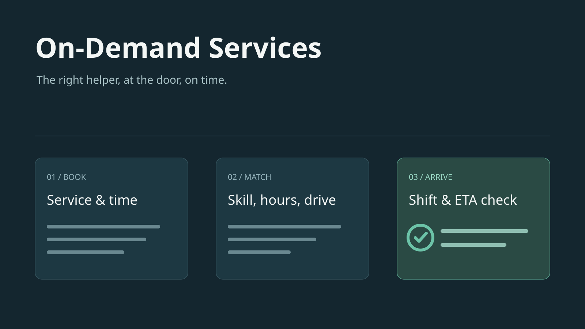

# On-Demand Services

A booking and dispatch workspace for businesses that send helpers to customers' homes: cleaning,
laundry, handyman work — anything booked by the visit. The desk takes a booking, the workspace
matches a helper to every visit, and it watches each shift until the helper is at the door.



The [local run sheet](docs/DEMO.md) covers booking and recovery.

## Apps and roles

**Scheduler** (the desk, team `Operations`) is a group of four apps:

| App                   | Pages                                                                                           |
| --------------------- | ----------------------------------------------------------------------------------------------- |
| **Scheduling**        | Schedule (a lane per helper — drag a visit to reassign), Warnings, Live map, Bookings           |
| **Helper profiles**   | Every helper; open one for their visits, time off and warnings; offboard                        |
| **Customer profiles** | Every customer; open one for their bookings and the notices sent to them                        |
| **Configurations**    | Dispatch settings (ETA limit, shift-check timing, free-change window) and the services on offer |

**My Day** (team `Helpers`) is the helper's phone app: the shift check to answer, the visit under
way, the next visits with the drive to each from where the phone is now, directions and a call
button, one tap to start and a completion sheet with notes. While it is open the phone's position is
shared with the scheduler. A helper signs in as the member their `helpers.user` names.

**Book a visit** is the customer portal: two portal pages (`portal: true`) with no workspace chrome, to
link to or embed in your own site. Anyone may open them.

1. **Details.** The customer types their mobile number and presses **Send code**; the six-digit code
   box appears beside **Verify**, and the sixth digit verifies (ui's `PhoneVerify`). The first verification signs them up
   as a `customer`. That policy opens the portal alone and shows only their own records. Then they
   pick the service (the hard requirement), address and area, how often, and their name. A returning
   customer finds these filled in.
2. **Time.** The service's open starts over the next two weeks, day by day.
3. **Confirmed.** The `portal_intake` run books it through the same matching the desk uses. When the
   time was just taken, it says a time will follow and the request waits in Scheduling → Bookings →
   Portal requests.

**My bookings** lists their upcoming and past visits (who is coming, how far away) and the messages
sent to them.

The portal requests private `availability_requests` after the verified customer supplies their
destination, preference and recurrence. The separate `openings` model is a public service-level
summary; it names no helper or customer and does not reserve capacity. Closing sign-up in
**Command center → People** stops new numbers from joining.

To embed the portal, frame it:

```html
<iframe
	src="https://<workspace host>/app/portal/book"
	style="width:100%;height:760px;border:0"
></iframe>
```

Only the portal's pages may be framed; every other page refuses. Inside the frame, the customer's
sign-in is kept apart from the host site's cookies, and writes started by another site are refused.

Teams `operations` and `helpers`, their policies and any opt-in approval flows are
authored under `src/access_control/`. Membership selects these source roles through People;
teams, policies and approval definitions have no runtime editor. Dispatch thresholds, services
and helper availability remain runtime configuration.

### UI layout

Booking uses one control per decision: service, recurrence, cleaner and a single destination
picker. Short fields share rows on wide screens and stack on phones. Area classifications are
optional descriptive metadata; customers do not select a compass region. A chosen map point feeds
availability and confirmation, and a changed destination clears the previous pin.

The controller uses the same date-first time picker instead of rendering every day’s time
buttons together. Settings pair related inputs; cleaner visits use a consistent reading width
and reserve travel status for the next visit. Notes and supporting record details stay folded.

### Controller recovery and cleaner route

Open a scheduled visit → **Review and rebook**, or **Warnings → Needs attention → Review**.
The review shows the customer, current appointment, a live countdown, the unavailable cleaner,
and ranked replacement choices with added travel and weekly booked hours. **Approve [cleaner]**
rechecks live capacity; a stale choice is refused with instructions to refresh. **Refresh recommendation**
prepares another suggestion without assigning it. Conflict, pending-review and unknown outcomes use the native feedback; success is shown only
after a committed action. The controller can also **Report cleaner unavailable**,
record whether an MC exists, and prepare replacements for that cleaner's remaining visits that day.

**Choose another time** uses the shared calendar and half-hour picker with skills, leave, hours,
existing appointments and travel on both sides. Confirm the new time with the customer before approving.
Service recovery after an actual recorded absence can move a visit inside the normal customer change
cutoff. Ordinary customer changes still obey the configured cutoff. Rebooking changes one occurrence;
other weekly, fortnightly or monthly occurrences remain intact. There is no automatic approval when
the countdown expires: the queue stays visible and marks the appointment overdue.

**My Day → Route date** shows that cleaner's assignments in chronological order, including completed
stops, the next job, estimated travel between stops and the available gap. The route remains readable
without GPS; starting a visit requires location sharing in the UI. New assignments appear through live
updates and create an in-app notification, plus WhatsApp if configured. Google Maps opens the ordered
remaining route for up to four stops (mobile waypoint limit), with individual directions for every
stop on longer days. The route view's inter-stop times are clearly labeled estimates; matching uses
cached Google route times where available. Real push and WhatsApp delivery require configured providers and device permissions.

## Data model

| Model                   | Purpose                                                                           |
| ----------------------- | --------------------------------------------------------------------------------- |
| `services`              | What is offered, with its skill and duration                                      |
| `helpers`               | Helpers: skills, working days and hours, home area, last reported GPS position    |
| `helper_time_off`       | A helper's leave                                                                  |
| `helper_warnings`       | Warnings filed against a helper, with the generated letter                        |
| `customers`             | Customers, bound to a portal sign-up by phone                                     |
| `bookings`              | A customer's booking of a service, once or recurring                              |
| `booking_helpers`       | A booking's preferred helpers, in order                                           |
| `visits`                | One occurrence of a booking, with at most one assigned helper                     |
| `customer_notices`      | Messages to a customer, with their WhatsApp and email delivery                    |
| `booking_requests`      | A verified portal booking awaiting `portal_intake`                                |
| `availability_requests` | A verified customer's private availability quote                                  |
| `openings`              | The public per-service start times the portal offers; names no helper or customer |
| `dispatch_settings`     | ETA limit, shift-check timing and the free-change window                          |
| `drive_times`           | Cached Google drive times per pair of ~1 km squares                               |

### Operating model

A **customer** books a **service** at their address. The booking has one **visit** per occurrence
(once, weekly, fortnightly or monthly), with at most one assigned **helper** per visit.

**Booking without a preference.** Choose service, destination and recurrence before requesting
available starts. The customer portal privately computes travel-aware half-hour starts over 14 days;
the controller uses the same feasibility functions. For each start, the workspace simulates a
provisional assignment. Confirmation reruns it against current supply.

**Booking with preferred helpers.** The portal scopes availability to one selected cleaner. The desk
accepts up to five cleaners in preference order and shows their feasible start union. A selected
cleaner missing the service skill is flagged and refused, rather than silently replaced.
Preferred helpers remain owned booking rows: their reference prevents removing a helper still
requested by a booking, including administrator erasure. Leaving helpers remain on file.

**Ad hoc and recurring.** Once creates one visit. Weekly, fortnightly and monthly default to eight
occurrences at the same local start time. Every occurrence must be staffable before the start is
offered or the series is saved; no partial series is created. This is a finite booking horizon, not
an indefinite subscription scheduler. Leave and later visits are included in the check.

**Matching.** Booking, drag, reassignment and move share `src/lib/matching.ts`. A candidate must
meet skill, working-day/hour, leave and adjacent-travel constraints. Eligible candidates are ranked
by a weighted combination of added driving, normalized weekly workload and recurring continuity.

The `check_drives` run then keeps the committed schedule at a local optimum automatically. Details:

1. _Hard requirements._ Active, required skill, working weekday/hours, no leave, and enough time
   around existing visits for travel plus a 15-minute settling buffer on both relevant legs.
2. _Small ranking heuristics._ Prefer less added route travel and a smaller increase in squared
   weekly utilization. Utilization includes service and planned travel, divided by available
   weekly work minutes after leave. The score is:

   `-D - 180 * (((L + J + D) / C)^2 - (L / C)^2) + continuity`

   D = added drive minutes; J = service duration; L = existing weekly service plus travel;
   C = weekly available work minutes. Continuity adds 15 for the previous recurring cleaner.
   Equal scores favor cleaners with fewer scarce extra skills, then name and id. Preferred order
   decides among feasible candidates and never overrides hard constraints. Weights are code
   constants, not dashboard settings.

   Added drive is previous stop (or home) to the new visit, plus new-to-next, minus previous-to-next
   where both neighbors exist, clamped at zero. No return-home cost is included. Existing jobs are
   never moved by booking itself. Booking is sequential (greedy) optimization; `optimise` (in `src/lib/dispatch.ts`, run by
   `check_drives`, using `improve` from `src/lib/matching.ts`) then relocates movable visits between cleaners until no single reassignment
   improves the objective by more than the continuity bonus: a local minimum, not a guaranteed global one.

**Private customer availability.** `prepare_availability` geocodes the submitted address and attempts
missing destination routes through Google, bounded to 24 distinct existing stops. Unknown locations,
missing data and larger rosters use labeled estimates. Successfully timed legs are cached for the
final match. Quotes belong to the verified phone, match exact booking details and expire after
15 minutes. A start is not held: final capacity loss becomes a controller follow-up. The submitted
address/location applies to returning customers too. First-commute feasibility and cache expiry are
still limitations; home travel affects ranking, but cannot block a first visit by shift start.

**No double booking.** Three layers stop it:

- The database refuses two visits of one helper that overlap, however they are written.
- Every write that names a helper or moves a visit is re-checked against the hard requirements.
  That covers a drag on the board, a reassignment and a move, and the refusal names the reason.
- The `check_drives` run walks each helper's next two weeks in order. A visit they can no longer
  reach from the one before is handed to the best match. That happens when Google's time is longer
  than the estimate, when two bookings race, or when a visit is written by hand. When nobody can
  take it, it waits in Needs attention.

**A helper leaving.** Offboarding a helper proposes, for each of their later visits, the helper with
the closest skills at the same time — or the nearest time anyone is free. The customer is emailed
the proposal; the desk accepts it.

**Changes and cancellations.** A visit can be moved or cancelled up to 24 hours before it starts;
a cancellation inside 24 hours is marked late; no fee is collected. The window, like the ETA limit and the
shift-check timing, is set in Configurations → Dispatch.

**Shift check.** Two hours before a helper's first visit of the day they are asked to confirm the
day in the helper app. No answer within the hour, or a decline, blocks that cleaner for the day and prepares replacement recommendations. The controller must approve each replacement; availability is checked again at approval. Without a medical certificate a warning letter (PDF) is filed on the helper's
record. The customer is notified after the controller approves a replacement; recommendations are not sent as confirmed assignments.

**ETA check.** Helpers share their position from the helper app while working. An hour before each
visit the drive from their last position is estimated (Google, in live traffic, when
`google_routes` is paired); over 30 minutes, or no position in the last
15 minutes, and the visit is flagged in Dispatch → Needs attention for the desk to call the helper
and reassign by hand if need be.

## Automations and integrations

All run as `dispatch_automation`. Row-event work lives in the models' `effect`, which runs as the
writer (a customer, the desk, a helper or a dispatch run) and schedules these runs; each writer's
policy lists the runs it may start.

| Automation             | Trigger                                                         | What it does                                                                         |
| ---------------------- | --------------------------------------------------------------- | ------------------------------------------------------------------------------------ |
| `check_drives`         | every 15 min; scheduled on booking created, visit or home moved | Times and caches drives, reassigns unreachable visits, rebalances to a local optimum |
| `publish_openings`     | every 15 min; scheduled on change                               | Publishes each active service's free start times for the next two weeks              |
| `prepare_availability` | scheduled on availability request created                       | Computes a verified customer's travel-aware starts                                   |
| `portal_intake`        | scheduled on booking request created                            | Books a portal request through the desk's matching                                   |
| `shift_watch`          | every 10 min; scheduled on a declined shift                     | Runs the pre-shift confirmation and prepares replacements                            |
| `eta_watch`            | every 5 min                                                     | Flags visits whose helper cannot arrive in time                                      |
| `warning_letter`       | scheduled on helper warning created                             | Renders the PDF warning letter and attaches it                                       |
| `deliver_notices`      | scheduled on customer notice created                            | Sends the notice on WhatsApp and records whether it went                             |

The `visits` effect itself tells a helper when visits are given to them or moved: an in-app alert
and one WhatsApp message listing the visits.

`src/+workspace.ts` names three connections, each an integration instance an administrator pairs
under **Settings → Integrations** with the business's own account:

| Connection      | Integration            | Used for                                                                                         |
| --------------- | ---------------------- | ------------------------------------------------------------------------------------------------ |
| `whatsapp`      | built-in `whatsapp`    | Customer and helper messages                                                                     |
| `customer_mail` | built-in `email`       | Customer notices from your own mailbox (the `customer_notices` `mail` sync), with their delivery |
| `google_routes` | `google_routes` (http) | Drive times; its API key is entered when it is paired                                            |

No envoy answers on these instances. Until an instance is paired nothing is delivered through it:
its messages stay queued, retrying or failed.

**Drive times (Google Maps).** Pair the `google_routes` connection in Settings → Integrations with a
Google Routes API key (sealed on the instance; the **Routes API** must be enabled in Google Cloud).

- `check_drives` runs every 15 minutes and whenever the schedule changes. It asks Google (Routes
  API, traffic-unaware routing) for every leg the helpers' next two weeks will be driven: home to the first
  visit, then visit to visit.
- Each time is cached in `drive_times`, per pair of ~1 km squares (0.01°). Matching reads that cache
  first. Squares recur, so a weekly customer's legs are timed once and reused. Cache rows are
  immutable; periodic checks do not refresh existing durations.
- A leg Google has not timed yet uses the straight-line estimate, at an urban 25 km/h.
- The ETA check asks Google in **live traffic** whenever the straight-line estimate is over half the
  ETA limit. A helper who is plainly close is not worth a paid lookup.
- Until `google_routes` is paired, `ctx.request` fails with typed `Unavailable`. The existing
  Effect recovery retains each drive's estimate, and no request is sent to Google.

Each new route leg and live ETA lookup consumes provider usage. Each route-check run makes at
most 25 calls; a backlog drains over later runs. Volume depends on itinerary changes and cache hits.

## Source layout

```text
src/
├── access_control/         source team declarations and policies
├── data/model/<name>/      one folder per model: services, helpers, helper_time_off, customers, bookings,
│                           booking_helpers, visits, helper_warnings, customer_notices,
│                           booking_requests, availability_requests, openings, dispatch_settings, drive_times;
│                           with native write guards and the notices' `mail` sync
├── automation/             shift_watch, eta_watch, check_drives, warning_letter,
│                           portal_intake, prepare_availability, publish_openings, deliver_notices;
│                           bookings_book, bookings_cancel, helpers_offboard and visits_* recovery/shift operations
├── integration/            google_routes (http)
├── lib/matching.ts         the matching rules, pure and unit-tested
├── lib/dispatch.ts         loading the pool (with cached drive times), Google calls, reassignment plans
├── lib/slots.ts            open starts, rebooking starts and replacement candidates over a read pool
├── lib/booking.ts          one atomic booking, its children and its confirmation notice
└── lib/visit-recovery.ts   recovery plans shared by manual starts and proposal acceptance
```

Manual operations use native automation starts and keep the starter's authority. Record operations
take `targets: [id]` (or several ids in one planned batch), with operation fields beside it. A start
queues the work; the native run status shows its result or refusal. The booking's nested visits and
preferred helpers, and each operation's customer notices, commit in the same guarded native batch.

## Seed

No public rows: a new workspace starts empty, with no services or dispatch settings row (matching
falls back to the `DEFAULTS` in `src/lib/matching.ts`). `seed/+seeder.ts` names the seed bank's
private tree `on-demand-services`, whose rows `bolt seed --bank=<checkout>` loads into a demo
environment as they are: a cleaning company's desk, cleaners, customers, services, dispatch settings,
bookings and visits.

## Checks

Requires Node 26 or newer and bun. Run inside this directory:

```bash
bun install --frozen-lockfile
bunx bolt check   # types, Svelte warnings, layout and declarations
bun run test    # bolt build, then bolt test (including tests/e2e)
```

`bolt build` generates the artifact and seed packs under `.norbital/`; that output is not committed.
Schema changes generate an editable SQL migration under `migrations/` and verify the complete
history against the declaration. Commit the SQL, `snapshot.json` and `migrations.lock.json`
together. The [local run sheet](docs/DEMO.md) covers booking and recovery acceptance in a running
workspace.
