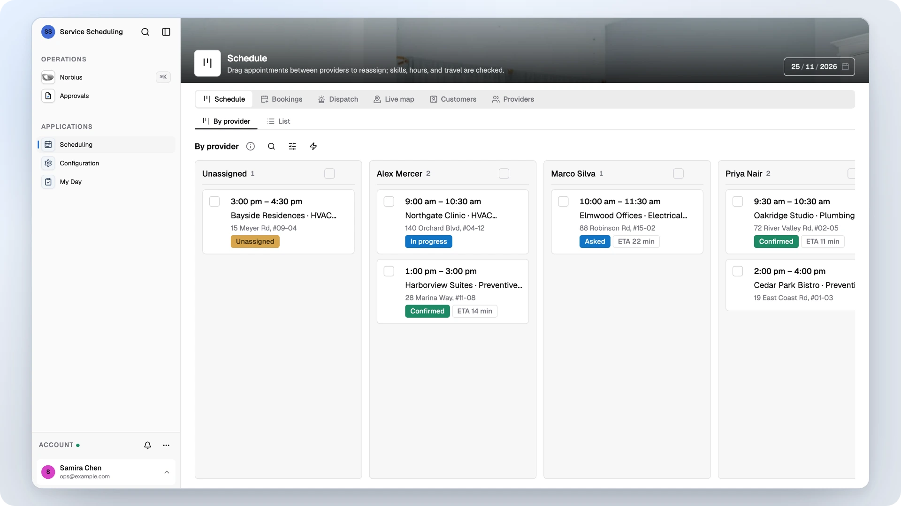

# 上门服务



一个预约与派单工作区，面向派帮手到客户家中服务的企业：清洁、洗衣、杂项维修——任何按上门次数预约的服务。排班人员接下预约，工作区为每次上门匹配帮手，并持续跟进每个班次，直到帮手到达门口。

[本地运行手册](docs/DEMO.md)涵盖预约与恢复流程。

## 应用与角色

**排班中心**（排班人员，团队 `Operations`）由四个应用组成：

| 应用         | 页面                                                               |
| ------------ | ------------------------------------------------------------------ |
| **排班**     | 排班表（每位帮手一条泳道——拖动上门即可改派）、警告、实时地图、预约 |
| **帮手档案** | 全部帮手；打开某位帮手可查看其上门、休假与警告；办理离职           |
| **客户档案** | 全部客户；打开某位客户可查看其预约及发给他们的通知                 |
| **配置**     | 调度设置（预计到达上限、班次确认时间、免费变更期限）以及提供的服务 |

**我的一天**（团队 `Helpers`）是帮手的手机应用：待回复的班次确认、进行中的上门、接下来的上门及从手机当前位置到各处的车程、导航与拨号按钮、一键开工，以及带备注的完工表单。应用打开期间，手机位置会共享给排班人员。帮手以其 `helpers.user` 所指定的成员身份登录。

**预约上门**是客户门户：两个门户页面（`portal: true`），不带工作区外框，可从您自己的网站链接或嵌入。任何人都可以打开。

1. **信息。** 客户输入手机号码并按下**发送验证码**；六位验证码输入框出现在**验证**旁边，输入第六位数字即完成验证（ui 的 `PhoneVerify`）。首次验证会将其注册为 `customer`。该策略只开放门户，且只显示其本人的记录。随后客户选择服务（硬性要求）、地址与区域、频率以及姓名。回头客会看到这些信息已预先填好。
2. **时间。** 按天列出该服务未来两周内可开始的时间。
3. **已确认。** `portal_intake` 运行通过与排班人员相同的匹配流程完成预约。如果该时间刚刚被占用，页面会提示稍后告知时间，请求则在 排班 → 预约 → 门户请求 中等待处理。

**我的预约**列出客户即将到来和已完成的上门（谁会来、距离多远）以及发给他们的消息。

经过验证的客户提供目的地、偏好和重复方式后，门户会发起私有的 `availability_requests`。独立的 `openings` 模型是公开的服务级汇总；它不涉及任何帮手或客户，也不预留产能。在**指挥中心 → 人员**中关闭注册，即可阻止新号码加入。

要嵌入门户，请用框架加载：

```html
<iframe
	src="https://<workspace host>/app/portal/book"
	style="width:100%;height:760px;border:0"
></iframe>
```

只有门户页面可以被嵌入框架；其他页面一律拒绝。在框架内，客户的登录状态与宿主网站的 Cookie 相互隔离，由其他网站发起的写入会被拒绝。

团队 `operations` 和 `helpers`、它们的策略以及任何可选的审批流程都在 `src/access_control/` 下编写。成员资格通过“人员”选择这些源码角色；团队、策略和审批定义没有运行时编辑器。派单阈值、服务和帮手可用性仍属于运行时配置。

### 界面布局

预约中每个决策只用一个控件：服务、重复方式、保洁员，以及单一的目的地选择器。短字段在宽屏上并排，在手机上堆叠。区域分类是可选的描述性元数据；客户无需选择方位区域。选定的地图点用于可用性计算和确认，更改目的地会清除之前的标记。

主管使用同样的先选日期再选时间的选择器，而不是把每天的时间按钮一起渲染出来。设置页将相关输入成对排列；保洁员的上门使用一致的阅读宽度，并只为下一次上门显示行程状态。备注和辅助记录详情默认折叠。

### 主管恢复与保洁员路线

打开一个已排定的上门 → **审核并改约**，或 **警告 → 待处理 → 审核**。审核界面显示客户、当前预约、实时倒计时、无法到岗的保洁员，以及按排名列出的替换选项（含新增行程和每周已预约工时）。**批准 [保洁员]** 会重新检查实时产能；过期的选择会被拒绝，并提示刷新。**刷新推荐**会准备另一条建议，但不会指派。冲突、待审核和结果未知均使用原生反馈；只有操作提交后才显示成功。主管还可以**报告保洁员无法到岗**，记录是否有病假证明（MC），并为该保洁员当天剩余的上门准备替换方案。

**选择其他时间**使用共享日历和半小时选择器，兼顾技能、休假、工作时间、已有预约以及前后两段行程。批准前请先与客户确认新时间。在实际记录缺勤后进行的服务恢复，可以在常规客户变更截止时间之内移动上门。普通的客户变更仍须遵守配置的截止时间。改约只改变一次上门；每周、每两周或每月的其他上门保持不变。倒计时结束时不会自动批准：队列保持可见，并将该预约标记为逾期。

**我的一天 → 路线日期**按时间顺序显示该保洁员的派单，包括已完成的站点、下一项工作、站点之间的预计行程以及可用空档。没有 GPS 时路线依然可读；在界面中开始上门需要共享位置。新的派单通过实时更新出现，并产生一条应用内通知，如已配置还会发送 WhatsApp。Google Maps 最多可为四个站点打开按顺序排列的剩余路线（移动端途经点上限），站点更多的日子则为每个站点提供单独导航。路线视图中的站点间时间明确标注为估算；匹配在可用时使用缓存的 Google 路线时间。真正的推送和 WhatsApp 投递需要已配置的服务商和设备权限。

## 数据模型

| 模型                    | 用途                                                        |
| ----------------------- | ----------------------------------------------------------- |
| `services`              | 提供的服务，含所需技能和时长                                |
| `helpers`               | 帮手：技能、工作日与工作时间、居住区域、最后上报的 GPS 位置 |
| `helper_time_off`       | 帮手的休假                                                  |
| `helper_warnings`       | 针对帮手记录的警告，附生成的警告信                          |
| `customers`             | 客户，通过手机号与门户注册绑定                              |
| `bookings`              | 客户对某项服务的预约，单次或定期                            |
| `booking_helpers`       | 预约的首选帮手，按顺序排列                                  |
| `visits`                | 预约的一次上门，最多指派一位帮手                            |
| `customer_notices`      | 发给客户的消息，含其 WhatsApp 和电子邮件投递情况            |
| `booking_requests`      | 已验证、等待 `portal_intake` 处理的门户预约                 |
| `availability_requests` | 已验证客户的私有可用性报价                                  |
| `openings`              | 门户提供的公开的按服务开始时间；不涉及任何帮手或客户        |
| `dispatch_settings`     | 预计到达上限、班次确认时间和免费变更期限                    |
| `drive_times`           | 按每对约 1 km 方格缓存的 Google 车程时间                    |

### 运营模型

**客户**在其地址预约一项**服务**。每次发生对应预约中的一次**上门**（单次、每周、每两周或每月），每次上门最多指派一位**帮手**。

**无偏好的预约。** 在请求可用开始时间之前，先选择服务、目的地和重复方式。客户门户会私下计算未来 14 天内考虑行程的半小时开始时间；主管使用相同的可行性函数。对每个开始时间，工作区都会模拟一次临时指派。确认时会针对当前供给重新运行一遍。

**指定首选帮手的预约。** 门户将可用性限定为所选的一位保洁员。排班人员最多可按偏好顺序接受五位保洁员，并显示他们可行开始时间的并集。所选保洁员若缺少该服务的技能，会被标记并拒绝，而不是被悄悄替换。首选帮手仍是预约所拥有的行：其引用会阻止删除仍被某个预约指定的帮手，包括管理员的清除操作。已离职的帮手仍保留在档案中。

**临时与定期。** 单次会创建一个上门。每周、每两周和每月默认在相同的本地开始时间生成八次上门。在提供该开始时间或保存该系列之前，每一次上门都必须能安排到人手；不会创建部分系列。这是一个有限的预约期限，而不是无限期的订阅排程器。检查会把休假和之后的上门都考虑在内。

**匹配。** 预约、拖动、改派和移动共用 `src/lib/matching.ts`。候选人必须满足技能、工作日/工作时间、休假以及相邻行程的约束。符合条件的候选人按新增车程、归一化的每周工作量和定期连续性的加权组合排序。

随后 `check_drives` 运行会自动将已提交的排班保持在局部最优。详情：

1. _硬性要求。_ 在职、具备所需技能、在工作日/工作时间内、未休假，并且在已有上门前后留有足够时间用于行程，外加两段相关行程各 15 分钟的缓冲。
2. _简单的排序启发规则。_ 优先选择新增路线行程更少、每周利用率平方增幅更小的人选。利用率包括服务和计划行程，除以扣除休假后的每周可用工作分钟数。得分为：

   `-D - 180 * (((L + J + D) / C)^2 - (L / C)^2) + continuity`

   D = 新增车程分钟数；J = 服务时长；L = 现有每周服务加行程；C = 每周可用工作分钟数。continuity 为上一位定期保洁员加 15 分。得分相同时，优先选择稀缺额外技能较少的保洁员，然后按姓名和 id 排序。偏好顺序只在可行候选人之间起决定作用，绝不凌驾于硬性约束之上。权重是代码常量，而不是看板设置。

   新增车程 = 上一站（或家）到新上门，加上新上门到下一站，若前后两站都存在则减去上一站到下一站，最小取零。不计返家成本。预约本身从不移动已有工作。预约是顺序（贪心）优化；随后 `optimise`（位于 `src/lib/dispatch.ts`，由 `check_drives` 运行，使用 `src/lib/matching.ts` 中的 `improve`）在保洁员之间迁移可移动的上门，直到没有任何单次改派能将目标提升超过连续性加分为止：这是局部最小值，而不保证是全局最小值。

**客户私有可用性。** `prepare_availability` 对提交的地址进行地理编码，并通过 Google 尝试获取缺失的目的地路线，上限为 24 个不同的已有站点。未知位置、缺失数据以及更大的名册使用带标注的估算。成功计时的行程会被缓存，供最终匹配使用。报价归属于已验证的手机号，须与预约详情完全一致，并在 15 分钟后过期。开始时间不会被保留：最终产能不足会转为主管的跟进事项。提交的地址/位置同样适用于回头客。首段通勤的可行性和缓存过期仍是局限；居家出发的行程会影响排序，但无法因班次开始时间而阻止第一次上门。

**杜绝重复预约。** 三层机制加以阻止：

- 数据库会拒绝同一帮手的两次重叠上门，无论它们以何种方式写入。
- 每次指定帮手或移动上门的写入，都会依据硬性要求重新检查。这包括排班表上的拖动、改派和移动，拒绝时会说明原因。
- `check_drives` 运行按顺序检查每位帮手未来两周的安排。从上一个上门已无法赶到的上门，会交给最佳匹配人选。这种情况发生在 Google 的时间比估算更长、两个预约同时竞争，或上门被手工写入时。如果无人能接，该上门会在“待处理”中等待。

**帮手离职。** 为离职帮手办理离职时，系统会为其之后的每个上门，提议同一时间技能最接近的帮手——或任何人有空的最近时间。客户会通过电子邮件收到该提议；由排班人员接受。

**变更与取消。** 上门最迟可在开始前 24 小时移动或取消；24 小时内的取消会被标记为迟取消；不收取费用。该期限与预计到达上限和班次确认时间一样，在 配置 → 调度 中设置。

**班次确认。** 在帮手当天第一个上门前两小时，系统会请其在帮手应用中确认当天班次。一小时内未回复或拒绝，则该保洁员当天被锁定，并准备替换推荐。主管必须逐一批准替换；批准时会再次检查可用性。若没有病假证明，系统会在帮手的记录上存档一封警告信（PDF）。主管批准替换后才会通知客户；推荐不会作为已确认的派单发送。

**预计到达检查。** 帮手工作期间通过帮手应用共享位置。每次上门前一小时，系统会根据其最后位置估算车程（当 `google_routes` 已配对时使用 Google 实时路况）；超过 30 分钟，或最近 15 分钟内没有位置，该上门就会在 调度 → 待处理 中被标记，供排班人员致电帮手，必要时手工改派。

## 自动化与集成

全部以 `dispatch_automation` 身份运行。行事件工作位于模型的 `effect` 中，它以写入者（客户、排班人员、帮手或派单运行）的身份运行，并安排这些运行；每个写入者的策略列出了它可以启动的运行。

| 自动化                 | 触发器                                         | 作用                                                   |
| ---------------------- | ---------------------------------------------- | ------------------------------------------------------ |
| `check_drives`         | 每 15 分钟；在预约创建、上门或居住地变动时安排 | 计时并缓存车程，改派无法赶到的上门，重新平衡到局部最优 |
| `publish_openings`     | 每 15 分钟；在变更时安排                       | 发布每项有效服务未来两周的空闲开始时间                 |
| `prepare_availability` | 在可用性请求创建时安排                         | 为已验证客户计算考虑行程的开始时间                     |
| `portal_intake`        | 在预约请求创建时安排                           | 通过排班人员的匹配流程预约门户请求                     |
| `shift_watch`          | 每 10 分钟；在班次被拒绝时安排                 | 执行班次前确认并准备替换                               |
| `eta_watch`            | 每 5 分钟                                      | 标记帮手无法按时到达的上门                             |
| `warning_letter`       | 在帮手警告创建时安排                           | 渲染 PDF 警告信并附上                                  |
| `deliver_notices`      | 在客户通知创建时安排                           | 通过 WhatsApp 发送通知并记录是否送达                   |

`visits` 的 effect 本身会在上门被分配给帮手或被移动时通知帮手：一条应用内提醒，以及一条列出这些上门的 WhatsApp 消息。

这些运行通过工作区账户与外界交互，账户由管理员在**设置 → 连接**下用企业自己的账户添加并配对：

| 集成                   | 用途                                                                        |
| ---------------------- | --------------------------------------------------------------------------- |
| 内置 `whatsapp`        | 客户与帮手消息                                                              |
| 内置 `email`           | 从您自己的邮箱发送客户通知（`customer_notices` 的 `mail` 同步），含投递情况 |
| `google_routes` (http) | 车程时间；其 API 密钥在配对时输入                                           |

运行使用每种集成唯一一个有效的共享账户：若没有，或多于一个，则不会通过它发送或计时（通知记录 `failed: no WhatsApp account`，车程保留其估算）。没有使者在这些账户上应答。在账户配对之前，其消息保持排队、重试或失败状态。

**车程时间（Google Maps）。** 在 设置 → 连接 中添加并配对一个 `google_routes` 账户，并提供 Google Routes API 密钥（密封保存在实例上；必须在 Google Cloud 中启用 **Routes API**）。

- `check_drives` 每 15 分钟运行一次，并在排班变动时运行。它向 Google（Routes API，不考虑路况的路线规划）查询帮手未来两周将要驾驶的每一段行程：从家到第一个上门，然后是上门到上门。
- 每个时间按每对约 1 km 方格（0.01°）缓存在 `drive_times` 中。匹配会优先读取该缓存。方格会重复出现，因此每周客户的行程只计时一次并重复使用。缓存行不可变；定期检查不会刷新已有时长。
- Google 尚未计时的行程使用直线估算，按城市速度 25 km/h 计算。
- 每当直线估算超过预计到达上限的一半，预计到达检查就会向 Google 查询**实时路况**。明显很近的帮手不值得一次付费查询。
- 在 `google_routes` 配对之前，`ctx.request` 会以类型化的 `Unavailable` 失败。现有的 Effect 恢复会保留每段车程的估算，不会向 Google 发送请求。

每个新的路线行程和实时预计到达查询都会消耗服务商用量。每次路线检查运行最多发起 25 次调用；积压会在之后的运行中逐步消化。用量取决于行程变化和缓存命中情况。

## 源码结构

```text
src/
├── access_control/         source team declarations and policies
├── data/model/<name>/      one folder per model: services, helpers, helper_time_off, customers, bookings,
│                           booking_helpers, visits, helper_warnings, customer_notices,
│                           booking_requests, availability_requests, openings, dispatch_settings, drive_times;
│                           with native write guards and the notices' `mail` sync
├── automation/             shift_watch, eta_watch, check_drives, warning_letter,
│                           portal_intake, prepare_availability, publish_openings, deliver_notices;
│                           bookings_book, bookings_cancel, helpers_offboard and visits_* recovery/shift operations
├── integration/            google_routes (http)
├── lib/matching.ts         the matching rules, pure and unit-tested
├── lib/dispatch.ts         loading the pool (with cached drive times), Google calls, reassignment plans
├── lib/slots.ts            open starts, rebooking starts and replacement candidates over a read pool
├── lib/booking.ts          one atomic booking, its children and its confirmation notice
└── lib/visit-recovery.ts   recovery plans shared by manual starts and proposal acceptance
```

手动操作使用原生的自动化启动，并保留启动者的权限。记录操作接受 `targets: [id]`（或在一个计划批次中传入多个 id），操作字段与之并列。一次启动会将工作加入队列；原生运行状态会显示其结果或拒绝原因。预约嵌套的上门和首选帮手，以及每个操作的客户通知，会在同一个受保护的原生批次中提交。

## 种子数据

没有公开行：新工作区从空开始，没有服务，也没有派单设置行（匹配会回退到 `src/lib/matching.ts` 中的 `DEFAULTS`）。`seed/+seeder.ts` 指定种子库的私有树 `on-demand-services`，`bolt seed --bank=<checkout>` 会将其中的行原样加载到演示环境中：一家清洁公司的排班人员、保洁员、客户、服务、派单设置、预约和上门。

## 检查

需要 Node 26 或更高版本以及 bun。在本目录内运行：

```bash
bun install --frozen-lockfile
bunx bolt check   # types, Svelte warnings, layout and declarations
bun run test    # bolt build, then bolt test (including tests/e2e)
```

`bolt build` 会在 `.norbital/` 下生成构建产物和种子数据包；该输出不提交。Schema 变更会在 `migrations/` 下生成一个可编辑的 SQL 迁移，并依据声明验证完整的迁移历史。请将 SQL、`snapshot.json` 和 `migrations.lock.json` 一起提交。[本地运行手册](docs/DEMO.md)涵盖在运行中的工作区里对预约与恢复流程的验收。

## 维护中的源码参考

请参阅[源码参考](docs/source-reference.md)，了解当前的应用/页面、模型输出与写入、自动化策略、集成以及浏览器截图。该清单会依据本模板的声明进行检查；服务商设置和已部署发布版本的就绪情况仍是单独的检查。
