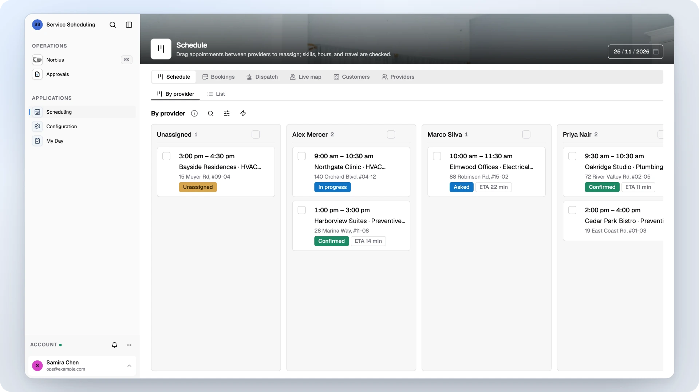

# Service Scheduling workflows

## Operating loop

1. **Configure services and rules** in **Configuration → Services** and **Scheduling rules**:
   define bookable services with normalized skill tags, duration, and price, and tune slot
   intervals, turnaround buffers, booking horizon, shift-check timing, ETA limits, and free-change
   windows.
2. **Manage providers and time off** in **Scheduling → Providers**: set working weekdays, daily
   hours, runtime skills, base coordinates, and link each provider to their `sys_user` sign-in so
   they can open **My Day**.
3. **Take bookings** either from **Scheduling → Bookings** (interactive desk composer with live
   slot availability) or via the embeddable **Booking portal** (phone-verified 3-step self-service
   flow backed by `availability_requests` and `booking_requests`).
4. **Dispatch and recover** from **Scheduling → Schedule** (drag-to-reassign board by provider and
   sortable list), **Dispatch** (attention queue and open shift checks), and **Live map** (live
   provider GPS markers with next-stop routes). Open any scheduled appointment's **Recovery** tab
   to compare ranked replacements, choose another time, or mark a provider unavailable.
5. **Execute in the field** with **My Day**: providers confirm their shift, share live GPS
   positions, open turn-by-turn directions, start appointments (`started_at` stamped natively), and
   record completion notes (`completed_at` stamped natively).

## External integrations

Connect shared accounts in **Configuration → Connections** (credentials remain sealed):

- **WhatsApp (`whatsapp`):** delivers outbound customer notices (`deliver_notices`), new
  appointment assignments (`alertProviders`), and pre-shift prompts (`shift_watch`).
- **Email (`email`):** drives `customer_notices` `+mail.sync.ts`, sending email copies to
  customers with an email address and folding delivery/open/bounce/reply events back onto each
  notice.
- **Google Routes (`google_routes`):** caches ~1 km grid driving times (`drive_times`) via
  `check_drives` and `prepare_availability`, and provides live traffic ETAs in `eta_check`. Without
  a connected key, scheduling falls back seamlessly to Haversine distance estimates.

See the [template README](../README.md) for the summary overview and the
[source reference](source-reference.md) for the exact models, policies, and automations.
