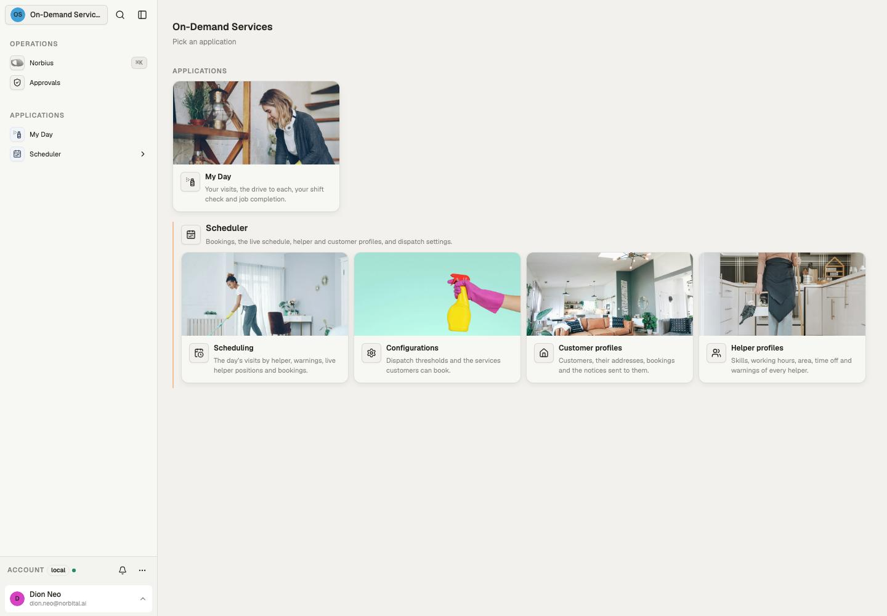
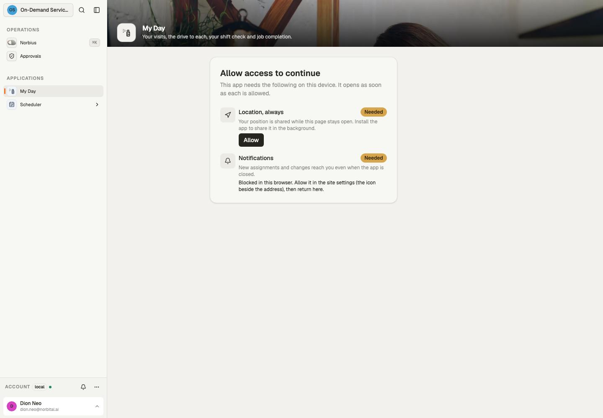
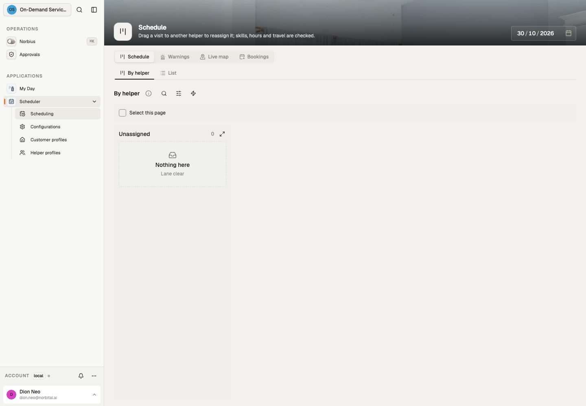

# Source reference

Checked against this template's source and compiled declaration manifest on 30 October 2026.
This is a local source inventory, not a declaration that a deployed tenant runs these bytes.

14 models, 6 applications, 21 automations.

## Applications and pages

| Source application                                                      | Title             | Pages                                                                   | Purpose                                                                   |
| ----------------------------------------------------------------------- | ----------------- | ----------------------------------------------------------------------- | ------------------------------------------------------------------------- |
| [helper](../src/app/helper/+app.ts)                                     | My Day            | today: Today                                                            | Your visits, the drive to each, your shift check and job completion.      |
| [portal](../src/app/portal/+app.ts)                                     | Book a visit      | book: Book; visits: My bookings                                         | Book a home service with your mobile number, and see your bookings.       |
| [scheduler/configurations](../src/app/scheduler/configurations/+app.ts) | Configurations    | dispatch: Dispatch; services: Services                                  | Dispatch thresholds and the services customers can book.                  |
| [scheduler/customers](../src/app/scheduler/customers/+app.ts)           | Customer profiles | profiles: Customers                                                     | Customers, their addresses, bookings and the notices sent to them.        |
| [scheduler/helpers](../src/app/scheduler/helpers/+app.ts)               | Helper profiles   | profiles: Helpers                                                       | Skills, working hours, area, time off and warnings of every helper.       |
| [scheduler/schedule](../src/app/scheduler/schedule/+app.ts)             | Scheduling        | board: Schedule; warnings: Warnings; live: Live map; bookings: Bookings | The day’s visits by helper, warnings, live helper positions and bookings. |

## Models and exposed operations

Outputs fix field visibility. Policies select outputs and scope rows; write columns and checks constrain mutations. Each row links to its owning declaration.

| Model                                                                                      | Fields | Read outputs                      | Writes                         | Post-commit effects | Syncs |
| ------------------------------------------------------------------------------------------ | ------ | --------------------------------- | ------------------------------ | ------------------- | ----- |
| [availability_requests](../src/data/model/services/availability_requests/+model.ts)        | 11     | default, customer                 | create, update, upsert         | created             | none  |
| [booking_helpers](../src/data/model/customers/bookings/booking_helpers/+model.ts)          | 1      | default                           | none                           | none                | none  |
| [booking_requests](../src/data/model/services/booking_requests/+model.ts)                  | 11     | default, customer                 | create, update, upsert         | created             | none  |
| [bookings](../src/data/model/customers/bookings/+model.ts)                                 | 9      | default, customer, helper         | create, update, upsert         | created             | none  |
| [customer_notices](../src/data/model/customers/bookings/visits/customer_notices/+model.ts) | 13     | default, customer                 | create, update, upsert         | created             | mail  |
| [customers](../src/data/model/customers/+model.ts)                                         | 7      | default, customer, helper         | create, update, delete, upsert | none                | none  |
| [dispatch_settings](../src/data/model/dispatch_settings/+model.ts)                         | 6      | default                           | create, update, upsert         | none                | none  |
| [drive_times](../src/data/model/drive_times/+model.ts)                                     | 2      | default                           | create                         | none                | none  |
| [helper_time_off](../src/data/model/helpers/helper_time_off/+model.ts)                     | 2      | default                           | create, update, delete, upsert | created             | none  |
| [helper_warnings](../src/data/model/customers/bookings/visits/helper_warnings/+model.ts)   | 4      | default                           | create, update, upsert         | created             | none  |
| [helpers](../src/data/model/helpers/+model.ts)                                             | 13     | default, customer, helper         | create, update, upsert         | updated             | none  |
| [openings](../src/data/model/services/openings/+model.ts)                                  | 2      | default, portal                   | create, update, delete, upsert | none                | none  |
| [services](../src/data/model/services/+model.ts)                                           | 6      | default, customer, portal, helper | create, update, delete, upsert | none                | none  |
| [visits](../src/data/model/customers/bookings/visits/+model.ts)                            | 18     | default, customer, helper         | update                         | created, updated    | none  |

Upsert is available when both create and update are exposed; it resolves an explicit ID or the model’s natural key and requires an explicit conflict rule.

## Automations

All named runs use the reserved system identity and the listed policies. A manual-start grant controls who may start a run; cron/webhook/schedules use their declared trigger path. Model effects run as their writer and are separate from these named automations.

| Automation                                                                              | Trigger                        | Policies            | Purpose                                                                                                                                                                                                                                                                       |
| --------------------------------------------------------------------------------------- | ------------------------------ | ------------------- | ----------------------------------------------------------------------------------------------------------------------------------------------------------------------------------------------------------------------------------------------------------------------------- |
| [bookings_book](../src/automation/+bookings_book.automation.ts)                         | started or scheduled from code | operations          | Books a service for a customer at their address, once or recurring. With preferred helpers every visit goes to the first of them who is free; without, to the best-matched helper. Every occurrence in the requested horizon must find a helper; otherwise nothing is booked. |
| [bookings_cancel](../src/automation/+bookings_cancel.automation.ts)                     | started or scheduled from code | operations          | Cancels the booking and every visit still to come. Each visit inside the configured free-change cutoff is marked late.                                                                                                                                                        |
| [check_drives](../src/automation/+check_drives.automation.ts)                           | {"cron":"*/15 * * * *"}        | dispatch_automation | Times every drive in the helpers’ next two weeks with Google Maps and caches it for matching; a visit its helper can no longer reach in time is reassigned to the best match; then movable visits are rebalanced to a local optimum of workload and driving.                  |
| [deliver_notices](../src/automation/+deliver_notices.automation.ts)                     | started or scheduled from code | dispatch_automation | Sends each customer notice on WhatsApp to the customer’s number and records whether it went.                                                                                                                                                                                  |
| [eta_check](../src/automation/+eta_check.automation.ts)                                 | started or scheduled from code | dispatch_automation | Checks one visit’s live ETA without sharing another visit’s read dependencies.                                                                                                                                                                                                |
| [eta_watch](../src/automation/+eta_watch.automation.ts)                                 | {"cron":"*/5 * * * *"}         | dispatch_automation | Until each visit starts, re-estimates the helper’s drive from their last GPS position every five minutes, flagging the visit for dispatch while it exceeds the ETA limit or the position is missing or stale.                                                                 |
| [helpers_offboard](../src/automation/+helpers_offboard.automation.ts)                   | started or scheduled from code | operations          | Marks the helper as left after their last day and proposes, for each of their later visits, the helper with the closest skills at the same time or the nearest time anyone is free.                                                                                           |
| [portal_intake](../src/automation/+portal_intake.automation.ts)                         | started or scheduled from code | dispatch_automation | Books each portal request when a helper is free at the time asked; otherwise hands it to the desk and tells the customer a time will be proposed.                                                                                                                             |
| [prepare_availability](../src/automation/+prepare_availability.automation.ts)           | started or scheduled from code | dispatch_automation | Calculates customer-specific starts after preference, skills, address, travel and recurrence are known.                                                                                                                                                                       |
| [publish_openings](../src/automation/+publish_openings.automation.ts)                   | {"cron":"*/15 * * * *"}        | dispatch_automation | Publishes, for each active service and each of the next two weeks, the start times at which a helper with its skill is free — the times the booking portal offers.                                                                                                            |
| [shift_watch](../src/automation/+shift_watch.automation.ts)                             | {"cron":"*/10 * * * *"}        | dispatch_automation | Asks each helper to confirm their day two hours before its first visit, and proposes replacements for controller approval when they decline or do not answer, issuing a warning letter when there is no medical certificate.                                                  |
| [visits_accept_proposal](../src/automation/+visits_accept_proposal.automation.ts)       | started or scheduled from code | operations          | Approves a recommended replacement, rechecking availability and travel at approval.                                                                                                                                                                                           |
| [visits_cancel](../src/automation/+visits_cancel.automation.ts)                         | started or scheduled from code | operations          | Cancels the visit; inside the free-change window before its start it is a late, chargeable cancellation.                                                                                                                                                                      |
| [visits_confirm_shift](../src/automation/+visits_confirm_shift.automation.ts)           | started or scheduled from code | helper_shift        | The helper confirms they will work their visits that day.                                                                                                                                                                                                                     |
| [visits_decline_shift](../src/automation/+visits_decline_shift.automation.ts)           | started or scheduled from code | helper_shift        | The helper says they cannot work their visits that day. Dispatch proposes replacements for controller approval.                                                                                                                                                               |
| [visits_reassign](../src/automation/+visits_reassign.automation.ts)                     | started or scheduled from code | operations          | Gives the visit to the named helper, or to the best-matched one when none is named. A customer who asked for particular helpers is told.                                                                                                                                      |
| [visits_rebook](../src/automation/+visits_rebook.automation.ts)                         | started or scheduled from code | operations          | Approves one occurrence at a feasible start; service recovery can bypass the customer change cutoff.                                                                                                                                                                          |
| [visits_recommend](../src/automation/+visits_recommend.automation.ts)                   | started or scheduled from code | operations          | Prepares a replacement recommendation; the controller must approve it.                                                                                                                                                                                                        |
| [visits_report_unavailable](../src/automation/+visits_report_unavailable.automation.ts) | started or scheduled from code | operations          | The controller records that the assigned cleaner cannot work this day and requests recommendations.                                                                                                                                                                           |
| [visits_reschedule](../src/automation/+visits_reschedule.automation.ts)                 | started or scheduled from code | operations          | Moves the visit to a new start, keeping its helper when they are free then. Only outside the free-change window before the visit.                                                                                                                                             |
| [warning_letter](../src/automation/+warning_letter.automation.ts)                       | started or scheduled from code | dispatch_automation | Renders a PDF warning letter for each warning filed and attaches it to the warning.                                                                                                                                                                                           |

## Integrations and source roles

- Integration definitions: `google_routes`.
- Named connections: `customer_mail`, `whatsapp`, `google_routes`.
- Source policies: `customer`, `dispatch_automation`, `helper`, `helper_shift`, `operations`, `portal_visitor`.
- Custom datatypes: none.

Pairing and credentials belong to the host's Connections surface; defining a connection does not mean it is paired.

## Browser evidence

Captured through the browser from a separate local documentation workspace on 30 October 2026. This shows layout and navigation; it does not certify external providers, automation results or deployment.

The My Day capture shows its declared location and notification permission gate. The scheduler board is also captured; the empty documentation workspace has no bookings or helper positions. A permission gate is expected behavior, not evidence that tracking or notification delivery succeeded.
