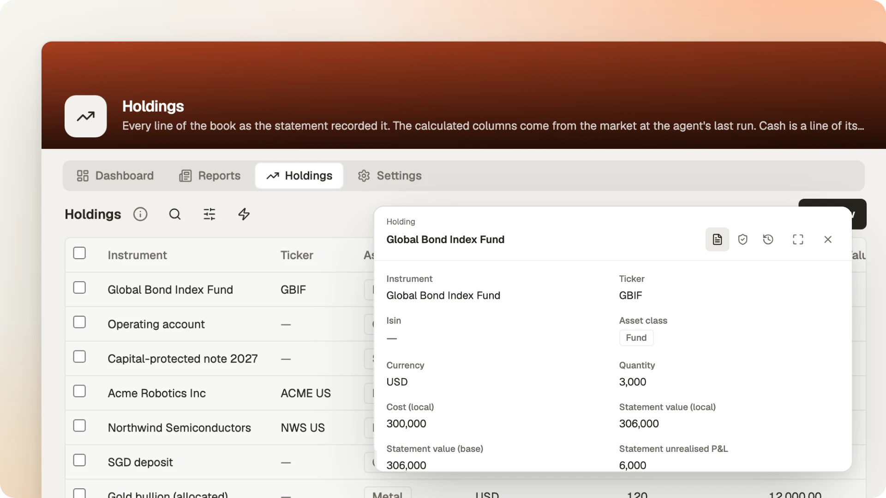

# Portfolio Manager



A portfolio workspace for a family office or a finance team: every line of the book with the research
kept on it, and a daily report — totals, allocation, the rates used and one call per position —
written by one agent.

## Apps and roles

| App         | Pages                                               | Who                                                                      |
| ----------- | --------------------------------------------------- | ------------------------------------------------------------------------ |
| `portfolio` | Dashboard, Reports, Holdings, Subscribers, Settings | `investors` (`portfolio_manage`), `portfolio_viewers` (`portfolio_read`) |

- `portfolio_manage` reads and maintains the book and the settings, reads and deletes reports (a report is read-only:
  it is what the agent saw that day), and may start the agent by hand.
- `portfolio_read` reads the book and the reports and changes nothing.
- `portfolio_automation` is what the agent holds: it reads the book, the settings, the subscribers and the accounts
  an envoy is deployed on, and writes the research and the report.

## Data model

| Model                 | Purpose                                                                                                                                                |
| --------------------- | ------------------------------------------------------------------------------------------------------------------------------------------------------ |
| `holding`             | One line of the book: a security, a fund, a cash balance (`cash`) or a facility (`loan`, negative value)                                               |
| `report`              | One per day (`one_per_day`): the lead, what is in it, the markets table and the move, one section per line with cited news, the sources and the totals |
| `portfolio_settings`  | One row: the base currency and the benchmarks                                                                                                          |
| `report_subscription` | One per subscribed user (`one_per_user`): a client subscribes and unsubscribes themselves from Reports; owners manage all under Subscribers            |

Cash and facilities are holdings, so the totals add up without models of their own; the
`loan_is_owed` constraint keeps a facility's base value at zero or below. The agent's figures
(price now, value now, change today, volume against the 20-session average, P&L by date, research)
are fields on the holding marked _calculated_.

### Valuation

Holdings are the latest bank statement, a monthly snapshot: each line keeps its quantity, cost, statement value in its
own currency, accrued interest and the statement's date (`price_date`). Each run values every line in base at that
moment (`lineValue` in `src/lib/portfolio/book.ts`): a quoted line at its quote, in the quote's own currency (a London
quote in pence is read in pounds; silver held as XAG at its USD future) and the day's rate; a line without a quote
(cash, deposits, accumulators) at its statement amount and accrued interest revalued at the day's rate, or at the
statement's own rate when no rate answers; a line priced since its statement but not today at its last price. A new
statement replaces the lines and, from its date, outranks older prices. Unrealised P&L is in base: each position's
value now less its cost at the statement's rate. The report keeps what the run saw: totals, allocation, the book by
currency (`exposure`) and every rate used (`fx_used`); its data line names the statement the book stands on.

From a year of daily bars (`signalsOf` in `src/lib/portfolio/market.ts`) the agent also files each quoted line's
signals: the move over a week, a month and a year; the trend (up when the price and its 50-session average sit above
the 200-session average, down when both are below, else sideways); buying against selling pressure (20-session
Chaikin money flow, −1 to 1, _buying_ above 0.05 and _selling_ below −0.05); RSI over 14 sessions; the distance from
the 52-week high; and volatility a year (the last 63 daily moves, annualised). The model reads them before each call,
the dashboard shows them under _Signals_, and the report's markets table carries the moves, trend and pressure for
every benchmark and quoted line.

## Automations

`portfolio_agent` runs every morning at 08:00 in the workspace's zone, or by hand from Holdings. It
reads exchange rates and quotes from free, keyless sources over plain HTTP; searches the market and
the six largest positions in its own browser tab (`ctx.browser`), the rest through their news feed, and reads the
_sources to read_ stored on each line; files each line's P&L for the day; asks the model for a call on every position
it read news on or holds a quote for (the quote's trading is itself a citable source), and for the lead and the
market paragraph; files the day's report (a second run that day rewrites it); renders the report's own record
view to PDF (`ctx.convert.record`, never stored) and sends it with the lead and the summary to each
`report_subscription` user, once a day: in their inbox, and through every chat account an envoy is deployed on
(a notice `via` those accounts, to the user's own WhatsApp number, Telegram, Slack or Discord); and notifies
`investors` in-app, with a separate notice for a line trading at more than twice its usual volume. Without a browser
a line falls back to its news feed and a source to a plain read; a source or model that does not answer leaves the
run on the recorded values. With no envoy deployed, subscribers get the report in the app only and the research log
says so. A run by hand may skip sending (`send: false`).

### The report

The report's record view (`src/data/model/report/+representation.svelte`) is what a client reads and
what the PDF shows, all Markdown, in this order: the date and a one-sentence lead; _In today's report_ in two to
four bullets; the book at a glance (net assets over the recent reports, allocation, the P&L of each line in the
report), charts with axes and legends so they read on paper; the markets as a plain Markdown table (every benchmark
and every quoted line: price, change ▲/▼) with a _data as of_ line naming the providers and one paragraph on the
move; then every position as the run valued it (value, share, the day's move, P&L and its call), a plain Markdown
table; then one section per call with
cited news, with _What happened_, _Why it matters for the book_ and _Call_. The model writes to six
numbered rules (plain words, no hype or filler, units and dates, every claim cited, cut what does not
change a decision, invent nothing). It cites a numbered source as `[n]`; `cite` in
`src/lib/portfolio/market.ts` turns each into a link with the publisher as its text and drops any
section or lead whose paragraph cites nothing (a lead falls back to the book's totals, cited to the
quote provider). Market figures cite the data provider. Every cited source is kept in `sources`.

## Configuration

- **Base currency** — the `portfolio_settings` row's `base_currency` (USD without a row). Keep one
  row; two refuse the run.
- **A new statement** — update the lines to it (quantity, cost, statement values, accrued interest, `price_date`),
  add the new ones and delete the closed ones; the next run values the book from it.
- **Delivery** — deploy an envoy on a paired WhatsApp, Telegram, Slack or Discord account (Settings →
  Integrations → Envoys); subscribers get the report there at their own chat (WhatsApp at their profile
  phone, Telegram, Slack or Discord at their linked id). Clients subscribe themselves from Reports; owners
  add or remove anyone under Subscribers, which names the accounts it goes out on.
- **Benchmarks** — the indices the markets table leads with, by quote symbol (`^GSPC`, `^STI`).
- **Zone** — the platform's workspace zone, `tz` in `src/+workspace.ts` (Asia/Singapore here): the
  cron and the report date follow it. It is the one setting that lives in source.

## Seed

Test rows only (`seed/test/holding.json`): a fictional book of one equity, one fund, a cash account
and a credit facility.

## Checks

```bash
bun install
bunx bolt check
bun run test
```

`tests/market.test.ts` covers the quote, rate and headline parsers, the signals of a rising and a falling year, the
citations and the totals;
`tests/research.test.ts` covers browser research over a fake browser and its fallback;
`tests/portfolio.test.ts` covers access, the refusals and the agent end to end with a scripted model
(a cited section kept as links, an uncited one dropped), including an SGD book whose rendered view goes to a
subscriber through a fake WhatsApp account an envoy is deployed on, and its delivery report, and a subscriber with
no envoy deployed who gets it in the app only.
