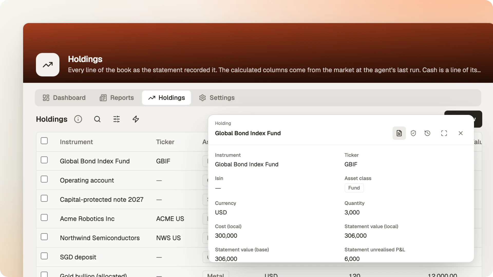

# 投资组合管理



面向家族办公室与财务团队的投资组合追踪与每日研究工作区。统一记录股票、基金、现金与授信额度，自动计算行情估值与技术信号，并由定时智能体每日生成带完整出处引用的组合日报——汇总净资产、资产配置、币种敞口及逐仓建议。

## 行业与 Bolt 核心能力

- **适用行业：** 金融（Finance）
- **Bolt 能力标签：** `data_modeling`、`browser_automation`、`ai_classification`、`document_intelligence`、`channel_integrations`、`scheduled_automations`

## 系统运作方式

1. **多币种持仓台账：** `holding` 统一管理证券、基金、现金与负值授信额度，并存放行情估值、技术指标与研究来源。
2. **每日自动行情与浏览器调研：** `portfolio_agent` 每日 08:00 拉取报价与汇率、计算技术信号，并通过 `ctx.web` / `ctx.browser` 浏览市场与重仓资讯，生成严格带出处的逐仓建议。
3. **日报归档与多渠道投递：** 写入不可变当日 `report`，通过 `ctx.convert.record` 渲染 PDF 并投递至应用内与已部署使者的 WhatsApp、Telegram、Slack 或 Discord 频道。

## 核心能力

- **统一多币种持仓簿：** 在同一 `holding` 表中管理证券、基金、现金（`cash`）与授信融资（`loan`，由 `loan_is_owed` 约束 ≤ 0），有行情标的按实时报价与当日汇率估值（自动处理伦敦便士及贵金属期货），无报价标的按最新对账单快照与应计利息估值。
- **自动技术信号计算：** 基于一年日线自动计算周/月/年涨跌幅、50/200 日趋势、20 日资金流向（买压/卖压）、14 日 RSI、距 52 周高点距离及 63 日年化波动率。
- **带引用的每日智能体报告：** 每日 08:00（或手动触发）运行 `portfolio_agent`，抓取免密钥行情与汇率、浏览市场与重仓新闻（`ctx.browser` 并支持资讯源回退），按严格引用规则撰写逐仓观点（自动剔除无出处段落）并归档当日报告快照。
- **应用内与多渠道 PDF 投递：** 按需将报告记录页渲染为 PDF（`ctx.convert.record`），发送至订阅用户收件箱及已部署使者的 WhatsApp、Telegram、Slack 或 Discord 私信，并对成交量超 20 日均量两倍的标的单独推送预警。

## 应用与角色

| 应用         | 页面                             | 受众                                                                       |
| ------------ | -------------------------------- | -------------------------------------------------------------------------- |
| **投资组合** | 仪表盘、日报、持仓、订阅者、设置 | `investors`（`portfolio_manage`）、`portfolio_viewers`（`portfolio_read`） |

- **`portfolio_manage`** 维护持仓、基准设置与订阅列表，可删除旧报告并手动触发运行（支持 `send: false` 跳过外发）。
- **`portfolio_read`** 只读查看持仓与日报，客户可在**日报**页自助订阅或退订。
- **`portfolio_automation`** 为每日智能体提供持仓、设置、订阅者与使者渠道的读取权限，以及指标与日报的写入权限。

## 数据模型

共 4 个模型：

- `holding` — 证券、基金、现金与融资额度，保存对账单成本/数量/应计利息、指定阅读源以及智能体计算的估值、信号与研究结论。
- `report` — 每日一条快照（`one_per_day`），保存导语、摘要要点、市场表、组合总额、币种敞口（`exposure`）、汇率（`fx_used`）、逐仓建议与引用来源（`sources`）。
- `portfolio_settings` — 单行配置基础币种（默认 `USD`）与基准指数代码（如 `^GSPC`、`^STI`）。
- `report_subscription` — 每用户一条订阅记录（`one_per_user`），控制每日 PDF 推送。

## 自动化与集成

| 自动化            | 触发方式          | 用途                                                                |
| ----------------- | ----------------- | ------------------------------------------------------------------- |
| `portfolio_agent` | 每日 08:00 / 手动 | 获取报价与汇率、计算信号、调研新闻、发布带引用日报、生成 PDF 并推送 |

外发复用 Bolt 内置渠道（`whatsapp`、`telegram`、`slack`、`discord`），在**设置 → 集成 → 使者**部署使者即可启用；未部署使者时仅在应用内送达。

## 快速开始

```bash
bun install --frozen-lockfile
bunx bolt check
bun run test
bunx bolt build
```

新工作区初始为空（`seed/test/` 仅包含 4 行合成测试持仓）。可在**投资组合 → 设置**配置基础币种与基准指数，在 `src/+workspace.ts` 调整工作区时区（`tz`）。
