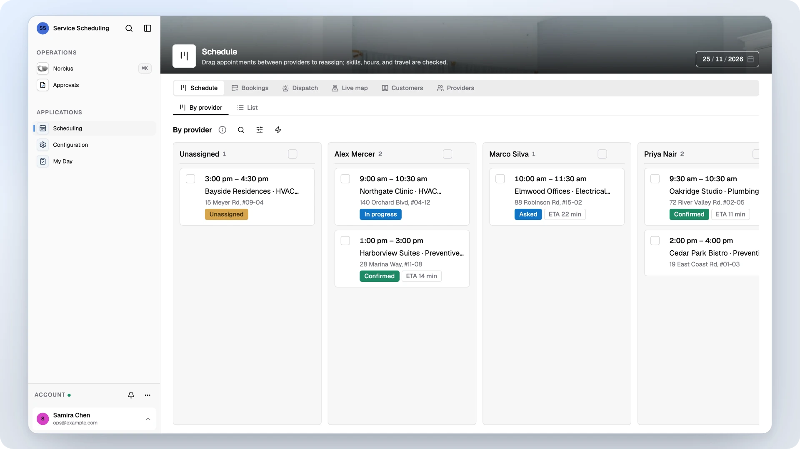

# Service Scheduling



A generic booking, provider scheduling and route-aware dispatch workspace for appointment-based service
businesses — HVAC, plumbing, electrical, cleaning, detailing, maintenance, tutoring, or any team
delivering scheduled services on site. Customers book online or through the desk, qualified providers are
matched automatically with travel and turnaround buffers, and operations tracks every shift through live
GPS ETAs and completion.

## Industry & Bolt capabilities

- **Industry:** Field & Local Services
- **Bolt capabilities:** `data_modeling`, `self_service_portal`, `gps_geospatial`, `third_party_saas`, `channel_integrations`, `scheduled_automations`

## How it works

1. **Self-service or desk intake:** Customers book recurring or one-off services through the phone-verified
   **Booking portal** (or operations books on their behalf), choosing from runtime-configured `services`
   and live slot `openings` refreshed every 15 minutes (`publish_openings`).
2. **Travel-aware matching:** `bookings_book` and `appointments_recommend` score active `providers` by
   skills, working hours, time off, driving time (`google_routes` cache with Haversine fallback) and
   turnaround buffer, minimizing added detour and balancing weekly load.
3. **Shift check-ins, live ETAs & notices:** `shift_watch` prompts pre-shift confirmations, `eta_watch`
   tracks live provider GPS positions to flag `eta_risk` for one-click dispatch recovery, and
   `deliver_notices` sends WhatsApp and synced email updates.

## Key capabilities

- **Self-service booking portal:** Embeddable phone-verified customer portal (`Book online` and
  `My appointments`) with address geocoding, recurring cadence selection, preferred provider picking,
  live slot quotes, `.ics` calendar export, and automated confirmation or desk follow-up.
- **Runtime service & skill catalog:** Configure any services, categories, durations, pricing and
  normalized skill tags in **Configuration** — no industry-specific skills or regions hardcoded in source.
- **Route-aware scheduling & auto-dispatch:** Provider matching enforces active status, required skills,
  working days/hours, time off, and driving time (Google Routes cache with Haversine fallback) plus
  configurable turnaround buffers, ranking candidates by minimal added detour and balanced weekly load.
- **Shift check-ins, live GPS ETAs & recovery:** Automated pre-shift prompts confirm each provider's day
  ahead of their first appointment, live GPS monitoring flags `eta_risk`, and operations approves
  recommended replacements or reschedules in one recovery tab.
- **Multi-channel customer & provider notices:** Automated confirmations, reassignments and cancellations
  deliver via WhatsApp and synced email (with mailbox delivery, open, bounce and reply tracking).

## Apps and roles

| App                | Pages                                                                                                                                            | Audience                     |
| ------------------ | ------------------------------------------------------------------------------------------------------------------------------------------------ | ---------------------------- |
| **Scheduling**     | Schedule (By provider board + List), Bookings (All + Portal requests), Dispatch (Needs attention + Shift checks), Live map, Customers, Providers | `Operations`                 |
| **Configuration**  | Services, Scheduling rules (slot interval, buffer, horizon, shift/ETA cutoffs), Connections (WhatsApp, Email, Google Routes)                     | `Operations`                 |
| **My Day**         | Today's chronological route, shift confirmation, live GPS sharing, directions, start & complete with notes                                       | `Providers`, `Operations`    |
| **Booking portal** | Book online (3-step self-service booking), My appointments                                                                                       | Public / verified `customer` |

## Data model

13 models across four ownership trees plus four top-level operational models:

- **Services (`services`):** `services` → `openings`.
- **Customers (`customers`):** `customers` → `customer_notices` (with `+mail.sync.ts`).
- **Bookings (`bookings`):** `bookings` → `booking_providers`, `appointments`.
- **Providers (`providers`):** `providers` → `provider_time_off`.
- **Intake & routing (top-level):** `availability_requests`, `booking_requests`, `scheduling_settings`,
  `drive_times`.

## Automations and integrations

18 automations and three integrations:

| Area                       | Automations / integrations                                                                                                                                                                               |
| -------------------------- | -------------------------------------------------------------------------------------------------------------------------------------------------------------------------------------------------------- |
| **Portal & booking**       | `publish_openings` (cron `3,18,33,48 * * * *`), `prepare_availability`, `portal_intake`, `bookings_book`, `bookings_cancel`                                                                              |
| **Dispatch & recovery**    | `appointments_rebook`, `appointments_recommend`, `appointments_accept_proposal`, `appointments_report_unavailable`, `appointments_cancel`, `providers_deactivate`, `check_drives` (`8,23,38,53 * * * *`) |
| **Shifts, ETAs & notices** | `appointments_confirm_shift`, `appointments_decline_shift`, `shift_watch` (`2,12,22,32,42,52 * * * *`), `eta_watch` (`*/5 * * * *`), `eta_check`, `deliver_notices`                                      |
| **Integrations**           | Built-in `whatsapp` and `email` (with `customer_notices` `+mail.sync.ts`); authored `google_routes` for driving times                                                                                    |

## Getting started

```bash
bun install --frozen-lockfile
bunx bolt check
bun run test
bunx bolt build
```

A fresh workspace starts empty; configure services and scheduling rules in **Configuration**, link
providers to user accounts in **Scheduling → Providers**, and optionally connect WhatsApp, Email and
Google Routes in **Configuration → Connections**.

- [Workflow guide](docs/README.md)
- [Source reference](docs/source-reference.md)
