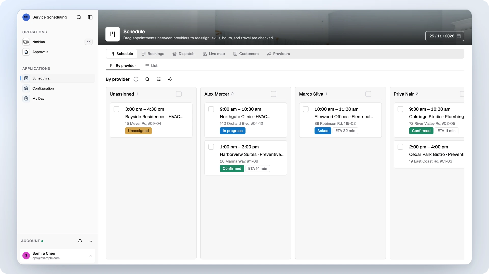

# 服务排程

**服务排程**是一套面向预约制现场与本地服务企业的端到端预约、排班与路径感知调度工作区，广泛适用于暖通空调、水电维修、保洁、汽车美容、设备维保、上门教学等各类按次履约的服务团队。客户可通过在线门户或调度台预约单次或周期性服务，系统结合技能资质、工作班次、休假记录与实际路程缓冲自动匹配服务人员，并从班前出勤确认到实时 GPS 到达预警和完工归档实现全程闭环。

它取代了分散的排班表格、人工电话与聊天群反复沟通、临期缺勤手忙脚乱以及撞单漏单等传统痛点。所有预约、改派、路径优化、到达预警与客户通知均在调度台、外勤人员端和客户门户之间实时同步。

## 预期业务价值

- **杜绝撞单与人工派单失误：** 每次新建预约、生成周期排程或拖拽改派时，系统均自动校验服务人员在岗状态、所需技能、工作日与班时、已登记休假以及点对点车程加周转缓冲。
- **7×24 小时自助获客，减少前台沟通成本：** 可嵌入企业官网的手机号验证预约门户支持客户随时浏览服务、查询结合地址与周期的真实可约时段并自助下单，若时段在提交瞬间被占满则自动转交调度台跟进。
- **降低无效空驶，均衡团队负荷：** 智能匹配综合评估新增绕行车程与本周负荷均衡度，在同等条件下优先保留稀缺多技能专家；后台优化还会持续微调灵活的远期预约，让每日路线更紧凑顺畅。
- **提前发现爽约与迟到风险：** 班前自动确认机制在服务人员当日首单前核实出勤状态，实时 GPS 到达监测则在预计超时或定位中断时及时向调度台预警，支持一键审核并指派排名靠前的替补人员。
- **沉淀完整的客户与履约审计记录：** 预约确认、人员变更、改期、取消、WhatsApp 队列状态、邮件送达/打开/退信/回复轨迹以及现场完工备注均自动关联至对应客户与预约档案。

## 角色与权限

| 角色                                 | 主要使用应用                 | 权限与操作范围                                                                                                                                             | 治理与隔离边界                                                                                                                   |
| ------------------------------------ | ---------------------------- | ---------------------------------------------------------------------------------------------------------------------------------------------------------- | -------------------------------------------------------------------------------------------------------------------------------- |
| **运营调度（Operations）**           | 排程调度、系统配置、今日行程 | 维护服务目录、排程规则与外部连接；管理客户与服务人员档案、休假及人员停用；代录、改期、改派或取消预约；处理调度提醒并批准替补建议；在实时地图查看外勤位置。 | 拥有全局运营管理权限；常规改期在免费变更窗口内会自动拦截，仅当预约处于异常恢复状态时允许突破窗口调整。                           |
| **服务人员（Providers）**            | 今日行程                     | 查看本人当日按时间排列的路线行程、确认或申报无法出勤、在岗共享实时 GPS 位置、一键打开地图导航或致电客户、点击开始与完成服务并填写完工备注。                | 严格隔离至本人档案、休假记录及名下排程；仅可将本人预约从“已排程”推进至“服务中”和“已完成”，无法查看他人排班或修改他人定位与班次。 |
| **已验证客户（Verified Customers）** | 在线预约门户                 | 通过手机号验证登录后发起结合地址与周期的档期询价、提交单次或周期预约、下载日历文件、查看即将到来的预约（含在途预计到达时间）、历史完工记录及通知消息。     | 严格限定在已验证手机号名下的数据范围内；无法查看其他客户记录、窥探服务人员内部排班或触发内部调度操作。                           |
| **公开访客（Public Visitors）**      | 在线预约门户                 | 在验证手机号前浏览已启用的服务项目、时长、参考价格以及脱敏后的可约时段汇总。                                                                               | 仅可只读访问公开服务目录与匿名时段数量，绝不泄露任何客户资料或服务人员排班细节。                                                 |

## 应用与核心功能

### 排程调度

面向调度员、排程专员与服务经理的日常运营指挥中心。

| 功能模块         | 核心功能说明                                                                                                                                                                                                                                                   |
| ---------------- | -------------------------------------------------------------------------------------------------------------------------------------------------------------------------------------------------------------------------------------------------------------- |
| **排班表**       | 支持按日期切换**按服务人员**拖拽看板（含**未指派**泳道）与可排序**列表视图**。在看板拖拽改派时会即时校验技能、班时、休假与车程缓冲；任务卡片直观展示状态、班前确认、关注预警与预计到达时间，并支持快速生成替补建议或取消预约。                                 |
| **预约管理**     | 分为**全部预约**（集中管理单次与周期订单、名下所有排程及按优先级排序的偏好人员）和**门户申请**（默认筛选因瞬时抢单而转入待跟进的在线预约申请）。在调度台新建预约时，交互式下单面板会实时校验整个周期的可约时段、支持最多指定五位偏好服务人员并原子化确认成单。 |
| **调度提醒**     | 集中异常处理台，包含**需处理**队列（待指派、迟到风险、人员停用及待审核替补预约，附带实时距开始倒计时与一键推荐替补、批准替补、取消操作）以及**班前确认**队列（持续追踪已询问、已请假及未回复的出勤确认）。                                                     |
| **实时地图**     | 分屏实时监控视图：左侧列出所有**服务中**及未来四小时内即将开始的预约，右侧地图实时标注在岗服务人员的 GPS 位置，并绘制指向各自当前或下一站客户地址的连线覆盖层。                                                                                                |
| **客户档案**     | 可搜索的客户名录，以唯一手机号识别客户并保存邮箱、默认服务地址、地图坐标和备注。点开客户档案可一站式查看**即将服务**、**历史预约**时间轴（含完工备注与临期取消标记）、**预约记录**（支持侧滑直接新建预约）以及带送达追踪的**通知记录**。                       |
| **服务人员**     | 管理外勤人员档案、标准化技能标签、工作日与上下班时间、关联登录账号、常驻基地坐标、最新定位时间、**预约记录**与防重叠的**休假记录**。提供一键**停用人员**功能，按指定最后工作日停用账号并为其后续已排程预约自动生成技能最相近的替补方案。                       |
| **改派恢复面板** | 内嵌于每条已排程预约详情页的**改派恢复**标签页。展示实时倒计时、按最优匹配排序的替补候选人列表（显示新增车程分钟数与本周已排小时数）、一键指派、刷新推荐、14 天**改选其他时间**档期选择器以及**标记人员无法出勤**按钮。                                        |

### 系统配置

无需改动代码即可按实际业务灵活调整的运营参数与集成配置中心。

| 功能模块     | 核心功能说明                                                                                                                                               |
| ------------ | ---------------------------------------------------------------------------------------------------------------------------------------------------------- |
| **服务项目** | 维护可预约服务目录，自由配置服务名称、可选分类、所需技能标签、服务时长（15 分钟至 12 小时）、参考价格、客户侧描述及启用状态。                              |
| **排程规则** | 在单一界面统一配置全局排程与预警参数：时段间隔、周转缓冲时间、门户提前可约天数、客户免费变更窗口、实时到达预警阈值与监测提前量、班前确认提前量及回复时限。 |

工作区共享的 **WhatsApp**、**电子邮箱**与 **Google Routes** 连接在**设置 → 集成 → 连接（Settings → Integrations → Connections）**中统一配置，密钥与凭证对普通用户保持加密隔离。

### 今日行程

专为外勤服务人员打造的移动端每日执行视图。

| 功能模块 | 核心功能说明                                                                                                                                                                                                                                                                 |
| -------- | ---------------------------------------------------------------------------------------------------------------------------------------------------------------------------------------------------------------------------------------------------------------------------- |
| **今日** | 按时间顺序展示当日（或任选日期）的完整路线清单及相邻站点间的预计车程与缓冲余量；顶部提供班前确认或申报无法出勤入口；在岗期间后台自动共享实时 GPS 定位；支持一键唤起 Google 地图单站或多站驾车导航、一键致电客户，以及带自动时间戳与完工备注的**开始服务**/**完成服务**操作。 |

### 在线预约门户

可独立访问或直接嵌入企业官网的客户自助预约界面。

| 功能模块     | 核心功能说明                                                                                                                                                                                                                                                                                                               |
| ------------ | -------------------------------------------------------------------------------------------------------------------------------------------------------------------------------------------------------------------------------------------------------------------------------------------------------------------------- |
| **在线预约** | 三步式自助预约流程：先浏览启用服务与近期可约时段汇总并完成手机号验证；再填写服务地址（支持地图选点）、单次或周期频率（单次、每周、每两周、每月）、可选偏好服务人员及特殊说明；随后从按上午、下午、傍晚分组的实时地址感知时段中选择时间并确认，即可获得即时确认回执与日历文件下载（若该时段刚被约满，则自动转调度台跟进）。 |
| **我的预约** | 客户经手机号验证后可查看所有即将到来的预约（展示已指派服务人员姓名及在途预计到达时间）、近期已完成服务以及历史通知消息。                                                                                                                                                                                                   |

## 自动化与外部连接

### 内置后台自动化

- **公开开放时段刷新：** 每 15 分钟自动更新配置可约天数内的公开可选开始时间，并在服务目录、人员班次、休假、预约、排程或规则变更时即时触发刷新，既保证门户时效又严防内部排班信息泄露。
- **地址感知询价与门户自动成单：** 按客户提交的服务地址与重复周期实时计算精准可约时段（报价有效期 15 分钟）；提交预约后自动匹配或新建并地理编码客户档案，档期可用时原子化生成预约与确认通知，若发生抢单冲突则自动转入待跟进并同时通知客户与运营团队。
- **路程缓存与持续路径重平衡：** 每 15 分钟（以及预约或基地坐标变动后）更新即将执行路线的实际路网车程缓存；若真实路程导致某笔后续预约不可达，系统会自动将其改派；在全部路线可达的情况下，系统还会对超出免费变更窗口的灵活预约执行局部搜索重平衡，持续降低总行车时长并均衡团队周负荷。
- **班前出勤巡检与替补推荐：** 每 10 分钟检查即将开始当日首单的服务人员，通过应用内通知与 WhatsApp 发出确认提醒；若人员申报无法出勤或超过回复时限未响应，系统自动为其登记当日不可出勤休假，并按时间顺序生成不互相冲突的替补建议供运营审核。
- **实时 GPS 到达监测：** 每 5 分钟巡检进入到达监测提前窗口的预约，核查服务人员 GPS 定位是否新鲜（15 分钟内）并结合实时路况评估车程；若定位过期或预计到达超出阈值，立即标记迟到风险并提醒调度台介入。
- **多渠道通知与邮件状态回写：** 预约确认、人员改派、改期、取消及新派单提醒均自动经 WhatsApp 与邮件发出，系统记录 WhatsApp 队列状态，并同步回写邮件的已发送、延迟、已送达、已阅读、已退信、失败及客户回复摘要。

### 外部连接

- **WhatsApp：** 通过工作区共享账号向客户发送预约与变更通知，并向服务人员发送新派单提醒和班前确认提示。
- **电子邮箱：** 当客户档案留有邮箱时自动同步发送邮件通知副本，并持续回收邮箱送达、打开、退信、失败与回复等生命周期事件。
- **Google Routes（可选）：** 为智能派单缓存网格点对点驾车耗时，并为临近到达监测提供实时路况预计时间；未配置时自动无缝回退至直线距离估算，不影响正常排程运转。
- **地址地理编码：** 内置地址搜索与坐标解析能力，支持客户门户地图选点并在门户新客建档时自动补全经纬度坐标。

## 范围与职责边界

- **开箱即用涵盖范围：** 运行时可配置服务目录与排程预警规则、客户自助在线预约门户、客户与服务人员档案、技能与路程感知匹配、单次及周期预约、后台路径优化重平衡、班前出勤确认、实时 GPS 到达预警、异常改派恢复以及 WhatsApp/邮件多渠道通知。
- **收款、开票与财务核算：** 服务项目保存用于展示的参考价格，但在线支付收单、临期取消费扣款、发票开具与财务总账记账由独立的计费或财务系统承担。
- **薪酬、人事与用工合规：** 工作区记录班次工时、服务起止时间戳与休假日期以支撑排程校验，不包含薪资核算、加班规则计算或法定人事档案管理。
- **库存、备件与单次作业成本：** 设备耗材库存、备件领用、采购单及单笔工单毛利核算不在本模板范围内。
- **客户侧自助改期与取消：** 已验证客户可在门户自助下单并追踪进度，但取消和改期须由运营调度台执行，以确保统一落实免费变更窗口与异常恢复规则。
- **第三方账号与终端定位授权：** WhatsApp、电子邮箱及 Google Routes 账号由企业自行开通与管理；实时 GPS 到达监测依赖于外勤人员在其移动设备上授权定位权限并保持**今日行程**正常运行。

## 技术文档

- [技术指南与开发者快速开始](docs/README.md)
- [系统架构与核心机制详解](docs/architecture.md)
- [源码清单参考](docs/source-reference.md)
