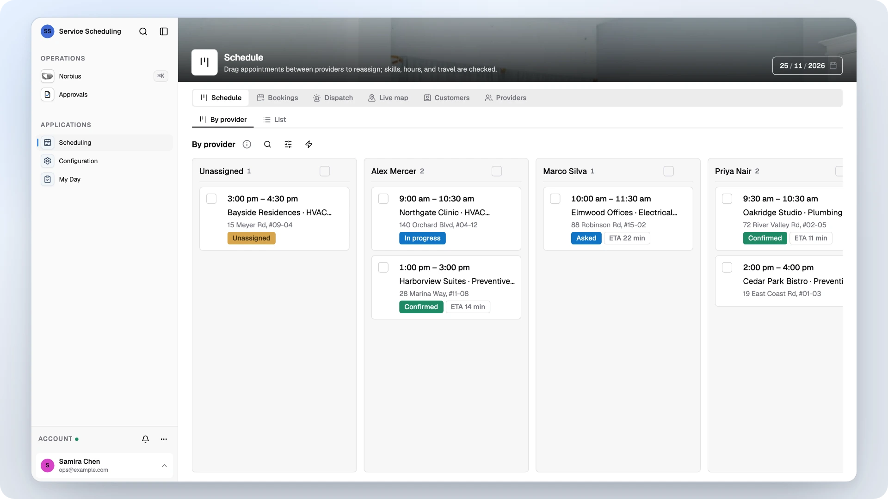

# Service Scheduling — Technical Documentation



Technical hub for developing, testing, configuring, and operating the `templates/scheduling`
Norbital Bolt workspace (`norbital-scheduling`).

## Documentation Index

- [Architecture & Inner Mechanisms](architecture.md) — System topology, data ownership ER diagram,
  state machines and record locks, write-time assignment guards, matching/scoring/slot math, portal
  quote-to-booking pipeline, route caching and local-search optimization, pre-shift and live GPS
  ETA pipelines, dual-channel notice delivery, and RBAC matrix.
- [Source Reference](source-reference.md) — Complete inventory of all 13 models, 4 apps, 11 pages
  (+ 1 session), 7 model representations, 2 teams, 7 policies, 18 automations, mail sync,
  integrations, shared library modules, i18n catalogs, and test suites.
- [Product Overview (English)](../README.md) · [产品概述（中文）](../README.zh.md) — Business-focused
  overview, roles, apps, automations, and scope boundaries.

## Developer Quickstart

Run all commands from the template root (`templates/scheduling`):

```bash
bun install --frozen-lockfile   # Install pinned Bolt toolchain and workspace dependencies
bunx bolt check                 # Verify discovery, schema history, physical DDL, policies, and types
bun run test                    # Execute Vitest + Bolt engine suites (matching, notices, workflow)
bunx bolt build                 # Generate/verify migrations and build release & seed packs
```

Additional local development scripts declared in `package.json`:

```bash
bun run dev                     # Run Bolt dev watcher (rebuilds .norbital/ on change)
bun run format                  # Format source and docs with Prettier
```

### Schema, Migrations & Seed Workflow

- **Declarative schema:** Author fields, relations, unique keys, checks, `no_overlap` constraints,
  and state locks in `src/data/model/**/+model.ts`.
- **Editable SQL migrations:** `bunx bolt build` generates the next migration under `migrations/`
  (currently `0001_initial.sql`) and replays the full history against a
  scratch database. Always commit generated SQL files together with `migrations/snapshot.json`,
  `migrations/migrations.lock.json`, and `migrations/physical.json`. Never commit `.norbital/`.
- **Test fixtures & initial workspace state:** Synthetic test rows in `seed/test/*.json` power
  `bun run test` through `TestWorkspace.layer()`. A fresh production workspace starts with its two teams
  (`seed/public/sys_team.json`) and no business rows: configure services and scheduling rules in **Configuration**, link providers to `sys_user`
  accounts in **Scheduling → Providers**, and optionally connect external accounts in
  **Settings → Integrations → Connections**.

## Operating Loop

1. **Configure services and rules** in **Configuration → Services** and **Scheduling rules**:
   define bookable services with normalized skill tags, duration (`15..720` min), and price, and
   tune slot interval, turnaround buffer, booking horizon, shift-check lead/reply timing, ETA
   alert thresholds, and free-change window.
2. **Manage providers and time off** in **Scheduling → Providers**: set working weekdays, daily
   hours (`day_end > day_start`), runtime skill tags, base coordinates, and link each provider to
   their `sys_user` sign-in so they can open **My Day**.
3. **Take bookings** either from **Scheduling → Bookings** (interactive desk composer with live
   slot availability via `livePool`) or via the embeddable **Booking portal** (phone-verified
   3-step self-service flow backed by `availability_requests` and `booking_requests`).
4. **Dispatch and recover** from **Scheduling → Schedule** (`By provider` drag-and-drop board and
   sortable `List`), **Dispatch** (`Needs attention` queue and open `Shift checks`), and **Live
   map** (live provider GPS markers with next-stop routes). Open any scheduled appointment's
   **Recovery** tab (`src/lib/Recovery.svelte`) to compare ranked replacements, choose another
   time across 14 days, or mark a provider unavailable.
5. **Execute in the field** with **My Day**: providers confirm or decline their shift, share live
   GPS positions automatically via `provider/+session.svelte` (throttled every 2 minutes), open
   turn-by-turn directions, start appointments (`started_at` stamped natively), and record
   completion notes (`completed_at` stamped natively).

## External Integrations

Connect shared accounts (`owner: null`) in **Settings → Integrations → Connections** (credentials remain
sealed inside the host store):

- **WhatsApp (`whatsapp`):** delivers outbound customer notices (`deliver_notices`), upcoming
  appointment assignment alerts (`alertProviders`), and pre-shift prompts (`shift_watch`).
- **Email (`email`):** powers `customer_notices` `+mail.sync.ts`, sending email copies to
  customers with an email address and folding `sent`, `deferred`, `delivered`, `opened`,
  `bounced`, `failed`, `auto_replied`, and `replied` events back onto each notice.
- **Google Routes (`google_routes`):** caches ~1 km grid driving times (`drive_times`) via
  `check_drives` and `prepare_availability` (`TRAFFIC_UNAWARE`), and fetches live traffic ETAs in
  `eta_check` (`TRAFFIC_AWARE`). Without a connected account, scheduling falls back seamlessly to
  Haversine estimates (`25 km/h`, or `30 min` when coordinates are missing).
