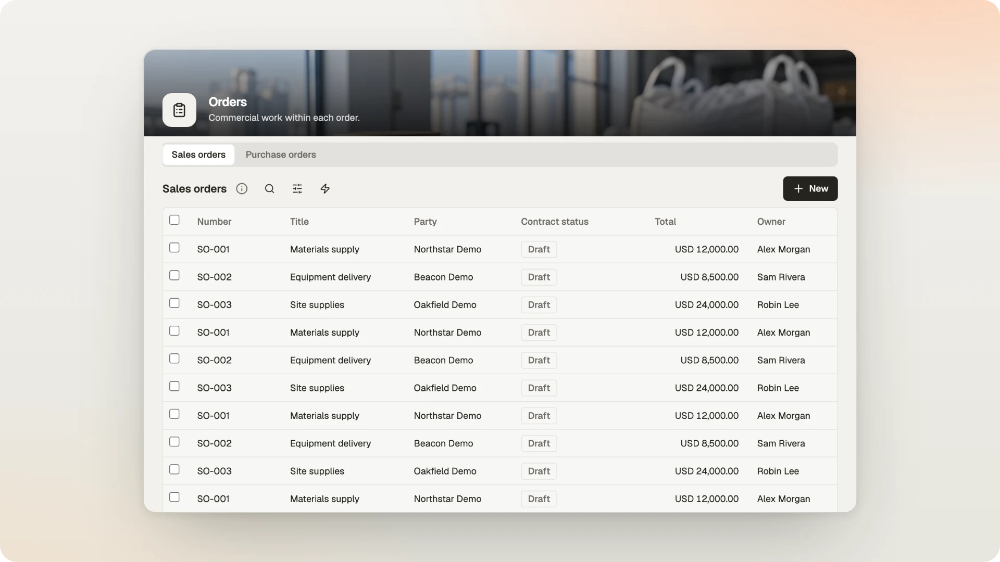

# Trade Operations

Trade Operations is a unified commercial workspace for B2B trading, distribution, and manufacturing
teams operating alongside **Kingdee KIS** accounting ledgers. It brings domestic and international
quotations, sales orders, and purchase orders into a single order lifecycle—so a draft quotation
confirms directly into an ERP order without re-keying, while downstream deliveries, receipts,
invoices, payments, stock lots, credit holds, and margins stay continuously reconciled back to the
original commercial agreement.

By replacing scattered quoting spreadsheets, disconnected contract Word files, ad-hoc chat
approvals for below-floor pricing or credit overrides, and manual month-end margin and commission
reconciliations, the workspace gives Sales, Procurement, Commercial Management, Finance, Logistics,
and Commercial Configuration one governed operational source of truth without altering the
underlying accounting ERP.

## Expected Business Impact

- **Eliminate commercial re-keying and handoff errors:** Quotations, sales orders, and purchase
  orders share one record from initial draft through confirmation and audited sales-order
  amendment, keeping commercial terms, contract documents, and ERP fulfillment aligned.
- **Protect margins before orders are confirmed:** Regional, date-effective price floors enforce
  configurable guardrails—warning sellers, routing exceptions for manager approval, or blocking
  confirmation—while surfacing live lot-level inventory costs during quoting.
- **Close credit-control leakage:** Credit-blocked deliveries follow a formal dual-party release
  process between Commercial Management and Finance, automatically invalidating approvals if a
  delivery changes before release and alerting leadership if an unapproved ERP override occurs.
- **Accelerate month-end financial and commission closing:** Real-time, currency-separated reports
  trace sold lots back to supplier purchase orders and landed duties, reconstruct historical
  receivables and payables aging without fabricating settlements, and lock verifiable monthly
  salesperson commission statements.
- **Enforce strict commercial confidentiality:** Role-scoped visibility isolates individual sales
  portfolios, masks all commercial prices, margins, and credit amounts from Logistics staff, and
  separates rule and template administration from live customer orders.

## Roles & Access

Six dedicated business roles enforce clear operational ownership and separation of duties across
the workspace:

| Role                    | Operational Scope & Governance Boundaries                                                                                                                                                                                                                                                                                                                                                                                     |
| ----------------------- | ----------------------------------------------------------------------------------------------------------------------------------------------------------------------------------------------------------------------------------------------------------------------------------------------------------------------------------------------------------------------------------------------------------------------------- |
| **Sales**               | Manages only their own domestic and international quotations and sales orders, generates customer PDFs, views their own commission statements and credit-release requests, and manages additional partner contacts. Below-floor sales lines (when approval mode is active) and sales draft deletions require Commercial Manager approval; credit-release requests require sequential Commercial Manager and Finance approval. |
| **Procurement**         | Creates, updates, and confirms purchase orders across the purchasing portfolio, tracks supplier receipts, invoices, and purchase progress, generates supplier contract PDFs, and manages additional partner contacts.                                                                                                                                                                                                         |
| **Commercial Managers** | Full visibility across all sales and purchasing orders, margins, lot costs, aging, and credit exceptions. Directly creates and edits orders, approves Sales pricing exceptions and draft deletions, sets product commission conversion factors, acknowledges monthly commission statements, and co-approves credit releases (Finance co-sign always required).                                                                |
| **Finance**             | Read-only oversight of all commercial orders and filed signed contracts, with full access to sales margins, purchase progress, receivables/payables aging, and credit exceptions. Maintains customer and supplier related-party flags, acknowledges monthly commission statements, and co-approves credit releases (Commercial Manager co-sign always required).                                                              |
| **Logistics**           | Views order quantities, delivery schedules, regional stock availability, credit-release status, and activity logs with all unit prices, totals, price floors, inventory costs, margins, and credit amounts completely hidden. Records delivery and coordination activities.                                                                                                                                                   |
| **Configurators**       | Works exclusively inside Trade Configuration to publish versioned English and Chinese contract layouts, maintain the regional price book and floor policy, configure commission rules and freight treatment, and set product commission factors—with no access to live orders, invoices, or financial statements.                                                                                                             |

Key governance boundaries enforced automatically across every role:

- **No self-approval on credit releases:** Whether initiated by Sales, a Commercial Manager, or
  Finance, every credit release requires independent sign-off from both Commercial Management and
  Finance.
- **ERP master ownership:** Core customer, supplier, product, warehouse, settlement, and primary
  contact records remain governed in Kingdee KIS; workspace teams can only add or edit supplemental
  contacts, product commission factors, and related-party flags locally.

## Apps & Functionality

### Operations

| App / Module                     | Functionality                                                                                                                                                                                                                                                                                                                                                                                                                                                                                       |
| -------------------------------- | --------------------------------------------------------------------------------------------------------------------------------------------------------------------------------------------------------------------------------------------------------------------------------------------------------------------------------------------------------------------------------------------------------------------------------------------------------------------------------------------------- |
| **Dashboard**                    | Role-scoped daily attention queue surfacing drafts awaiting ERP sync, pending approval requests, ERP follow-ups and pending audits, overdue receivables by currency, and credit exceptions, with inline drill-down tables and direct report links.                                                                                                                                                                                                                                                  |
| **Orders**                       | Unified Sales Orders and Purchase Orders workspace supporting domestic and international trade terms (including Incoterms). Features live price-floor and FIFO/weighted-average inventory cost warnings on drafts, one-click confirmation to Kingdee KIS, audited sales-order amendments, single-order PDF preview with optional seller stamp, bulk PDF zip download, signed contract filing, spreadsheet import/export, and a complete timeline of deliveries, invoices, payments, and activities. |
| **Partners**                     | Synchronized customer and supplier directory showing primary ERP contacts alongside locally managed additional contacts, Finance-maintained related-party classification, customer credit limit and exposure history, and linked orders.                                                                                                                                                                                                                                                            |
| **Warehouse**                    | Three-tab operational view: **Products** (catalog with historical price-floor charts, spreadsheet export, and commercial fields hidden from Logistics), **Stock** (per-product, per-region grid showing on-hand inventory, inbound and outbound commitments, projected balance, and automatic shortage flags), and **Warehouses** (locations grouped by commercial region).                                                                                                                         |
| **Analysis — Sales Analysis**    | Monthly profitability report on either an invoice-date or delivery-date basis. Traces sold inventory lots back to supplier purchase orders, purchase prices, and supplier payment status, and forward to customer invoicing and collection status, with freight-adjusted net sales, cost, margin, margin rate, and salesperson breakdown.                                                                                                                                                           |
| **Analysis — Purchase Listing**  | Monthly purchase-order progress covering ordered quantities, warehouse receipts, unreceived balances, supplier invoices, allocated customs duty and import VAT expenses, payment status, and related-party vs. third-party filtering.                                                                                                                                                                                                                                                               |
| **Analysis — Receivables Aging** | Historical as-of-date customer aging across five overdue buckets plus unapplied receipts and credits, supporting both actual gross balances and estimated oldest-first offset views separated by currency.                                                                                                                                                                                                                                                                                          |
| **Analysis — Payables Aging**    | Historical as-of-date supplier aging in gross or estimated views, with related-party vs. third-party separation and accrued-not-invoiced period notes alongside the report.                                                                                                                                                                                                                                                                                                                         |
| **Analysis — Commission**        | Monthly salesperson commission review calculated from each order's locked-in commission rule and freight treatment. Flags unresolved lines or pending approvals, and supports formal monthly statement acknowledgement with an immutable history if shipments or returns later change.                                                                                                                                                                                                              |
| **Analysis — Credit Exceptions** | Consolidated view of credit-held, over-limit, and overdue customers, overdue invoice details, and end-to-end review and tracking of credit-release requests for blocked deliveries.                                                                                                                                                                                                                                                                                                                 |

### Trade Configuration

| App / Module            | Functionality                                                                                                                                                                                                                                                                                                                                                                                            |
| ----------------------- | -------------------------------------------------------------------------------------------------------------------------------------------------------------------------------------------------------------------------------------------------------------------------------------------------------------------------------------------------------------------------------------------------------- |
| **Documents**           | Manages six fixed bilingual document slots (English and Chinese layouts for Quotations, Sales Contracts, and Purchase Contracts). Supports built-in structured templates or custom print layouts, company letterhead, and seller contract stamps (applied to sales documents only). Published versions lock permanently as historical contract evidence; revisions branch cleanly into new drafts.       |
| **Prices & Commission** | Three-tab governance hub: **Monthly Price Book** (editable product-by-day regional grid with spreadsheet import/export conflict checks and the global floor-rule toggle: warn, require approval, or block), **Pricing History** (complete dated floor register), and **Commission Rules** (configurable dated commission formulas with freight-treatment policy and an interactive live test simulator). |

## Automations & Connections

- **Multi-Ledger Kingdee KIS ERP Connection:** Administrators connect one or more Kingdee KIS
  accounting ledgers at runtime with automatic permission and mapping checks—without installing
  database triggers or altering ERP tables. Background pipelines continuously mirror masters,
  stock lots, open commitments, credit limits, deliveries, receipts, invoices, payments,
  receivables, payables, and purchase progress, while pushing confirmed sales orders, purchase
  orders, and audited sales-order amendments back to the ledger.
- **Automated Credit-Release Monitoring & Notifications:** Continuously monitors unaudited deliveries
  against ledger credit rules, alerts Commercial Managers, Finance, and order owners when a
  delivery is blocked, notifies Finance and Logistics once dual-party approval is granted,
  automatically supersedes approvals if a delivery is modified in the ERP before release, and
  alerts leadership immediately if an unapproved credit override occurs.
- **Ledger Health Alerting:** Automatically notifies workspace administrators whenever an
  accounting ledger connection falls behind, fails a coherence check, or requires operator
  attention.
- **On-Demand Bilingual PDF & Spreadsheet Exchange:** Generates print-ready English and Chinese
  A4 PDFs directly on demand (individually or as multi-order zip packages) and supports workbook
  import/export for orders, lines, regional price books, commission rules, directories, and
  analysis reports.

## Scope & Boundaries

- **ERP auditing, warehousing, and statutory accounting remain in Kingdee KIS:** Final order
  auditing, physical stock receipts and dispatches, billing issuance, general ledger posting, and
  statutory tax filings stay inside the accounting ERP. Audited purchase orders cannot be modified
  from this workspace.
- **No banking or payment execution:** The workspace reconciles payment records, settlements, and
  overdue aging from the ERP but does not initiate bank transfers, letters of credit, or vendor
  disbursements.
- **Organization-owned legal wording and branding:** Starter English and Chinese contract layouts
  are generic templates only; adopting teams supply their own legal clauses, company letterhead,
  and contract stamp artwork and remain responsible for legal and regulatory review.
- **No synthetic cross-currency rollups:** Revenue, aging, credit, and commission totals remain
  strictly separated per currency rather than applying assumed exchange rates (only sales-margin
  analysis converts foreign sales net to inventory cost currency using the ERP order's recorded
  exchange rate).
- **External ERP connectivity and access provisioning:** Connecting live ledgers requires
  organization-managed network reachability, database permissions, and administrator-configured
  credentials; no ERP credentials or live ledger records ship with the template.

## Documentation

- [Documentation Index & Developer Quickstart](docs/README.md) — Ordered technical reading path,
  local setup commands, migration workflow, and seed structure.
- [Inner Mechanisms Diagrams](docs/0009-inner-mechanisms-diagrams.md) — Pure-ASCII architecture
  and mechanism diagrams covering topology, data ownership, order lifecycle, two-way Kingdee sync,
  polling reliability, pricing floors, credit releases, FIFO lot costing, PDF rendering,
  commissions, financial analysis, and access control.
- [Product Objective](docs/0000-objective.md) & [System Architecture](docs/0001-architecture.md)
- [Kingdee Integration Boundary](docs/0002-integration.md),
  [Kingdee Implementation Runbook](docs/0004-kingdee-implementation.md) &
  [Kingdee Order Lifecycle](docs/0005-kingdee-order-lifecycle.md)
- [Source Reference](docs/0003-source-reference.md),
  [Workspace Capabilities](docs/0006-workspace-capabilities.md),
  [Print Layouts Guide](docs/0007-print-layouts.md) &
  [Manual Probe Matrix](docs/0008-manual-probe-matrix.md)
