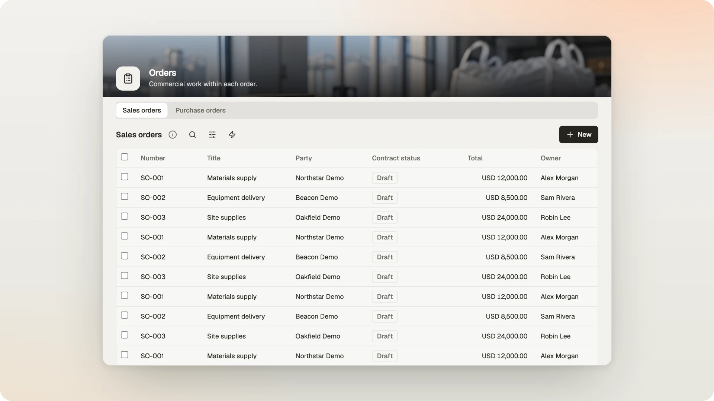

# Trade Operations



面向贸易和制造团队的公开 Bolt 入门模板。客户报价和销售订单共用一个协议模型；供应商采购订单使用同一模型，方向为采购。报价无需移到另一张表即可成为定稿协议。

## 文档

从[文档索引](docs/README.md)开始。它按顺序列出目标、架构、集成、源码清单，以及更深入的金蝶（Kingdee）、功能对齐、打印和探测参考。

## 应用与角色

运营默认打开仪表板（需要处理的事项：待同步与无法同步的草稿、订单审批、金蝶跟进、本月已同步销售、逾期应收款、信用异常和账套连接；每项都能打开对应的表格或报表），并包含交易（一个可筛选的订单表格）、合作伙伴（一个客户/供应商表格）、仓库（SKU、库存和仓库）以及分析（报表）。交易配置包含文档（每种打印单据按语言的版式）以及价格与提成（月度价格表、底价列表和提成规则）。

订单包含基本信息、活动和交易三个部分。基本信息保存其客户/供应商、负责人、合同 SKU、配额数量、价格、信用/付款条款和有效期，以及金蝶销售订单或采购订单状态。活动包含跟进事项。原生历史将修订滑块与订单、明细、活动和源记录的变更合并在一起；它就是订单的审计记录。交易显示针对约定配额的交付单和发票。每笔交易拥有自己的单据。合作伙伴包含基本信息、联系人（往来单位的金蝶联系人排在最前）和订单（只读；订单在订单应用中创建）。

可编辑的子表格使用显式的创建表单，该表单在由右对齐的 `+ Model` 工具栏按钮打开的弹窗中。源系统拥有的表格没有创建按钮或可编辑表单。基础数据包提供通用商务设置，以及每种打印单据（报价单、销售合同、采购合同）的中英文版式。订单只选择其单据语言；要自定义输出，请在交易配置 → 文档中修订该单据的版式并发布；每个订单都按最新发布的版本打印。订单表格的操作菜单提供**预览文档**（单个订单）和**下载 PDF**（所选订单，打包为一个 zip）；两者都将已保存的订单渲染为一个生成文件。商务表格包含已保存的明细规格、数量、价格、折扣、税额和合计。公司信笺抬头和合同章图片是可选的租户 PNG 文件。在预览中勾选**加盖公司印章**后，或通过下载 PDF 导出时，销售订单的报价单和合同会加盖印章；采购合同从不加盖。单据字段可以提供固定选项（`options`，每行一个）。

已发布的版式还可以附带一个可选的**打印版式 HTML** 上传文件。它控制打印 CSS、排版和图片位置。在重现已批准的单据或工作簿时使用它。[打印版式指南](docs/0007-print-layouts.md)列出了支持的字段和渲染器配置。

合同 SKU、配额、价格、信用条款和有效期属于基本信息中的订单；历史显示每个较早的值。要保留之后收到的客户采购单或签回件，请将其添加到已确认订单的归档文件下。

订单为使用它们的团队提供销售订单和采购订单视图。**同步至金蝶**只执行一次，将草稿变为已确认（显示为已同步金蝶）；此后对订单或其明细保存的每项修改都会同步到对应的金蝶订单。销售和采购直接同步和修改自己的订单。账套的采购单据经验证后，同步会将采购订单写入金蝶为未审核采购订单，审核前的明细变更会替换该采购订单的明细，其入库单、采购发票和付款都关联到该订单。审批只用于例外：底价规则为**经理审批**时，销售代表低于底价的明细须等待商务经理审批，等待期间订单不能同步。删除自己的销售草稿也须等待商务经理审批。信用额度和余额是只读的源数据，信用管控由源系统负责。

库存行表示剩余批次，包括批次号和单位成本。价格警告将销售明细的净单价与同一 SKU、单位和币种按数量加权的剩余库存成本进行比较。已实现的销售毛利使用所消耗批次记录的成本；缺失的成本保持未知。账龄在一个网格中合并未付发票和未分配收款，而不会假装某笔收款已分配到某张发票。

团队（`src/access_control/team/+team.ts`）按 handle 各关联一个策略：**销售**（`sales` → `sales`）、**采购**（`procurement` → `procurement`）、**商务经理**（`commercial_managers` → `manager`）、**财务**（`finance` → `finance`）、**物流**（`logistics` → `logistics`）以及**配置人员**（`configurators` → `configuration`）。低于底价的销售明细（**经理审批**时）和销售草稿删除会进入 `commercial_managers` 审批步骤。

销售读取自己的客户协议和财务数据；采购读取自己的供应商协议。物流看到运营数量，商务字段被遮盖。财务和经理使用报表；配置权限不授予商务记录访问。源记录只由其金蝶同步写入；配置人员和商务经理只能修改商品的本地提成设置；销售、采购和商务经理维护往来单位除金蝶联系人以外的联系人。中英文目录负责标题、业务状态和错误消息。复用原生 Bolt 的历史、权限、审批、操作、类型和运行。

## 数据模型

- `orders` / `order_lines`：我们的销售或采购协议及其合同 SKU 行，保存条款。已同步的订单（`confirmed`）是其金蝶销售订单或采购订单的双向影子：同步时创建，之后保存的每项修改都会同步过去，金蝶中的变更会更新订单。金蝶保留表头（往来单位、币别、订单日期、业务员、付款条件）。
- `contacts`：每个往来单位可有多个联系人。往来单位的金蝶联系人（`primary`，排在最前）读取自其客户或供应商主数据，在金蝶中修改；其他联系人由成员添加。订单的买方联系人是其中之一。
- `settlements`：金蝶结算方式（`t_Settle`）的只读镜像。订单的付款条件指向其中一条；其单据打印结算方式名称。
- `transactions`：与其订单关联的只读交付（采购为入库）和发票。已开具的发票保留实际开具日期、到期日期和总额；应收不会虚构这些值。
- `source_payments`：一个只读的收款/付款/退款台账，可选择应用到某笔发票交易。定金保持独立，退款冲减收款，撤回的收款仍可查看，重放按源身份收敛。没有并行的手工收款台账。
- `source_sales_lines`：标准的财务报表数据，区分出库、退货和仅发票收入。在经验证的源映射能够提供等效的交易财务数据、且不会将出库/发票对重复计算之前，它保持独立。
- `commission_rules`：动态 CEL 表达式和参数。已同步的订单保留其订单日期当天生效的规则；其明细保留各自的底价和换算数据。
- `commission_statements`：唯一保留的月度提成审批流程。没有额外的按订单提成确认模型或重复表格。
- `stock_snapshots`：只读的源批次，包含批次号、在库数量和单位成本。库存标签页在每个批次旁按商品和仓库显示未结金蝶销售订单的待发数量（`source_stock_commitments`）和可用数量；源数据缺失或过期、单位不一致或未结订单没有仓库时，可用数量留空。

只有一个交付/发票台账。结清时每个交付明细只计算一次。归档可撤销且只在本地生效：它从不作废金蝶订单或释放其承诺；只有金蝶的作废或关闭才会终止它。已确认的订单不能删除。

## 自动化与集成

| 自动化          | 触发器                                 | 作用                                 |
| --------------- | -------------------------------------- | ------------------------------------ |
| `source_health` | `kingdee` 连接的状态或健康状况发生变化 | 当账套连接需要处理时通知工作区管理员 |

订单单据不需要自动化。共享预览通过 `ctx.preview_pdf` 生成 PDF，并将该文件同时用于预览和下载。`orders` 文件导出渲染的是同一个已保存订单。价格表按仓库组和币种打开一个月度矩阵，支持在日单元格内直接编辑；带日期的行保留原生 Excel 和 CSV 导入/导出，并使用按账套区分的 SKU 编码。

自定义的[金蝶集成](docs/0004-kingdee-implementation.md)位于 `src/integration/kingdee/`。它负责 SQL Server rowversion 轮询和完整列表、源身份、有序头寸以及表头/明细提交。每个源模型声明一个带 `read` 的 `kingdee` 同步；`orders` 和 `order_lines` 镜像销售订单或采购订单的表头和明细，并写入订单及其明细变更。账套的采购单据经验证后，采购订单也参与同步。Bolt 提供通用的 SQL Server 请求驱动、同步调度、发件箱及其重试、按账套区分的身份，以及原子化的游标/模型写入。每个金蝶账套是一个 `sys_integration` 实例，带有其密封凭据和安全配置；管理员在运行时逐个添加（工作区不声明连接槽位）。每次读取都会为其行标记来源账套（`source`），订单属于其往来单位的账套（`ledger`）。每个有效账套都会收到订单变更；`orders` 写入只将订单提交到其自己的账套。

工作区管理员打开设置 → 集成 → 连接 → 金蝶，进行原生配对、测试、同步选项设置以及查看数据新鲜度。连接列表显示账套状态。保存 SQL 凭据时，会先检查主数据、联系人、结算方式和库存投影及其 SQL 读取权限，再激活 SQL 同步。未配对或已暂停的实例会让排队的订单写入保持等待。账套需要处理时会通知管理员。交易配置将每条规则放在它所管理的内容旁边：文档页按语言保存每种打印单据（报价单、销售合同、采购合同）的版式；价格与提成页在价格表上设置底价规则（提示、经理审批、拒绝），在提成规则旁设置运费处理方式。源单据是只读的。

金蝶绑定使用实际的 `dbo` 主数据、销售订单以及经验证的源单据关系。聚焦的本地探测使用禁用 CDC 的合成物理表。Trade Operations 通过阿里巴巴网络路径直接连接到本地部署的 SQL Server 2017。部署验收涵盖 SQL 端点的地址策略和 TLS、源默认值、权限和查询计划。信用为可选功能：将 `creditPolicy` 设为 `kis-sales-out-v1`、`creditAccount` 设为实际数据库/恢复分支标识、本位币设为 CNY 后，同一 SQL 读取原生信用、发票、收款和出库表；未知设置、缺失映射或读取失败时保留上次有效数据。

## 金蝶双向同步

金蝶 KIS 是单据、库存与账务的记录系统；Trade Operations 保存协议及其审批。两者通过 SQL Server 对接：
每次读取都是按计划轮询的有界 `SELECT`，每次写入都是从 Bolt 发件箱发出的受校验 SQL 批处理。金蝶不主动推送，
Trade Operations 也不在账套中添加任何对象、触发器或 CDC。

### 四条路径

| 路径                              | 同步内容                                                                                                                                                                                                                                         |
| --------------------------------- | ------------------------------------------------------------------------------------------------------------------------------------------------------------------------------------------------------------------------------------------------ |
| 销售订单：Trade Operations → 金蝶 | 同步销售订单即生成未审核的销售订单，其 `FUUID` 由订单派生，每行的交货日期为装运期的最后一天。之后保存的修改在未审核时直接替换明细（与 KIS 的修改一致）；审核后则走订单变更：归档旧版本、`FVersionNo` 加一，并按变更字段逐行写入 `ICOrderAlter`。 |
| 销售订单：金蝶 → Trade Operations | 销售订单表头（客户、业务员、结算方式、日期、币别、汇率、审核、作废、关闭、版本）与明细（物料、单位、数量、价格、税、金额）每分钟更新到订单。金蝶新建的未关闭订单先以草稿到达，下一次读取即确认；已作废或已完成的历史单据不导入。                 |
| 采购订单：Trade Operations → 金蝶 | 同步采购订单即生成未审核的采购订单；未审核时明细变更直接替换。已审核的采购订单拒绝变更，明细恢复为采购订单上的条款。                                                                                                                             |
| 采购订单：金蝶 → Trade Operations | 与销售订单相同，读取 `POOrder`。                                                                                                                                                                                                                 |

采购订单需在账套上设置 **Verified SQL account for purchase documents**；任一方向的写入都需要 **Verified SQL account for order writes**。
从金蝶读取的出库单（采购为入库单）、发票与收付款都挂在对应订单下。

**归属。** 表头归金蝶：已同步订单拒绝在本地修改往来单位、业务员、付款条件、日期或币别，金蝶中的修改会同步到订单。
明细和其他条款双方共享：本地变更写入金蝶，金蝶的变更读回本地。双方同时修改同一明细时，尚待写入的本地变更优先，叠加在金蝶现有数据之上。

### 为什么双方最终一致

| 情况                                                         | 结果                                                                                                                      |
| ------------------------------------------------------------ | ------------------------------------------------------------------------------------------------------------------------- |
| 金蝶或链路中断                                               | 写入留在发件箱（订单显示“待同步”），每分钟重试；读取从游标处继续。不丢失、不重复。                                        |
| 写入已提交但回执丢失                                         | 重试前先按 `FUUID` 读回订单，发现已写入则不再发送。期间若发生读取，新明细会像写入时那样与待写入的明细配对，不会多出一行。 |
| 读取与写入之间金蝶改了订单                                   | SQL 批处理在锁内复核所读内容，不写入并返回“已变动”；写入方重新读取后重试。                                                |
| 金蝶拒绝（已审核采购订单、作废或关闭的订单、数量低于已出库） | 不再重试；明细显示“失败”及原因，下一次读取恢复为金蝶上的条款。                                                            |
| 读取在一页中途中断                                           | 一页数据与其游标同时提交或都不提交；下一次读取重读该窗口。                                                                |
| 金蝶直接删除未审核订单                                       | 删除不改变行版本，订单保留最后读取的状态；之后的本地变更被拒绝，绝不重建。                                                |

### 读取内容与频率

| 数据                         | 频率           | 方式                                    |
| ---------------------------- | -------------- | --------------------------------------- |
| 往来单位、联系人、物料、仓库 | 1 分钟         | 主数据行版本（`FModifyTime`），含关联行 |
| 结算方式（`t_Settle`）       | 1 分钟         | 指纹变化时完整读取：该表没有行版本      |
| 订单及其明细                 | 1 分钟         | `SEOrder` / `POOrder.FOperDate` 窗口    |
| 出库、入库、发票、收付款     | 5 分钟         | 单据表头行版本，追溯到其明细所指的订单  |
| 销售与采购分析明细、批次成本 | 5–15 分钟      | 表头行版本；需单独授权账套              |
| 库存（`ICInventory`）        | 15 分钟        | 读取有库存的批次：该表没有行版本        |
| 未结销售订单占用、信用       | 5 分钟、1 分钟 | 带指纹的快照；内容变化时才传输          |
| 应收账龄                     | 1 小时         | 按行版本读取变动的未清项；分桶合计兜底  |

窗口读取 `[书签, MIN_ACTIVE_ROWVERSION())`，晚提交的行不会被跳过；任何数据开始同步后都不再整表读取，因为链路按量计费。
KIS 只在单据表头盖行版本，且整单保存，所以修改明细也会更新表头。暂时无法应用的行（例如客户尚未同步的订单）不占用书签，
按标识保留，待其依赖变化时再读。主机在请求之间保持 SQL 连接，主数据每小时核对一次行版本列：在 SQL Server 2017 上实测，一个销售账套空闲时每分钟 8 个请求、18.5 KB。
系统只轮询金蝶：页面通过一条实时变更流跟随工作区，健康通知跟随状态写入。金蝶窗口为空、且自上次读取以来工作区没有写入的数据，不查询工作区数据库、不提交、不记录运行，所以账套空闲时数据库保持休眠。库存、信用、未完成订单占用和批次成本在 SQL 中比对指纹，只有变化时才写入；其新鲜度上限从数据开始失败的时间算起（账套的 `status.failing`），而不是每行的时间戳。

### 测试

- `tests/kingdee-order-sync.test.ts`、`tests/kingdee-import.test.ts`：销售订单两条路径，以及中断、回执丢失、并发与拒绝。
- `tests/kingdee-purchase-sync.test.ts`：采购订单两条路径及相同的故障。
- `tests/kingdee-live-polling.test.ts`：在兼容级别 100 的 SQL Server 2017 临时数据库上运行同样的 SQL（`TRADE_SQL2017_PROBE_PASSWORD`，端口 11434）。
- `tests/kingdee-simulator.test.ts`：对金蝶模拟器跑完整流程（`TRADE_SIMULATOR_ACCESS`）。

连接客户账套前，须先完成[实施手册](docs/0004-kingdee-implementation.md#before-connecting-a-customer-account-set)中的各项测量。

## 种子数据

- **public** — `seed/public/*.json`：默认商务设置和六份单据版式，随发布版本的基础数据包提供。
- **test** — `seed/test/*.json`：用于 `bolt test` 的合成商务设置、文档模板、一个账套、往来单位、商品和仓库。它们从不进入发布版本；入门模板不附带任何凭据或真实财务数据。
- **private** — `seed/+seeder.ts` 指定种子库树 `trade-operations`，由 `bolt seed --bank=<checkout>` 将其加载到一个演示中。

## 检查

```bash
bun install
bunx bolt check   # types, Svelte warnings, layout and declarations
bun run test    # bolt test
```

`.norbital/` 是生成的，从不提交。

最终验收要求在最终构建中逐个探测每个页面、订单标签页、表示组件、嵌套弹窗、选择器、审批、报表/导出和集成界面。检查行为和易用性、角色范围、已确认/草稿状态、中英文、桌面/窄屏、键盘/触控以及浅色/深色外观。记录证据，修复令人困惑的行为，并重复受影响的探测。测试和设计稿不能替代人工验收关卡。

## 维护中的源码参考

当前的应用/页面、模型输出与写入、自动化策略、集成以及浏览器截图，请参见[源码参考](docs/0003-source-reference.md)。该清单会对照本模板的声明进行检查；服务商配置和已部署发布版本的就绪状态仍是单独的检查。

关于让金蝶保持可靠且低成本的边界，请阅读[集成文档](docs/0002-integration.md)。它列出了同步写入的本地表，以及与之并列的平台游标/发件箱表。

有关支持的工作流程、验收检查和 ERP 写入边界，请参见 [工作区能力说明](docs/0006-workspace-capabilities.md)、[人工探测矩阵](docs/0008-manual-probe-matrix.md)和[金蝶订单生命周期](docs/0005-kingdee-order-lifecycle.md)。
