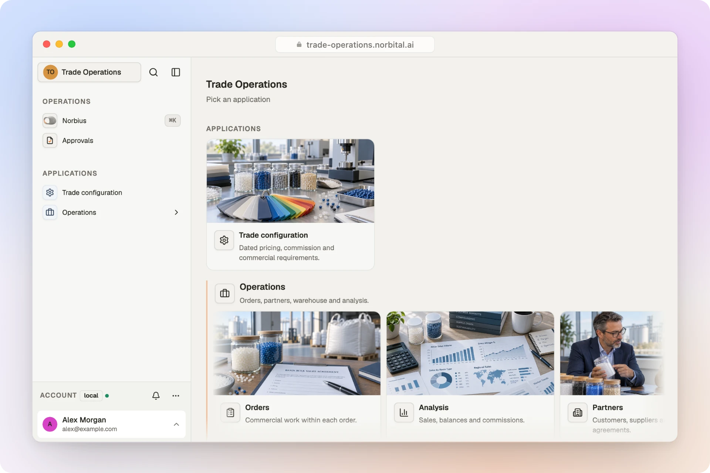
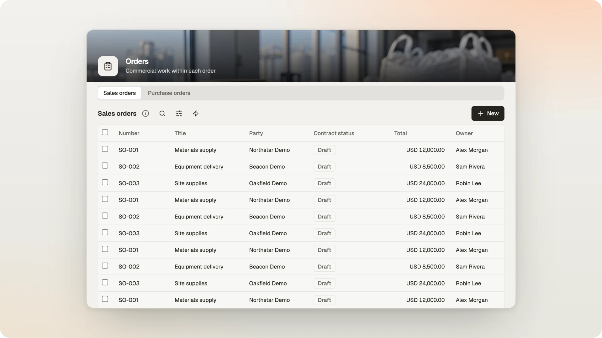

# Source reference

Checked against this template's source and compiled declaration manifest on 20 November 2026.
This is a local source inventory, not a declaration that a deployed tenant runs these bytes.

23 models, 6 applications, 1 automation.

## Applications and pages

| Source application                                              | Title               | Pages                                                             | Purpose                                                                                                                     |
| --------------------------------------------------------------- | ------------------- | ----------------------------------------------------------------- | --------------------------------------------------------------------------------------------------------------------------- |
| [operations/analysis](../src/app/operations/analysis/+app.ts)   | Analysis            | reports: Analysis                                                 | Sales, balances and commissions.                                                                                            |
| [operations/dashboard](../src/app/operations/dashboard/+app.ts) | Dashboard           | dashboard: Dashboard                                              | What needs attention across orders, Kingdee and receivables.                                                                |
| [operations/partners](../src/app/operations/partners/+app.ts)   | Partners            | parties: Partners                                                 | Customers, suppliers and their agreements.                                                                                  |
| [operations/trade](../src/app/operations/trade/+app.ts)         | Orders              | orders: Orders                                                    | Commercial work within each order.                                                                                          |
| [operations/warehouse](../src/app/operations/warehouse/+app.ts) | Warehouse           | stock: Warehouse                                                  | Products, lots and stock.                                                                                                   |
| [trade_configuration](../src/app/trade_configuration/+app.ts)   | Trade configuration | `templates` (Documents), `pricing_floors` (Prices and commission) | Each document case's layout per language; the dated price book and its floor rule; commission rules with freight treatment. |

## Models and exposed operations

Outputs fix field visibility. Policies select outputs and scope rows; write columns and checks constrain mutations. Each row links to its owning declaration; Fields counts every declared field, hidden ones included.

| Model                                                                                    | Fields | Read outputs        | Writes                 | Syncs                 |
| ---------------------------------------------------------------------------------------- | ------ | ------------------- | ---------------------- | --------------------- |
| [activities](../src/data/model/orders/activities/+model.ts)                              | 7      | default             | create, update         | none                  |
| [commercial_settings](../src/data/model/commercial_settings/+model.ts)                   | 4      | default, logistics  | update                 | none                  |
| [commission_rules](../src/data/model/commercial_settings/commission_rules/+model.ts)     | 10     | default             | create, update         | sheet                 |
| [commission_statements](../src/data/model/commission_statements/+model.ts)               | 10     | default             | create                 | none                  |
| [contacts](../src/data/model/parties/contacts/+model.ts)                                 | 6      | default             | create, update, delete | kingdee               |
| [credit_snapshots](../src/data/model/parties/credit_snapshots/+model.ts)                 | 8      | default             | create, update         | kingdee               |
| [document_templates](../src/data/model/commercial_settings/document_templates/+model.ts) | 12     | default             | create, update         | none                  |
| [order_files](../src/data/model/orders/order_files/+model.ts)                            | 3      | default             | create                 | none                  |
| [order_lines](../src/data/model/orders/order_lines/+model.ts)                            | 21     | default, logistics  | create, update, delete | kingdee               |
| [orders](../src/data/model/orders/+model.ts)                                             | 40     | default, logistics  | create, update, delete | lines, sheet, kingdee |
| [parties](../src/data/model/parties/+model.ts)                                           | 10     | default             | create, update         | kingdee, sheet        |
| [pricing_floors](../src/data/model/products/pricing_floors/+model.ts)                    | 10     | default             | create, update         | price_book            |
| [products](../src/data/model/products/+model.ts)                                         | 16     | default, logistics  | create, update         | kingdee               |
| [settlements](../src/data/model/settlements/+model.ts)                                   | 6      | default             | create, update         | kingdee               |
| [source_lot_costs](../src/data/model/source_lot_costs/+model.ts)                         | 4      | default             | create, update         | kingdee               |
| [source_payments](../src/data/model/orders/source_payments/+model.ts)                    | 11     | default             | create, update         | kingdee               |
| [source_purchase_lines](../src/data/model/source_purchase_lines/+model.ts)               | 24     | default             | create, update         | receipts, invoices    |
| [source_receivables](../src/data/model/source_receivables/+model.ts)                     | 4      | default             | create, update         | kingdee               |
| [source_sales_lines](../src/data/model/orders/source_sales_lines/+model.ts)              | 20     | default, commercial | create, update         | kingdee, invoice_only |
| [source_stock_commitments](../src/data/model/source_stock_commitments/+model.ts)         | 3      | default             | create, update         | kingdee               |
| [stock_snapshots](../src/data/model/products/stock_snapshots/+model.ts)                  | 10     | default, logistics  | create, update, delete | kingdee               |
| [transactions](../src/data/model/orders/transactions/+model.ts)                          | 13     | default, logistics  | create, update         | kingdee               |
| [warehouses](../src/data/model/warehouses/+model.ts)                                     | 7      | default             | create, update         | kingdee, sheet        |

Import is available on a model with an `import_key` constraint; it matches by that key and names its conflict rule (`on_conflict`). Writes listed on a source mirror are the sync’s path (`kingdee_sync`), not a member permission: policies grant members read-only access, except a product's local commission settings and a party's contacts other than its primary one.

## Automations

All named runs use the reserved system identity and the listed policies. A manual-start grant controls who may start a run; cron/webhook/schedules use their declared trigger path. Model effects run as their writer and are separate from these named automations.

| Automation                                                      | Trigger                                          | Policies      | Purpose                                                                                 |
| --------------------------------------------------------------- | ------------------------------------------------ | ------------- | --------------------------------------------------------------------------------------- |
| [source_health](../src/automation/+source_health.automation.ts) | [{"model":"sys_integration","verbs":["update"]}] | source_health | Notifies workspace administrators when an accounting ledger connection needs attention. |

## Integrations and source roles

- Integration definitions: `kingdee`.
- Named connections: none; each Kingdee ledger is a `sys_integration` row an administrator adds at run time.
- Source policies: `configuration`, `finance`, `kingdee_sync`, `logistics`, `manager`, `procurement`, `sales`, `source_health`.
- Custom datatypes: none.

Pairing and credentials belong to the host's Connections surface; defining a connection does not mean it is paired.

## Browser evidence

Captured through the browser from a separate local documentation workspace on 30 October 2026. This shows layout and navigation; it does not certify external providers, automation results or deployment.

Next: [Kingdee implementation](0004-kingdee-implementation.md)
