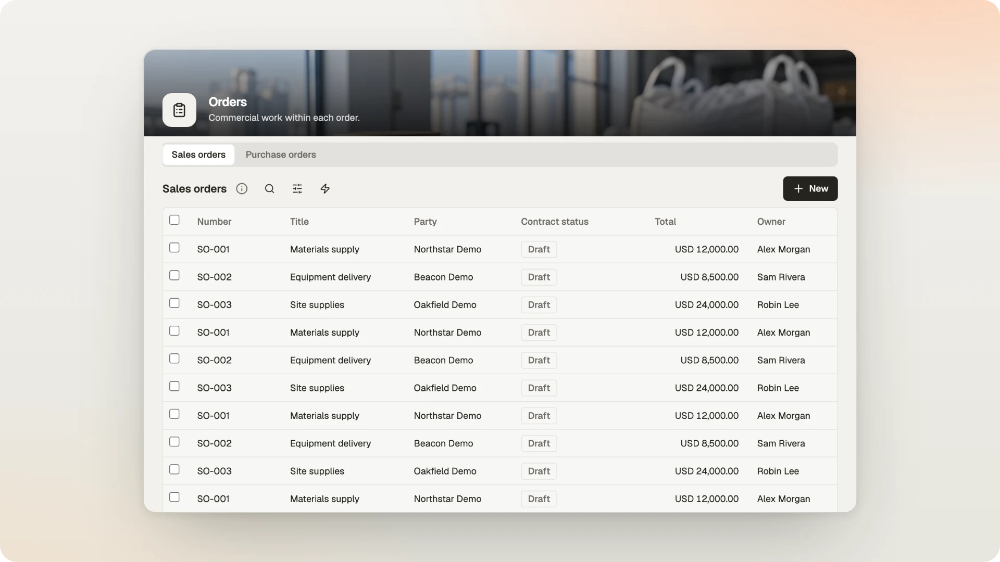

# Trade Operations documentation



This folder is the maintained technical documentation for the Trade Operations template workspace.
The source tree under [`src/`](../src/) is the final authority; these documents describe its
objective, architecture, contracts, inner mechanisms, and verification gates.

Read in order. Each numbered document builds on the previous one, moving from product intent to
architecture, ERP integration contracts, implementation details, manual probes, and pure-ASCII
system diagrams.

| #    | Document                                                       | Owns                                                                                                   |
| ---- | -------------------------------------------------------------- | ------------------------------------------------------------------------------------------------------ |
| 0000 | [Objective](0000-objective.md)                                 | What the workspace is for, who it serves, scope, principles and success                                |
| 0001 | [Architecture](0001-architecture.md)                           | Applications, order/agreement lifecycle, pricing, commission, documents, access, invariants            |
| 0002 | [Integration](0002-integration.md)                             | Kingdee boundary, read pages, network-blip safety, efficiency, hidden/local tables                     |
| 0003 | [Source reference](0003-source-reference.md)                   | Current applications, 26 models, outputs/writes, 27 syncs, automation and integrations                 |
| 0004 | [Kingdee implementation](0004-kingdee-implementation.md)       | SQL projections, account set, bindings, write path and connection operations                           |
| 0005 | [Kingdee order lifecycle](0005-kingdee-order-lifecycle.md)     | Identities, SO/PO create and amend, read-back and connection verification                              |
| 0006 | [Workspace capabilities](0006-workspace-capabilities.md)       | Supported workflows, ownership boundaries and acceptance checks                                        |
| 0007 | [Print layouts](0007-print-layouts.md)                         | Layout HTML, fields, PDF rendering and retained document evidence                                      |
| 0008 | [Manual probe matrix](0008-manual-probe-matrix.md)             | Live acceptance checklist, evidence and open probes                                                    |
| 0009 | [Inner mechanisms diagrams](0009-inner-mechanisms-diagrams.md) | Pure-ASCII diagrams of topology, ER graph, syncs, pricing floors, credit, PDF, commission, AR/AP, RBAC |

The customer-facing workspace overviews live in [`README.md`](../README.md) (English) and
[`README.zh.md`](../README.zh.md) (Simplified Chinese). The workspace agent brief is
[`src/agent/+agent.md`](../src/agent/+agent.md); the coding-agent source map is
[`src/agent/AGENTS.md`](../src/agent/AGENTS.md).

## Developer quickstart

Run commands inside `templates/trade-operations/`:

```bash
bun install --frozen-lockfile
bunx bolt check
bun run test
bunx bolt build
```

- **Schema migrations:** `bunx bolt build` generates the next editable SQL migration under
  `migrations/` and replays the full migration chain against a scratch database. Commit SQL files,
  `migrations/snapshot.json`, `migrations/migrations.lock.json`, and generated
  `migrations/physical.json` together. Never commit `.norbital/`.
- **Seed data:** `seed/public/` ships generic commercial settings (`commercial_settings.json`) and
  starter EN/ZH layouts (`document_templates.json`) for quotations, sales contracts, and purchase
  contracts. `seed/test/` contains synthetic fixtures for automated tests only. No credentials or
  live ERP rows ship with the template.
- **Kingdee connections:** Each accounting ledger is added dynamically at runtime under
  **Settings -> Integrations -> Connections**; credentials stay in the host's sealed store.

## How to keep these docs honest

- A behaviour claim names the source that owns it. If the code changes, change the document in the
  same change.
- A gap is a gap. Do not describe a planned path as implemented, and do not turn a missing source
  binding into a guessed value.
- `0003` and `0009` reflect the exact models, outputs, writes, syncs, formulas, and policies in
  `src/`. Re-verify them whenever declarations or libraries change.
- `0008` records runtime evidence. A green automated suite does not certify an external provider or
  a deployed release; name the build and the actual probe.
