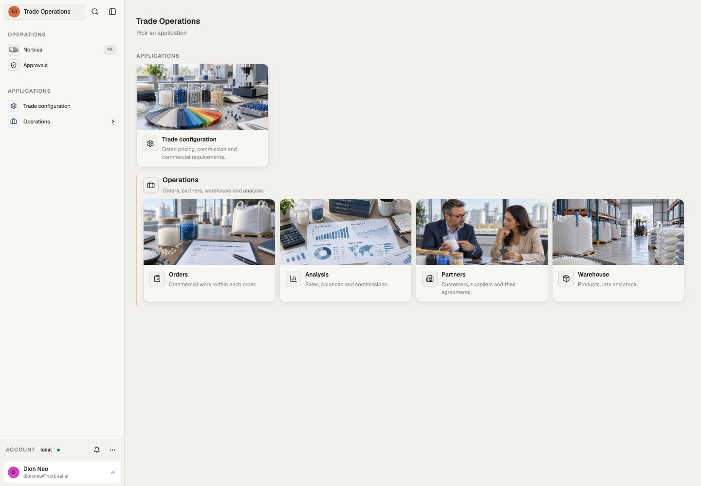
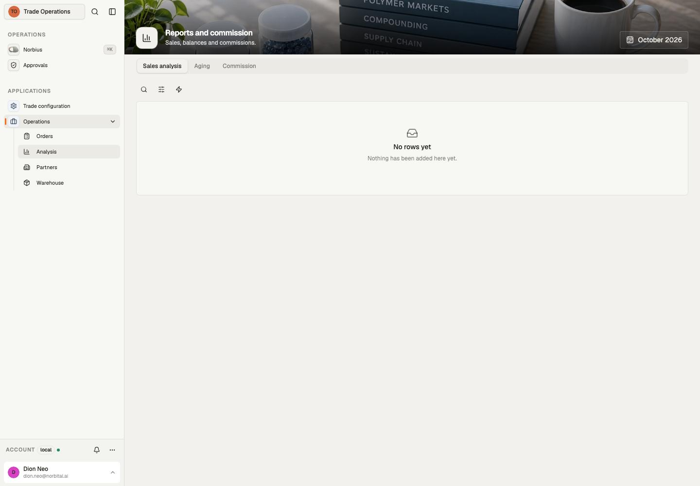

# Source reference

Checked against this template's source and compiled declaration manifest on 30 October 2026.
This is a local source inventory, not a declaration that a deployed tenant runs these bytes.

19 models, 5 applications, 2 automations.

## Applications and pages

| Source application                                              | Title               | Pages                                                                                                                 | Purpose                                                |
| --------------------------------------------------------------- | ------------------- | --------------------------------------------------------------------------------------------------------------------- | ------------------------------------------------------ |
| [operations/analysis](../src/app/operations/analysis/+app.ts)   | Analysis            | reports: Analysis                                                                                                     | Sales, balances and commissions.                       |
| [operations/partners](../src/app/operations/partners/+app.ts)   | Partners            | parties: Partners                                                                                                     | Customers, suppliers and their agreements.             |
| [operations/trade](../src/app/operations/trade/+app.ts)         | Orders              | orders: Orders                                                                                                        | Commercial work within each order.                     |
| [operations/warehouse](../src/app/operations/warehouse/+app.ts) | Warehouse           | stock: Warehouse                                                                                                      | Products, lots and stock.                              |
| [trade_configuration](../src/app/trade_configuration/+app.ts)   | Trade configuration | templates: Document templates; settings: Commercial settings; pricing_floors: Pricing floors; rules: Commission rules | Dated pricing, commission and commercial requirements. |

## Models and exposed operations

Outputs fix field visibility. Policies select outputs and scope rows; write columns and checks constrain mutations. Each row links to its owning declaration.

| Model                                                                                    | Fields | Read outputs       | Writes                         | Post-commit effects | Syncs             |
| ---------------------------------------------------------------------------------------- | ------ | ------------------ | ------------------------------ | ------------------- | ----------------- |
| [activities](../src/data/model/orders/activities/+model.ts)                              | 5      | default            | create, update, upsert         | none                | none              |
| [commercial_settings](../src/data/model/commercial_settings/+model.ts)                   | 5      | default, logistics | update                         | none                | none              |
| [commission_rules](../src/data/model/commercial_settings/commission_rules/+model.ts)     | 10     | default            | create, update, upsert         | none                | none              |
| [commission_statements](../src/data/model/commission_statements/+model.ts)               | 8      | default            | create                         | none                | none              |
| [contacts](../src/data/model/parties/contacts/+model.ts)                                 | 4      | default            | create, update, upsert         | none                | none              |
| [credit_snapshots](../src/data/model/parties/credit_snapshots/+model.ts)                 | 6      | default            | none                           | none                | kingdee           |
| [document_templates](../src/data/model/commercial_settings/document_templates/+model.ts) | 7      | default            | create, update, upsert         | none                | none              |
| [ext_purchase_orders](../src/data/model/orders/ext_purchase_orders/+model.ts)            | 6      | default, logistics | create, update, upsert         | none                | kingdee           |
| [ext_sales_orders](../src/data/model/orders/ext_sales_orders/+model.ts)                  | 6      | default, logistics | create, update, upsert         | none                | kingdee           |
| [order_lines](../src/data/model/orders/order_lines/+model.ts)                            | 16     | default, logistics | create, update, delete, upsert | none                | none              |
| [orders](../src/data/model/orders/+model.ts)                                             | 36     | default, logistics | create, update, upsert         | none                | kingdee, document |
| [parties](../src/data/model/parties/+model.ts)                                           | 9      | default            | none                           | none                | kingdee           |
| [pricing_floors](../src/data/model/products/pricing_floors/+model.ts)                    | 8      | default            | create, update, upsert         | none                | none              |
| [products](../src/data/model/products/+model.ts)                                         | 12     | default, logistics | update                         | none                | kingdee           |
| [source_payments](../src/data/model/orders/source_payments/+model.ts)                    | 9      | default            | create, update, upsert         | none                | kingdee           |
| [source_sales_lines](../src/data/model/orders/source_sales_lines/+model.ts)              | 16     | default            | none                           | none                | kingdee           |
| [stock_snapshots](../src/data/model/products/stock_snapshots/+model.ts)                  | 9      | default, logistics | none                           | none                | kingdee           |
| [transactions](../src/data/model/orders/transactions/+model.ts)                          | 12     | default, logistics | create, update, upsert         | none                | kingdee           |
| [warehouses](../src/data/model/warehouses/+model.ts)                                     | 6      | default            | none                           | none                | kingdee           |

Upsert is available when both create and update are exposed; it resolves an explicit ID or the model’s natural key and requires an explicit conflict rule.

## Automations

All named runs use the reserved system identity and the listed policies. A manual-start grant controls who may start a run; cron/webhook/schedules use their declared trigger path. Model effects run as their writer and are separate from these named automations.

| Automation                                                      | Trigger                        | Policies       | Purpose                                                                              |
| --------------------------------------------------------------- | ------------------------------ | -------------- | ------------------------------------------------------------------------------------ |
| [orders_revise](../src/automation/+orders_revise.automation.ts) | started or scheduled from code | order_revision | Start or resume a replacement contract from the current accepted terms.              |
| [source_health](../src/automation/+source_health.automation.ts) | {"cron":"*/5 * * * *"}         | configuration  | Notifies configuration holders when an accounting ledger connection needs attention. |

## Integrations and source roles

- Integration definitions: `kingdee`.
- Named connections: `kingdee`.
- Source policies: `configuration`, `finance`, `logistics`, `manager`, `order_revision`, `procurement`, `sales`.
- Custom datatypes: none.

Pairing and credentials belong to the host's Connections surface; defining a connection does not mean it is paired.

## Browser evidence

Captured through the browser from a separate local documentation workspace on 30 October 2026. This shows layout and navigation; it does not certify external providers, automation results or deployment.
