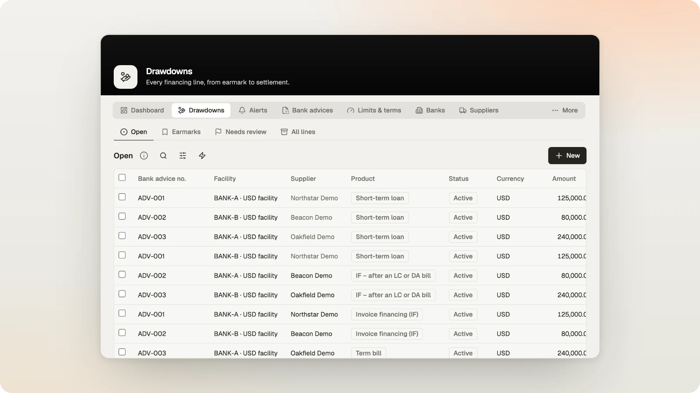

# Treasury

Treasury is a unified corporate treasury, trade-financing, and foreign-exchange hedging workspace for businesses that fund supplier purchases through multi-bank credit facilities. It connects Purchasing, Finance, and Treasury in one operating rhythm: buyers raise purchase orders and prepare financing requisitions from supplier PDFs, Finance plans payment earmarks and verifies incoming supplier invoices, and Treasury allocates bank lines, reconciles bank drawdown and settlement advices, monitors currency hedges, and closes immutable month-end books.

Instead of stitching together bank-limit trackers, interest accrual workbooks, scattered email attachments, and manual PDF comparisons, teams work from a single controlled record of every facility, financing obligation, letter of credit, currency hedge, and supplier order. Automated document reading pulls structured figures straight from bank advices, purchase orders, and hedge term sheets, while built-in arithmetic checks, approval gates, and daily morning alerts catch discrepancies, approaching maturities, and credit-limit pressure before they turn into costly bank penalties or missed cut-offs.

## Expected Business Impact

- **Eliminate spreadsheet reconciliation and re-keying:** Bank advices, purchase orders, supplier proformas, FX confirmations, and banker proposals are read automatically into structured records and checked side by side against the original documents.
- **Lower all-in borrowing costs:** Side-by-side bank cost comparisons, 90-day weighted rate benchmarks, monthly rate histories, and an invoice financing calculator reveal the cheapest eligible facility—factoring in interest, bank fees, sub-limits, supplier acceptance, and tenor caps—before funds are drawn.
- **Prevent missed maturities, fee leakages, and over-invoicing:** Live verification checks bank interest and debit totals against agreed day-count and rounding conventions, flags supplier invoice price or quantity discrepancies against purchase orders, and surfaces upcoming maturities, expiring letters of credit, and high bank utilization in one daily digest.
- **Protect closed financial periods and audit trails:** Locking a month-end freezes every open position, accrued interest figure, and USD revaluation at the month-end exchange rate so subsequent rate updates or operational edits never alter historical reports, while every bank-advice update flows through a formal Treasury approval gate.
- **Keep cross-team handoffs clean and confidential:** Purchasing, Finance, Treasury, and read-only stakeholders share linked commercial and financing status without exposing sensitive banking terms, credit limits, or other buyers' orders to unauthorized users.

## Roles & Access

Four preconfigured business teams enforce clear segregation of duties across the purchasing-to-settlement lifecycle:

| Role           | Operational Scope                                                                                                                                                                                                                                                                                                          | Key Boundaries                                                                                                                                                                                                                                   |
| -------------- | -------------------------------------------------------------------------------------------------------------------------------------------------------------------------------------------------------------------------------------------------------------------------------------------------------------------------- | ------------------------------------------------------------------------------------------------------------------------------------------------------------------------------------------------------------------------------------------------ |
| **Treasury**   | Full operational control over banks, credit facilities, sub-limits, fee rules, supplier bank eligibility, financing drawdowns, bank advices, FX rates, FX hedges and proposals, and month-end locking/unlocking. Can also review and update purchase orders, record invoices, and link purchase orders to financing lines. | Automated updates parsed from bank advices always require explicit Treasury review and approval before modifying a financing line. Cannot manually overwrite locked month-end figures or imported historical summaries.                          |
| **Finance**    | Full visibility across Treasury, Hedging, Purchasing, and Configuration. Plans and cancels payment earmarks, maintains the business partner directory, updates purchase orders, records supplier invoices, and files commercial invoices or issued letters of credit.                                                      | Cannot allocate earmarks to banks, modify credit limits or fee rules, change bank acceptance lists, alter financing lines once allocated, manage FX hedges, or lock month-ends.                                                                  |
| **Purchasing** | Works exclusively within the Purchasing app: looks up business partners, raises and edits their own purchase orders, uploads PO and supporting documents, and prepares financing requisitions with downloadable PDF packs.                                                                                                 | Strictly isolated to purchase orders they created; cannot view Treasury, Hedging, or Configuration pages, cannot edit a purchase order once its first supplier invoice is recorded, and cannot upload or remove issued LCs or supplier invoices. |
| **View**       | Read-only access across every page in Treasury, Hedging, Purchasing, and Configuration, plus the ability to download financing request PDF packs.                                                                                                                                                                          | Cannot create, edit, approve, or delete any record.                                                                                                                                                                                              |

## Apps & Functionality

The workspace is organized into four focused applications tailored to each operational workflow.

### Treasury

Day-to-day liquidity oversight, trade financing operations, bank-advice reconciliation, cost analysis, and month-end closing.

| Page             | Functionality                                                                                                                                                                                                                                                                                                                                                                                                                                                                                                                                                                                                                                                                                                           |
| ---------------- | ----------------------------------------------------------------------------------------------------------------------------------------------------------------------------------------------------------------------------------------------------------------------------------------------------------------------------------------------------------------------------------------------------------------------------------------------------------------------------------------------------------------------------------------------------------------------------------------------------------------------------------------------------------------------------------------------------------------------- |
| **Overview**     | Executive USD dashboard with selectable analysis date showing total credit limits, used, available, earmarked, and free-after-earmarks balances; per-bank utilization bars (flagging banks at 80% or above); upcoming maturity buckets (past due, 30, 60, and 90 days) and 12-month maturity ladder; 24-month weighted and simple cost-of-funds trend; and selectable period cost-of-funds breakdown by bank (this month, last month, last 3 months, financial year to date, last 12 months, or custom month range).                                                                                                                                                                                                    |
| **Financing**    | Central ledger of every financing obligation moving from earmark through application and active drawdown to settlement or cancellation, across 37 trade-finance, loan, guarantee, and documentary products. Each record displays live tenor, interest to maturity, accrued interest to today, latest allowable due date, actual vs. estimated bank charges, real-time non-blocking warnings (limit breaches, sub-limits, supplier acceptance, tenor limits, LC expiry), available bank headroom for earmarks, linked purchase orders, and guided actions to allocate, record advices, settle, cancel earmarks, or close bills via cash payment or conversion into post-bill financing without double-counting exposure. |
| **Bank advices** | Side-by-side workspace displaying each uploaded bank PDF alongside AI-extracted figures, automatic reference matching against open financing lines and invoice bill numbers, live arithmetic verification (days, interest with bank rounding, total debited vs. charges/principal), and native Treasury approval tracking. Submitted advices lock automatically as audit evidence.                                                                                                                                                                                                                                                                                                                                      |
| **Attention**    | Single prioritized action queue aggregating live issues across the entire workspace: overdue or near-due lines (7 days for loans, 14 days for bills and expiring LCs), stale earmarks, discrepancy notes, lines due beyond bank tenor limits, banks at 80%+ utilization, facilities missing or approaching review dates (within 60 days), purchase orders awaiting LC issuance or earmarking (highlighting urgent Tuesday payments), upcoming T/T requisitions, draft FX deals awaiting confirmation, past FX fixings missing bank rates, and unfiled or unreadable FX documents.                                                                                                                                       |
| **Costs**        | Three analytical views for USD trade financing: an **Invoice calculator** that ranks every active facility by estimated all-in annual cost (interest plus fee rules) while flagging ineligible banks; a **Bank comparison** table benchmarking latest rates, 90-day weighted rates, spread to group in basis points, open-book rates, annualised charges, offer margins, and available headroom; and a 12-month **Rates by month** matrix for bank negotiations.                                                                                                                                                                                                                                                        |
| **Month-end**    | Monthly closing ledger capturing every facility obligation open at month-end, revalued at the latest exchange rate on or before the closing date, with accrued days, accrued interest, interest to maturity, and charges. Supports one-click locking to freeze snapshots, unlocking of portal-closed months when corrections are required, immutable viewing of imported historical summaries, and Excel/CSV export.                                                                                                                                                                                                                                                                                                    |

### Hedging

Foreign-exchange derivative tracking, fixing management, risk monitoring, and pre-trade proposal evaluation.

| Page           | Functionality                                                                                                                                                                                                                                                                                                                                                                                                                                                                                                                                                                                                                                                             |
| -------------- | ------------------------------------------------------------------------------------------------------------------------------------------------------------------------------------------------------------------------------------------------------------------------------------------------------------------------------------------------------------------------------------------------------------------------------------------------------------------------------------------------------------------------------------------------------------------------------------------------------------------------------------------------------------------------- |
| **Overview**   | Portfolio snapshot valued at today's official exchange rates showing live hedge value, past fixings awaiting bank rates, fixings due in the next 14 days, closest knock-out barrier distance, a live risk watch list (barriers within 3% or breached, targets 75%+ consumed, out-of-the-money deals, DCIs within 1% of strike, deals ending within 30 days), a 6-month firm-fixing USD ladder, active deals summary, and reference exchange rates.                                                                                                                                                                                                                        |
| **Structures** | Registry of FX structures (forwards, target redemption forwards, knock-out and knock-in forwards, enhanced forwards, pivot forwards, accumulators, dual currency investments, and custom deals) alongside a dedicated hedge documents tab for term sheets, confirmations, notices, and letters. Opening a deal provides four analytical tabs: **Today** (live valuation and watch flags), **Results** (worked-out fixing outcomes and realized gains/losses), **Scenarios** (spot ±2/4/6%, strike, knock-out, and custom test rates), and **How likely** (historical volatility simulation, risk points to weigh, and stress testing against Treasury's own market view). |
| **Fixings**    | Operational queue of all fixing dates split into **Needing a rate** (past fixings awaiting the bank's official fixing rate), **Next 30 days**, and **All**, showing strike, recorded fixing rate, automatic or manually chosen outcome, exchanged amount, and USD gain or loss.                                                                                                                                                                                                                                                                                                                                                                                           |
| **Planning**   | Staging area for bankers' FX proposals pasted from email/chat or uploaded as PDFs or images. Automatically parses multiple proposed alternatives and fixing schedules into comparable draft structures with a side-by-side comparison matrix across strikes, barriers, maximum single-fixing exposure, simulated outcome probabilities, worst-case (1-in-20) outcomes, and ±2/4/6% spot sensitivity, plus one-click promotion of a chosen option when traded.                                                                                                                                                                                                             |

### Purchasing

Commercial order coordination between Purchasing, Finance, and Treasury without exposing bank facilities to buyers.

| Page                   | Functionality                                                                                                                                                                                                                                                                                                                                                                                                                                                                                                                                                           |
| ---------------------- | ----------------------------------------------------------------------------------------------------------------------------------------------------------------------------------------------------------------------------------------------------------------------------------------------------------------------------------------------------------------------------------------------------------------------------------------------------------------------------------------------------------------------------------------------------------------------- |
| **Business partners**  | Shared directory of suppliers and customers, including alternate spellings/aliases (used when matching uploaded documents), countries, standard payment terms, product notes, and Treasury-controlled bank acceptance lists for invoice financing.                                                                                                                                                                                                                                                                                                                      |
| **Purchase orders**    | Commercial order register where uploading a PO PDF automatically extracts header details, matches the supplier, and populates item lines (quantities in kg and amounts). Enforces Tuesday (urgent) and Friday treasury payment schedules, tracks invoiced vs. ordered status, runs automated 5-point invoice cross-checks (invoice total vs. lines, currency match, ±0.5% unit-price tolerance, quantity tolerance, and linked financing supplier/principal checks), displays linked LCs and financing lines, and offers one-click earmarking for Finance and Treasury. |
| **Financing requests** | Requisition workspace for orders funded by T/T advance or letter of credit. Uploading the PO, supplier proforma, and customer PO automatically classifies attachments, populates empty fields without overwriting user entries, flags amount/currency/payment-term mismatches, links the matching purchase order, ticks LC-required automatically on LC requests, and generates a single downloadable PDF requisition pack combining the formatted form, a three-role paper sign-off page, and every original attachment in order.                                      |

### Configuration

Reusable banking master data and reporting exchange rates kept separate from daily transactions.

| Page               | Functionality                                                                                                                                                                                                                                                                                                                                                                                                                              |
| ------------------ | ------------------------------------------------------------------------------------------------------------------------------------------------------------------------------------------------------------------------------------------------------------------------------------------------------------------------------------------------------------------------------------------------------------------------------------------ |
| **Banks**          | Directory of lending banks with short codes, contacts by role (relationship manager, client service, trade operations), daily cut-off times, offered products, operational watch points (restrictions, supplier rules, settlement notes), and attached letters of offer whose next review date automatically synchronizes to the corresponding credit facility.                                                                            |
| **Facilities**     | Credit line definitions including active/expired status, USD credit limits, offer margin and pricing basis, interest day-count convention (Actual/360 or Actual/365), bank interest rounding rule (nearest cent or down to cent), maximum tenor and tenor start rule, early settlement terms, security, review/expiry dates, product/supplier sub-limits, and stage-based fee rules (percentage with minimum floor or flat currency fees). |
| **Exchange rates** | Historical table of dated USD-per-unit exchange rates powering foreign-currency fee estimates, month-end revaluations, and FX hedge valuation/simulations, populated automatically on weekdays or entered manually when needed.                                                                                                                                                                                                            |

## Automations & Connections

- **Automated Document Reading:** Uploading a bank drawdown or settlement advice, purchase order PDF, financing request attachment, FX term sheet/confirmation/notice, or banker FX proposal triggers background document extraction. Extracted data fills empty fields or stages structured figures without overwriting human-entered values, lists uncertain fields for review, and strips bank account numbers.
- **Bank-Advice Matching & Approval Routing:** Extracted bank advices automatically match against open financing lines using bank, currency, and normalized references (including invoice bill numbers). When a unique open line matches, the workspace stages the drawdown or settlement update together with actual stage charges and routes it to the Treasury team for formal approval.
- **Combined Requisition PDF Packs:** Financing requests can be compiled on demand into a single print-ready PDF pack containing the requisition cover sheet, a paper sign-off page (_Affirmed by_, _Approved by_, _Acknowledged by Treasury_), and every attached PDF or image in sequence.
- **Daily Morning Attention Digest:** Every morning at 08:00 (workspace time), the workspace evaluates live attention rules across financing lines, facilities, purchase orders, T/T requests, and FX hedges, sending a single deduplicated summary notification to the Treasury team whenever items require action.
- **Official Daily Exchange-Rate Feed (Monetary Authority of Singapore):** Once connected in workspace settings, a weekday afternoon schedule (13:30, Monday through Friday) fetches official end-of-period daily exchange rates from the Monetary Authority of Singapore API, crosses them into USD-per-unit rates, backfills any missing weekdays across the prior 15 days, and replaces preliminary rates once final figures are published.

## Scope & Boundaries

- **Operational ledger, not a bank execution channel:** The workspace tracks financing requests, approvals, and advices, and exports printable PDF packs, but it does not initiate wire transfers, open letters of credit directly with banks, or transmit trade instructions to banking portals.
- **Treasury management, not a statutory ERP or general ledger:** Month-end reports provide frozen debt, utilization, and interest accrual schedules ready for accounting export (Excel/CSV), but journal posting, statutory financial reporting, tax compliance, and accounts payable payment runs remain in your accounting or ERP system.
- **Decision support, not binding bank quotes or official valuations:** Bank cost rankings, estimated fee calculations, FX mark-to-market views at official daily rates, scenario tables, and historical-move probability simulations are internal planning tools—not executable bank quotes, formal derivative valuations, or hedge-accounting calculations.
- **External legal documents remain authoritative:** Signed bank letters of offer, executed FX confirmations, and bank advices remain the authoritative legal record; wet-ink or external signatures collected on exported financing requisition packs are managed outside the workspace.
- **Workspace regional defaults:** Configured out of the box for Singapore reporting time (UTC+8), USD reporting totals, bilingual English and Simplified Chinese interfaces, and Tuesday/Friday treasury payment scheduling, all adaptable to your organization's calendar and reporting currency.

## Documentation

- [Technical documentation index](docs/README.md) — developer setup, local verification commands, migration workflow, and guide directory.
- [Architecture and inner mechanisms](docs/architecture.md) — system topology, ownership ER diagram, state machines, approval pipeline, calculation engines, FX simulation logic, and access-control matrix with ASCII diagrams.
- [Domain and calculation reference](docs/reference.md) — glossary, complete product catalogue, interest/charge/month-end formulas, document extraction rules, FX hedging mechanics, and attention criteria.
- [Source reference](docs/source-reference.md) — verified inventory of all 26 models, 4 apps, 16 pages, 10 record views, 17 automations, 11 policies, 4 teams, 1 integration, and 1 file sync.
