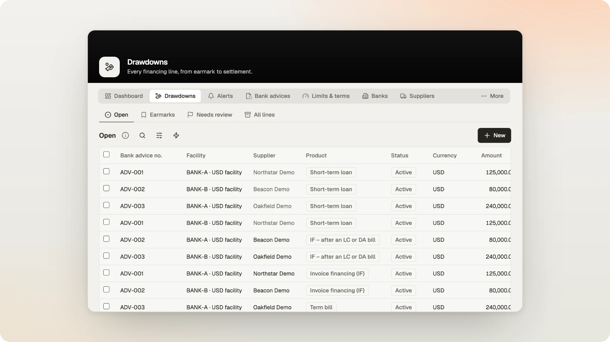

# 资金管理

「资金管理」是面向通过多家银行授信额度开展采购融资与外汇风险管理企业的一体化工作区，将采购、财务与资金三大团队纳入同一协同闭环：采购人员基于供应商订单 PDF 发起采购订单与融资申请，财务团队规划付款预留并核验供应商发票，资金团队分配银行授信、核对银行提款与结算通知、管理外汇套期保值结构，并按月完成可锁定、不可篡改的月末结账。

借助统一受控的业务台账，团队无需再在分散的额度表格、利息测算表、邮件附件与人工比对单据之间反复切换。每笔银行授信、融资义务、信用证、外汇交易与采购订单均集中留痕；系统自动识别银行通知、采购订单及外汇条款书中的核心数据，并结合内置算术校验、审批闸口与每日晨间提醒，在逾期罚息、额度超限或单证差错发生前及时预警。

## 预期业务价值

- **消除手工台账与重复录入：** 银行提款与结算通知、采购订单、供应商形式发票、外汇确认书及银行对冲建议均可自动提取为结构化数据，并与原始单据并排核对。
- **降低综合贸易融资成本：** 发票融资测算器、银行综合成本排行、近 90 天加权利率对比与按月利率矩阵全面考量利率、手续费规则、子额度、供应商白名单与期限上限，帮助资金团队在放款前锁定成本最优的合规授信行。
- **防范逾期、多计息与超额开票风险：** 系统按各银行约定的计息基准与取整规则实时验算银行通知中的天数、利息和扣款总额，对供应商发票执行五项交叉校核（总额、币种、单价容差、数量容差与融资主体/本金），并通过每日统一清单集中提示到期、信用证效期与额度紧张事项。
- **保障结账历史不可漂移且全程可审计：** 锁定月末报表后，当期末每笔未结融资余额、应计利息及按月末汇率重估的美元金额将全部冻结，后续汇率或业务调整不会改写历史账目；所有由银行通知触发的融资变更均须经资金团队正式审批方可生效。
- **兼顾跨部门协同与权限隔离：** 采购、财务、资金与只读角色共享必要的订单与融资进展，同时严格隔离敏感授信条款、银行额度及他人采购订单，守住职责分离与保密边界。

## 角色与权限

工作区预设四个业务团队，在“采购—融资—结账”全链路落实清晰的职责分离：

| 业务角色               | 操作范围                                                                                                                                                                                          | 关键权限边界                                                                                                                                                   |
| ---------------------- | ------------------------------------------------------------------------------------------------------------------------------------------------------------------------------------------------- | -------------------------------------------------------------------------------------------------------------------------------------------------------------- |
| **资金（Treasury）**   | 全面管理银行资料、授信额度、子额度、费率规则、供应商可融资银行名单、融资全周期流转、银行通知、汇率、外汇套期保值与建议方案，以及月末锁定/解锁；同时可审阅并维护采购订单、登记发票及关联订单融资。 | 由银行通知解析提交的融资变更必须经过资金团队的正式审批复核，不可绕过；已锁定的月末报表数字及导入的历史汇总不可手工改写。                                       |
| **财务（Finance）**    | 可查看资金管理、套期保值、采购与配置全部页面；负责规划与取消付款预留、维护业务伙伴名录、更新采购订单、登记供应商发票，以及上传商业发票和已开立信用证。                                            | 不可将预留分配至具体银行、不可修改已分配后的融资记录，也不可维护银行额度、费率规则、银行接受名单、外汇交易或执行月末封账。                                     |
| **采购（Purchasing）** | 仅使用「采购」应用：查阅业务伙伴，创建并维护本人发起的采购订单、上传订单及支持文件，并准备电汇或信用证融资申请表及合并 PDF 文件包。                                                               | 仅可见本人创建的采购订单，不可访问资金管理、套期保值或配置页面；采购订单一经登记首张供应商发票即锁定不可再由采购修改；不可上传或删除已开立信用证与供应商发票。 |
| **只读（View）**       | 拥有资金管理、套期保值、采购与配置全部页面的只读浏览权限，并可下载融资申请 PDF 文件包。                                                                                                           | 不可新增、编辑、审批或删除任何业务记录。                                                                                                                       |

## 应用与核心功能

工作区按业务职责划分为四个应用模块，界面原生支持中英文切换。

### 资金管理

日常流动性监控、贸易融资全周期作业、银行通知核对、融资成本比选与月末封账。

| 页面         | 核心功能                                                                                                                                                                                                                                                                                                                                                                                                                                                                    |
| ------------ | --------------------------------------------------------------------------------------------------------------------------------------------------------------------------------------------------------------------------------------------------------------------------------------------------------------------------------------------------------------------------------------------------------------------------------------------------------------------------- |
| **概览**     | 支持自选分析日期的美元资金总览：汇总全部有效授信的额度上限、已用、可用、已预留及扣除预留后可用余额；展示各银行横向额度使用率条（80% 及以上高亮预警）；按逾期未结、30 天、31–60 天、61–90 天统计即将到期分布并绘制 12 个月到期梯队；呈现 24 个月加权与简单平均资金成本走势，并支持按本月、上月、近 3 个月、本财年至今、近 12 个月或自定义月份区间核算各银行资金成本与平均余额。                                                                                              |
| **融资**     | 覆盖 37 类贸易融资、贷款、保函及单证产品的全生命周期台账，记录每笔义务从预留、已提交、未结到已结清或已取消的完整状态。单笔记录内置实时测算的期限、到期利息、截至今日应计利息、最晚可融资到期日、实际与估算费用明细、非阻断式风险提示（超额度、超子额度、供应商不被接受、超期限、信用证临近到期等）、预留阶段的各行剩余额度视图及关联采购订单，并提供分配银行、登记提款通知、结清、取消预留及信用证/票据现金结清或转融资（保留原订单与发票关联且不重复占用额度）等向导操作。 |
| **银行通知** | 左右分栏工作台，将原始银行通知 PDF 与 AI 提取的数据并排展示；自动依据银行、币种及标准化编号（含发票银行票据编号）匹配未结融资，实时校验起止天数、按银行取整规则计算的利息及扣款总额，并直接衔接资金团队原生审批流程。已提交的通知自动锁定作为审计凭据。                                                                                                                                                                                                                     |
| **注意事项** | 全工作区统一待办与预警清单，实时汇总：逾期或 7 天内到期的融资（信用证与票据为 14 天，含信用证有效期预警）、过期预留、存在通知书差异的融资、超出银行期限上限的到期日、使用率达 80% 及以上的银行、缺少复审日期或 60 天内到期复审的授信、待开信用证或待预留资金的采购订单（突出标识周二紧急付款）、临近付款日的电汇申请、待确认的外汇交易、待补录银行定价汇率的历史定盘，以及未归档或读取失败的外汇文件。                                                                      |
| **成本**     | 面向美元贸易融资的三项分析视图：**发票测算**按模拟金额、期限、产品和供应商计算各有效授信行的年化综合成本（利息加手续费规则）并自动标识不适用原因；**银行对比**对标各行最近利率、90 天加权利率、相对集团基点利差、未结融资利率、年化费用率、授信利差与可用余额；**按月利率**呈现近 12 个月各行加权利率矩阵，为银企议价提供依据。                                                                                                                                             |
| **月末**     | 按所选月份列出期末全部未结融资（含月末后方结清的融资），按月末当日或之前最新汇率重估美元余额，逐笔计算应计天数、应计利息、到期利息与费用。支持一键锁定冻结快照、对系统关账月份按需解锁重算、只读查阅导入的历史汇总，并导出 Excel 或 CSV 明细表。                                                                                                                                                                                                                            |

### 套期保值

外汇衍生品全流程台账、定盘跟踪、风险观察清单与交易前方案比选。

| 页面     | 核心功能                                                                                                                                                                                                                                                                                                                                                                                                                    |
| -------- | --------------------------------------------------------------------------------------------------------------------------------------------------------------------------------------------------------------------------------------------------------------------------------------------------------------------------------------------------------------------------------------------------------------------------- |
| **概览** | 按当日官方汇率汇总存续对冲参考价值、待录银行汇率的历史定盘数、未来 14 天定盘笔数与金额、最近敲出距离、实时风险观察清单（距敲出不足 3% 或已触发、目标已用达 75%、价外状态、双币投资距转换价不足 1%、30 天内到期）、未来 6 个月确定交割美元梯队、存续交易明细及主要币种参考汇率。                                                                                                                                             |
| **结构** | 集中管理远期、目标赎回远期（TRF）、敲出/敲入远期、增强型远期、枢轴远期、累计期权、双币投资（DCI）及其他自定义结构，并附带独立的外汇文件视图管理条款书、确认书、通知书与函件。打开单笔交易可查看四个分析标签：**今日**（当日估值与风险提示）、**结果**（逐期定盘结果与盈亏）、**情景**（即期汇率 ±2/4/6%、行权价、敲出价及自定义试算汇率）与**可能性**（基于历史波动的概率模拟、决策风险要点及结合自身市场观点的情景检验）。 |
| **定盘** | 汇总全部存续及待确认交易的定盘计划，按**待录入汇率**（已过定价日但未录银行汇率）、**未来 30 天**与**全部**分组，展示行权价、银行定价汇率、自动推算或人工确认的交割结果、交割金额及美元盈亏。                                                                                                                                                                                                                                |
| **规划** | 用于承接银行通过邮件、即时通讯发来或以 PDF/图片附带的对冲建议。系统自动解析其中多个备选方案及定盘排期，提供并排对比矩阵（行权价较即期优势、敲出距离、目标值、单次最大名义金额、模拟敲出/达标/付款概率、二十分之一不利情形及 ±2/4/6% 敏感度），成交后可一键转为待确认交易。                                                                                                                                                  |

### 采购

面向采购、财务与资金的商业订单协同入口，采购端与银行授信信息天然隔离。

| 页面         | 核心功能                                                                                                                                                                                                                                                                                                                      |
| ------------ | ----------------------------------------------------------------------------------------------------------------------------------------------------------------------------------------------------------------------------------------------------------------------------------------------------------------------------- |
| **业务伙伴** | 供应商与客户统一名录，维护单证匹配别名、国家、标准付款条件、主营货品说明，以及由资金团队维护的供应商发票融资可接受银行名单。                                                                                                                                                                                                  |
| **采购订单** | 上传采购订单 PDF 后自动识别订单编号、日期、供应商、币种、业务员、收货国、备注及货品明细（公斤数量与金额）。内置周二（紧急）与周五资金付款日校验、开票进度跟踪与五项发票自动核对（总额与明细一致、币种一致、单价 ±0.5% 容差、数量容差、关联融资供应商与本金校验），同时展示关联信用证/融资并提供一键资金预留入口。             |
| **融资申请** | 针对电汇预付或信用证采购订单的融资申请台账。上传采购订单、形式发票与客户订单附件后，系统自动识别附件类型、填充空白申请字段而不覆盖已填内容、提示金额/币种/付款方式出入、关联对应采购订单（信用证申请自动勾选订单的“以信用证付款”），并支持一键生成合并 PDF 文件包（含申请表正文、三方纸质签批页及按顺序排列的全部原始附件）。 |

### 配置

独立于日常交易的可复用银行主数据、授信条款与汇率配置中心。

| 页面         | 核心功能                                                                                                                                                                                                                                                                                                  |
| ------------ | --------------------------------------------------------------------------------------------------------------------------------------------------------------------------------------------------------------------------------------------------------------------------------------------------------- |
| **银行**     | 维护合作银行代码、全称、按职能分类的联系人（客户经理、客户服务、贸易操作等）、每日截止时间、可做产品清单、风控注意事项以及授信函附件；保存授信函的下次复审日期时自动同步至对应授信额度。                                                                                                                  |
| **授信额度** | 配置每条授信的状态（有效/已过期）、美元额度上限、授信利差与定价基准、计息基础（实际/360 或实际/365）、银行利息取整方式（四舍五入到分或向下取整到分）、最长期限与期限起算规则、提前结清罚息、担保方式、复审/到期日、按产品或供应商划分的子额度，以及分阶段的费率规则（按比例含最低费用，或固定金额费用）。 |
| **汇率**     | 按日期记录各币种兑美元汇率，支撑外币费用估算、月末美元重估及外汇对冲估值与模拟；支持工作日自动拉取或人工补录。                                                                                                                                                                                            |

## 自动化与外部连接

- **智能单证提取：** 上传银行提款/结算通知、采购订单 PDF、融资申请附件、外汇条款书/确认书/通知书或银行对冲建议后，后台自动解析文本与扫描页影像，仅回填空白字段或暂存提取数据，标明存疑字段且不提取银行账号。
- **银行通知匹配与审批流转：** 解析后的银行通知自动按银行、币种及标准化编号（含发票票据号）匹配唯一未结融资，并将融资状态更新与实际费用打包提交资金团队正式审批。
- **融资申请合并 PDF 打包：** 一键将融资申请表、三方纸质签批页（_Affirmed by_、_Approved by_、_Acknowledged by Treasury_）及所有 PDF/图片附件按上传顺序合并为单个可打印文件包。
- **每日晨间预警推送：** 每日 08:00（工作区时区）按统一规则扫描全量未结融资、授信额度、采购订单、电汇申请与外汇交易，存在待处理事项时向资金团队发送一次去重提醒。
- **新加坡金融管理局（MAS）官方每日汇率同步：** 在工作区外部连接配置完成后，系统于每个工作日 13:30 自动对接新加坡金融管理局每日期末汇率接口，自动换算为美元汇率、补齐近 15 天内缺失的工作日数据，并在官方终版发布后覆盖暂定汇率。

## 范围与职责边界

- **资金作业台账，而非银行直连付款通道：** 工作区负责融资规划、审批留痕与纸质申请包导出，不直接发起银行电汇划款、不直连银行网银开立信用证或提交授信指令。
- **资金与融资管理，而非财务总账或法定报表系统：** 月末模块提供可冻结、可导出（Excel/CSV）的债务余额与应计利息明细表，但总账凭证过账、法定财报编制、税务申报及应付账款付款执行仍由企业 ERP 或财务软件承担。
- **内部决策辅助，而非具有约束力的银行报价或公允价值估值：** 银行成本排序、费用估算、按官方汇率的对冲参考价值、情景表及历史波动概率模拟均用于内部比选与风控参考，不构成银行可执行报价、正式衍生品公允价值估值或套期会计核算依据。
- **法律文件与线下签批以原始外部凭据为准：** 银行正式授信函、已签署的外汇确认书及银行通知书仍为最终法律依据；导出的融资申请包所含签批页用于线下纸质或外部签核，不属于平台内置的二次电子审批流。
- **默认区域与排程设置：** 默认采用新加坡时间（UTC+8）、美元汇总口径、中英双语界面及周二/周五资金付款日规则，可根据企业实际日历与记账本位币灵活调整。

## 技术文档

- [技术文档目录](docs/README.md) — 开发者快速上手、本地校验命令、数据库迁移流程与文档导航。
- [系统架构与内部机制详解](docs/architecture.md) — 含系统拓扑、数据模型实体关系、融资状态机、银行通知审批流、财务测算管道、外汇模拟引擎及权限矩阵的完整 ASCII 架构图说明。
- [业务领域与计算参考](docs/reference.md) — 术语表、37 类产品目录、利息/费用/月末计算公式、单证解析规则、外汇套保与预警规则。
- [源码清单参考](docs/source-reference.md) — 覆盖全部 26 个模型、4 个应用、16 个页面、10 个自定义记录视图、17 个自动化、11 条权限策略、4 个团队、1 个外部集成与 1 个文件同步的源码核对清单。
