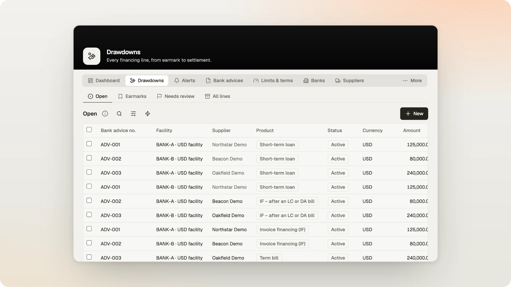

# Treasury workflows

Treasury records banks, their facilities and fee rules, then plans each line as an earmark and moves
it through applied, active and settled as the bank's advices arrive. Purchasing raises purchase
orders on the supplier list; Finance records the invoices that come back against them.

The [template README](../README.md) is the maintained workflow and authoring reference.

Teams, policy links and approval flows are authored in source. People selects existing roles;
it does not edit those definitions.
